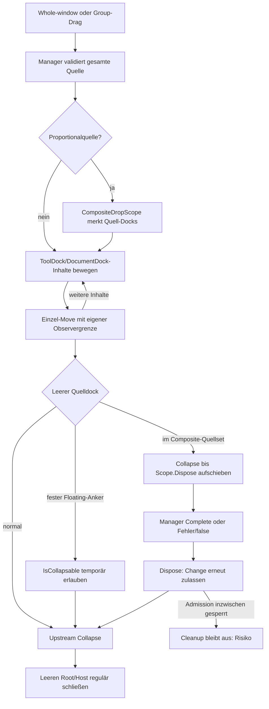
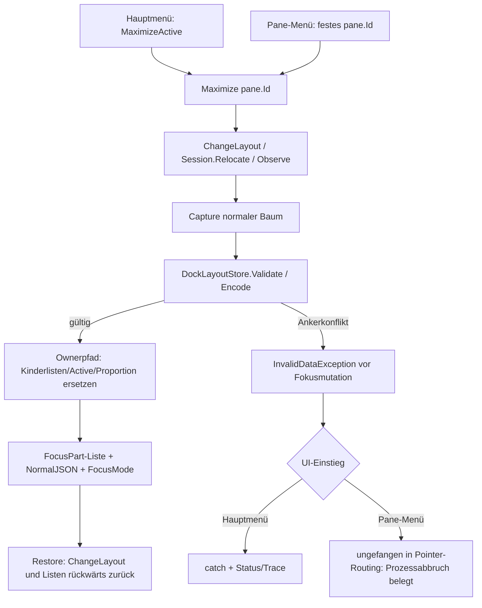
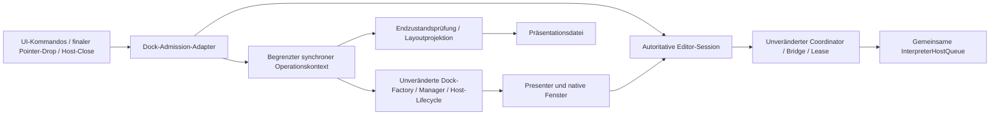

# G1-A01 – Docking Architecture and Lifecycle Review

Stand: **9. November 2026**, Windows, Zeitzone Europe/Zurich. Analysepaket; **keine Produkt- oder Testquellen geändert, keine Korrektur implementiert, kein Commit/Push/Merge**.

Prüfgrundlage: `feature/gui-g1`, Worktree `artifacts/worktrees/gui-g1`, HEAD `7ecac04483c10722c4cb4b459e3f6cb5157c6af1` **einschließlich der vorhandenen uncommitteten G1-/F03-Arbeiten**. HEAD allein identifiziert diesen Stand nicht. 1.116 vorhandene versionierte/nicht ignorierte Dateien wurden vor den Diagnoseläufen gehasht. Die 1.115 Einträge des F03-Quellmanifests stimmen mit dem untersuchten Bestand überein. Neue Diagnoseartefakte liegen ausschließlich unter `artifacts/g1-a01/` dieses Worktrees.

## 1. Executive Summary

Die Trennung zwischen einer langlebigen fachlichen Editor-Session und austauschbaren Dock-Presentern ist grundsätzlich richtig. Der Schwachpunkt liegt in der **Verteilung der Layoutzulassung, Fortsetzungsfreigabe, Ankerverwaltung und Fehlerbehandlung über mehrere Grenzen**. Die Befunde rechtfertigen eine Architekturkorrektur, aber keine pauschale Abschaffung der Editor-/MCP-Schutzmechanismen.

| Befund | Nachweis und Konsequenz |
|---|---|
| **B1 – Maximize-Absturz nachgewiesen** | Windows `.NET Runtime` 1026, Record 104253, 09.11.2026 12:25:44 +01:00: unbehandelte `InvalidDataException: Invalid fixed-shell anchors`. `Application Error` 1000 identifiziert die G1-Release-EXE und PID 1232. Es war bei diesem Ereignis ein Prozessabbruch, kein bloß verschwundenes Fenster. |
| **B2 – Passender Ankerkonflikt reproduziert** | Mit unveränderten Release-Binaries: Dokument floaten, über `DockManager` rechts an den Dokumentanker redocken, anschließend `Maximize` → dieselbe Exception. Zwei verschiedene `DocumentDock`-Objekte tragen `dock:documents`. Fill-Redock besteht. Die konkrete vorausgehende Mausfolge des Eigentümers ist damit noch nicht rekonstruiert. |
| **B3 – Fehlergrenzen sind uneinheitlich** | Das Pane-Menü `DockShellPresentation.Build` lässt Exceptions aus Layoutaktionen entweichen; das Hauptmenü `DockShellWindow.ActionItem` fängt sie. Der Windows-Stack belegt den Pane-Menüpfad. `Capture` scheitert hier **vor** der Fokusbaumänderung. |
| **B4 – Fortsetzungsfreigabe ist zu weit** | `_mutationDepth > 0` lässt sämtliche eingehenden Factory-Aktionen zu. Ein isolierter `DockableMoved`-Callback konnte dadurch ein unabhängiges Info-Float auslösen. Editor/Document/UndoStack blieben identisch. Kein Nachweis einer Editor-/Interpreter-Autoritätsumgehung, aber ein belegter Verstoß gegen die verlangte Begrenzung auf interne Dock-Fortsetzungen. |
| **B5 – Historische Fehler haben verschiedene Ursachen** | F01: erneute Busy-/Observer-Prüfung vetoisiert notwendigen Host-Close. F03: `IsCollapsable=false` verhindert bereits den Weg zum Close; zusätzlich beginnt die native Dokumentcaption keinen Dock-Drag. Diese Mechanismen dürfen nicht als ein einziger Fensterfehler behandelt werden. |
| **B6 – Persistenz verändert Lifecycle-Semantik** | `DockLayoutStore.Project` setzt **alle** kopierten Docks auf `IsCollapsable=false`, auch temporäre Gruppen und Floating-Roots. F03 behandelt nur drei bekannte Anker-IDs. Das ist ein statisch belegter Semantikwechsel mit weiterem Cleanup-Risiko; kein in G1-A01 ausgeführter vollständiger Startup-/Mausnachweis. |
| **B7 – Dokumentchrome erfasst auch Tools** | `DocumentSafeHostWindow.OnOpened` prüft `d is IDocument`; `Dock.Model.Mvvm.Controls.Tool` implementiert ebenfalls `IDocument`. Die Windows-Caption-Erweiterung ist damit im aktuellen Code nicht auf echte Dokumenthosts begrenzt. Eine Ursache der offenen Completion-Fehler ist dadurch nicht bewiesen. |

**Empfehlung:** Variante B als begrenzter Integrationsvertrag, mit der Verantwortlichkeitstrennung aus Variante C: Dock verwaltet Layout/Fenster; die Anwendung verwaltet fachliche Session und Admission. Kein eigener allgemeiner Dock-Transaktionsmotor, kein Upstream-Fork, kein globaler Busy-Bypass. Zuerst Fehlergrenze und Anker-/Persistenzvertrag konsistent machen; danach die Fortsetzungszulassung mit expliziter Operationseigentümerschaft absichern. Variante A ist als kurzfristiger Migrationsschritt geeignet, reicht als langfristiger Vertrag allein nicht.

**Freigabestatus:** Analyse abgeschlossen; gezielte Folgepakete zur ausdrücklichen Freigabe vorgeschlagen. **Keine Produktions-/Gesamtabnahme der Dock-Shell.** F03-Eingabefehler, Release-Nativmatrix und ausstehende Maus-/Plattformprüfungen bleiben offen.

## 2. Integrationsstand, Quellen und Evidenzqualität

### 2.1 Historischer Stand

Alle folgenden Berichte und ihre `docs/gui/evidence/…-results.json` wurden als historische Nachweise berücksichtigt; sie wurden nicht überschrieben. Zahlen sind jeweilige Abschlussstände, keine erneut ausgeführten G1-A01-Vollmatrizen.

| Paket | Architekturbeitrag | Einordnung für diesen Review |
|---|---|---|
| [G1-01](G1-01-dock-feasibility.md) | Dock.Model.Mvvm, Prism-DI, stabile logische Inhalte; separater Referenzprototyp | 12 Prototyp-Headlesstests; API-Zyklen und 60 native Checks sind keine vollständigen Mausgesten. Prototyp enthält eigene Rückkehranker-/Cleanup-Hilfe. |
| [G1-02](G1-02-shell-implementation.md) | Opt-in-Shell, Root/Factory, ein Dokument und fünf Tools, Host-Close-Schutz | Legacy bleibt Standard. Fallback nur vor produktivem Sessionstart. |
| [G1-03](G1-03-editor-mcp-integration.md) | Session statt Registrierung pro Visual; Observer-Grenze, Gate und MCP-Integration | Fachliche Identität darf nicht am Dock-Detach hängen. Konservative globale Relokationssperre eingeführt. |
| [G1-04](G1-04-variables-info-integration.md) | Langlebige Variables-/Info-Views und globale ViewModels | Tool-Close beendet keine fachliche Session. Refresh bleibt explizit und regulär zugelassen. |
| [G1-05](G1-05-output-pipeline.md) | Sessiongebundener Output, Quellrevision, keine Output-Textinsertion im Dock-Editor | Layout ist kein Ausführungstrigger; verspätete Publikation bleibt an ursprüngliche Destination gebunden. |
| [G1-06](G1-06-diagnostics-navigation.md) | Diagnostics/Status, gemeinsame validierte Quellnavigation | Fokus/Caret sind visuell; Navigationsprüfung schützt Identität, Revision und Observer-Grenze. |
| [G1-07](G1-07-layout-persistence.md) | Schema 1, eigene Fokusbaumtransformation, Restore/Reset | 47 neue Layoutfälle; feste Ankerbedingungen treffen auf frei mutierbare Dock-Container. |
| [G1-08](G1-08-final-validation.md) und [Checkliste](G1-08-native-acceptance-checklist.md) | Integration, Template-Ownership-Korrekturen, Ressourcen-/Neustartprüfungen | GUI 953 je Debug/Release; umfangreiche native Baseline, aber M1–M8 im damaligen Bericht offen. Linux/macOS nicht nativ zertifiziert. |
| [F01](G1-N1-F01-mouse-redock-correction.md) | Enger Close-Marker für den leeren Quellhost | Bewiesener Integrationsfehler; programmatische Rot-/Grünläufe. Historischer M2-Vorbehalt bleibt im Bericht bestehen. |
| [F2](G1-N1-F01-F2-native-window-investigation.md) | Tatsächliche Eigentümergesten, unabhängige HWND-Erfassung | **M2 PASS** durch ausdrückliche Eigentümerbestätigung am 09.11.; M3–M8 offen. Historischer M1-PASS aus F01 bleibt getrennt. |
| [F03](G1-N1-F03-group-document-redock.md) | Feste Floating-Anker, Gruppenabschluss, Dokumentcaption | GUI 984, MCP 176, Core 11.512, Prototyp 12 je Konfiguration; native Debug-Automatik 514 und Redock 134 Checks. **Abnahme unvollständig.** |

F03 meldet ausdrücklich zwei fehlgeschlagene Debug-Completion-Prüfungen (`completion-in-floating-host`, `completion-retired-on-relocation`), Tools-Clipboard-Timeout bei nicht abgeschlossener Copy-Aktion, Output-Input-Timeout, unterbrochene Diagnostics-Eingabe sowie nicht abgeschlossene Layout-/Release-Eingabemodi. Die native Release-Matrix/Redock wurde nach dem Build nicht mehr ausgeführt. Das bleibt **FAIL/PARTIAL/NOT RUN gemäß jeweiligem Rohbeleg**, niemals PASS aufgrund anderer grüner Tests. Die aktuelle Eigentümerbeobachtung, dass zahlreiche Redock-Kombinationen funktionieren, erweitert nicht automatisch diese formale Abnahme.

### 2.2 Versionsgenaue Referenz

- .NET 10; vorhandene Release-Binaries mit .NET 10.0.12; SDK 10.0.401.
- Avalonia 12.1.4, AvaloniaEdit 12.0.0, Dock.Avalonia/Dock.Model.Mvvm/Serializer 12.1.0.13; lokale Prism-Integration unverändert.
- Lokaler Dock-Checkout: `artifacts/g1/dock-source`, HEAD **`78da173545501e796f37bc8528e9e55d9cbfd991`**, `git status --short` leer.
- `artifacts/g1/research/dock.avalonia.nuspec` nennt genau diese Version und diesen Repository-Commit. Kein Vergleich gegen bewegliches `main`.
- Offizieller [Release-Quellstand](https://github.com/wieslawsoltes/Dock/tree/78da173545501e796f37bc8528e9e55d9cbfd991); online zusätzlich geprüfte [Capability-Dokumentation](https://wieslawsoltes.github.io/Dock/articles/dock-capability-policies.html) und [Fenster-Owner-Dokumentation](https://wieslawsoltes.github.io/Dock/articles/dock-window-owner.html). Für versionsgebundene Aussagen maßgebend sind die gleichnamigen `docfx/articles/*.md` und Implementierungen im gepinnten Checkout. Der Webabruf des Commit-Verzeichnisses lieferte einen Cache-Miss; der vollständige lokale Checkout war lesbar und sauber.

**Belegarten:** **V** = dokumentierter API-/XML-Vertrag; **I** = aus dem gepinnten Code abgeleitete Implementierungseigenschaft; **R** = in G1-A01 reproduzierte Diagnose; **H** = historischer Bericht/Rohbeleg; **O** = offene Hypothese. Eine I-Aussage ist keine zugesicherte zukünftige Upstream-API.

### 2.3 Neue G1-A01-Evidenz

Die Pfade beziehen sich auf den G1-Worktree:

| Evidenz | Inhalt / Grenze |
|---|---|
| `artifacts/g1-a01/windows-events.json` | Lesender Export passender Application-Events 1000/1001/1026 ab 09.11.2026 00:00. Zugriff in der Sandbox zunächst verweigert; genehmigter lesender Abruf außerhalb der Sandbox erfolgreich. |
| `artifacts/g1-a01/diagnostic/Program.cs`, `Diagnostic.csproj` | Isolierter Diagnosetreiber, **kein Produkt- oder Testsuite-Code**. Referenziert vorhandene Release-DLLs, nutzt bestehenden Headless-Host mit produktiver Session/Factory und unveränderten Gates. |
| `artifacts/g1-a01/diagnostic-results-2.json` | Acht Szenarien: sechs mit Produktintegration, zwei mit unveränderter Basis-Factory. Modell-/Exception-/Identitätsdaten; keine echte Maus, keine nativen HWNDs. |
| `artifacts/g1-a01/diagnostic-results.json` | Vorheriger erfolgreicher Sechs-Szenarienlauf, erhalten. |
| `artifacts/g1-a01/tests-2/existing-targeted.trx` | **78/78 vorhandene Release-Tests** aus DockLayoutTests, DockGroupDocumentRedockTests, DockMouseRedockTests bestanden; kein Rebuild der Produkt-/Testprojekte. |
| `artifacts/g1-a01/existing-tests.log` | Erster Sandbox-VSTest-Lauf ohne Ergebnis beendet; kein PASS. Der gesonderte Abschlusslauf außerhalb der Sandbox steht in `existing-tests-2.log`, Exit 0. |
| `artifacts/g1-a01/diagnostic-run.log` | Erster Treiberstart scheiterte an fehlendem nativen HarfBuzz-Asset, Exit -532462766. **Kein Produkt-Maximize-Nachweis.** Danach wurden vorhandene Laufzeitassets ausschließlich in das Diagnoseverzeichnis kopiert; `diagnostic-run-2.log` und `diagnostic-run-3.log` enden erfolgreich. |
| `artifacts/g1-a01/binary-hashes.json` | GUI-, Dock.Avalonia-, Dock.Model- und Dock.Model.Mvvm-DLL in Test- und Desktop-Release-Verzeichnis jeweils SHA-256-identisch. GUI-DLL: `786DC2D5B686FA490C60E65C47A170DD034A97F342C580AA5E08BAFF82B5CD0A`. |
| `artifacts/g1-a01/baseline-files.json`, `f03-source-comparison.json` | Arbeitsstand vor Diagnosen und Abgleich mit historischem F03-Manifest. |
| `artifacts/g1-a01/integrity-result.json` | Abschlussvergleich: alle 1.116 Bestandsdateien unverändert und vorhanden; einzige neue nicht ignorierte Datei ist dieser Bericht. Benutzerlayout-Hash unverändert, Dock-Checkout sauber, `git diff --check` ohne Befund. |
| `artifacts/g1-a01/integration-callsite-inventory.txt` | Suchinventar der Factory-/Root-/Gate-/Override-Aufrufstellen in `Shell/*.cs`; semantische Bewertung in Abschnitt 4. |
| `artifacts/g1-a01/user-layout-observation.json` | Vorhandene Benutzerlayoutdatei nur gelesen/gehasht; kein Diagnoseprozess verwendet ihren Store. Datei ist kein Snapshot des abgestürzten Live-Baums. |

Es wurde kein produktives Benutzerfenster gestartet, gesteuert oder geschlossen. Keine ungespeicherten Benutzerdokumente wurden angefasst. Diagnosefixtures leben in einem separaten Prozess und aktivieren keinen externen MCP-Transport.

## 3. Dock.Avalonia-Referenzarchitektur

In diesem Abschnitt ist `U/` die lokale Basis `artifacts/g1/dock-source/`. Offizielle Dateilinks zeigen denselben gepinnten Commit.

### 3.1 Zuständigkeiten

| Baustein | Verantwortung und Grenze |
|---|---|
| `DockableBase`, Document, Tool | Modellidentität, Owner/Factory/Context, Capability-Werte und Bindungsereignisse. Keine CryptoScript-/MCP-Autorität. **Tool implementiert in Mvvm auch IDocument** (`U/src/Dock.Model.Mvvm/Controls/Tool.cs:15`); eine reine Interfaceprüfung unterscheidet nicht fachliches Dokument und Tool. |
| `DocumentDock` | Dokumentgruppe, Auswahl, Dokumenterzeugungs-/Drag-Einstellungen; zulässiges Rückdockziel für Dokumente. Das Interface und die Auswahl ersetzen keine Sessionregistrierung. |
| `ToolDock` | Toolgruppe, Alignment, AutoHide/Grip und Auswahl. Eine Gruppe kann selbst umgehängt oder in ihre Inhalte zerlegt werden. |
| `RootDock` | Sichtbarer Hauptinhalt, Focus/Active/Default, Window-Verbindung und Floating-Window-Sammlung, Policies, ShowWindows/ExitWindows. Ein Floating-Root hat ein eigenes `Window`; dessen `Owner` verweist auf den Workspace-Root. Das ist etwas anderes als `dockable.Owner` oder nativer OS-Owner. |
| `DockManager` | Typ-/Ziel-/Operations-/Capability-/Gruppenvalidierung; Preview (`bExecute=false`) versus Ausführung. Zerlegt Gruppen und wählt Move/Swap/Split/Window. Kein rollbackfähiger Datenbank-Transaktionsvertrag. |
| `DockService` | Übersetzung in Factory-Schritte; erzeugt temporäre Tool-/DocumentDocks und führt Move **und danach** Split aus. Eine Manageraktion kann mehrere getrennte virtuelle Factory-Aufrufe enthalten. |
| `Factory` / `FactoryBase` | Modelllisten, Owner-/Factory-Verknüpfung, Auswahl, Dock-/Window-Events, Collapse, Erstellung/Initialisierung/Registrierung der Hosts. Mvvm-Factory liefert die konkrete Modellfamilie. |
| `HostWindow` / `HostAdapter` / DockWindow | Native Darstellung versus Fenstermodell; Öffnen, Geometrie, Tracking, cancelbares Closing und endgültige Abmeldung. Ein abgelehnter Close lässt das Modell registriert. |
| `DockControlState`, `HostWindowState`, `DockManagerState` | Reale Pointer-/Fenstergeste, Zielermittlung, Koordinaten, Adorner/Preview und finaler Manageraufruf. Direkte Factory-Aufrufe durchlaufen diese Ebenen nicht. |
| `DockCapabilityPolicy`, Resolver, `IDockDropPolicy` | V: Basiseigenschaft → Rootpolicy → Dockpolicy → Dockableoverride; spätere gesetzte Werte überschreiben frühere. Drop-Policy wird für beteiligte Factories vor Zielanzeige/Ausführung geprüft und darf nicht mutieren. Direkte Collection-Operationen konsultieren sie ausdrücklich nicht. |

Quellen: [DockManager](https://github.com/wieslawsoltes/Dock/blob/78da173545501e796f37bc8528e9e55d9cbfd991/src/Dock.Model/DockManager.cs), [DockService](https://github.com/wieslawsoltes/Dock/blob/78da173545501e796f37bc8528e9e55d9cbfd991/src/Dock.Model/DockService.cs), [FactoryBase](https://github.com/wieslawsoltes/Dock/blob/78da173545501e796f37bc8528e9e55d9cbfd991/src/Dock.Model/FactoryBase.cs), [HostWindow](https://github.com/wieslawsoltes/Dock/blob/78da173545501e796f37bc8528e9e55d9cbfd991/src/Dock.Avalonia/Controls/HostWindow.axaml.cs).

### 3.2 Beginn, Mutationen und Abschluss

1. Tab-/Grip-Eingabe beginnt in den Control-State-Pfaden. Native Fensterbewegung nimmt nur dann am Docking teil, wenn Dock-Tracking gestartet wurde; `HostWindow.TryBeginMoveDrag` (Z.236) kombiniert Tracking mit `BeginMoveDrag` und beendet Tracking im Exceptionpfad. Bloßes Ziehen einer OS-Caption ist nicht gleichbedeutend mit Dock-Drag (I/H).
2. Zielermittlung prüft Pointerposition, Drop-Area/Target und lokale/globale Adorner. `DockManagerState.ValidateDockable` (Z.192 ff.) ruft den Manager ohne Mutation; `Execute` (Z.173–189) ruft mit `bExecute:true` auf.
3. `DockManager.ValidateDockable` (Z.631–649) führt bei einer Observer-Factory zunächst eine Vorschauvalidierung aus, öffnet dann `IDockOperationObserver.BeginDockOperation`, führt die eigentliche Aktion aus und ruft nur bei `true` `Complete`. `Dispose` läuft auch bei `false` oder Exception. V: verschachtelte Scopes sind möglich. **`null` als Scope bedeutet keine Beobachtung, nicht Ablehnung.**
4. `DockService.SplitDocumentDockable` (Z.206 ff.) erzeugt einen neuen DocumentDock, übernimmt ausdrücklich die Quell-ID, verschiebt den Inhalt und splittet anschließend das Ziel. Eine eindeutige Container-ID wird dadurch gerade nicht garantiert (I/R).
5. `FactoryBase.MoveDockable` (`FactoryBase.Dockable.cs:274–392`) entfernt aus der Quelle, fügt ins Ziel ein, initialisiert Owner/Factory und Auswahl und löst synchrone Events aus. Bei einer Floating-Root-Quelle wird Collapse bis nach dem Zielcommit aufgeschoben; andere Quellcontainer können bereits während `RemoveDockable` kollabieren. Die Reihenfolge hängt vom konkreten Pfad ab.
6. `CollapseDock` (`FactoryBase.cs:274–388`) kehrt bei `IsCollapsable=false` sofort zurück. Sonst prüft es Leere/Pinned-Zustand, entfernt angrenzende Splitter und Container, reduziert Proportionalbäume und erreicht bei leerem Floating-Root `RemoveWindow`. Ein fester Anker schützt damit auch dann vor Collapse, wenn er in einen Floating-Host verschoben wurde; Dock interpretiert die anwendungsspezifische Bedeutung „nur Hauptfensteranker“ nicht.
7. `RemoveWindow` (`FactoryBase.Window.cs:74–98`) ruft zuerst `window.Exit()`. Wurde der Close vetoisiert (`IHostWindowCloseState.IsClosed == false`) oder der Owner zwischenzeitlich verändert, bleibt die Registrierung bestehen. Erst danach werden Window-Sammlung und Modellverbindungen gelöst.
8. `HostWindow.OnClosing` (Z.562 ff.) lässt Avalonia-Closing und Factory-WindowClosing vetoisieren; danach speichert es Geometrie und führt gegebenenfalls Root-Close aus. `OnClosed` (Z.503 ff.) markiert den Host geschlossen, gibt Modelle/Content frei, ruft Framework-Closed auf und führt Factory-/Tracking-Cleanup aus. Der PreserveLayout-Hook ist vorhanden, wird von CWB jedoch nicht implementiert.

### 3.3 Callback-, Identitäts- und Schutzannahmen

- **V:** `IDockDropPolicy` ist eine nebenwirkungsfreie Prüfung; `IDockOperationObserver` beobachtet die ganze Manageroperation, ersetzt deren Validation/Movement aber nicht. Quellen: `U/src/Dock.Model/Core/IDockDropPolicy.cs:6–16`, `IDockOperationObserver.cs:7–35`.
- **I:** Property-/Collection-/Factory-/Closing-/Closed-Ereignisse sind synchron und können Anwendungslogik aufrufen. Upstream enthält einzelne Reentranzprüfungen, etwa erneute Mitgliedschaft nach `OnWindowAdded` (`FactoryBase.Window.cs:57–69`) und Owner-/Close-State-Prüfung nach Exit. Das ist keine globale Garantie gegen beliebige Callback-Mutationen.
- **I/H:** `DockManager.ValidateChildDocks:596–627` indiziert die **lebende** Kinderliste rückwärts. Collapse inklusive Splitter-/Proportionalbereinigung kann mehr als ein Element entfernen. Die F03-Nested-Regression zeigt den Konflikt. Andere Gruppenpfade benutzen bewusst `ToList` (`DockManager:198 ff.`); daraus folgt keine allgemeine Snapshot-Garantie.
- **I:** Ein während der Bewegung weiterlebendes Dockable und sein Context müssen auf dieselbe fachliche Instanz zeigen. Sein Owner darf wechseln. Eine bereits aufgelöste Host-/DockWindow-Referenz darf nicht durch eine neu erzeugte Instanz gleichen Namens ersetzt werden, solange Closing/Closed/RemoveWindow noch diese Identität verwenden.
- **I:** Floating-Root, DockWindow, Host und Hauptroot-Sammlung müssen zusammenpassen: `window.Layout.Window == window`, Host↔Modell und Factoryzugehörigkeit, Window.Owner als Workspace-Root, `ParentWindow` als gesonderte native Ownerwahl. Ein HWND ist eine zusätzliche Lebenszeitidentität; Factory-Registrierung und native Existenz können während Callbacks zeitweise auseinanderliegen.
- Dock schützt selbst Capabilities, Dokumentzieltypen, Dockgruppen/Operationsmasken, Close-Veto und Teile der Reentranz/Hostbereinigung. Es kennt weder MCP-Leases noch TextDocument-/History-Identität und garantiert nicht CWB-spezifische Ankernamen.

### 3.4 Maximierung und Restore

Die in der G1-Shell benutzte Fokusmaximierung ist **kein Aufruf eines Upstream-`FocusLayout`-Vertrags**. In der untersuchten Dock.Model-/Mvvm-API wurde kein solcher Layoutbefehl gefunden. Native Host-/Toolchrome-Maximierung schaltet den Fensterzustand; MDI hat gesonderte `MdiWindowState`-/`MdiLayoutHelper`-Funktionen. Diese verändern nicht automatisch den gesamten CWB-Fokuspfad.

CWB ersetzt dagegen entlang der Owner-Kette `VisibleDockables` durch Ein-Kind-Listen und merkt die Originalreferenzen. Die Erfolgsaussagen über normales Windows-Maximize oder MDI-Restore sind daher kein Nachweis für `DockShellLayout.Maximize/RestoreCore`.

## 4. Vollständiges Eingriffsinventar der Integration

Basis der Quellpfade ist `CryptoWorkBenchAvalonia/`, sofern nicht anders angegeben. **A** = unverzichtbarer fachlicher Schutz; **B** = notwendiger Zweck, vereinfachbare Ausführung; **C** = im benannten Anteil redundant; **D** = Lifecycle-Annahme gefährdet oder nachgewiesener Konflikt. Mehrere Buchstaben trennen ausdrücklich Zweck und konkrete Umsetzung; sie sind keine Unentschiedenheit über denselben Aspekt.

Gemeinsamer Ausnahmevertrag **E1**: `EditorDockFactory.Change`/`ChangeLayout` und `Session.Relocate` propagieren Fehler; Depth/Observer werden in `finally` zurückgesetzt, **Layoutänderungen werden nicht zurückgerollt**. Das Hauptmenü fängt die Exception, Pane-Menü und Dock-Eingabepipeline haben diese CWB-Fanggrenze nicht. Gemeinsamer Ablehnungsvertrag **G1**: `Change` kehrt als `void` ohne Mutation zurück; kein Replay und kein semantisches Resultat für den Aufrufer. Ein Upstream-Service kann deshalb weiter `true` melden, obwohl ein einzelner Factory-Schritt abgewiesen wurde. Das ist eine I-abgeleitete Möglichkeit, kein zusätzlich reproduzierter Teilcommit.

| Nr. / ursprünglicher Aufruf und Quellstelle | Zusätzlicher Eingriff, Zweck und geschützte Invariante | Callbacks, Reentranz, Ablehnung / Exception | Klasse / Erforderlichkeit |
|---|---|---|---|
| E01 Factory-/Modellerzeugung; `Shell/DockShellLayout.cs:26–57` | Eine EditorDockFactory; eigener HostWindowLocator; stabile sechs Pane-Objekte; Document.CanClose=false, CanPin=false, keine Dokumentneuanlage, Native-Hosts, feste nicht kollabierbare Anker | `InitLayout` setzt normale Owner/Factory. Konstruktorfehler gehen an strukturellen Startup-Fallback. Kein späteres automatisches Rebuild der Session. | **A** Pane-/Sessionidentität; **B/D** feste Containerrollen/IDs und `IsCollapsable` als globale Lifecycle-Eigenschaft. |
| E02 `CreateRootDock`; `EditorDockFactory.cs:103 ff.` und `Layout:55`, `Persistence:61` | Dynamische Root-CapabilityPolicy auf initialen, neuen Floating- und wiederhergestellten Roots | `Get` liefert bei Sperre false für alle Capabilities, sonst Basispolicy. Keine Mutation; keine eigene Fehlerbehandlung. Spätere Dock-/Dockableoverrides könnten laut Resolver darüberliegen. | **B** frühe UI-/Factory-Abweisung nötig; eine Rootpolicy allein ist keine endgültige Sicherheitsgrenze. |
| E03 `IDockDropPolicy.CanDrop`; `EditorDockFactory.cs:71–76` | Gleiches `Allowed` bei Vorschau und Drop; keine Zielsemantik ergänzt | false entfernt/verweigert Ziel; normale Dockvalidierung folgt bei true. Trace schreibt Diagnose. Während Depth>0 wird auch ein neuer Manageraufruf zugelassen. | **A** eigene Admission im tatsächlichen Managerpfad; **D** pauschale Depth-Ausnahme. Nicht redundant zur Capabilitypolicy: anderer Vertrag/Prüfpfad. |
| E04 `HideDockable`, `RestoreDockable`; `EditorDockFactory.cs:138–139` | Beide über `Change`; schützen Hostwechsel/Session vor unerlaubtem Eingriff | G1/E1. Hide/Restore-Events und visuelle Umhängung unter Observer; direkte Hidden-Tree-Semantik passt nicht zu Schema 1. | **B** Schutz notwendig; unterstützte visuelle Operationen und Persistenz müssen dieselbe Menge beschreiben. |
| E05 `MoveDockable` beide Overloads; `EditorDockFactory.cs:140–141` | `Change` um den einzelnen Move | G1/E1; Added/Removed/Undocked/Moved/Docked/Close können synchron reentrieren. R: unabhängiges Float in Moved zugelassen. | **B/D** fachliche Beobachtungsgrenze sinnvoll, einzelner Move ist nicht immer die gesamte Dockaktion. |
| E06 `SwapDockable` beide Overloads; `EditorDockFactory.cs:142–143` | Gleicher Guard, keine Änderung des eigentlichen Swapalgorithmus | G1/E1; mehrere Auswahl-/Owner-/Swap-Callbacks. Keine Operationseigentümerschaft. | **B/D** gleiche Vertragslücke wie E05. |
| E07 `SplitToDock`; `EditorDockFactory.cs:144` | Einzelnen Split in `Change` einschließen | G1/E1. DockService kann vorher bereits separat verschoben haben; neue Wrapper werden außerhalb dieser Methode angelegt. | **B/D** Gate zu spät für eine vollständige Manageraktion, wenn nach vorangegangenem Teil eine Zustandsänderung eintritt. |
| E08 `SplitToWindow`; `EditorDockFactory.cs:145–153` | Guard plus Rekonstruktion eines fehlenden Hauptankers nach erfolgreichem Whole-Anchor-Float | G1/E1; Float/Opened/Focus vor `EnsureReturnAnchor`; dessen Add/Insert lösen weitere Callbacks aus. Fehler nach Float kann partiellen Aufbau hinterlassen. | **B** Rückkehrziel notwendig; **D** Rollenverwaltung nur anhand kopierter IDs. |
| E09 `FloatDockable`, `FloatAllDockables`; `EditorDockFactory.cs:154–155` | Oberer Guard um vollständigen Factory-Float, innere virtuelle Calls durch Depth zugelassen | G1/E1; innere Splits und Close/Opened synchron. Alle unabhängigen Factory-Aufrufe im selben Stack profitieren ebenfalls von Depth. | **B/D**, Fortsetzung notwendig, pauschale Freigabe nicht. |
| E10 `NewHorizontalDocumentDock`, `NewVerticalDocumentDock`; `EditorDockFactory.cs:156–157` | Guard um neue Dokumentgruppe | G1/E1; Upstream übernimmt ebenfalls Container-ID (`FactoryBase.Dockable.cs:1519`, `1594`). Keine zusätzliche Eindeutigkeitsregel in CWB. | **B/D** Gate nötig, Ankerschema mit zugelassenen Gruppenoperationen nicht vereinbar. |
| E11 `CloseDockable`; `EditorDockFactory.cs:158` | Guard; `HideToolsOnClose=false`, fachliches Dokument bleibt unclosebar | G1/E1; reguläres `OnDockableClosing`/Closed läuft nur bei Zulassung. Toolzustand wird visuell entfernt, nicht fachlich entsorgt. | **A** Dokument-/Sessionerhalt; **B** globale Tool-Close-Sperre, später nur nach Nachweis enger fassen. |
| E12 `Change`, `Allowed`, `ChangeLayout`; `EditorDockFactory.cs:65–70,109–137` | Exiting-/Depth-/Focus-/Session-Gates; Observer um Top-Level-Mutation. ChangeLayout erlaubt Restore/Reset trotz Focus, prüft aber erneut Session | E1/G1; ChangeLayout liefert false bei Busy, true nach Relocate-Aufruf. Depth hat keine Source-/Target-/Operation-ID. `Exiting` öffnet die Factory während Dispose. | **A** Admission/Observerzweck; **D** zu breiter dynamischer Fortsetzungskontext und kein explizites Commitresultat. |
| E13 `DockManager`-Scope; `EditorDockFactory.cs:21–46` | Nur Proportionalquellen: Quell-Docks aufnehmen, leere Collapses sammeln, bis Dispose verschieben | Complete protokolliert nur. Dispose setzt Scope zurück und führt Cleanup erneut durch `Change` aus, auch bei nicht erfolgreichem Complete. Bei inzwischen gesperrter Admission bleibt Cleanup aus; Exception kann einen ursprünglichen Fehler überlagern. Keine Rollbacklogik. | **B/D** versionsspezifischer Listenschutz erforderlich; Abschluss-/Fehlersemantik noch nicht ausreichend modelliert. |
| E14 `CollapseDock`; `EditorDockFactory.cs:77–102` | E13-Deferral; sonst für leeren, registrierten Floating-Anker mit einer von drei IDs während Depth temporär `IsCollapsable=true` | Normales base.Collapse bleibt; Flag wird in finally restauriert. Kein eigener Admissionguard für alle übrigen Collapse-Aufrufe. Reentrante Events sehen temporär veränderte Eigenschaft. | **B** begrenzte F03-Reparatur; **D** ID-Sonderfall ist kein allgemeiner Rollen-/Rootvertrag. |
| E15 `RemoveWindow`; `EditorDockFactory.cs:47–64` | Marker für genau das leere, eigene, im aktuellen Hauptroot registrierte Window innerhalb vorhandener Mutation | Base wird immer aufgerufen; keine eigene Ablehnung. Host überprüft Marker erneut. Vorheriger Marker in finally restauriert; andere Hosts erhalten keine Close-Ausnahme. | **A/B** F01-Sicherheitszweck richtig, guter enger Teilvertrag; künftig Teil der Operationseigentümerschaft. |
| E16 `HostWindow.OnClosing`; `DockShellLayout.cs:197–218` | Busy/Focus-Close vetoisieren; Documentpane im Host schützt fachliche Session; Ausnahme nur E15, `_replacing`, Dispose bzw. Owner-/Application-CloseReason | Veto erfolgt **vor** base: Avalonia-/Factory-Closing und Dock-Cleanup laufen dann nicht. Auf akzeptiertem Weg normale Closecallbacks; keine catch-Unterdrückung. `_replacing` gilt für den ganzen synchronen Austausch, nicht nur einen Host. | **A** dokumenthaltigen nativen Close schützen: CanClose genügt nicht. **B/D** globale CanChange-Abfrage darf Abschluss nicht erneut ablehnen; breite Austauschflags prüfen. |
| E17 `HostWindow.OnOpened`; `DockShellLayout.cs:189–195`, `DockDocumentWindowChrome.cs:18–61` | Windows/sessiongebundenes Caption-Template; Pointergrip ruft öffentliche FullWindow-Drag-API; CanChange am Einstieg, DoubleClick/Buttons setzen WindowState, Close bleibt normaler Host-Close | Originaltemplate/Overlays behalten. Fehlendes ContentTemplate wirft. Kein einheitlicher Exceptionhandler der Buttons. `Any(IDocument)` schließt Mvvm-Tools ein. Doppelklick ist gegatet, Maximize-Button nicht; native Größenänderung ist visuell. | **B** Dock-aware Dokumentgrip für F03 erforderlich; **D** zu breiter Typfilter/zusätzliche Toolchrome-Interaktion. |
| E18 `Show/Float/Move/Dock/Close`; `DockShellLayout.cs:76–128` | Verify UI/Dispose, CanChange, Home-Ziele, Dokument nur in Documentbereich, Repeat-Float-Schutz, Add statt Neuerzeugung; explizites Active/Focus/Host-Aktivieren | Frühe Ablehnung ohne Replay; Argumentfehler werden geworfen. Add/Active/Focus liegen teilweise außerhalb `Session.Relocate`, anders als Factory-Move. Menü-Caller kann Fehler fangen; andere Caller nicht. | **A** Identität; **B** UI-Kommandofassade; **C** Dokument-zu-Tool-Verbot redundant gegenüber Manager für dessen Pfad, aber nötig im direkten Menü/API-Pfad. |
| E19 `Anchor/NewAnchor/EnsureReturnAnchor`; `DockShellLayout.cs:133–154` | Suche nur Hauptbaum, `SingleOrDefault` nach ID; fehlende Bereiche/Splitter neu einsetzen | Kein gesondertes Gate im Helfer; muss im zugelassenen Caller bleiben. Doppelte bekannte IDs → `InvalidOperationException`. Leerer Hauptanker bleibt erhalten. | **B/D** Rückkehrrolle notwendig, Gleichsetzung von Rolle und Container-ID fehlerhaft. |
| E20 `CloseEmptyHosts`; `DockShellLayout.cs:156–160` | Nach Menü-Move/Close kompletter Root.Windows-Scan auf tool-/dokumentleere Hosts und RemoveWindow | Erfolgt nach Factory-Rückkehr, damit meist nach Observer-Ende. Kein gleicher Nachlauf im Managerpfad; wirft weiter. | **C** für normal kollabierbare Dockquellen bereits Upstream-Aufgabe; **B/D** aktuell Fallback für feste/restaurierte Container, maskiert Differenzen und ist kein Ersatz für korrekten Lifecycle. |
| E21 `CanRelocate/Relocate`; `DockEditorSession.cs:93–111` | Started/Disposed/Stopping/Busy/Executing, Haupt-/aktueller Host modal, Phase Gui, Active=false, Pending=0, ObserverDepth=0, Editor-Locks, Document-Update prüfen; Popups vor Hostwechsel beenden | Abgelehntes Relocate kehrt void zurück; kein Ticket/Generation/Lease erzeugt. Observe(propagate:true) schützt vor fachlich reentranten Callbacks; E1. | **A** Schutzsemantik; **B** Detailkopplung der Layoutschicht an zahlreiche Coordinatorzustände durch schmalen Adapter kapseln. |
| E22 Presenter-/View-Detach; `DockEditorSession.cs:79–91,113–143`, `DockShellPresentation.cs:51–68`, `Views/CryptoScriptEditView.axaml.cs:37–81` | Registrierung einmal; alter Presenter.Content=null vor neuer Parentzuweisung; sessionOwned-Visualdetach beendet nur Input/Popuphandler, keine EditorBridge-Registrierung | Synchrone Attach/Detach und Templatecallbacks; keine Änderung von TextDocument/Undo/History. Dispose erst nach Drain; Startfehler ab Registrierung kein Legacy-Fallback. | **A**, nicht durch Dock garantiert. Bestehende Template-Ownership-Korrekturen in WorkbenchTextEditor/TextArea bleiben erforderlich. |
| E23 Startup/Reset-Install; `DockShellLayout.Persistence.cs:36–78,122–135` | Startup nur vor Session/DockControl; Rebind an vorhandene Panes; `_replacing` um alte ExitWindows; neuer Root/InitDockable/RootChanged/ShowWindows | Reset E1. Rebind erfolgt vor Schließen der alten Hosts; zeitweise referenzieren zwei Bäume dieselben Panes. Canceled Close oder Exception besitzt keinen vollständigen atomaren Rückweg. RootChanged setzt Host.Layout null/neu. | **A** Identität und Startupgrenze; **B/D** Austauscheigentümerschaft und Fehler-/Veto-Endzustand präzisieren. |
| E24 `Maximize/Restore/MaximizeActive`; `DockShellLayout.Persistence.cs:80–120,138–149` | Snapshot zuerst, Ownerpfad-Kinderlisten/Active/Proportion ersetzen, `_focus`/NormalJSON/FocusMode merken; Restore rückwärts mit Originalreferenzen | E1; keine zyklensichere Owneriteration, keine rollbackende Sicherung bei Fehler mitten im Loop; FocusMode erst nach Loop. Active-Auswahl über gerade aktiven Floatinghost, sonst Hauptroot. | **B** Feature kann rein visuell sein; **D** direkte Modelltransformation + Persistenzvorbedingung + uneinheitliche UI-Fehlergrenze. |
| E25 Capture/Decode/Project/Save; `DockLayoutStore.cs:47–119,122–151,173–284`, `Persistence:22–33` | Strikte Präsentationsprojektion/Whitelist, Größen-/Strukturprüfung, Closed-Inventory; OriginalJSON bei Focus; atomisches Speichern erst bei Closed | Load/Save behandeln recoverable Fehler; Encode/Capture/Maximize propagieren. Project setzt sämtliche Docks nicht kollabierbar. Live-Baum-Ankerprüfung kann nach legalem Dock-Split scheitern. | **A** Datenschutz/Dateigrenze; **D** Container-ID-Eindeutigkeit und pauschale Collapse-Flags; keine Lockerung der fachlichen Paneidentitäten nötig. |
| E26 Layoutmenüs; `DockShellWindow.axaml.cs:49–67,117–132`, `DockShellPresentation.cs:78–88` | Hauptmenü ActionItem mit Trace/Status; pro Pane zusätzliche Layoutaktionen, deren „Active“ fest pane.Id meint | Hauptmenü fängt synchron; Pane-Menü tut es nicht. R/H: letzteres beendet Prozess bei Maximize-Validierungsfehler. Fanggrenze allein repariert keinen partiellen Baum. | **D**, gemeinsame Resultat-/Fehlerbehandlung notwendig. |
| E27 Shutdown/Dispose; `App.axaml.cs:93–110,121–169`, `DockShellWindow.axaml.cs:70–77,88–95,110–115`, `DockShellLayout.cs:168–184` | Vor Close Snapshot, BeginShutdown/Transportstop/Drain, dann geposteter Close; Save nur Closed, Exiting/Owner lösen, ExitWindows und Locator-/Hostfreigabe, danach Sessiondispose | Initial Closing canceln, Fehldrain offenlassen; finally setzt lokale Zustände. Layoutdispose setzt IsDisposed vor ExitWindows; ein geworfener Teardown kann damit einen nicht wiederholbaren Teilzustand hinterlassen. | **A** fachlicher Drain; **B/D** rein visuelle Teardown-Fehler unabhängig von fachlichem Erfolg behandeln. |
| E28 `DockLifecycleTrace`, Desktop `NativeDockWindowTrace` | Opt-in Diagnose von Factory-/Window-/Pointer-/HWND-Zuständen, Identitätszuordnung über Abmeldung hinweg | Kein Admission-/Executionersatz; Timing und Objektretention werden beeinflusst. Native Census unabhängig von HostWindows. | **B** Diagnose nötig, uninstrumentierte Abnahme bleibt erforderlich. |

**Nicht zusätzlich abgefangen:** CWB überschreibt nicht sämtliche `AddDockable`, `InsertDockable`, `RemoveDockable`, `SetActiveDockable`, `SetFocusedDockable`, `InitDockable`, `CreateWindowFrom`, `CloseWindow`, Pin-/DockAsDocument- und Collection-APIs. Ein öffentlich erreichbarer `Factory` ist deshalb keine vollständige Sicherheitsfassade. Teile davon werden intern benötigt; ein pauschales zusätzliches Gate auf jede Methode würde genau die F01-Fortsetzungsprobleme wieder erzeugen. Das Inventar ist vollständig für die untersuchten CWB-Dockinterventionsstellen; allgemeine Editor-/MCP-Admission wird im nächsten Abschnitt als fachlicher Unterbau getrennt bewertet.

## 5. Ablaufdiagramme

### 5.1 Float

```mermaid
sequenceDiagram
    participant UI as Menü oder Pointer-State
    participant M as DockManager/DockService
    participant F as EditorDockFactory
    participant S as Session/Coordinator
    participant D as Dock-Modelle/Host
    UI->>M: Pointerpfad prüft Ziel/Capabilities/CanDrop
    Note over UI,F: Menü-Float ruft Factory direkt auf
    M->>F: Float oder SplitToWindow
    F->>S: CanRelocate; Relocate/Observe
    S->>S: Popups beenden; fachliche Reentranz sperren
    S->>F: action mit mutationDepth > 0
    F->>D: Quelle entfernen; Collapse; CreateWindowFrom
    F->>D: AddWindow; Init; Present; Focus
    D-->>F: synchrone Modell-/Opened-/Focus-Callbacks
    F->>F: ggf. Haupt-Rückkehranker ergänzen
    F-->>S: finally Depth zurücksetzen
    S-->>UI: Observer endet; kein Editor-Ticket erzeugt
```

### 5.2 Redock eines Inhalts

```mermaid
sequenceDiagram
    participant P as Pointer/HostWindowState
    participant M as Manager/Service
    participant F as Factory
    participant H as Quellhost
    P->>M: ValidateDockable execute=true
    M->>M: Policy/Typ/Gruppe; optional Observer-Scope
    M->>F: MoveDockable unter Session.Observe
    F->>F: Remove Quelle / Init Ziel / Events
    F->>F: Collapse leere Quelle (pfadabhängige Reihenfolge)
    F->>F: RemoveWindow + Marker für genau leeres Window
    F->>H: Exit / OnClosing
    alt unerlaubtes neues Close oder Dokument im Host
        H-->>F: Cancel; Modell/Host bleiben registriert
    else interner erlaubter Cleanup
        H->>H: base Closing; Closed; Content freigeben
        H-->>F: Factory-Closed/Remove; native Zerstörung
    end
    M->>F: bei Seitendrop zusätzlich SplitToDock
    Note over M,F: Getrennte Factory-Scopes können Teile einer Aktion umschließen
    M-->>P: Ergebnis; Scope Complete/Dispose
```

### 5.3 Gruppen-Redock



### 5.4 Maximize / Restore / Fehler



## 6. F01/F2/F03 und Vergleich ohne CWB-Mutationssperren

### 6.1 Ursachen getrennt halten

**F01 (H/I):** `Change → Session.Relocate → Coordinator.Observe` setzt ObserverDepth. `DocumentSafeHostWindow.OnClosing` prüfte während derselben zugelassenen Bewegung erneut `CanChange`, sah false und brach ab. Upstream respektierte das Veto und behielt den leeren Host. CWB-Menü-Redock verdeckte es durch `CloseEmptyHosts` nach der Observergrenze. Der neue Fensteridentitätsmarker behebt genau diese Kollision; er ist kein Nachweis einer allgemeinen Transaktionsgrenze.

**F2 (H):** Die instrumentierte echte Geste zeigte den erfolgreichen Close: Move 2580, RemoveWindow 2583, OnClosing 2584/2587 ohne Cancel, Closed 2590, Factoryereignisse 2591/2592, native Destroy 2605, Dispatchabschluss 2607. Das kurz noch registrierte, bereits zerstörte HWND ist kein persistenter nativer Zombie. Eigentümerbestätigung führte zu M2 PASS; ältere widersprüchliche Meldung wurde im Bericht aufgeklärt, nicht als reproduzierter Fehler fortgeschrieben.

**F03 Gruppe (H/I):** Der originale `dock:diagnostics` mit `IsCollapsable=false` wurde als Gruppe gefloatet. Nach dem letzten Tool-Move (Trace 9714–9715) kehrte Collapse zurück. Es gab deshalb **kein** RemoveWindow und kein OnClosing-Veto. Die engere F01-Erlaubnis konnte nicht wirken. Ein originaler fester Dock ist eine andere Quelle als der beim Einzeltab-Float neu erzeugte, standardmäßig kollabierbare Container.

**F03 Dokumentcaption (H/I):** Native Move-Loops waren vorhanden, Dock-DragBegin/Policy/Manager-Mutationen fehlten. Innerer Tab-Redock funktionierte. Die nachgerüstete Caption beginnt die öffentliche Dock-FullWindow-Pipeline; ihre endgültige native Eingabeabnahme ist offen. Die B7-Typprüfung erweitert ihren Wirkungsbereich unbeabsichtigt auf reine Toolhosts.

**F03 Composite (H/I):** Der Manager iteriert lebende Proportionalchildren, während Collapse inklusive Splitterabbau dieselbe Liste verkleinert. Das ist eine versionsspezifische Upstream-Implementierungskollision, nicht ein MCP-Vertragsproblem. CWB verschiebt Cleanup bis Scopeende, hat damit aber selbst Abschluss-/Fehlersemantik zu verantworten.

### 6.2 Vergleichsmatrix

„Referenz“ bedeutet unveränderte Bibliothek mit expliziten Fixture-Eigenschaften; nicht alle Konfigurationen sind identisch. R sind neue Headless-Diagnosen, H historische Tests, I Quellschluss. Kein Tabellenfeld behauptet neu ausgeführte Cross-Window-Mauseingabe.

| Szenario | Unverändertes Dock / vorhandener Prototyp | Aktuelle CWB-Integration / Schluss |
|---|---|---|
| Einzeltool float/redock | I/H: normale kollabierbare Floating-Gruppe erreicht Cleanup. Prototyp-`Move` macht zusätzlichen Scan. | F01/F2 zeigen Unterschied zwischen direktem Manager und Menü; M2 für Eigentümerworkflow bestätigt. |
| Mehrere Tools in einem Floating-Window | I: ToolDock-Inhalte werden nacheinander verschoben; spätester leerer Quellcontainer muss kollabierbar sein. | Historische Manager-/native Redocktests decken Gruppen ab; keine allgemeine Freigabe sämtlicher Pointer-Ziele. |
| Ganze ursprüngliche ToolDock-Gruppe | **R `plain-fixed-tool-group-fill`:** Basis-Factory akzeptiert Drop, ein leerer Floating-Host bleibt bei festem Quelldock registriert. | R Produkt-Toolgruppe rechts: erfolgreich, keine Floating-Hosts zurück. F03-Ausnahme wirkt für bekannte Anker. Das ursprüngliche Basisverhalten folgt `IsCollapsable=false`, nicht einer fremden Busy-Sperre. |
| DocumentDock auskoppeln / Fill zurück | I: Gruppe wird verschoben; Upstream erzeugt keinen anwendungsspezifischen Hauptanker. Prototyp stellt ihn beim API-Move selbst wieder her. | F03 `EnsureReturnAnchor`; R Dokumenttab-Fill + Maximize besteht, ganze Dokumentgruppe rechts erzeugt B2. |
| Dokument-Redock seitlich | **R `plain-document-right`:** true, zwei DocumentDocks mit derselben ID, kein Resthost. | R Tab/Gruppe rechts: true, zwei `dock:documents`, Maximize wirft. CWB-Container-ID-Vertrag kollidiert mit zugelassener Bibliotheksoperation. |
| Docking zwischen Floating-Windows | I: normale Manager-/Servicepfade; Registrierung am obersten Workspace-Root durch `ResolveWindowCollectionRoot`; ParentWindow separat. | Factory- und Empty-Window-Gate erfordern denselben Hauptroot/Factory. Historische offene M3-Prüfung bleibt offen; kein neuer nativer A/B-Nachweis. |
| Angedockten Bereich maximieren | Kein identischer CWB-Fokusbefehl in Basis-Factory; natives Fenster-Maximize ist anderes Verhalten. | R Default-Layout besteht; nach Dokument-Seitendrop reproduzierter Fehler vor Mutation. |
| Floating-Bereich maximieren | I: native Host-WindowState-Maximierung vorhanden; Prototyp bietet keinen identischen Fokuspfad. | CWB reduziert nur die Ownerkette im ausgewählten Host, hält das Fenster. Historische native Layoutmenüprüfungen gelten für ihre Fixtures. |
| Wiederherstellen | Native Fenster-Restore bzw. Schema-/Navigationsmechanismen sind nicht CWB-`RestoreCore`. | Original-Listenreferenzen werden zurückgesetzt; vorhandene Fokus-/Restoretests bestehen. Ausnahmen mitten in der eigenen Transformation sind nicht vollständig abgedeckt. |
| Reset to Default | Anwendung baut eigenes Defaultlayout; keine Kenntnis von CWB-Pane-/Sessionrollen bei Dock. | Decode/Rebind/ExitWindows/Init/RootChanged; bestehende Resettests bestehen, komplexe Seitendrop-/Fehlerfolgen fehlen. |
| Letztes Dockable im Floating-Host schließen | I: kollabierbare Quelle normal schließen; native Host-Close prüft nicht automatisch CWB-Dokumentinvariante. | Dokumentclose wird bewusst verhindert; leere Toolhosts sollen normal kollabieren. Persistiertes `IsCollapsable=false` für alle Docks erweitert das Problemfeld. |

Der Prototyp `prototypes/G1DockFeasibility/ProbeWorkspace.cs:88 ff.` ist als vollständiger „unveränderter Dock“-Kontrollarm ungeeignet: `Move` rekonstruiert Anker und entfernt alle leeren Hosts. Sein Factory-Ableger hat zwar keine MCP-Sperren, sein Workspace-Wrapper verändert aber die beobachtbare Operation. Künftige Vergleiche müssen dieselbe Modelltopologie/Flags über den direkten Managerpfad in zwei isolierten Hosts fahren und API-/Pointer-Nachweise getrennt ausweisen.

## 7. Eigenständige Untersuchung des Maximize-Befunds

### 7.1 Belegter Prozessabbruch

Der vorhandene Windows-Ereignisbestand enthält:

- `.NET Runtime`, ID **1026**, Record **104253**, **12:25:44.093 +01:00**: Prozess wegen unbehandelter `System.IO.InvalidDataException: Invalid fixed-shell anchors` beendet.
- `Application Error`, ID **1000**, Record **104254**, **12:25:44.259 +01:00**: G1-Worktree-Release-EXE, PID **0x4D0 = 1232**, Exceptioncode **0xe0434352**, Modul KERNELBASE.dll. Der Modulname beweist keinen KERNELBASE-Defekt; das .NET-Ereignis liefert die verwaltete Fehlerursache.
- WER ID 1001, Records **104255/104278**, Report-ID **65190e8a-b103-4b23-b967-2fb169a0f286**, CLR20r3 / InvalidDataException; dieselbe Fehlergruppe, keine zusätzlichen unabhängigen Abstürze.

Der ursprüngliche Prozess wurde nicht von G1-A01 gestartet; daher liegt **kein vom Elternprozess erfasster Original-Exitcode** vor. `0xe0434352` ist hier der Windows-Exceptioncode, nicht als Exitcode auszugeben. Es liegt kein Crashdump und kein vollständiger Live-Baum des Ereignisses vor.

Relevanter Stack in absteigender Aufrufrichtung:

```text
PointerReleased / MenuItem.RaiseClick
DockShellPresentation.PlaceholderTemplate.Build:82,85
DockShellLayout.Maximize:84,86
EditorDockFactory.ChangeLayout:132,135
DockEditorSession.Relocate:104
EditorCoordinator.Observe:352   [propagate=true, kein fachlicher Fehler-Bypass]
DockShellLayout.Capture:32
DockLayoutStore.Encode:109
DockLayoutStore.Validate:236  -> Invalid fixed-shell anchors
```

Damit ist ein zur Meldung passender Maximize-Absturz belegt. Der Stack identifiziert das Pane-Layoutmenü mit derselben Beschriftung „Maximize Active View“. Er beweist **nicht**, dass der Benutzer das gleichnamige Hauptmenü bedient hat. Eine genaue historische Mausfolge oder welcher Pane dabei gewählt war, lässt sich daraus nicht ablesen.

### 7.2 Deterministische isolierte Reproduktion

Die Diagnose nutzt den bestehenden `DockToolTests.Host` per Reflection als Fixture, mit unveränderter produktiver `DockEditorSession`, `EditorDockFactory` und Coordinator. Keine Gate-Flags werden deaktiviert oder Sessionreferenzen entfernt. Reflection dient allein dem Zugriff auf die interne bestehende Fixture; die Dockaktionen selbst laufen über ihre regulären APIs. Der Headless-Prozess lädt/speichert keine Benutzerlayoutdatei.

| Neue Diagnose | Ergebnis |
|---|---|
| Default → Maximize Dokument | Erfolg; Editor/Document/UndoStack identisch |
| Float Dokumenttab → Manager Fill zum bisherigen Dokumentanker → Maximize | Drop true, kein Floating-Resthost, Maximize Erfolg |
| Float Dokumenttab → Manager Right zum bisherigen Dokumentanker → Maximize | Drop true, **zwei `dock:documents`**, kein Resthost, **InvalidDataException**, IsMaximized=false |
| Float Dokumenttab → gesamte Floating-DocumentDock-Gruppe per Right zurück → Maximize | Derselbe Fehler; IsMaximized=false |
| Originale Diagnostics-Toolgruppe floaten → Right zum Toolsdock → Maximize Dokument | Erfolg; kein Resthost |

Die Produkt-DLL und die drei relevanten Dock-DLLs sind bytegleich mit dem bestehenden Desktop-Release-Verzeichnis. Das ist ein passender Modell-/Exceptionnachweis, **kein erneuter nativer Prozessabbruch und keine Reproduktion der historischen Eigentümergeste**; der Treiber fängt den erwarteten Fehler zur Diagnose ab.

Mechanismus: `DockService.SplitDocumentDockable` kopiert die Quellcontainer-ID. Der alte Haupt-Dokumentanker ist nicht kollabierbar und bleibt leer stehen; der neue befüllte DocumentDock hat dieselbe ID. Upstream akzeptiert den Endzustand. CWB-`Validate` verlangt dagegen höchstens einen bekannten Anker je Hauptbaum. `Maximize` ruft Capture vor dem Speichern/Ersetzen der Fokuslisten auf und trifft auf diesen Widerspruch. Auch `Anchor(...).SingleOrDefault` kann anschließend scheitern. **Nicht jede fehlerhafte Ankerlage muss genau diese Ursache haben:** dieselbe Fehlermeldung umfasst auch fehlenden/falschen `dock:main` oder `dock:root`; der historische Ereignistext unterscheidet diese Unterfälle nicht.

### 7.3 Prüfung der Alternativhypothesen

| Hypothese | Bewertung zum nachgewiesenen Ereignis / offene Grenze |
|---|---|
| Unbehandelte Exception / Prozessabsturz | **Nachgewiesen**, B1/B3. |
| Regulärer oder unbeabsichtigter Shutdown | Kein `CoordinateClosing`-/Drain-Stack, sondern Runtime-Termination. Nicht die Erklärung dieses Ereignisses. Allgemeine Shutdown-Regressionen bleiben separat. |
| Letzten sichtbaren Host entfernt | Für diesen Stack kein Beleg; Capture scheitert vor Fokusmutation. In R sind alle Dokumentseiten-Drops bereits ohne Resthosts abgeschlossen; Maximize entfernt keinen Host. |
| RootDock verloren | Historischer Live-Baum fehlt. R erhält `dock:root` und `dock:main`; doppelte Dokumentanker genügen zum Fehler. Nicht pauschal als Rootverlust klassifizieren. |
| Ungültiger Owner/Parent | R zeigt den ID-Konflikt bei vorhandenen Ownern. Originale Owner-/Parent-/HWND-Struktur nicht aufgezeichnet. Kein Nachweis eines nativen Ownerfehlers. |
| Fehler im Fokus-/Restore-Modell | Die konkrete Exception entsteht **vor** Fokusreduktion; kein Nachweis eines fehlgeschlagenen Restore. Allgemein fehlende Rollback-/Zyklensicherung bleibt D-Risiko. |
| Rekursive/verschachtelte Mutation | Eigenständige Reentranzlücke B4 reproduziert; historischer Stack liefert keinen Beleg dafür als Absturzauslöser. |
| Coordinator-/Observer-Grenze verletzt | Observe propagiert den Fehler wie angefordert und räumt die Tiefe im finally auf. Kein Beleg für Leaseverlust/Ticketfreigabe. Fehlerursache liegt im Layout-/UI-Vertrag. |
| Vorherige Toolgruppenaktionen | Eigentümerkontext plausibel, aber Toolgruppe-Rechtslauf allein besteht. Dokument-Seitendrop genügt. Keine Toolgruppenkausalität behaupten. |
| Frühere ungültige Layoutpersistenz | Bestehende Benutzerdatei wurde lesend geprüft/gehasht, nicht als Live-Crashbaum ausgegeben. Startup-Load validiert und fällt bei recoverable Fehlern auf Default zurück. R beginnt ohne gespeicherte Datei; Persistenzdatei ist für B2 nicht erforderlich. |

### 7.4 Weitere Diagnose und Fehlerbehandlung als Folgeauftrag

Vor einem späteren nativen Wiederholungslauf: neuer Ergebnisordner, frische isolierte Store-Datei über bestehenden Probe-Store, Fixture-Dokument statt Benutzerdokument, genaue Release-DLL-Hashes und Prozess-ID. Vor/ nach jeder Geste Modellidentitäten, Container-IDs/Rollen, Owner-/Parent-Verbindungen, Hauptroot, alle HWNDs und Active/Focused-Pane erfassen; Zieloperation Fill/Right/Bottom und Menüquelle explizit notieren. Elternprozess erfasst Exitcode; Windows-Events und gegebenenfalls genehmigter Dump werden zeitlich zugeordnet. Das normale Release danach ohne Recorder gesondert abnehmen.

Die künftige Fehlergrenze muss zwischen „vor erster Mutation abgelehnt“, „vollständig angewandt“ und „partiell fehlgeschlagen“ unterscheiden. Nur eine Exception zu fangen verhindert zwar den B1-Prozessabbruch, beweist aber weder einen wiederhergestellten Baum noch sichere Persistenz. Nach B2 ist die Fokusmutation noch nicht begonnen: hier ist ein kontrolliertes Nein ohne weitere Veränderung möglich. Bei späteren Mutationsfehlern braucht es einen explizit geprüften visuellen Wiederherstellungsweg mit derselben Editor-Session; kein automatischer fachlicher Neustart.

## 8. Sicherheits- und Lebenszyklusinvarianten

### 8.1 Fachliche Autorität bleibt außerhalb von Dock

| Invariante | Bestehender Eigentümer / zu bewahrender Vertrag |
|---|---|
| Eine autoritative G1-Editor-Session, genau eine gültige G1-Bridge-Registrierung | `DockEditorSession.Start/Dispose`; `EditorBridge.Attach/Detach/Owns/IsLive` (`Services/Automation/EditorBridge.cs:77–159,201 ff.`). Bridge unterstützt bereits mehrere Registrierungen, G1 bindet genau eine: spätere Mehrdokumentfähigkeit darf diese Begriffe nicht vermischen. |
| Stabiles TextDocument, UndoStack, History und EditorId | Session-/Presentertrennung; `WorkbenchTextEditor`-Identitäts-/Mutationsschutz; `EditorBridge.Registration` bindet tatsächliches Dokument/Revision. Visueller Wechsel erzeugt keine neue Registration. |
| MCP-Lease und Exklusivität | Bestehender WorkbenchAutomationService/Lease-/EditorControlPhase-Vertrag; Dock gibt keine Lease frei und erwirbt keine. |
| Keine konkurrierenden GUI-/MCP-Schreibvorgänge | `EditorCoordinator.CanBeginIn/Commit/RejectDocumentMutation` und Editorlocks. ObserverDepth verhindert neue fachliche Mutationen auch während erlaubter Dock-Fortsetzung. |
| Tickets/Pending/Callbackpflichten | `EditorCoordinator.Pending` zählt Tickets und Callbacks; `OperationTicket` bindet Registration, Document, Version und Generation; späte Callbacks prüfen Identität/Generation. Ein Dockkontext darf diese Werte weder nullen noch ersetzen. |
| Kein Interpreterstart durch Dock | `InterpreterHostQueue.Reserve:24–28` lehnt im threadlokalen Observer ab; gemeinsamer Semaphore/WithinJob schützt Serialisierung. Service-`ValidateStateAccess:88 ff.` prüft zusätzliche Autorität. |
| Keine unautorisierte Textmutation | Coordinator-/WorkbenchTextEditor-/TextArea-Grenzen bestehen unabhängig von sichtbarer Dockstruktur. Ein visueller Fokus-/Captionbefehl erhält keine Schreib-Capability. |
| Kein Callback auf abgelöste Session | Bridge-Liveness, Ticketgeneration und Ausgabe-/Diagnostikdestination; Input-/Completionhandler werden bei Hostwechsel retiert. Nicht durch Dock-ID-Gleichheit ersetzen. |
| Kontrollierter Shutdown/Drain | `WorkbenchAutomationRegistry.cs:715–751`, `App.CoordinateClosing:121–169`: Stop/Revocation, Pending-Arbeit abwarten, dann endgültig schließen/entsorgen. |
| Mehrdokumentfähigkeit ohne zusätzliche globale Interpreter | Mehrere sessiongebundene Dokumentmodelle können später denselben Hostservice/Interpreter teilen. Toolzustand bleibt global, Dokumentidentität pro Session, aktive Auswahl explizit. Keine neue globale Queue pro Dockfenster. |

`WorkbenchAutomationService` besitzt weder Docklayout noch HostWindow. Die Abhängigkeit läuft heute vom Layout über Session zu Service/Coordinator; diese Richtung ist besser als eine zusätzliche Dockabhängigkeit im Coordinator. Die Kopplung ist dennoch zu detailliert: `CanRelocate` liest viele interne Zustandsmerkmale, `Observe` wird als Grenze einzelner Factoryschritte verwendet und `_mutationDepth` übersteuert diese Grenze visuell.

### 8.2 Visuell versus fachlich

**Visuell:** Tabauswahl, Caret/Fokus/Scroll, native Fensterposition/-größe/-zustand, Tool-Sichtbarkeit, Dockable.Owner, Containerstruktur, Hostregistrierung und Layoutpersistenz. **Fachlich:** Text/Revision, Undo-/History-Inhalt, Editorregistrierung/Sessionlebenszeit, WorkspaceGeneration, MCP-Lease/Ticket/Pending, Interpreterzustand und Ausführung. Visuelle Operationen können synchrone fachliche Callbackversuche auslösen; deshalb bleibt eine Beobachtungs-/Admissiongrenze nötig. „Visuell“ bedeutet nicht automatisch „bei jeder aktiven Lease gefahrlos“.

Eine LostFocus-bedingte Änderung kurzlebiger **InputGeneration** ist nicht gleich einer Änderung der **WorkspaceGeneration** und nicht pauschal ein Identitätsverlust. Bestehende Verträge hierzu bleiben erhalten.

Zusätzliche Layoutinvarianten: jeder Pane genau einmal im sichtbaren/zulässig geschlossenen Inventar; konsistente Owner/List-Membership am stabilen Operationsende; genau passende Window/Layout/Host-Beziehungen; keine leeren sichtbaren Floating-Hosts nach abgeschlossenem erlaubtem Cleanup; reale Rückkehrziele für Dokument/Tools; nach jedem unterstützten Endzustand Capture/Decode möglich; Maximize/Restore verliert keine Originalreferenzen. Container-IDs und Rollen sind von fachlichen Pane-IDs zu trennen.

## 9. Zulassung und Abschluss: Bewertung eines synchronen Kontexts

**Die Zweiphasentrennung ist notwendig.** F01 beweist, dass „erneut dieselbe Idle-Prüfung auf jedem internen Schritt“ eine bereits erlaubte Operation verhindern kann. B4 beweist umgekehrt, dass „Depth größer null erlaubt alles“ die Abschlussfreigabe überdehnt. F03 zeigt außerdem, dass der Gültigkeitsbereich einer Operation über einen einzelnen Factory-Aufruf hinausgehen kann.

### Phase A – Admission

An jedem unabhängigen Einstieg: Benutzerkommando, finaler Manager-Drop, nativer Host-Close, Reset/Focus und fachlich relevanter Hostwechsel. Ein schmaler Adapter fragt den unveränderten Session-/Coordinatorvertrag ab. Pending, aktive Ausführung, MCP, Modalität, Locks, Shutdown, Session- und Layoutgeneration sowie Source-/Target-Identitäten werden vor der ersten Mutation geprüft. Ein abgelehnter Vorgang bleibt vollständig ohne Mutation und wird nicht später automatisch wiederholt.

Die Pointer-Preview ist nur eine frühere Prognose, keine dauerhafte Zulassung. Der Drop braucht eine endgültige Prüfung. `IDockOperationObserver.BeginDockOperation` kann diese Ablehnung nicht allein ausdrücken; `null` ist laut API zulässig und kein Veto. Der tatsächliche Vertrag muss Drop-Policy/Manager-Einstieg und direkte UI-/Factory-Kommandos gemeinsam erfassen. Eine nachgelagerte void-Factory-No-op darf nicht die einzige Abweisung sein.

### Phase B – synchroner Abschluss

Ein enger Kontext ist sinnvoll, wenn er folgende Eigenschaften nachweisbar erfüllt:

1. UI-threadlokal, streng synchron; kein `await`, Dispatcher-Pump, modal verschachtelter Message-Loop oder automatisch übertragener AsyncLocal-Token während der Modellmutation. Eine lange Pointergeste hält keinen solchen Scope; nur ihr Commit.
2. Expliziter Besitzer: Operations-ID/Art, Factory, Session-/Layoutgeneration, Source/Target-Objektidentitäten und erwartete betroffene Container/Windows. Vergleich per Referenz, nicht nur per Name.
3. Interne Schritte wie Move, Quellreduktion und genau zugehöriger Empty-Host-Close dürfen den ursprünglichen Abschluss durchführen, obwohl ObserverDepth neue Aktionen blockiert. Ein Owner-/Sessionwechsel beendet diese Berechtigung.
4. Unabhängige neue Aktionen aus Events werden abgelehnt; der B4-Callback darf kein anderes Tool floaten. Referenzlisten allein reichen nicht als Herkunftsnachweis: ein Callback könnte dieselben Objekte verwenden. Öffentliche Einstiegspunkte und interne Fortsetzungen brauchen unterscheidbare Ausführungspfade; rohe Factoryreferenzen sollten nicht als allgemeine Callback-Autorität verteilt werden.
5. Die bestehende fachliche Observer-Grenze bleibt aktiv. Kein Ticket, keine Interpreterreservation, kein Leasewechsel, keine Editor-/History-Schreibberechtigung wird durch Dock-Commit erteilt.
6. Ende mit explizitem Ergebnis: vollständig, vor Mutation abgelehnt oder partiell fehlgeschlagen. `Complete` und `Dispose` dürfen nicht gleichbedeutend sein. Cleanup nach Fehler muss ursprünglichen Fehler erhalten und darf keine unrelated Aktion starten.
7. Endprüfung umfasst betroffene Modell-/Hostidentitäten und normalen persistierbaren Baum. Kein unbeschränkter Scan, Timer oder späteres Replay zur Reparatur einer beliebigen Session.

Der heutige `_removingEmptyWindow`-Marker erfüllt bereits einen wichtigen Teil dieser Idee. `_mutationDepth` erfüllt sie nicht. Auch `_compositeDrop` ist nur ein Listener/Deferral, keine vollständige Transaktion. Der Begriff „Transaktionsvertrag“ beschreibt hier Admission und konsistenten Abschluss, **keine behauptete atomare Rollbackfähigkeit der Dockbibliothek**.

Ob alle erforderlichen Eintritts-/Fortsetzungspfade mit öffentlichen Dock-Hooks vollständig abbildbar sind, muss ein kleines Folgepaket beweisen. Falls nicht, ist ein explizit begrenzter unterstützter Operationsumfang ehrlicher als ein globaler Reentranz-Bypass. Kein Upstream-Fork wird vorab vorausgesetzt.

## 10. Vergleich der Architekturvarianten

| Kriterium | A – bestehende Factory/Policies gezielt verbessern | B – zentraler Dock-Operationsvertrag | C – Dock stärker von Editor-Koordination entkoppeln |
|---|---|---|---|
| MCP-/Editor-Sicherheit | Bestehende Gates bleiben; geringe Migrationsgefahr, aber verteilte Sonderfälle | Hoch bei unverändertem fachlichem Adapter und beweisbar engem Fortsetzungsscope | Gute Eigentumstrennung; gefährlich, wenn „Entkopplung“ pauschales Docken während Lease/Callbacks bedeutet |
| Korrekte Dockabläufe | Jede Kollision separat korrigieren; F01/F03-Kette kann sich fortsetzen | Ganze Manageraktion plus Cleanup statt einzelner Factorycalls; beste explizite Abschlusssemantik | Größte Übereinstimmung mit Upstream, löst aber feste Anker, Dateischema und Dokumentclose nicht von selbst |
| Komplexität | Anfangs niedrig, langfristig wachsende Flag-/Ausnahmekombinationen | Anfangs höher; begrenzter Adapter/Scopecode kann Gesamtkomplexität senken | Layout einfach, sichere Session-/Presentergrenze weiterhin anspruchsvoll |
| Reentranz | Depth-Sonderfälle bleiben ohne systematische Herkunftstrennung riskant | Explizite externe versus interne Pfade; neue Proof-Pflicht | Upstream nimmt weiterhin Callbacks an; fachliche Guards bleiben notwendig |
| Fehlerbehandlung | Gemeinsame UI-Grenze und gezielte Endprüfung nachrüstbar | Ergebnis-/Fehlzustände und Cleanup unter einem Vertrag | Dock bietet kein allgemeines Rollback; Anwendungsfehler weiterhin behandeln |
| Testbarkeit | Viele lokale Kombinationen, schwer erkennbare Pfadunterschiede | Eintritts-/Abschluss-/Callback-Matrix deterministisch testbar | Gute Basis-Factory-A/B-Tests; native Host-/Editorfolgen trotzdem nötig |
| Wartbarkeit | Stetig versionsabhängige Overrides | Zentraler Vertrag, kleinere spezifische Kompatibilitätsadapter | Weniger Overrides; klare Ownership, sofern Features nicht durch neue Spezialfälle ersetzt werden |
| Dock-Upgrades | Hoher manueller Aufwand pro überschriebenem Pfad | Hook-/Callback-Vertrag und kleiner Upstream-Kompatibilitätstest als Upgrade-Gate | Am besten bei Standardpfaden; ID-/Collapse-Semantik bleibt zu prüfen |
| Multi-Document | Harte Primary-ID, sechs Pane-IDs und globale Focusflags müssen aufgelöst werden | Operationen können explizite Session-/Dokumentmengen tragen | Günstigste Zielzuständigkeit: Dokument-Session separat vom Layout; globale Interpreterexklusivität bleibt |
| Linux/macOS | Bestehende Windowscaption-Sonderfälle bleiben, neue Plattformzweige drohen | Gemeinsames Modell, plattformspezifische native Eintrittsadapter | Mehr native Upstreamnutzung; kein Ersatz für echte Fokus-/Drag-/Ownerprüfung |
| Migrationsaufwand | Klein je Patch, unklarer kumulierter Aufwand | Mittel; zuerst Vertrag/Beweise, dann schrittweiser Ersatz der Flags | Mittel bis hoch; reine Toolbewegung von Editorabhängigkeit lösen erst nach Callbackbeweisen |
| Hauptrisiko | Korrektur einzelner Symptome ohne vollständiges Operationsmodell | Überdimensionierter „Transaktionsmotor“ oder illusorische Herkunftsprüfung | Zu früh Schutz entfernen; Sessionlebenszeit wieder indirekt an Window/Visual koppeln |

**Auswertung:** A allein erklärt nicht, wie die beiden gegensätzlichen Anforderungen aus F01 und B4 dauerhaft zusammenpassen. C löst die richtige Eigentumstrennung, aber nicht automatisch den synchronen Callback-/Cleanupvertrag. B gibt diesem verbleibenden Integrationsproblem eine überprüfbare Grenze. Deshalb Empfehlung **B mit C als Zuständigkeitsprinzip**, umgesetzt in kleinen Schritten von A aus. Kein pauschales Zulassen reiner Toolaktionen unter MCP im ersten Schritt; das wäre eine gesondert nachzuweisende Lockerung.

## 11. Risiken, technische Schulden und Zielarchitektur

### 11.1 Priorisierte Risiken

| Priorität | Risiko | Begründung / Belegstatus |
|---|---|---|
| Hoch | Prozessende durch Pane-Layoutmenü | B1/B2/B3; normale Layoutaktion kann ungespeicherten Inhalt durch Prozessabbruch verlieren. Korrekturfreigabe priorisieren. |
| Hoch | Inkonsistenter Containerrollen-/Persistenzvertrag | Kopierte Dokument-IDs versus Unique-Anker; `Anchor.Single` und Capture betroffen. Kein Anlass, die Eindeutigkeit fachlicher Dokumente zu lockern. |
| Hoch | Neue unabhängige Dockmutation innerhalb erlaubter Operation | B4 reproduziert; betrifft Lebenszykluskonsistenz, nicht nachgewiesen fachliche Schreibexklusivität. |
| Mittel bis hoch | Persistierte temporäre Docks/Floating-Roots werden fest | B6 Codebefund; Cleanup nach Restart/Reset braucht explizite Regression. F03-ID-Ausnahme deckt keine beliebigen Container/Roottypen. |
| Mittel | Composite-Dispose prüft Admission erneut / unterscheidet Complete nicht | Abschluss kann ausfallen oder Fehler maskieren; I, kein eigener produktiver Ablaufnachweis in G1-A01. |
| Mittel | Windowschrome wird für Tools mitinstalliert | B7 Codebefund; möglicher unerwarteter Eingriff in Toolchrome/Fokus. Keine behauptete Erklärung der F03-Completion-Fails. |
| Mittel | Fokus-/Install-/Dispose-Teilzustände bei Exceptions | Direkte Listenumschaltung und Austausch ohne allgemeines Rollback; abgesicherte Vorvalidierung und definierte Fehlerendzustände fehlen. |
| Mittel | Unterschiedliche Menü-, Factory- und Pointerpfade | Historisch belegt; Erfolgsquoten ohne Eingabeart sind irreführend. |
| Mittel | UI zeigt veraltete Capability-/Active-Sicht | `EditorPolicy` liest dynamisch einen Delegate ohne eigene Zustandsnotifications; Mainmenü-Aktivierung kann aktiven Floatinghost ändern. I/O, kein belegter Crashgrund. |
| Offen | Langzeitressourcen/Bindings, Multi-Monitor, DPI, Linux/macOS | G1-08 dokumentiert Grenzen. F03 ändert keine native Plattformfreigabe. Produktive MCP-Lease-Uhr bleibt laut Bestand auf Windows beschränkt. |

### 11.2 Zielverantwortlichkeiten



Die Pfeile bedeuten Zuständigkeits-/Aufrufbeziehungen, keine Freigabe zur Interpreterausführung durch Dock. Der Adapter darf ausschließlich vorhandene Zulassung lesen und eine Beobachtungsgrenze öffnen. Die fachliche Session bleibt der Besitzer des Editors, die Darstellung nur dessen Host. Containerrollen werden separat von kopierbaren Dock-IDs geführt oder nach einer ausdrücklich definierten, getesteten Regel normalisiert. Persistenz projiziert denselben unterstützten Layoutvertrag und rekonstruiert korrekte Collapse-Rollen statt alle Docks festzusetzen.

Ein späterer Multi-Document-Ausbau benötigt Session-/Dokumentregistrierung pro logischem Dokument, explizite Auswahl und eine gemeinsame Interpreterkoordination. Ein zweites Floatingfenster erzeugt weder eine zweite autoritative Session desselben Dokuments noch einen zusätzlichen globalen Interpreter.

## 12. Überschaubare Folgepakete – noch nicht freigegeben

| Paketvorschlag | Enger Umfang | Abnahmebedingung |
|---|---|---|
| **G1-A02 – Maximize-Fehler und Layoutrollen** | Gemeinsame Fehler-/Resultatgrenze für Haupt- und Pane-Menü; gültige Containerrollen/Anker nach Dokument-Seitensplit; keine Lockerung fachlicher Paneidentität. | B2 zunächst als permanente rote Regression; Fill/Right/Bottom, Tab/Group, beide Menüs, Capture/Restore/Reset; Prozess bleibt bei zulässigen Fehlern kontrolliert bedienbar, gleiche Session. |
| **G1-A03 – Persistenz und Cleanup-Rollen** | IsCollapsable beim Restore/Reset nach Rolle rekonstruieren; leere temporäre Gruppen/Roots korrekt bereinigen; Anker nur im Hauptlayout fest. | Save/Restart/Redock/letztes Tool schließen; echte Quell-HWNDs verschwinden, anderer Host bleibt, Datei-/Pane-/Dokumentinvarianten erhalten. |
| **G1-A04 – Admission/Fortsetzung als Vertrag** | Kleine Operationshülle und Eingangsadapter; explizite Zugehörigkeit, Composite Complete/Abort, ursprüngliche Fehler erhalten; vorhandene Gates unverändert. | B4-Callback wird abgelehnt, interne F01/F03-Cleanupschritte dürfen abschließen; Pending/Lease/Modal/Observer/Shutdown und Callback-Ausnahmen vollständig prüfen. Vor Übernahme Hook-Abdeckung belegen. |
| **G1-A05 – Native Chrome und Eingabeabschluss** | Dokument-/Tooltypgrenze prüfen, Wirkung vorhandener Windowscaption begrenzen; die zwei F03-Completionfehler separat diagnostizieren. | Ganze Dokument-/Toolfenster und Tabs mit echter Maus; Completion-/Popup-/Clipboard-/Focusabläufe in Debug und Release. Keine Umdeutung alter Fehlprüfungen. |
| **G1-A06 – Dauerhafte Plattform-/Upgrade-Matrix** | Testebenen/Evidenzstandard, versionsgenauer Basisvergleich, Windows/Linux/macOS-Desktopnachweise; Lease-Uhr separat behandeln. | Native Plattformprotokolle, keine Windows- oder Headless-Stellvertreter für fremde Desktops; Upgradeprüfung des Operations-/Collapse-/Hostvertrags. |

Die Nummern sind Vorschläge für neue, separat zu beauftragende Pakete, keine bereits gestarteten Arbeiten. A02 muss nicht auf einen großen Architekturumbau warten; A04 darf nicht mit einem weiteren allgemeinen Depth-Bypass abgekürzt werden.

## 13. Dauerhafte Teststrategie und erforderliche Regressionen

### 13.1 Warum die bisherige Testmenge die Mausprobleme nicht ausschloss

1. **Factory versus Manager:** Layout.Move ergänzt Cleanup und Home-Anker. Die echte Manageraktion verwendet diese Fassade nicht; F01 wurde dadurch verdeckt.
2. **Manager versus Pointer:** Ein direktes `ValidateDockable` kann nur die vorgegebene Quelle/das vorgegebene Ziel prüfen. Es beweist nicht, dass Tab-/Caption-/Toolgrip-Eingabe diesen Pfad überhaupt erreicht oder den gleichen Container auswählt. F03-Caption lag vor dieser Grenze.
3. **Unterschiedliche Quellen:** Einzelfloat erzeugt einen neuen kollabierbaren Container; Whole-Group-Float nimmt einen festen Originalanker mit. Ein Testname „group“ garantiert nicht diese konkrete Topologie.
4. **Registrierung versus HWND:** `Root.Windows.Count == 0` und `Factory.HostWindows.Count == 0` sind kein alleiniger OS-Freigabenachweis. Umgekehrt kann ein Closed-Callback kurz noch Registrierung sehen, obwohl das HWND schon zerstört ist; F2 zeigt das.
5. **Sequenzen statt Einzelfunktionen:** Maximize im Default- oder Fill-Layout prüft nicht Maximize nach Document-Right-Drop. F03 prüft Seitendrops, aber nicht automatisch anschließend Capture/Maximize/Restart. Die 78 grünen G1-A01-Bestandstests bei gleichzeitig reproduziertem B2 demonstrieren diese Lücke.
6. **Temporäre Modelle und synchrone Events:** Ownerloser Zielcontainer zwischen Move/Split, lebende Composite-Liste, Close-Veto und Popup-/Templatecallbacks fehlen in simplen Endzustandsprüfungen.
7. **Unvollständige native Ausführung:** Große frühere Checkzahlen ersetzen weder unterbrochene F03-Eingaben noch den endgültigen Release-Mauslauf. Die offene M8-Kombination „nach Bewegungen maximieren/restore/shutdown/restart“ war genau relevant.

### 13.2 Testebenen mit klarer Aussagegrenze

| Ebene | Automatisierung und Messung | Was sie nicht belegt |
|---|---|---|
| L0 Modell/Vertrag | Reine Dock-Mvvm-Topologien, unveränderte Basis-Factory versus CWB; Policykombinationen, Rollen, Capture/Decode, IDs, Complete/Abort | Keine Templates, echten Handles oder Mausziele |
| L1 produktive Headless-Integration | Reale Session/Coordinator/Presenter, API und Manager getrennt; reentrante Callbacks, Text-/Undo-/Registrationreferenzen, Lease/Pending/Modalität | Keine native OS-Caption-/Move-/Focussequenz |
| L2 native programmatische Integration | Echter Release-/Debugprozess, Factory/Manager-Commit, unabhängiger HWND-Census, Owner/Parent, Closing/Closed/Destroy, Shutdown/Exitcode | Keine tatsächliche Pointerzielauswahl, Draggrip-/Capture-/Adornerabnahme |
| L3 native lokale Eingabe | Echte Klicks/Tastatur: beide Layoutmenüs, Captionbuttons, Completion/Enter/Undo/Clipboard, Modalität | Kein Cross-Window-Drag, wenn dieser nicht tatsächlich ausgeführt wurde |
| L4 native Cross-Window-Maus | Gehaltene Maus von tatsächlichem Tab/Groupgrip/Caption zu sichtbarem Fill/Side-Ziel, Escape, mehrere Hosts, DPI/Monitorvarianten; Werkzeug mit geeigneter API oder Eigentümer | Kein allgemeiner Plattformbeweis aus nur einem Betriebssystem/einer Geometrie |
| L5 Sequenz-/Soak-/Upgradeprüfung | Begrenzte reproduzierbare Sequenzen und Seeds; nach jedem Commit Struktur/Identität/Capture prüfen, periodisch Restart; gleiche Fälle gegen gepinnte Upgradeversion | Endliche Tests garantieren keine allgemeine Leak-/Fehlerfreiheit |

Jeder Lauf muss OS, Konfiguration, Commit **und Dirty-Quellmanifest**, DLL-Hashes, Eingabeart, tatsächlich erreichte Checkpoints, Source-/Targettyp, Operation, native PID/HWND und Ergebnis PASS/FAIL/PARTIAL/NOT RUN enthalten. Ein programmatischer L2-PASS darf keinen L4-PASS erzeugen. Debug/Release sowie instrumentiert/uninstrumentiert bleiben getrennte Nachweise.

### 13.3 Konkrete dauerhafte Regressionen

- B2 als Matrix: Dokumenttab und ganze DocumentDock-Gruppe, Float → Fill/Left/Right/Top/Bottom zurück, wiederholen, danach Capture/Maximize/Restore/Reset und Neustart. Leere Hauptanker und gleichnamige Floatingcontainer ausdrücklich einschließen.
- Maximize für alle sechs Panes aus Haupt- und Pane-Menü nach komplexen Gruppen-/Floating-Transfers; UI-Fehlergrenze mit absichtlich ungültigem reinem Layoutzustand, ohne Benutzerdokument. IsMaximized/Root/Original-Listen vor und nach Ablehnung vergleichen.
- B4: Moved/Added/Closing/Closed/PropertyChanged-Callback versucht anderes Tool-Float/Move/Close, neues Manager-Drop und Reset; unabhängige Aktionen verweigert. Gleichzeitig müssen zugehöriges Collapse/RemoveWindow sowie erlaubte innere Factory-Fortsetzungen abschließen. Fachliche Execute/Text/Undo/Leaseversuche bleiben gesperrt.
- Composite-False/Exception/Dispose: Quellliste stabil während Enumeration; Cleanup-Reihenfolge Child→Parent; ursprüngliche Exception bleibt erhalten; kein späteres Retry; neuer Admissionzustand kann keine halbe Aktion unsichtbar machen.
- Restore/Reset mit gewöhnlichen und namenlosen dynamischen Toolgruppen, verschachtelter Proportionalquelle, Floating-Root: IsCollapsable-Rollen, letzter Inhalt, tatsächlicher Hostabbau und Haupt-Rückkehranker. Zwei legitime andere Hosts bleiben unverändert.
- Native Host-Close: Dokument enthalten → verweigert; leerer eigener Quellhost im Commit → erlaubt; fremder/populierter Host aus Callback → verweigert; Owner-/Application-Shutdown erst nach bestehendem Drain → vollständig.
- Pointer: äußere Dokumentcaption, innere Dokumenttabs, Toolgrip, ganze ursprüngliche ToolDock-Gruppe und Proportionalgruppe unterscheiden; sichtbare Adorner und final gewähltes Ziel beweisen. Dragabbruch/Escape darf keine Mutation hinterlassen.
- Sessionprüfungen: Text/Revision, TextDocument/UndoStack/History, EditorId/Registration, WorkspaceGeneration, Pending/Active und Lease über alle visuellen Wechsel; InputGeneration getrennt behandeln; alter Popup-/Presenter-/Resultcallback darf nicht schreiben.
- F03-Fehlprüfungen explizit erneut durchführen und nicht durch Automaten ersetzen; Linux/macOS echte Desktopabnahme einschließlich Owner/Caption/Fokus/Clipboard und gesondertem produktivem Lease-Uhrnachweis.

## 14. Offene Punkte und Nachweisgrenzen

1. B1 identifiziert den Prozessabbruch und Pane-Menüpfad. Die genaue vorherige Eigentümergeste, der ausgewählte Pane und der ursprüngliche Live-Ankerbaum fehlen. B2 ist eine ausreichende reproduzierbare Fehlerfolge, keine nachträglich erfundene Rekonstruktion.
2. Die Benutzerlayoutdatei wurde nicht überschrieben und ist nicht der Live-Baum beim Crash. Ein vollständiger nativer Wiederholungslauf mit dessen ursprünglicher Anordnung wurde nicht erzwungen; der Windows-Eventnachweis plus isolierte Reproduktion genügen zur Fehlerklassifikation, nicht zur Gesamtfreigabe.
3. Kein Original-Elternprozess-Exitcode, kein Dump, kein Hinweis auf einen nativen Dock-/Avalonia-Crash statt der belegten verwalteten Exception. Kein belastbarer Grund, einen Paketupgrade als Lösung zu behaupten.
4. B4 wurde durch einen bewusst eingesetzten Diagnosecallback ausgelöst. Das beweist die Vertragslücke, nicht dass ein vorhandener produktiver Callback sie bereits nutzt. Kein neuer Test hat eine fachliche Schutzumgehung gezeigt.
5. B6/B7 sind direkte Codebefunde. Ihr vollständiger nativer Folgeeffekt und ein möglicher Bezug zu F03-Completion-Fails bleiben gesondert zu untersuchen.
6. Keine neue native Maus-/Caption-/HWND-Abnahme, keine Linux-/macOS-Ausführung, kein Multi-Monitor-/DPI-Wechsel, kein Langzeitprofiling in G1-A01. Historische F2-Eigentümerabnahme bleibt gültig für ihren Umfang, historische F03-Fehler bleiben offen.
7. Der zentrale Operationsvertrag ist ein Architekturvorschlag. Die Hook-Abdeckung, unterscheidbare Herkunft interner Fortsetzungen und eine tragfähige Fehlerendzustandsstrategie müssen vor breitem Ersatz der Overrides in einem kleinen Prototyp/Folgepaket bewiesen werden.
8. Scope dieser Analyse ist das Dock-/Session-Zusammenspiel. Es wurde keine vollständige erneute Sicherheitszertifizierung aller MCP-, Datei- oder Coreoperationen behauptet. Die ausgewählten vorhandenen Tests bestanden; die vollständige F03-Matrix bleibt historische Evidenz.

## 15. Freigabeempfehlung und Abschluss

**Freigabeempfehlung zur Entscheidung durch den Projekteigentümer:** Zielrichtung B mit der fachlichen Entkopplung aus C annehmen; zuerst G1-A02 und G1-A03 eng begrenzt beauftragen, anschließend G1-A04 nur nach nachgewiesener Eintritts-/Fortsetzungsabdeckung. F03-Nativeingaben und echte Cross-Window-Folgen bleiben notwendige Abnahmebedingungen. Die bestehende Session-/MCP-/Coordinator-/Queue-Autorität bleibt unverändert.

**Keine Empfehlung**, Dock pauschal während MCP freizugeben, OnClosing-Schutz zu entfernen, `_mutationDepth` weiter auszudehnen, sämtliche leeren Fenster nachträglich per Timer zu schließen, fachliche Paneidentität zu lockern oder die Bibliothek zu forken. Ebenso wenig genügt ein allgemeines catch als alleinige Architekturkorrektur.

G1-A01 endet mit diesem Bericht und den isolierten Diagnoseartefakten. Der Abschlussvergleich bestätigt alle 1.116 erfassten Bestandsdateien bytegleich; keine fehlt. Produkt- und Testsuitequellen, Paketstände und historische Berichte/Evidenz bleiben erhalten. Andere Worktrees wurden nicht bearbeitet. Der SHA-256-Wert der Benutzerlayoutdatei ist unverändert. **Vor ausdrücklicher Freigabe der Zielarchitektur wird keine Architekturänderung implementiert.**
