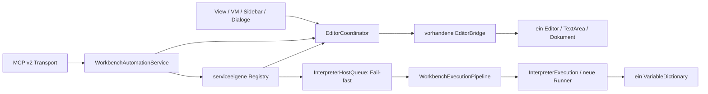
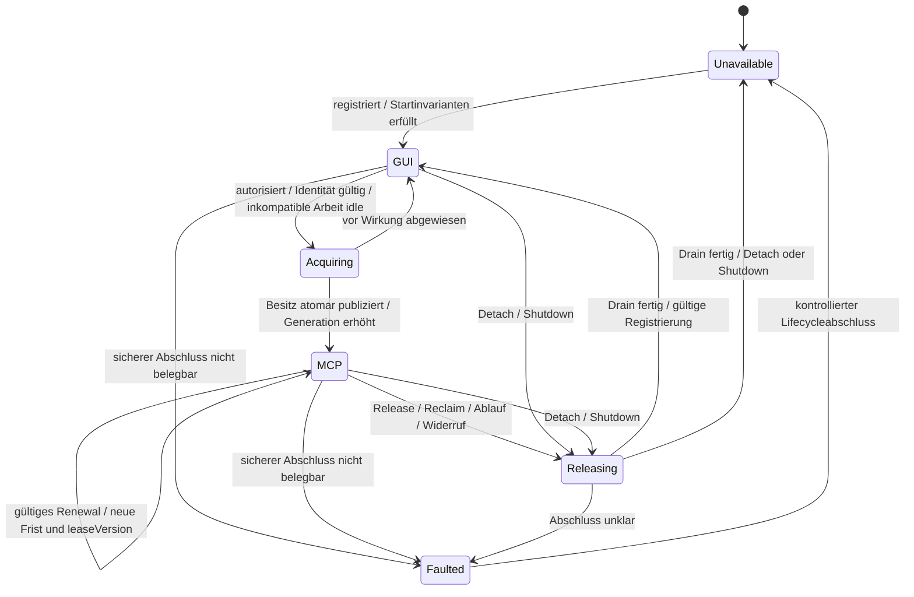
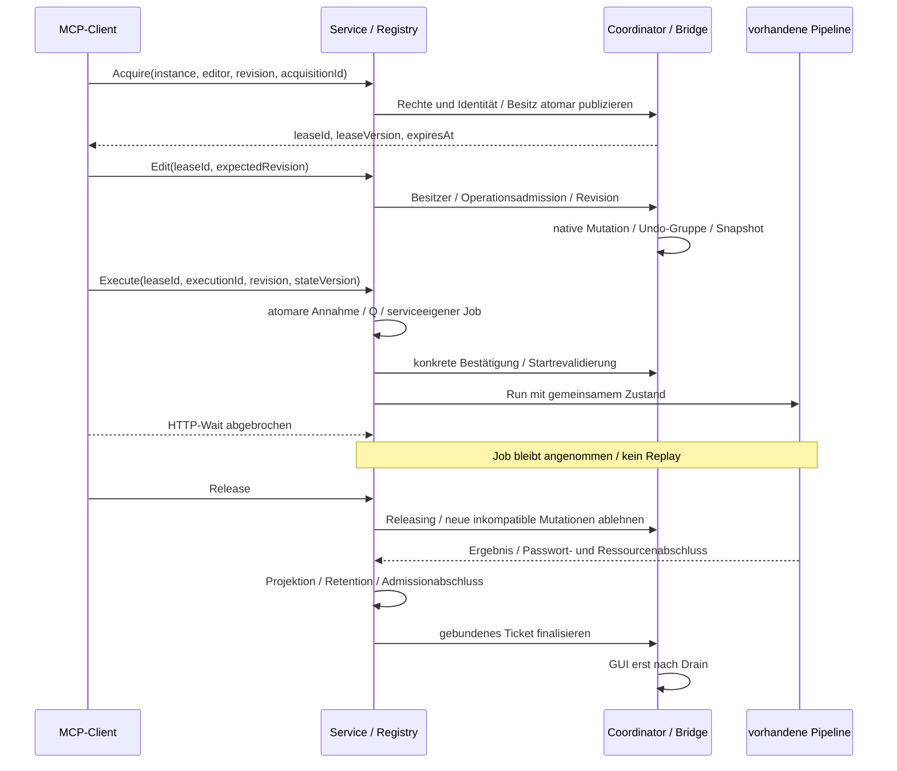
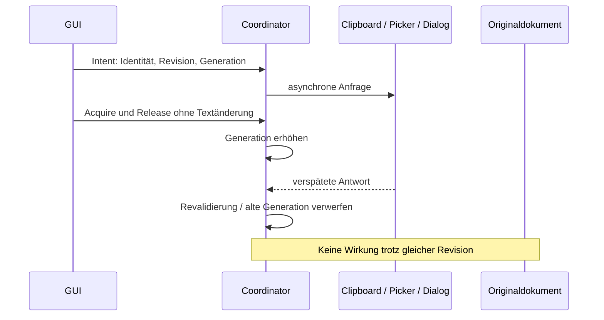
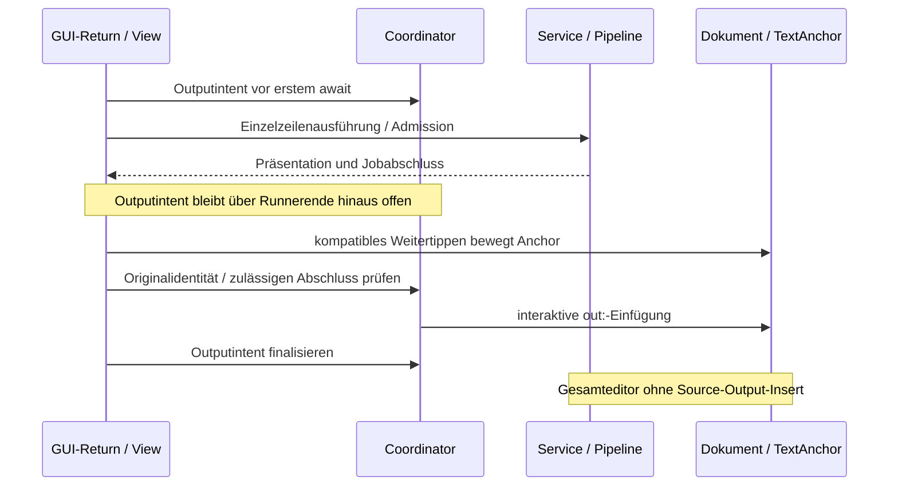

# MCP-00-R2 – Consolidated Architecture Decision

Stand: 26.10.2026. **Konsolidierte Architekturgrundlage; keine Implementierungs- oder Produktfreigabe.**

## 1. Executive Summary

Die genehmigte Zielarchitektur verwendet einen sichtbaren CryptoScript-Editor, ein Dokument und einen hostinternen EditorCoordinator für exklusiven GUI-/MCP-Besitz. Eine erneuerbare Übernahme umfasst mehrere Änderungen und mehrere jeweils gesondert bestätigte Ausführungen. Bestehende serviceeigene Jobs, Fail-fast-Admission, gemeinsame Interpreterpipeline und Variablen bleiben erhalten.

**Empfehlung:** Hostvertrag H auf Avalonia 11.3.20 / Avalonia.AvaloniaEdit 11.4.1 weiterverfolgen. H4 und U1 liefern positive Teilnachweise, keinen abgenommenen Produktpatch. Eine AvaloniaEdit-Änderung ist bisher **nicht als zwingend notwendig nachgewiesen**; ihre Entbehrlichkeit für alle benötigten Pfade ist ebenfalls nicht bewiesen. B2 und Avalonia-12-Migration bleiben zurückgestellt.

**Freigabestatus:** Vollständige Hostabnahme und produktive MCP-01.4-Umsetzung bleiben gesperrt. U2 bleibt INCONCLUSIVE: echte CJK-Unterdrückung beim Erstfokus und alte Commitfolgen nach Besitz-/Dokumentwechsel sind nicht belegt. MCP-01.5, externe Ausführung und produktive HTTP-Aktivierung bleiben separat gesperrt. R2 beauftragt keine Umsetzung.

Kennzeichnung im gesamten Bericht:

- **D – genehmigte Entscheidung:** Vorgabe des R2-Auftrags und der darin bestätigten Entscheidungen vom 24.–26.10.2026.
- **F – technische Tatsache:** gelesener aktueller Bestand oder verifizierte Repositorymetadaten.
- **E – experimentelle Evidenz:** vorhandener isolierter Testbefund, keine produktive Integration oder erneuter Testlauf in R2.
- **P – geplanter Entwurf:** Ausgestaltung/Arbeitspaket für gesonderte spätere Freigabe.
- **O – offen:** fehlender Nachweis oder Grundsatzentscheidung, keine Produktgarantie.

### Ausgangsbasis

**F:** Produktworktree `C:\Users\stefa\Documents\projects\GITHUB\CryptoWorkBench-Mcp`, Branch `feature/mcp-server`, HEAD `bd48c57fa4cae9dc733da7d4521eb6f79a9017f0`. Bewertet sind auch die vorhandenen uncommitteten Arbeiten. Vor Beginn: sechs geänderte getrackte Dateien, 18 unversionierte Dateien, leeres Staging. Getrackt verändert: WorkbenchAutomationRegistry, WorkbenchAutomationService, CryptoScriptEditViewModel, SidebarViewModel sowie CryptoScriptEditView AXAML/Codebehind. Unversioniert: sieben Control-/Service-/Testdateien und elf bisherige MCP-Berichte. Kein vorhandener Stand wurde bereinigt.

Grundlagen: [MCP-00-R1 Architektur](MCP-00-architecture.md), [MCP-00-R1 Plan](MCP-00-implementation-plan.md), [Editor Coordination Design mit Design Review R1](MCP-00-editor-coordination-design.md), [MCP-01.4 Architekturentscheidung](MCP-01.4-editor-architecture-decision.md), [Review](MCP-01.4-review.md), [B1](MCP-01.4-B1-feasibility.md). Ihre Dateien, damaligen Statusaussagen und Assertions bleiben unverändert. H ist durch den aktuellen Auftrag genehmigt, nicht durch rückwirkende Umdeutung damaliger Vorschläge.

H1–U2 liegen ausserhalb des Produktrepositories; Quellen in Abschnitt 7. B1 ist ein anderer isolierter Bibliotheksnachweis auf AvaloniaEdit 12. Sein damaliges GO FOR B2 DESIGN ist weder Produktfreigabe noch heutiger Fortsetzungsauftrag.

## 2. Genehmigte Produkt- und Architekturentscheidungen

| D | Verbindliches Ziel | Grenze |
|---|---|---|
| D1 | Ein sichtbarer Editor, gemeinsames Dokument | Kein unsichtbarer MCP-Editor/zweite schreibbare Wahrheit; immutable Snapshots erlaubt |
| D2 | Ein Coordinator verwaltet exklusiven Besitz | Sämtliche produktiven Host- und nativen GUI-Schreibpfade gehören zu H; IsReadOnly allein reicht nicht |
| D3 | Gemeinsamer Interpreterzustand/Variablenbestand | Serielle Fail-fast-Annahme, neue Runner pro Einheit, keine zusätzliche Pipeline oder wartende Queue |
| D4 | Anfangslease zehn Minuten; Renewal zehn Minuten ab Annahme | Keine Addition zur Restzeit, keine absolute MVP-Höchstdauer; lokale Rückforderung jederzeit |
| D5 | Release/Ablauf/Rückforderung sperren neue inkompatible Arbeit | GUI-Freigabe erst nach Drain; Jobdeadline/Finalisierung unabhängig |
| D6 | Versionierter MCP-v2-Vertrag mit leaseId und Rechten | Lease ersetzt keine konkrete lokale Ausführungsbestätigung |
| D7 | Text-Drag dauerhaft ab Initialisierung deaktiviert | Nicht erst bei Acquire; normale Auswahl/Caret erhalten |
| D8 | Datei-Drop späteres GUI-Feature | Nicht im MCP-01-MVP |
| D9 | Mehrstufige CJK-Komposition entfällt; dauerhafte Deaktivierung vorgesehen | Unicode, Schweizer Eingaben, Dead Keys, AltGr und Paste bleiben erforderlich; native Sperre OPEN |
| D10 | Native Undo-/Redo-Historie und Commandregistrierung erhalten | Hostprüfung vor Stackwirkung; U1 bisher nur isoliert integriert |
| D11 | Gesamteditor-Ausführung ohne zusätzliche out:-Einfügungen | Interaktives Return mit TextAnchor-Ausgabe bleibt |

Während MCP-Besitz keine GUI-Editor-/Historymutation, GUI-Ausführung, Variablenänderung, Open/Clear oder Save. Lesen, Scrollen, reine Suche, Auswahl/Copy, lokale Bestätigung, Cancel und Rückforderung bleiben möglich. Diese Aktionen legitimieren keine versteckten Schreibfortsetzungen. Mehrfensterfähigkeit wird durch Identitäten berücksichtigt, jetzt nicht implementiert; solange CryptoScript global ist, bleibt ein Prozessgate erforderlich.

## 3. Vergleich MCP-00-R1 gegen Hostvertrag H

MCP-00-R1 bezeichnet hier Architektur-/Planrevision vom 22.10.2026, nicht das spätere Design Review R1 des Koordinationsberichts.

| Thema | Bisheriger Vertrag/Stand | D – Ziel und Konsequenz |
|---|---|---|
| Exklusivität | Admission einzelner Mutation, Save oder Run | Zusätzlich auftragsübergreifender Besitz; Einzeladmission bleibt |
| Eingabe während Lauf | GUI-Eingabe bei kopierter Ausführung möglich | Während MCP-Besitz gesperrt; kompatibles GUI-Weitertippen im Return-Pfad bleibt |
| Setter/Callbacks | Breite direkte API-/Callbackgarantien, R2/R4/R6/R7 unerfüllt | H umfasst sämtliche Produktpfade samt internen Librarycalls/Fortsetzungen; nur direkte Fremdzugriffe ausserhalb dieser Pfade ausgenommen |
| Historische Findings | Setter-, Reentrancy- und Abschlussprobleme | Weiter gültig, keine VERIFIED-FIXED-Umetikettierung oder abgeschwächte Altassertion |
| Autorisierung | Principal/Epoche/Rechte/Revision | Zusätzlich aktuelle leaseId; gleicher Principal allein reicht nicht |
| Tools | Acht spezifizierte Tools | Drei Lifecycletools zusätzlich, strikt versioniertes v2 statt gemischter DTOs |
| Interpreter/Jobs | Gemeinsame Pipeline, Variablen, serviceeigene Jobs | Unverändert; kein Runner pro Lease; Leaseende löscht weder Job noch Ergebnisrecht |
| EC21 | Aktueller Code fügt Gesamtausführungsoutput ein | Keine out:-Quelltextänderung; späterer Code-/Testauftrag |
| Bibliotheksweg | B1-Kernlösung für breiteren Vertrag mit Libraryänderung | H bevorzugt unveränderte 11er-Basis unter offenen Nachweisen; B2 zurückgestellt |

Ein unkontrollierter benötigter Produktcallback ist eine **Lücke innerhalb H**, keine Fremd-API-Ausnahme. Der frühere Gate-Schwerpunkt EC04/05/06/16/19/26 bleibt anhand nativer Commands, Asyncpfade, Observer und Fehlerabschluss nachzuweisen. Bei belegter Unkontrollierbarkeit eines benötigten Pfads muss vor Implementierung erneut über die Architektur entschieden werden.

R2 konsolidiert das Ziel, editiert aber weder alte MCP-00-Verträge noch den alten Plan. Vor Codefreigabe sind Vertrags-/Schemaänderungen in einem gesonderten Review eindeutig zuzuordnen. Historische Befunde bleiben erhalten.

## 4. Konsolidierte Komponentenarchitektur

| Komponente | F/E – Grundlage | P – Zielverantwortung |
|---|---|---|
| EditorCoordinator | H4EditorCoordinator nur Labor | Ein Slot, Besitz/Lease/Generation, Mutationszulassung, Intents, Observergrenze und Drain; UI-affine Entscheidungen |
| EditorBridge | Serviceeigene Registrierung/editorId/Revision vorhanden | Dieselbe Bridge als einzige Revisionsquelle; keine parallele H1/H3-Bridge |
| WorkbenchTextEditor / kontrollierte TextArea | Produktguard; frühe H4/U1-Eingänge | Commands/Textinput vor Wirkung vermitteln; Drag/IME früh setzen; native Undo-/Anchor-/Selektionsalgorithmen erhalten |
| WorkbenchAutomationService | Autorisierung/Zustandszugriff/Editoroperationen | Ein Eingang für GUI/MCP; Besitz zusätzlich zu Admission; kein Service→Editor-VM-Zyklus |
| WorkbenchAutomationRegistry | Partial-Datei desselben Service, kein zweiter Dienst | Jobs/Fingerprints/Deadline/Cancel/Resultate/Retention/Tombstones; Editor-Ticket bis Finalisierung |
| InterpreterHostQueue | Reserve verwendet Wait(0); RunAdmittedAsync unterdrückt Caller-ExecutionContext | Bestehendes nicht wartendes Prozessgate; Klassenname bedeutet keine wartende Jobqueue |
| WorkbenchExecutionPipeline | Gemeinsamer Parser-/Runner-/Passwort-/Präsentationspfad | Runner pro Parse-Einheit, Parserreset, Diagnostikkopie, Outputkorrelation, Passwortdrain |
| MCP / Abstractions | Hostneutrale Verträge; Status-Probe | v2-DTOs/Validierung/Auth/Toolmapping; kein direkter Avalonia-/VM-/Interpreterzugriff |
| GUI / VM / Sidebar | Produktaufrufer, teilweise uncommitted korrigiert | Vollständige vermittelte Callchains; Anzeigen aus Coordinator/Service; CanExecute nie zweite Autorität |

Einzige Wahrheiten: Bridge für Editoridentität/Revision; Coordinator für Besitz/Generation; Service für stateVersion und Registryjobs; vorhandenes Gate für Interpreterzugriff. Lease hält nicht zehn Minuten das Interpretergate. H4Enabled/H4AllowMcpExecution, künstliche IME-Pendingflags, Fakeprovider und Reflection-Testseams sind keine produktiven Schnittstellen.

## 5. Editorbesitz, Admission und Lifecycle

### 5.1 Getrennte Prüfungen

| Ebene | P – Regel |
|---|---|
| Besitz | GUI oder eine MCP-Lease, gebunden an instanceId/editorId/Principal/Aktivierungsepoche |
| Einzelmutation | Operationszustand vor Callbacks publizieren; Reentrancy früh Busy, keine allgemeinen Callback-Schreibrechte |
| Interpreter-Admission | Bestehende Q-Reservation für ganze Operation; Konkurrenz fail-fast |
| Asyncintent | Originaldokument/editorId, Version/Revision, controlGeneration und Auswahl-/Anchor-/Auftragsbindung vor await erfassen; vor Commit revalidieren |
| Observer | Eigene Callbacks rein oder kontrolliert inventarisieren; ObserverDepth auch in späteren Callbacks; Exceptions begrenzen; keine neue Mutation aus Observerkontext |
| Jobfinalisierung | Service hält Projektion, Passwort-/Ressourcendrain und Registryabschluss; HTTP-Abbruch beendet nur Warten |
| Freigabe | Erst ohne inkompatible offene Wirkungen/Updategruppen GUI oder unavailable publizieren |

Revision zählt Textzustände innerhalb einer Bridge-Identität. controlGeneration entwertet auch textneutrale Besitz-/Fokus-/Lifecyclewechsel. stateVersion beschreibt abgeschlossenen Interpreter-/Variablenzustand. leaseVersion schützt Renewal/Timer-CAS; executionId/Fingerprint verhindern Replay. Keine Grösse ersetzt eine andere. Dokument-/Registrierungswechsel erzeugen neue editorId; alte Intents dürfen keinen Nachfolger übernehmen.

### 5.2 Zustandsmodell

**P:** Active, ObserverDepth und Pending sind orthogonal, keine weiteren Besitzmodelle.

Keine automatische Rückkehr aus Faulted zu beschreibbarem GUI ohne Konsistenznachweis. Renewal in Releasing/abgelaufen ist verboten. Rückforderung ist jederzeit auslösbar: sofortiger Entzug weiterer Zulassung, keine vorzeitige Freigabe laufender Wirkungen. Angenommene Ausführungen behalten Cancellation/Deadline/Finalisierung; noch nicht gestartete bestätigungspflichtige Runs revalidieren vor Runnerstart.

### 5.3 Sequenzen

Noch lesende Clipboard-/Pickerintents können durch Acquire entwertet werden; Pending ist kein pauschaler Lock. Angenommener Save-Commit hält Zulassung bis Delete/Write/Unlock. Keine neue Cancellationstelle zwischen bestätigtem Delete und Write, kein Rollbackversprechen. Keine native Updategruppe über Clipboard-/Dialog-/HTTP-await. Pro MCP-Edit eine Undo-Gruppe, keine leaseweite Gruppe.

## 6. Editorfunktionalität und ausdrücklich reduzierte Anforderungen

**Text-Drag, D/E:** EnableTextDragDrop=false vor erster Interaktion und bei Optionsersatz. H2-R zeigt: spätes Ausschalten stoppt begonnenen Drag/Move nicht zuverlässig. Kein Hot-Umschalten als Sicherheitsnachweis. H2-Targetfehler bleiben historische Befunde der künftig nicht angebotenen Text-Move-Funktion.

**Datei-Drop, D/E/O:** Separater Avalonia-Dateipfad erkennt Dateireferenzen; H2-R belegt lokalen Windows-OLE-Drag im Labor. Explorer-/Dateimanagerimport, fremde Provider, tatsächliches Open und Lifecyclewechsel bleiben späterem GUI-Auftrag vorbehalten, ausserhalb MCP-01-MVP.

**IME, D/E/O:** Editor und tatsächliche TextArea früh und dauerhaft mit InputMethod.SetIsInputMethodEnabled(false); das Property vererbt sich nicht. U2 reproduziert false/false beim Erstfokus mit nichtnull HIMC; nach Referenzfokus/Rückkehr HIMC null. HIMC beweist weder Komposition noch Sicherheitsverletzung. Manager-/IMM32-Quellanalyse ersetzt keinen Providertrace. Gewöhnlicher später TextInput wird nach Release angenommen; ohne Herkunftsnachweis ist er kein IME-Commit. Keine pauschale WM_CHAR-/Unicodefilterung als Ersatz.

**Undo/Redo, E/P:** U1 erhält native DefaultInputHandler-/TextArea-Registrierungen und vermittelt originale Commands vor Stackwirkung mit begrenzter Delegation ohne allgemeines Callbackrecht. 18 echte Ctrl+Z/Y-Folgen belegen GUIausführung und MCP-Abweisung im Labor. Produktintegration fehlt; keine neue Undoengine oder Historylöschung bei Leasewechsel.

**Weitere Eingaben, E/O:** H3 vergleicht Clipboard, Shift-Enter, Einrückung, Overstrike, Rechteckauswahl, Regex-/Mehrzeilenreplace und Completion. Ganze Ketten mit aktivem H bleiben abzunehmen. Die Bibliothek publiziert WholeLine-/Rectangle-Copy als Text; Marker nicht mit erfundener Semantik behandeln. OnTextCopied/OnTextPasted-Gleichheit wird nicht pauschal behauptet. TitleCase wirft unverändert NotSupportedException; keine eigene unterstützte UIbindung gefunden. R2 entfernt keinen Befehl. Künftige TitleCase-Anforderung separat entscheiden.

### EC21 – verbindliche Ausgabesemantik

**D:** Gesamteditor-Ausführung liest gebundene Revision als ScriptBook und verändert Quelltext weder durch erneutes Scriptanhängen noch zusätzliche out:-Zeilen. Resultate/Diagnostik/Präsentation bleiben möglich. Interaktives Return behält TextAnchor-Ausgabe und zulässiges Weitertippen.

**F/E:** Produktiver uncommitteter Gesamtausführungspfad enthält noch die zu korrigierende Outputwirkung. H4 prüft execution/shared-pipeline-ec21-diagnostics und execution/gui-return-anchor-output separat positiv. WholeEditorPrintIsInsertedOnceWithoutDuplicatingSource erwartet weiterhin Print plus out: im Quelltext und bleibt in H4/U1/U2 FAIL.

**P:** Späterer autorisierter Auftrag korrigiert Produktcode, passt die kollidierende Altassertion ausdrücklich ans neue Soll an und prüft beide Wege: unveränderter Gesamteditor/SourceRevision versus einmalige Return-Anchor-Ausgabe, einschliesslich Fehler, Weitertippen, Dokumentwechsel und verspäteter Finalisierung. R2 ändert keine Assertion und zählt keinen Alt-FAIL als PASS.

## 7. Ergebnisse H1 bis U2

Alle Zahlen sind **E**, aus Originalberichten; keine Wiederholung in R2 und keine Addition zu einer Gesamt-Abnahmezahl. PASS eines negativen Referenzorakels ist keine Sicherheitsfreigabe.

| Untersuchung / Quelle | Historischer Stand | Belegter Teilumfang | Erhaltene Fehler / Grenzen |
|---|---|---|---|
| [H1](C:/Users/stefa/Documents/ChatGPT/CryptoWorkBench-Mcp/mcp00-h1/MCP-00-H1-feasibility.md) | INCONCLUSIVE, 69/70 | Synchrone Host-/GUIpfade, einfache Asyncintents, Returnfinalisierung; 96 bestehende Editortests | TitleCase FAIL; Legacy 42/46 mit R6/R7; native IME/Move und Varianten offen |
| [H2](C:/Users/stefa/Documents/ChatGPT/CryptoWorkBench-Mcp/mcp00-h2/MCP-00-H2-feasibility.md) | INCONCLUSIVE, 26/28 | Source-Lifecycleadapter, 18 Zustandsvergleiche | target-error-Started/Changed FAIL, mögliche Quelllöschung trotz Zielproblem; vollständiger OS-Move fehlt |
| [H2-R](C:/Users/stefa/Documents/ChatGPT/CryptoWorkBench-Mcp/mcp00-h2r/MCP-00-H2R-feasibility.md) | INCONCLUSIVE, 44/44 neue Proben | Frühes Drag-Aus, Dateireferenzerkennung, lokaler OLE-Datei-Drag; GUI 434/434 | Zwei PASS reproduzieren unsichere Altpfade; externer Dateimanager und Lifecycle nicht vollständig belegt |
| [H3](C:/Users/stefa/Documents/ChatGPT/CryptoWorkBench-Mcp/mcp00-h3/MCP-00-H3-feasibility.md) | INCONCLUSIVE, 84/85 | 32 Native-/Host-Paare, 96 verglichene Zustände; Clipboard/Commands/Completion; GUI 434/434 | Später ungesicherter Fokusobserver FAIL; gesonderte Observergrenze positiv, nicht vollständig integriert; native IME offen |
| [H4](C:/Users/stefa/Documents/ChatGPT/CryptoWorkBench-Mcp/mcp00-h4/MCP-00-H4-feasibility.md) | INCONCLUSIVE, 50/50 | Ein Coordinator an echter View/Bridge/Registry/Pipeline; EC21, Return, Intent-/Drainketten | GUI 433/434, EC21 FAIL; Sidebar/Dialog/Observer/native Varianten, echte Leasecredentials/Zeitgeber offen |
| [H4-IME](C:/Users/stefa/Documents/ChatGPT/CryptoWorkBench-Mcp/mcp00-h4-ime/MCP-00-H4-IME-feasibility.md) | INCONCLUSIVE, 22 IME-Headless PASS | Frühe false/false-Initialisierung, Lifecycle/Unicode; native Fortsetzung mit Schweizer Eingaben | Native Ctrl+Z-Störung gefunden; echte CJK-Unterdrückung/alte Commits nicht belegt; HIMC-Befund offen |
| [U1](C:/Users/stefa/Documents/ChatGPT/CryptoWorkBench-Mcp/mcp00-h4-ime-u1/MCP-00-H4-IME-U1-review.md) | PASS nur Undo-/Redo-Korrektur | 15 U1-Proben, 18 native Shortcutfolgen; 22 IME/50 H4 PASS wiederholt; GUI 433/434 | Kein IME-/Host-Gesamt-GO; EC21 FAIL; Korrektur nur Prüfstand |
| [U2](C:/Users/stefa/Documents/ChatGPT/CryptoWorkBench-Mcp/mcp00-h4-ime-u2/MCP-00-H4-IME-U2-feasibility.md) | INCONCLUSIVE | Wiederholung 15/22/50 PASS; GUI 433/434; normale native Eingaben/Completion/Return/Lifecycle, 14 Logorakel | Keine funktionierende CJK-Umgebung; erforderliche CJK-Negativfälle OPEN; Null-HIMC kein Drainbeweis |

H4s [Mutationspfadmatrix](C:/Users/stefa/Documents/ChatGPT/CryptoWorkBench-Mcp/mcp00-h4/MUTATION-PATHS.md) und [Observerinventur](C:/Users/stefa/Documents/ChatGPT/CryptoWorkBench-Mcp/mcp00-h4/OBSERVER-INVENTORY.md) sind Ausgangspunkte der Vollständigkeitsprüfung, keine Liste abgenommener Produktpfade. H3s Fokus-Fail wird durch neue kontrollierte H4-Proben nicht rückwirkend verändert. Die GUI-Suite aktiviert H nicht durchgehend; 433 PASS ersetzen keine Aktiv-H-Abnahme.

## 8. Offene Risiken und Freigabebedingungen

Kategorien sind Arbeitsstatus, **keine Freigaben**: IR = **IMPLEMENTATION REQUIRED**, VR = **VERIFICATION REQUIRED**, AR = **ARCHITECTURE DECISION REQUIRED**. Mehrere Kategorien einer Zeile benennen getrennte Aufgaben.

| ID | Fläche / Kategorie | Konkrete Restarbeit und Abnahmeevidenz |
|---|---|---|
| O01 | Sidebar, IR + VR | Alle Command-/CanExecute-/Fallbackeingänge an H; echte Open/Clear/Save/Historyketten vor/nach awaits mit Besitzerwechsel |
| O02 | ScriptBook Open/Clear, IR + VR | Gebundener dokument-/zustandsverändernder Gesamtauftrag; Clear/Append/Run seriell. VM-Probe ersetzt keine Sidebar/Dialogkette. Shared-Verwendung in ClearAdmitted gegen injizierten Service/stateVersion abgleichen |
| O03 | SaveIntent/Commit, IR + VR | Snapshot, Ziel/Overwriteentscheidung und Generation binden; vor Delete revalidieren; Delete/Write/Unlock drainen; reale StorageProviderfehler/Reentrancy; ASCII/LF/Filter-/Appendsemantik erhalten |
| O04 | Passwort/Bestätigung, IR + VR | Script/Revision/stateVersion/Clientbindung; Antworten nach Wechsel verwerfen; Passwortquarantäne/Antwortentsorgung; sichtbare Dialoge, Cancel und Shutdown |
| O05 | Variablen/DataGrid, IR + VR | Jede Modify-/Parameter-/Collection-/Modelmutation durch Stateadmission plus Besitzgrenze; tatsächliche UIevents und stateVersion |
| O06 | Dokument/Detach/Reattach, IR + VR | Kontrollierter Lifecycle; alte Identität/Generation entwerten; alte Abschlüsse dürfen Nachfolger weder ändern noch entsperren; Drain vor Freigabe |
| O07 | Produktobserver, IR + VR | Vollständige Subscription-/Dispatcher-/Property-/Collectioninventur, reine versus vermittelte Observer; späte Focus/Caret/Selection/Info/Navigationcallbacks adversarial prüfen |
| O08 | Clipboard/Completion/Commands, IR + VR | Komplette frühe Operationsgrenzen; verzögerte Provider, Exceptions, leer/ungültig, WholeLine/Rechteck/ReadOnlysegmente, Context-/Fallbackcommands und Popupwechsel unter aktivem H; native Historie |
| O09 | Revision/Generation/stateVersion, IR + VR | Replace/Insert/Append/No-op, Bestätigungsawait, Book-Clear und Save/Detach-Kombinationen; Textrevision ersetzt keine Kontrollgültigkeit |
| O10 | Lease-v2/Timer, IR + VR | leaseId in DTOs; alte Anfrage desselben Principals unter neuer Lease abweisen; CAS-Renew/idempotentes Release, monotone Echtzeituhr, alte Timer; keine absolute Höchstdauer |
| O11 | Jobs/Retention/Cancel/Shutdown, IR + VR | Registry erhalten, Editor-Tickets bis Abschluss anbinden; HTTP-Waitabbruch, Timeout, Disable, späte Passwortantwort, App.Exit und Retentionfehler |
| O12 | Sichere Projektion, IR + VR | Immutable DTOs, Outputrechte/Opt-in/lokale Zustimmung, Metadaten statt Variablenwerte; keine Exceptions, ASTs, Dialogantworten oder Keymaterial in MCP-Fehlern/Logs |
| O13 | Native IME-Sperre, VR; bedingt AR | U2-Positivkontrolle plus Erstfokus/Preedit/Commit/Cancel/alte Nachrichten mit Providertrace. Falls Hostmittel nicht reichen: Architekturentscheid vor Implementierung, kein stiller Librarypatch |
| O14 | Fehler nach Teilwirkung, AR + IR + VR | Exakten v2-Fehler-/Receiptvertrag für angewandte Mutation mit Callbackfehler versus unklaren Abschluss/Faulted reviewen; kein falsches „keine Wirkung“, kein unsicheres Retry |
| O15 | Protokollkapazität/Kompatibilität, AR + IR | Erwerbs-ID-/Renewreceipt-/Release-Tombstone-Budget und Überlauf verbindlich festlegen; strikt v2, keine unbemerkte v1-Fallbackmutation |
| O16 | EC21, IR + VR | Freigegebene Produktkorrektur und autorisierte Altassertionsanpassung, danach beide Ausgabewege regressionsprüfen |

**Native Umgebung, E/O:** U2 fand Windows 11 Home 25H2/Build 26200, Schweizer Layout 00000807 und registrierte, aber nicht als funktionierende CJK-Komposition nachgewiesene Profile. Der Benutzer bestätigte das Fehlen einer vorbereiteten Testumgebung. [U2-Prüfplan](C:/Users/stefa/Documents/ChatGPT/CryptoWorkBench-Mcp/mcp00-h4-ime-u2/NATIVE-PLAN.md): zuerst echte Komposition im unveränderten Referenzeditor, danach Negativprüfung im deaktivierten Editor; Fokus aus aktiver Komposition, Acquire/Release, Leaseablauf/Rückforderung, Dokumentwechsel/Detach mit alten Nachrichten. Headless-TextInput ersetzt keinen nativen Nachweis. Andere unterstützte Zielplattformen brauchen eigene Evidenz.

Nicht jede offene Arbeit ist eine Grundsatzfrage: Sidebarverdrahtung ist IR, fehlender Providerbeleg VR. Unklare Fehlersemantik oder nachgewiesene Unkontrollierbarkeit verlangt AR. Solange O13 offen bleibt, keine vollständige Hostfreigabe.

## 9. Geplanter MCP-v2-Vertrag

**D:** Versionierter Wechsel mit leaseId/Rechten. **P:** Folgende Ausgestaltung ist vor Umsetzung als Schema/Abstractionsvertrag zu reviewen. **F:** Status-Probe-Transport ist kein implementierter Elf-Tool-Produktkatalog; externe ExecuteEditor-Aufrufer bleiben im aktuellen Service gesperrt.

| Tool | P – Eingabe, Bindung, Wirkung |
|---|---|
| workbench_get_status | Autorisierter Status mit Phase, editorWriteBlocked, mutationBusy und eigenem Besitzstatus; fremde leaseId/Principaldetails nicht offenlegen |
| workbench_get_editor | editor.read; konsistenter Snapshot auch vor Erwerb; keine halbfertige Mutation |
| workbench_acquire_editor | instanceId, acquisitionId, editorId, expectedRevision; editor.control + editor.write. Antwort leaseId/editorId/revision/leaseVersion/acquiredAt/expiresAt/ownership ohne Text |
| workbench_renew_editor | instanceId, editorId, leaseId, expectedLeaseVersion; gültiger Besitzer/control+write; zehn Minuten ab Renewalannahme |
| workbench_release_editor | instanceId, editorId, leaseId; authentisierter Besitzer bzw. berechtigter idempotenter Retry; releasing/released, kein force/ownerId-Clientargument |
| workbench_update_editor | Bestehender Edit plus leaseId; Principal/Epoche/Identität/Frist vor/nach Replacebestätigung; Revisions-/Range-/No-op-Regeln erhalten |
| workbench_execute_editor | Bestehende executionId, Revision/stateVersion plus leaseId; execution.run und konkrete lokale Zustimmung; Revalidierung vor Start |
| workbench_get_execution | Eigener angenommener Job, execution.read/Epoche und Retention; kein neuer Run, keine aktive Lease nötig |
| workbench_get_diagnostics | Gleiches Eigentums-/Retentionmodell; sichere Projektion |
| workbench_get_variables | Berechtigter Metadatensnapshot, stale während Lauf; keine Values oder lebende Enumeration |
| workbench_cancel_execution | Eigene Jobautorisierung, nicht Editorbesitz; Cancelanforderung ist kein abgeschlossener Abbruch |

Caller entstehen im vertrauenswürdigen GUI-/Auth-Eingang; Lease-ID ist keine Authentifizierung. acquisitionId/Fingerprint binden normalisierte Argumente an Principal/Epoche. Gleicher Retry erzeugt keine zweite Lease; andere Argumente unter derselben ID werden abgewiesen. Abgeschlossene Erwerbs-IDs dürfen keine neue Lease aktivieren. Begrenzte Tombstones/Receipts benötigen O15 statt unbegrenzten Speicher oder unsichere Wiederverwendung.

Renewal verändert weder Editorrevision, stateVersion, Jobdeadline noch Retention. Gleiches CAS-Retry liefert denselben Receipt ohne weitere Verlängerung. Monotone Zeit entscheidet; expiresAt ist UTC-Darstellung. Alte Timer prüfen leaseId/leaseVersion/aktuelle Frist. Renewal bleibt bei gültigem Besitz während Run/Bestätigung möglich, ohne zusätzliche Mutation/Runnerzulassung; in Releasing nicht. Releaseabschluss ist an Lease/Generation gebunden und entsperrt keinen späteren Besitzer.

Run-Deadline getrennt: Default 30 Sekunden, erlaubt 1–120 Sekunden ab Annahme einschliesslich Bestätigung. Ergebnisretention 15 Minuten ab terminalem Abschluss ist keine Leasehöchstdauer. Angenommene executionId/Fingerprint-Retries lesen bestehende Resultate auch nach Leaseende, statt erneut auszuführen. Neue Runs benötigen gültige Lease. HTTP-Abbruch nach Annahme ist kein Cancel.

Schemas behalten camelCase, UUIDs, Dezimalstrings für Versionen, UTC-Zeiten und additionalProperties:false. Geplante Fehler unterscheiden Forbidden, Busy, RevisionConflict, StateConflict, EditorUnavailable/InstanceMismatch sowie LeaseRequired/LeaseExpired/LeaseRevoked/LeaseVersionConflict/EditorOwned/EditorFaulted. Identitätsdetails erst nach Autorisierung; keine fremden Besitzinformationen. Teilwirkungs-Receipts bleiben O14.

Keine execute_text-, Save-, Passwort-, Raw-Undo- oder Fremdrückforderungs-Tools im MVP. Roh-Print/Info braucht output.read, includeText und lokale Zustimmung. Scriptbestätigung bindet Script, Revision, stateVersion, Client, Arbeitsverzeichnis und Ausgabeoption. Keine neue Dateisystem-Sandbox behaupten.

## 10. Implementierungsarbeitspakete und Abhängigkeiten

Alle Pakete sind **P**, separat zu beauftragen. Letzte Spalte: künftige Voraussetzungen, keine hier erteilte Erlaubnis.

| Paket / Ziel | Komponenten / Abhängigkeiten | Risiken | Tests und Akzeptanz | Freigabebedingung |
|---|---|---|---|---|
| AP0 – Vertrag/Pfadvollständigkeit | R2, v2, H4-Matrix/Observerinventur | Übersehene Pfade, unklare Teilfehler/Receipts | Jeder Pfad mit Owner, Admission, await-/Commitgrenze und Orakel; O14/O15 entscheiden | Separates Designreview, eindeutiger Scope/Fehlervertrag |
| AP1 – Native IME-Gate | U1/U2, AP0-Testvertrag, vorbereitete Umgebung | Erstfokus, alte Commits, TSF/IMM32 | U2-Positivkontrolle und vollständige Negativmatrix plus normale Eingaben; kein stilles OPEN | Native Evidenzreview; bei Scheitern Architekturentscheid vor Produktimplementierung |
| AP2 – Ein Koordinationskern | Service/Bridge/Coordinator, Editor/TextArea; AP0 und erforderliches AP1-Gate | Zweite Wahrheiten, Reentrancy, doppelte U1-Commands | Frühe Ablehnung, echtes Undo/Redo/Folgeedit, Identity/Generation, Fehlerabschluss; aktive H-Proben | Eigener begrenzter Codeauftrag/Kernreview; kein externer Zugang |
| AP3 – GUI/Observer vollständig | View/VM/Sidebar/History/Open/Clear/DataGrid/Clipboard/Completion; AP2 | Fallback-/Callbackbypass, stateVersion, Semantikverlust | Jede Inventurzeile geschlossen; Native-/Referenzvergleich und Fehler-/Reentrancytests | Aktiv-H-Pfadinventur vollständig, keine Produktausnahme |
| AP4 – Save/Dialog/Lifecycle | SaveIntent/Commit, Picker/Bestätigung/PasswordDialog, Attach/Detach/App.Exit; AP2/AP3 | Wirkung nach Entzug, früher Unlock, Delete ohne Write | Echte Provider/Dialoge, Shutdown/Cancel, alte Identität, geschlossene Gruppen, Snapshotbindung | Review O03/O04/O06/O11; keine kritischen offenen Fortsetzungen |
| AP5 – EC21/Ausführungsanbindung | Editoroperationen/Registry/Pipeline/Return; AP2/AP3/AP4-Abschlussvertrag | Sourceänderung, verlorene Returnausgabe, zweiter Statepfad | Gesamteditor unverändert; Return einmal am Anchor; Shared-State/Diagnostik; autorisiertes Alt-Testupdate | Separater Code-/Testauftrag mit bestätigter EC21-Sollsemantik |
| AP6 – Lease-v2/Zeitgeber | Abstractions/Service/Coordinator/Toolmapping; AP0/O15, AP2/AP4/AP5 | Alte Same-Principal-Anfrage, Timer/CAS/Replay, Receiptwachstum | Fake-/Echtzeitgrenzen, Renew über 15 Minuten, alte Timer, Disconnect, Dedupe/Rechte/Datenschutz | v2-Review und isolierte Transporttests; kein produktiver HTTP-Start |
| AP7 – Hostabnahme | Ganze Anwendung/Registry/Projektion; AP1–AP6 | Grüne Legacytests ohne aktives H, native Lücken | H aktiv, alle benötigten Varianten, akzeptierte EC21-Tests, historische Gegenproben separat erhalten | Unabhängiges Abnahmereview, erforderliche IR/VR/AR geschlossen |
| AP8 – Spätere Produktfreigabe | Auth/Pairing/lokale Zustimmung/Desktop-HTTP; AP7 plus eigener MCP-01.5-Auftrag | Frühe Aktivierung, Rechte-/Outputleck, Shutdown | End-to-end mit echten Clients/Credentials, Zustimmung/Projektion/Retention | Eigene Produkt-/Securityfreigabe; durch R2 nicht erlaubt |

Reihenfolge: AP0/AP1-Vorbereitung zuerst; native Grundsatzlücke vor unbedingter Hostumsetzung schliessen. Danach Kern, GUI/Observer, Asyncabschluss, EC21, v2 und Abnahme. AP3/AP4 können nach geklärten Schnittstellen getrennt entwickelt werden; gemeinsame Abnahme bleibt nötig. Einzelkomponenten können für einen **gesondert begrenzten Auftrag implementierungsbereit** sein, ohne AP7/AP8 zu erfüllen. Kein unkontrolliertes Kopieren von Laborflags/Testseams.

## 11. Akzeptanz-/Freigabematrix

| Gate | Erforderliches Ergebnis | Heute |
|---|---|---|
| G0 Architektur | D1–D11 anerkannt, historische Verträge/Findings getrennt | Durch R2-Auftrag bestätigt; keine Codefreigabe |
| G1 Komponentenentwurf | Eine Bridge/Revision, ein Coordinator, bestehende Pipeline, klare Fehler-/Intent-/Observergrenzen | Kerne tragfähig; O14/O15 und Integration offen |
| G2 Native Funktionen | Frühes Drag-Aus, IME-Unterdrückung und normale Eingabe/Undo/Clipboard/Completion | Teilproben positiv; CJK und weitere Varianten OPEN |
| G3 Lease/Lifecycle | 10-Minuten-Renewal ohne Höchstdauer, alte Credentials/Timer abgewiesen, Drain vor Release | H4-Labor positiv; Produkt-v2/Echtzeittimer/volle Ketten offen |
| G4 Gesamtpfade | Sidebar/Open/Clear/Save/Dialog/DataGrid/Observer vollständig unter H | IR + VR, keine Hostabnahme |
| G5 CryptoScript/EC21 | Gemeinsame Pipeline/Variablen/Fail-fast, beide Outputwege korrekt | Grundlage vorhanden/H4 positiv; Produktkorrektur/Alt-Testupdate offen |
| G6 Jobs/Geheimnisschutz | HTTP-unabhängige Finalisierung, Cancel/Retention/Shutdown/Projektion regressionsfrei | Bestehende Basis; kompletter Nachweis nach H-Integration nötig |
| G7 MCP-01.4 Hostabnahme | G1–G6 erfüllt, alle erforderlichen Bedingungen geschlossen | NICHT FREIGEGEBEN |
| G8 Externe Aktivierung | G7 plus eigener MCP-01.5-/Transport-/Securityentscheid | GESPERRT; kein Listener-/Ausführungs-GO aus R2 |

Datei-Drop ist kein G7-MVP-Gate, da späteres Feature; offene Explorer-/Providerbelege gehen in den GUI-Auftrag. IME-Unterdrückung bleibt trotz entfallener CJK-Bedienfunktion ein G2-Sicherheitsgate: Wegfall der Funktion beweist nicht das Ausbleiben verspäteter Effekte.

## 12. Abschliessende Architektur- und Umsetzungsempfehlung

1. **Ausreichend belegt für begrenzte Versuchsfälle:** gemeinsamer Editor/Bridgeverbund, frühe Hostzulassung, U1-Undo-/Redo-Vermittlung, mehrere Clipboard-/Completionintents, kontrollierte Observer, Registry-/Pipelineanbindung, gebundener Output-/Saveabschluss, getrennte EC21-/Returnsemantik. Kein pauschaler Nachweis sämtlicher Produktpfade.
2. **Vor produktiver MCP-01.4-Implementierung nötig:** vollständiger Pfad-/Observer-/v2-Review, Teilfehler-/Receiptentscheidungen, Schliessen der nativen IME-Grundsatzlücke und gesonderte Paketfreigaben. Danach kontrollierte Integration statt Laborflagübernahme; Hostabnahme erst nach vollständigen Implementierungs-/Regressionstests.
3. **Erst in geeigneter nativer Umgebung prüfbar:** CJK-Positivkontrolle, Erstfokus-/Preedit-/Commit-/Cancelunterdrückung, aktive Komposition bei Fokus-/Besitz-/Dokumentwechsel, verspätete Provider-/Resetfolgen. Sichtbare Dialog-/StorageProvider- und unterstützte Plattformkombinationen ebenfalls real abnehmen; Datei-Drop später separat.
4. **Bibliotheksänderung:** bisher unter H nicht zwingend erforderlich; keine Entbehrlichkeitsgarantie. Bei unkontrollierbarem benötigtem Pfad erneut entscheiden. Direkte R2/R4/R6/R7-Garantien werden durch H nicht technisch erfüllt.
5. **Reihenfolge:** Vertrag/Native-Gate → ein Kern mit U1 → GUI-/Observerpfade → Save/Dialog/Lifecycle → EC21/Registryfinalisierung → v2/Timer → Hostabnahme → separat beauftragte Produktfreigabe.

### Arbeits- und Erhaltungsnachweis R2

Nur dieses neue Dokument wird im Produktworktree angelegt. Keine Tests/Builds in R2: historische Resultate gelesen, nicht neu erzeugt oder umbewertet. Vor Anlage wurden 19.545 Originaldateien in Produkt und H1–U2 per SHA-256 erfasst, einschliesslich vorhandener Build-/Evidenzdateien; Git-Metadaten gesondert erfasst. `.codex/config.toml` wurde vor Inhaltszugriff ausgeschlossen, weder gelesen noch gehasht oder verändert. Temporäre Inventare liegen ausserhalb des Produktworktrees.

Abschlussprüfung am 26.10.2026: alle 19.545 ursprünglich erfassten Dateien in Produkt und H1–U2 unverändert (SHA-256). HEAD, Branch, staged Diff und Indexhash identisch. Git-Status unverändert bis auf dieses eine neue unversionierte R2-Dokument; Staging weiterhin leer. Sämtliche Dokumentverweise geprüft; zwölf Hauptabschnitte, ein Komponentendiagramm, ein Zustandsdiagramm und drei Sequenzdiagramme vorhanden.

Keine Bibliotheks-, Projekt-, C#-, AXAML-, Test- oder bestehende Dokumentänderung; kein Commit, Push, Merge, Reset, Rebase oder Stash. Keine automatische Freigabe, Folgeuntersuchung oder Umsetzung.

## Eigentümerergänzung vom 26.10.2026 – AP2.1 / akzeptiertes IME-Restrisiko

Diese neue Entscheidung ersetzt ausschliesslich die früheren Aussagen, nach denen der fehlende native CJK-Negativtest den Beginn von AP2 oder zwingend die finale Hostfreigabe blockiert (insbesondere AP0-D06). Die damalige technische Evidenz wird dadurch nicht nachträglich verändert.

- Mehrstufige CJK-IME-Komposition gehört nicht zum unterstützten Funktionsumfang des CryptoScript-Editors. Der Projekteigentümer akzeptiert das verbleibende Risiko einer nicht vollständig nachgewiesenen nativen IME-Unterdrückung.
- Frühestmögliche **dauerhafte** IME-Deaktivierung an Editor und fokussierbarer TextArea bleibt verpflichtend, vor erstem Benutzerfokus und nach relevanter Neuinitialisierung. Keine Reaktivierung bei Release; `EnableTextDragDrop=false` bleibt ebenfalls verpflichtend.
- Normale Unicode-Eingabe, Schweizer Tastatur, Dead Keys, AltGr und Clipboard bleiben unterstützt. Keine pauschale Unicode-/WM_CHAR-Filterung.
- U2 bleibt historisch **INCONCLUSIVE**; echte CJK-Negativtests bleiben technisch OPEN. Der fehlende Nachweis wird nicht als PASS ausgegeben. Alle anderen Sicherheits-, Drain-, Credential-, Speicher- und Integrationsgates bleiben bestehen.

AP2.1 ist als produktives, begrenztes Grundpaket autorisiert. Der normale Produktbetrieb bleibt bei GUI-Besitz; eine reale MCP-Übernahme, externe Lease-v2-Tools, Credentialrotation, HTTP-Aktivierung und epochenbezogene Tombstonefreigabe sind nicht freigegeben. Die D02-S1-Modellprüfung ist weiterhin kein Produktdrain-Zertifikat.

Implementierung und Prüfresultate stehen in [MCP-00-AP2.1-implementation-review.md](MCP-00-AP2.1-implementation-review.md). Diese Ergänzung erteilt keine vollständige MCP-01.4-/HTTP-Freigabe. AP2.1 darf erst nach einem separaten unabhängigen Review als abgeschlossen gelten. EC21-Code und historischer EC21-Test bleiben AP5 und in AP2.1 unverändert. Historische H4-/H4-IME-/U1-/U2-Berichte und D02-S1 werden nicht umgeschrieben.
