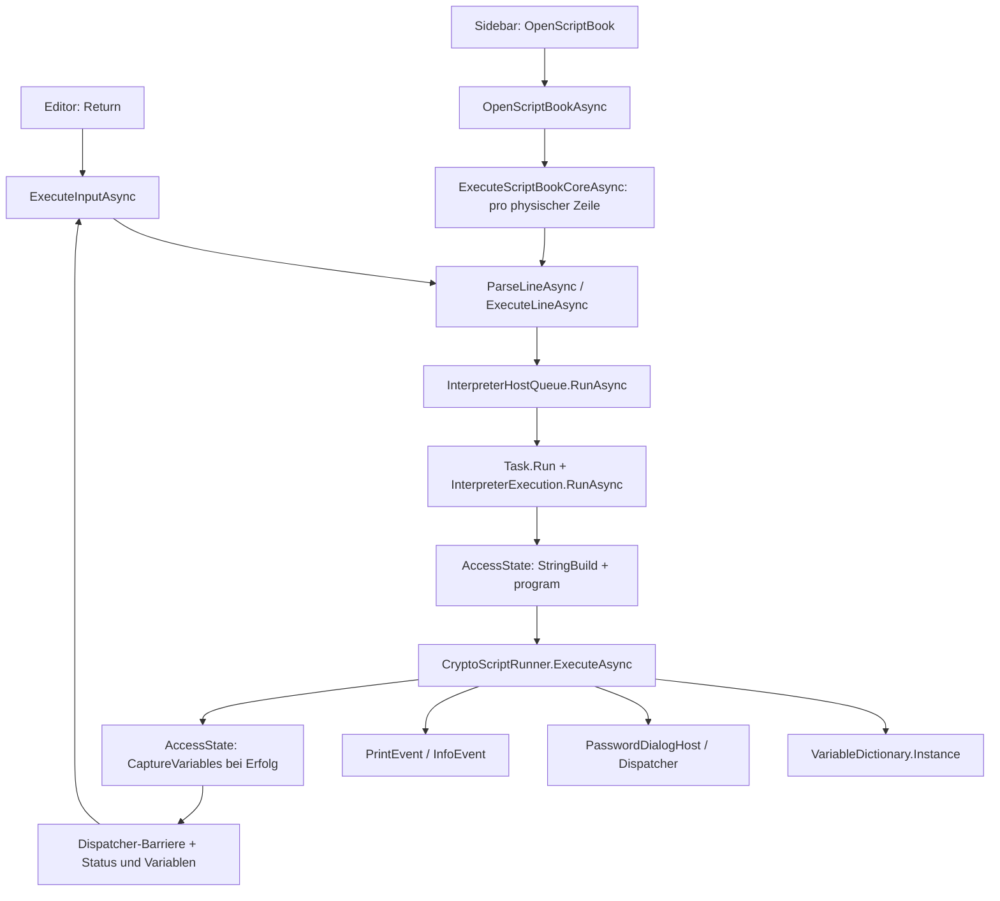
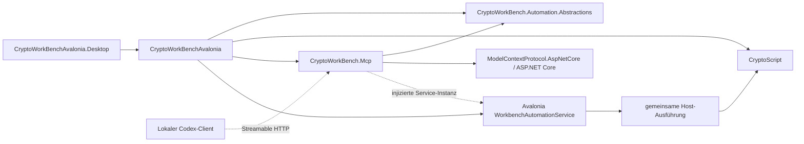
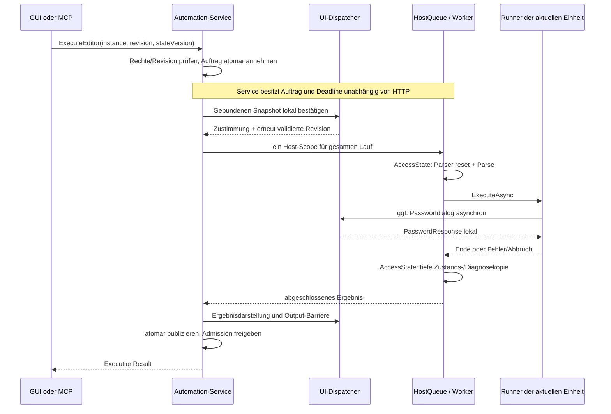

# MCP-00 – Architektur und Integrationsvertrag

Status: Architekturvorschlag zur gemeinsamen Prüfung; keine Implementierungsfreigabe. Revision MCP-00-R1 (Reviewpunkte R1–R5), Stand: 22.10.2026.

Analysierte Basis: `tkbss/CryptoWorkBench`, Commit `027815e9ea6f2dab11bd03485500b819907f2862` (`master` und `feature/mcp-server`). Der bereits bestehende, anfangs saubere Worktree `C:/Users/stefa/Documents/projects/GITHUB/CryptoWorkBench-Mcp` wird wiederverwendet. Der gleichnamige Chat-Arbeitsordner unter `Documents/ChatGPT` ist ein anderes, leeres Repository. Bestehende Worktrees werden weder verschoben noch neu angelegt. Dieser Vorschlag ändert nur die beiden MCP-00-Dokumente.

## 1. Ergebnis und verbindliche Grenzen

Ein einziger Automation-Service im Avalonia-Host koordiniert Editorzugriff, GUI-Ausführung, MCP-Ausführung und Zustandsaufnahme. Er verwendet die bestehende asynchrone Interpreter-Pipeline und denselben prozessweiten Variablenbestand. `CryptoWorkBench.Mcp` übersetzt MCP-Aufrufe in diesen Vertrag; es kennt weder Avalonia noch ViewModels noch den Interpreter. Eine kleine Bibliothek `CryptoWorkBench.Automation.Abstractions` enthält ausschliesslich hostneutrale Interfaces und DTOs. CryptoScript erhält keine Referenz auf eines dieser Projekte.

Der MCP-HTTP-Host läuft im Avalonia-Prozess und ist standardmässig ausgeschaltet. HTTP-Verbindungen besitzen keinen eigenen CryptoScript-Zustand. Ein angenommener Auftrag gehört dem Automation-Service und überlebt den Abbruch seines HTTP-Aufrufs; Ausführungsabbruch ist eine gesonderte Aktion. Ausführungen werden als ganze Benutzeroperationen exklusiv zugelassen; konkurrierende Änderungen erhalten unmittelbar `Busy`. Runner entstehen weiterhin pro Ausführungseinheit in derselben Pipeline. Lesen erfolgt überwiegend aus veröffentlichten, unveränderlichen Snapshots. Editoränderung, GUI-Speichern und Ausführung sind getrennte, revisionsgebundene Vorgänge.

Nicht Bestandteil von MCP-00: neue Projekte, Pakete, Servercode, GUI-Refactoring, Änderungen der Sprachsemantik, Builds mit Paketinstallation, Commit, Push oder Merge. Alle folgenden C#-, JSON- und TOML-Blöcke sind Spezifikation.

## 2. Tatsächliche Integrationspunkte

Die folgenden Pfade sind relativ zur Repository-Wurzel; die genannten Methoden wurden an der obigen Basis gelesen.

| Integrationspunkt | Tatsächliches Verhalten und Konsequenz |
| --- | --- |
| [CryptoScriptRunner](../../CryptoScript/Model/CryptoScriptRunner.cs), `Execute`, `ExecuteAsync` | Runner werden heute im Editor pro Zeile erzeugt. `ExecuteAsync` verwendet `RunRunnerAsync`; normale Statements laufen unter `EnterState(runner: true)`, SecureSave/SecureLoad dürfen asynchron Passwort-Callbacks abwarten. `RunnerId` ist instanzbezogen, Diagnose-ExecutionIds entstehen pro Ausführung. Ein Runner ist kein isolierter Variablencontainer. |
| [InterpreterExecution](../../CryptoScript/Model/InterpreterExecution.cs) | Statischer exklusiver Owner. `Enter` erlaubt nur synchrone Reentrancy desselben Threads. `RunAsync` weist einen vorhandenen Owner zurück. `RunRunnerAsync` erlaubt einen Runner im gültigen ambient Host-Scope, aber keinen zweiten aktiven Runner. `AccessState` erlaubt kurze synchrone Schritte zwischen Runner-Aufrufen. `VerifyAccess` alleine ersetzt keine mehrschrittige Sperre. |
| [InterpreterHostQueue](../../CryptoWorkBenchAvalonia/Services/InterpreterHostQueue.cs) | Statisches `SemaphoreSlim` wartet auf andere Jobs; `WithinJob` verhindert verschachtelte Jobs. Ein Job wird über `Task.Run` in `InterpreterExecution.RunAsync` ausgeführt. Die Queue deckt heute Parsing, einzelne Zeilenausführung und detached Capture ab, nicht das gesamte ScriptBook. |
| [VariableDictionary](../../CryptoScript/Variables/VariableDictionary.cs) | Prozessweiter Singleton; `GetVariables()` liefert die lebende Values-Enumeration, `Get()` veränderliche Objekte. `PublishBatch` publiziert einzelne Snapshot-Importe atomar, macht jedoch weder ganze Scripts transaktional noch die Sammlung allgemein threadsicher. |
| [CryptoScriptEditViewModel](../../CryptoWorkBenchAvalonia/ViewModels/CryptoScriptEditViewModel.cs) | `ParseLineAsync`/`ExecuteLineAsync` koordinieren Queue, Parsing, temporären Runner, Passwort-Subscription, Diagnose- und Variablendarstellung. `lineActive`/`bookActive` sind GUI-lokale Flags. `ExecutionPresentation` ist privat; öffentliche Async-Methoden liefern keinen reichhaltigen Ausführungsvertrag. |
| [CryptoScriptEditView](../../CryptoWorkBenchAvalonia/Views/CryptoScriptEditView.axaml.cs) | DI-Konstruktor findet den wirklichen `TextEditor`, leert ihn und weist ihn dem VM zu. Return startet `ParseLineAsync` für die aktuelle Zeile. Die View fügt danach `PrintMessage` über einen TextAnchor in das Dokument ein. `PendingExecution` verfolgt diesen Task. Beim Detach wird nur der Completion-Controller entsorgt; eine Automation-Registrierung existiert noch nicht. |
| [VariableViewModel](../../CryptoWorkBenchAvalonia/ViewModels/VariableViewModel.cs) | `CaptureVariables` kopiert in veränderliche GUI-Modelle, einschliesslich `Value`, Parametern und Schlüsselmetadaten. `ApplyVariables` verändert ObservableCollections. Bearbeitungsbefehle prüfen `IsExecutionActive` und benutzen `Enter`. Diese Modelle sind kein sicherer MCP-Ausgabevertrag. |
| [StatusViewModel](../../CryptoWorkBenchAvalonia/ViewModels/StatusViewModel.cs) | Enthält Status-Text und UI-Diagnosecollection. `AppendDiagnostics` erhält Reihenfolge und unterdrückt nur die zusätzlich transportierte, referenzidentische Exception-Diagnose. `DiagnosticDisplayItem` friert die Darstellung ein, enthält aber nicht sämtliche strukturierten Diagnosefelder. |
| [App.axaml.cs](../../CryptoWorkBenchAvalonia/App.axaml.cs) | Prism/DryIoc registriert Editor-, Variablen- und Status-VM als Singletons. `CreateShell` hängt Dispose an `window.Closed`; `OnInitialized` registriert Regionen und zusätzlich Dispose an Desktop-Exit. Bisher keine geordnete, awaitbare Serverbeendigung. |
| [Desktop/Program.cs](../../CryptoWorkBenchAvalonia.Desktop/Program.cs) | `StartWithClassicDesktopLifetime` betreibt den Desktop-Lebenszyklus; `BuildAvaloniaApp` wird auch vom Designer benutzt. Der MCP-Host darf hier nicht bereits beim Builder-Aufbau starten. |

Weitere relevante Grenzen:

- [ParserBuilder](../../CryptoScript/Model/ParserBuilder.cs), [SyntaxErrorListner](../../CryptoScript/ErrorListner/SyntaxErrorListner.cs) und [SyntaxErrorList](../../CryptoScript/ErrorListner/SyntaxErrorList.cs): Parser-/Lexerfehlerlisten und Fehlerflag sind global. Vor jeder Parse-Einheit müssen sie unter dem Gate zurückgesetzt und danach kopiert werden. `FileBuild` verwendet andere, konsolenorientierte Diagnosepfade; Automation verwendet wie die GUI `StringBuild`.
- [CryptoScriptProgram](../../CryptoScript/Model/CryptoScriptProgram.cs) und Runner-Diagnostics frieren nur Mitgliedschaft und Reihenfolge ein. Enthaltene `SemanticError`-Objekte bleiben veränderlich und können bei Wiederverwendung eine andere Location erhalten. Transportiert werden daher neue DTOs, niemals diese Listen oder AST-/Statement-Objekte.
- [OutputOperations](../../CryptoScript/Operations/OutputOperations.cs) sendet statische `PrintEvent`/`InfoEvent` und schreibt zusätzlich auf `Console`. Die GUI postet auf den Dispatcher; eine Background-Dispatcher-Barriere wartet vor Ergebnisdarstellung auf vorherige Ausgaben. Der Service muss Ausgaben am Ereignisursprung sammeln; `PrintMessage` ist kein vollständiges, ausführungskorreliertes Protokoll.
- [PasswordDialogHost](../../CryptoWorkBenchAvalonia/Services/PasswordDialogHost.cs) verwendet den UI-Dispatcher und das Hauptfenster als Owner. Request- und Host-Lifetime-Cancellation schliessen Dialoge. Der Runner verlangt genau einen Handler, prüft Antwortidentität und entsorgt verspätete Antworten. Bei verspäteten Antworten bleibt sein Passwortpfad vorübergehend gesperrt.
- [SidebarViewModel](../../CryptoWorkBenchAvalonia/ViewModels/SidebarViewModel.cs): Öffnen kann nach Bestätigung Editor **und Variablen** leeren und führt das Buch sofort aus. `SaveScriptBookCommand → GuardAsync → SaveScriptBook()` prüft `IsExecuting` nur beim Einstieg, wartet dann auf Dokumentordner, Ordneranlage und `SaveFilePickerAsync` (`ShowOverwritePrompt=false`). Existiert das Ziel, folgt die eigene asynchrone Überschreibbestätigung; bei Zustimmung `await result.DeleteAsync()`. Erst danach liest `CryptoScriptEditViewModel.SaveScriptBook(filePath)` das **aktuelle** TextDocument und schreibt nichtleere/nicht ausschliesslich aus Whitespace bestehende Zeilen als ASCII mit LF im Append-Modus. Nach den await-Grenzen fehlen Busy-/Revisionsprüfungen. Ein während der Dialoge veränderter Text kann deshalb ohne erneute Zustimmung gespeichert werden. Ein verlässlicher gespeicherter Dokumentstand mit Revisionen existiert nicht; `IsModified` allein reicht nicht als Schutzvertrag. Korrekturvertrag: Abschnitt 4.5.

### 2.1 Bestehende Aufrufketten



`ParseLine`/`ExecuteLine` und das synchrone ScriptBook-Verfahren existieren daneben weiterhin, unter anderem in Tests. SecureSave/SecureLoad erfordern den asynchronen Pfad. Diese synchronen APIs dürfen später kein unkontrollierter Nebenweg zum gemeinsamen Service werden.

### 2.2 Unterschied der Ausführungsarten

| Art | Bestand / festgelegtes Ziel |
| --- | --- |
| Einzelne Eingabe | Heute wird der übergebene Text als ein `program()` geparst; mehrere Statements sind möglich. Syntaxfehler verhindern die Ausführung dieser Parse-Einheit. Bereits erfolgte Effekte vor einem späteren Laufzeitfehler bleiben bestehen. Zielmodus `submission` erhält dieses Verhalten. |
| ScriptBook | Physische Zeilen werden nacheinander geparst und ausgeführt. Nur exakt am Zeilenanfang stehendes, ordinales `out:` wird übersprungen. Die bearbeitete Zeile wird auch bei Fehler angehängt; danach stoppt das Buch. Frühere Zeilen bleiben wirksam. Zielmodus `scriptBook` erhält diese Regeln, inklusive LF/CRLF und Zeilennummern. |
| Aktueller Editorinhalt | Einen eigenen Befehl „gesamten Editor ausführen“ gibt es derzeit nicht. Ziel: atomar gelesene Dokumentrevision als `scriptBook` ausführen, weil der Editor auch `out:`-Transkriptzeilen enthält. Kein implizites Clear, kein nochmaliges Anhängen des gesamten Inhalts, keine Umdeutung als ein einziges mehrzeiliges Program. |

Semantische Diagnose mit Severity Error bedeutet nicht zwingend Abbruch: beispielsweise kann `Check` eine Diagnose liefern und die Folgeanweisung trotzdem ausgeführt werden. Der Automation-Vertrag trennt deshalb Kontrollflussabschluss, Diagnose-Schweregrad und Seiteneffekte. Weder neue „stop on every diagnostic“-Regeln noch Rollback werden eingeführt.

## 3. Zielstruktur und erlaubte Abhängigkeiten



Durchgezogene Projektpfeile bedeuten Referenzen, gestrichelte Pfeile Laufzeitkommunikation. Adapter und Pipeline liegen zunächst in `CryptoWorkBenchAvalonia/Services/Automation`, nicht in zusätzlichen Runtime-Projekten.

- **Abstractions**, `net10.0`: BCL-Verträge, immutable Records und Enums; keine Referenzen auf CryptoScript, Avalonia, Prism, ASP.NET oder MCP. Die zusätzliche kleine Bibliothek verhindert, dass GUI-Fachlogik vom MCP-Transportvertrag abhängt.
- **Mcp**, `net10.0`: FrameworkReference `Microsoft.AspNetCore.App`, geprüfter stabiler Paketkandidat `ModelContextProtocol.AspNetCore` **2.3.0**, später exakt zu pinnen, Referenz auf Abstractions. Kein Zugriff auf `VariableDictionary`, kein Runner, kein GUI-Service-Locator.
- **Avalonia**: erzeugt genau eine `WorkbenchAutomationService`-Instanz für GUI und MCP, aber keinen langlebigen Singleton-Runner. Der gemeinsame Zeilenkern erzeugt wie bisher einen Runner pro tatsächlich auszuführender Parse-Einheit (`submission`: ein Program; `scriptBook`: eine nicht übersprungene Zeile). Die Runner greifen sequenziell auf denselben globalen Variablenbestand zu; sie schaffen keinen unabhängigen Zustand. `SemanticErrors`, aktive/letzte Runner-Diagnostik und RunnerId gehören nur dieser Einheit. Syntaxfehler liefern neue Syntax-DTOs und keine Diagnostik einer vorherigen Einheit. Diagnosekopien werden vor Verwerfen des Runners aufgenommen; Details zur serviceweiten Passwort-Quarantäne in Abschnitt 5.4.
- **DI-Brücke**: Prism erzeugt den Service. Der HTTP-Host erhält die bereits aufgelöste Instanz explizit über einen Factory-/Start-Vertrag und registriert sie als vorhandenes Singleton in Microsoft DI. Keine zweite Factory-Registrierung, kein zweiter DryIoc-Container, kein automatisches Scannen der GUI. Der Desktop-Lifecycle-Owner besitzt den Service; das Stoppen des Webhosts darf ihn nicht entsorgen.
- **GUI-Präsentation**: Der Service hängt nicht vom Editor-VM ab. Ein lokaler `IEditorBridge` kapselt TextDocument/Dispatcher; ein Präsentationsadapter wendet Resultate auf Status-/Variablen-VM an. Editor-VM und GUI-Kommandos delegieren an den Service. So entsteht kein DI-Zyklus Service → Editor-VM → Service.

Ein zweiter Host kann später Abstractions implementieren und denselben MCP-Transport wiederverwenden. Eine Auslagerung der gemeinsamen Pipeline kann dann erfolgen. Heute werden weder Multi-Host-Broker noch IPC, Session-Dictionaries oder ein Headless-Server gebaut. Aufgrund statischer CryptoScript-Zustände bedeutet diese Architektur weiterhin **ein Workbench-Zustand pro Prozess**, nicht beliebig viele isolierte Workbenches.

## 4. Automation-Vertrag

### 4.1 C#-Interface

```csharp
public interface IWorkbenchAutomationService
{
    Task<Reply<WorkbenchStatus>> GetStatusAsync(AutomationCaller caller, CancellationToken ct);
    Task<Reply<EditorSnapshot>> GetEditorAsync(AutomationCaller caller, CancellationToken ct);
    Task<Reply<EditorMutation>> UpdateEditorAsync(AutomationCaller caller, EditorEdit request, CancellationToken ct);
    Task<Reply<ExecutionResult>> ExecuteEditorAsync(AutomationCaller caller, EditorExecution request, CancellationToken requestCancellation);
    Task<Reply<ExecutionResult>> ExecuteTextAsync(AutomationCaller caller, TextExecution request, CancellationToken requestCancellation);
    Task<Reply<ExecutionResult>> GetExecutionAsync(AutomationCaller caller, Guid executionId, CancellationToken ct);
    Task<Reply<DiagnosticSnapshot>> GetDiagnosticsAsync(AutomationCaller caller, Guid executionId, CancellationToken ct);
    Task<Reply<VariableSnapshot>> GetVariablesAsync(AutomationCaller caller, CancellationToken ct);
    Task<Reply<CancelReceipt>> CancelExecutionAsync(AutomationCaller caller, Guid executionId, CancellationToken ct);
}
```

`AutomationCaller` wird ausschliesslich vom vertrauenswürdigen GUI-Einstieg bzw. aus geprüften HTTP-Credentials erstellt: PrincipalId, Quelle, Berechtigungen und Aktivierungsepoche. Er ist niemals ein vom MCP-Client lieferbares Argument. Die Methoden enthalten keine Avalonia-Typen, Exceptions, Streams, Lexer-Kontexte oder Delegates im Ergebnis.

`ExecuteEditorAsync` und `ExecuteTextAsync` sind bewusst getrennt: ersteres verlangt Editoridentität und Revision, letzteres verändert den Editor nicht und benötigt expliziten Text und Ausführungsmodus. GUI-Einzelzeilen und ScriptBook-Import benutzen intern dieselbe Text-/Zeilenpipeline. Der MCP-01-Katalog veröffentlicht **kein** `execute_text`; der minimale externe Weg führt sichtbar über den Editor.

Bei beiden Execute-Methoden gilt `requestCancellation` nur bis zur atomaren Annahme und danach für das Warten dieses Aufrufers auf die Antwort. Es ist **kein** Execution-Token. Der angenommene Auftrag hat eine service-eigene CancellationSource und einen beobachteten Lauf-Task. Ein abgebrochener Wait darf `OperationCanceledException` an den Transport geben, aber weder den Lauf auf cancelled setzen noch seine Resultate/Admission verwerfen. Bei Lesemethoden beendet ct nur den Leseaufruf. `CancelExecutionAsync` prüft ct vor dem atomaren Setzen der Abbruchanforderung; eine danach verlorene Antwort nimmt den ausdrücklich angeforderten Abbruch nicht zurück. Siehe Abschnitt 5.3.

### 4.2 Operationen

| Operation | Eingabe / Ausgabe | Seiteneffekte und spezielle Fehler |
| --- | --- | --- |
| Status | keine / `WorkbenchStatus` | Nur veröffentlichten Status lesen; auch während Ausführung möglich. |
| Editor lesen | keine / `EditorSnapshot` | UI-Snapshot; `EditorUnavailable`, `Forbidden`. Text kann Geheimnisse enthalten, deshalb eigenes Leserecht. |
| Editor ändern | `EditorEdit` / `EditorMutation` | Eine Undo-Gruppe, dirty=true, neue Revision. Kein Parsen, Ausführen, Speichern oder Variablen-Clear. `RevisionConflict`, `Busy`, `InvalidRange`, `ConfirmationDenied`, `ConfirmationUnavailable`. |
| Editor ausführen | `EditorExecution` / `ExecutionResult` | Genau die gebundene Revision; History, Variablen, Print/Info, ggf. Dateizugriff und lokale Dialoge. `RevisionConflict`, `StateConflict`, `Busy`, `ConfirmationDenied`. |
| Text ausführen | `TextExecution` / `ExecutionResult` | Gemeinsame Pipeline ohne Editoränderung; gleicher Zustands- und Sicherheitsvertrag. Runner pro Einheit aus demselben Host-Ausführungspfad. |
| Ergebnis lesen | executionId / `ExecutionResult` | Letzter veröffentlichter Stand dieses Laufs, kein erneutes Ausführen. `NotFound` oder `ResultExpired`. |
| Diagnostik lesen | executionId / `DiagnosticSnapshot` | Laufbezogene Kopie, keine Interpretation des Status-Textes. Gleiche Retention wie Ergebnis. |
| Variablen lesen | keine / `VariableSnapshot` | Letzter abgeschlossener State-Snapshot; während Lauf `stale=true`. Keine Live-Enumeration, keine Werte im MVP. |
| Abbruch | executionId / `CancelReceipt` | Nur Cancellation anfordern; eigener Lauf oder lokale GUI darf abbrechen. `Forbidden`, `NotFound`; bereits terminaler Lauf liefert `accepted=false` samt Zustand. |

Gemeinsam: `InvalidArgument`, `LimitExceeded`, `NotReady`, `ShuttingDown`, `Forbidden`, `InternalError`, `InstanceMismatch` (anderer Prozesslauf). Eine fremde editorId ergibt `EditorUnavailable`. Ein vor Annahme beobachteter Request-Abbruch verhindert sämtliche Auftragseffekte. Nach Annahme besitzt der Service Ausführung und Finalisierung unabhängig von der HTTP-Antwort. Bei einem Rennen an dieser Grenze klärt get_execution den Annahmestatus; aus einer fehlenden HTTP-Antwort darf kein Abbruch abgeleitet werden.

### 4.3 Datenverträge und Serialisierung

Normativ: JSON-Objekte verwenden camelCase, Enum-Werte die unten genannten Zeichenketten, GUIDs das Format `uuid`, Zeitpunkte UTC `date-time`. Revisionen sind dezimale **Strings** (`^[0-9]+$`), damit Clients keine 64-Bit-Präzision verlieren. Gleichnamige Felder ohne erneut ausgeschriebenen Typ übernehmen den zuvor definierten Typ (insbesondere instanceId/executionId: uuid, expectedStateVersion/stateVersion: revision). Alle aufgeführten Felder sind erforderlich, sofern nicht mit `?` optional gekennzeichnet; nullable Felder werden als `null` serialisiert. Unbekannte Eingabefelder werden zurückgewiesen (`additionalProperties:false`). Arrays werden tief kopiert und als `ImmutableArray<T>` bzw. gleichwertig eingefroren.

| DTO | Felder / Regeln |
| --- | --- |
| `Reply<T>` | `schemaVersion: "1"`, `instanceId: uuid`, `ok: boolean`, `data: T\|null`, `error: AutomationError\|null`; genau einer von data/error ist gesetzt. |
| `AutomationError` | `code: string`, `message: string` (sicherer Katalogtext), `retryable: boolean`, `executionId: uuid\|null`. Keine Exceptiontexte/Stacks. |
| `WorkbenchStatus` | `lifecycle: starting\|ready\|stopping\|stopped\|faulted`, `mcpEnabled: boolean`, `editorAvailable: boolean`, `executionState: idle\|awaitingConfirmation\|running\|waitingForUser\|cancellationRequested`, `activeExecutionId: uuid\|null`, `mutationBusy: boolean`, `stateVersion: revision`, `lastExecutionId: uuid\|null`, `capabilities: string[]`. mutationBusy erfasst auch GUI-Speicher-Commit und blockierte Gates ohne Scriptlauf; keine erfundene executionId für Speichern. |
| `EditorSnapshot` | `editorId: uuid`, `revision: revision`, `text: string`, `length: integer`, `isModified: boolean`, `dirtyState: clean\|dirty\|unknown`. Länge/Offsets zählen UTF-16-Codeeinheiten des unveränderten Texts. |
| `EditorEdit` | `instanceId: uuid`, `editorId: uuid`, `expectedRevision: revision`, `mode: insert\|append\|replace`, `text: string`, `offset?: integer >= 0`. `offset` genau bei insert erforderlich, sonst verboten. |
| `EditorMutation` | `editorId: uuid`, `previousRevision: revision`, `revision: revision`, `length: integer`, `dirtyState: clean\|dirty\|unknown`. Echte Änderungen liefern dirty, No-ops den bisherigen Zustand. Keine automatische Rückgabe des gesamten Texts. |
| `EditorExecution` | `instanceId: uuid`, `executionId: uuid` (vom Client neu gewählt), `editorId: uuid`, `expectedRevision: revision`, `expectedStateVersion: revision`, `timeoutMs?: integer 1000..120000`, `outputPolicy?: metadataOnly\|includeText` (Default metadataOnly). |
| `TextExecution` | `instanceId`, `executionId`, `expectedStateVersion`, `text: string`, `mode: submission\|scriptBook`, dieselben optionalen timeoutMs/outputPolicy. |
| `ExecutionResult` | `executionId`, `state: awaitingConfirmation\|running\|waitingForUser\|cancellationRequested\|completed\|syntaxError\|aborted\|cancelled\|timedOut\|failed\|rejected`, `acceptedAt: date-time`, `deadlineAt: date-time`, `startedAt: date-time\|null`, `finishedAt: date-time\|null`, `cancellationReason: explicit\|timeout\|shutdown\|mcpDisabled\|user\|null`, `source: editor\|text\|guiLine\|scriptBookFile`, `editorId: uuid\|null`, `sourceRevision: revision\|null`, `stateVersion: revision`, `hasErrors: boolean`, `effects: none\|possible`, `diagnostics: Diagnostic[]`, `outputs: Output[]`, `variables: VariableSnapshot`, `truncated: boolean`, `error: AutomationError\|null`. `completed` beschreibt den Kontrollfluss, auch wenn hasErrors=true; error bleibt bei nur fortsetzbaren Diagnosen null. cancellationReason beschreibt eine angeforderte Ursache, nicht automatisch den terminalen Zustand. |
| `DiagnosticSnapshot` | `executionId`, `isFinal: boolean`, `items: Diagnostic[]`, `truncated: boolean`. Während Ausführung nur bereits abgeschlossene Parse-Einheiten, niemals paralleles Lesen von runner.Diagnostics. |
| `Diagnostic` | `kind: syntax\|semantic\|host`, `severity: warning\|error`, `code: string`, `message: string` (redigiert), `line: integer\|null` (1-basiert), `column: integer\|null` (0-basiert), `statementIndex: integer\|null` (1-basiert innerhalb Parse-Einheit), `runnerExecutionId: uuid\|null`, `operationId: integer\|null`, `parentOperationId: integer\|null`, `functionName: string\|null`, `mechanism: string\|null`. Fehlende Source-Spans werden nicht erfunden. |
| `Output` | `sequence: integer >= 1`, `kind: print\|info`, `text: string\|null`, `redacted: boolean`, `truncated: boolean`. Metadatenmodus enthält keine Textinhalte. |
| `VariableSnapshot` | `stateVersion: revision`, `capturedAt: date-time`, `stale: boolean`, `items: VariableInfo[]`, `truncated: boolean`. Version bezeichnet die letzte abgeschlossene Host-Zustandsgrenze, keinen Hash und keine Garantie tatsächlicher Änderung. |
| `VariableInfo` | `identifier: string`, `type: string`, `isKey: boolean`, `algorithm: string\|null`, `materialKind: string\|null`, `keySizeBits: integer\|null`, `mechanism: string\|null`, `valueIncluded: false`. Keine Value-, Parameterwert-, KCV-, GMAC-, PATH-Inhalt- oder SecretShare-Felder. Namen sind ebenfalls Daten des Benutzers. |
| `CancelReceipt` | `executionId`, `accepted: boolean`, `state: string` (ExecutionResult-State). accepted=true bedeutet weder Rollback noch bereits erfolgtes Ende. |

Zusätzliche Eingabegrenzen: maximal 256 Ki UTF-16-Codeeinheiten Script/Editoränderung und maximal 1 MiB HTTP-Body; Offset höchstens aktuelle Dokumentlänge, keine Trennung eines Surrogatpaares oder CRLF-Paares. Zeitbudget Default 30 s ab acceptedAt, inklusive Bestätigung; timeoutMs ist eine service-eigene Ausführungsdeadline, kein HTTP-Wartebudget. deadlineAt dient der Anzeige, der Ablauf wird monoton gemessen. Wiederholungen und Reconnect verlängern die Deadline nicht. MCP-Ausgaben pro Lauf maximal 64 KiB Text und jeweils 1000 Output-/Diagnose-/Variableneinträge, mit sichtbaren Truncation-Flags; das begrenzt nur Transportkopien. GUI und Sprachoperationen erhalten unveränderte Inhalte. Grosse Editor-Leseantworten werden mit `LimitExceeded` zurückgewiesen, nicht als vollständig ausgegeben.

Vor jedem angenommenen Lauf wird ein Anfangssnapshot vorbereitet. StateVersion steigt nach jedem ausgeführten Lauf, auch bei Teilfehler/Abbruch, sowie nach GUI-Variablenänderung und Clear. Syntaxfehler ohne vorangegangene Ausführung ändern die Version nicht. Alle mutierenden GUI-Wege müssen diese Grenze benutzen. Bei fehlgeschlagener Snapshot-Aufnahme darf nicht mit einer alten Version „frisch“ gemeldet werden: letzter Snapshot bleibt stale, Status wird faulted, Änderungen bleiben gesperrt bis zur Wiederherstellung.

### 4.4 Editor-Semantik und Bestätigung

- `insert`: Text an explizitem Offset einfügen; ersetzt weder Auswahl noch nachträglich veränderte Caret-Position.
- `append`: exakt am Dokumentende anfügen. Kein automatischer Zeilenumbruch; der Client liefert gewünschte Trenner.
- `replace`: gesamtes Dokument ersetzen. Bei nichtleerem oder dirty/unknown Dokument ist eine lokale Bestätigung des konkreten Vorher/Nachher-Inhalts erforderlich. Identischer Ersatztext bzw. leeres Insert/Append ist nach gültiger Revisionsprüfung ein No-op ohne zusätzlichen Dialog, mit unveränderter Revision und bisherigem dirtyState.
- Jeder echte Edit markiert dirty und bildet eine Undo-Gruppe. Auch Benutzeränderungen, Undo/Redo, History-Einsetzungen, Dokumenttausch und programmgenerierte Ausgaben erhöhen die Revision. Textänderungen lösen keine synthetischen Return-Tastenevents aus.
- Einfügen/Anhängen benötigt ein zuvor lokal erteiltes `editor.write`-Recht, aber keinen zusätzlichen Dialog pro Einfügung. Ersetzen eines leeren, nachweisbar sauberen Dokuments ist damit ebenfalls erlaubt. Es gibt keinen vom Client gesetzten `force`-/`approved`-Schalter.
- Bestätigung bindet Principal, instanceId, Dokumentidentität/-revision, Modus, Offset und Hash des neuen Texts. Nach dem Dialog werden alle Voraussetzungen auf dem UI-Thread erneut geprüft; eine zwischenzeitliche Änderung führt zu `RevisionConflict` ohne Edit.
- Der Adapter registriert den wirklich angehängten Editor und deregistriert ihn beim Detach. Vor Registrierung bzw. nach Detach: `EditorUnavailable`; während Start: `NotReady`; nach Shutdown-Beginn: `ShuttingDown`. Kein verzögertes Anwenden auf einen späteren Editor.
- Dirty-Erkennung wird konservativ ergänzt: `IsModified` oder Änderung seit bekannter Saved-Revision bedeutet dirty; fehlende Save-Baseline bedeutet unknown. Die bestehende ASCII-/Leerzeilen-Speicherung ist nicht zwingend verlustfrei; daraus darf nicht automatisch eine saubere Baseline für das unveränderte Dokument abgeleitet werden.

### 4.5 GUI-Speichern: Revision bis zum Dateischreiben schützen

Der lokale Save-Befehl wird an die Editor-/Admission-Grenze angebunden; es entsteht kein MCP-Speichertool. Sein privater `SaveIntent` enthält editorId, erwartete Revision, unveränderlichen Text-/Zeilensnapshot, später den vom Picker gewählten Zielhandle/Pfad und die auf genau dieses Ziel und diese Revision bezogene Überschreibentscheidung. Er ist kein externes DTO und enthält keine Ausführungs-executionId.

1. Vor dem ersten await des Save-Kommandos wird auf dem Dispatcher ein Editor-Snapshot aufgenommen. Während Ordnerzugriff, Dateiauswahl und Bestätigung wird keine Interpreter-Sperre oder dauernde Mutation-Reservation gehalten. Der Benutzer darf editieren; das macht den SaveIntent veraltet. Die bisherige Erstellung des Vorschlagsordners bleibt möglich.
2. Nach den Dialogen, **vor `DeleteAsync` oder dem Öffnen des Zielstreams**, nimmt der Save-Commit die gemeinsame nicht wartende Admission. In einem Dispatcher-Schritt werden Editoridentität, Revision, Lifecycle und Ergebnis der Bestätigung geprüft. Busy, RevisionConflict, EditorUnavailable, Abbruch oder verweigerte Bestätigung bedeuten: keine Löschung und kein Schreiben der Zieldatei; kein automatischer Retry mit neuem Inhalt. Eine neue Speicheraktion erfordert eine neue Auswahl/Entscheidung. Das bereits erfolgte Anlegen des Vorschlagsordners wird damit nicht rückgängig gemacht.
3. Zwischen erfolgreicher Prüfung und Abschluss des Dateischreibens wird eine kurze editorbezogene Mutation-Sperre gehalten, auch über das bestehende asynchrone `DeleteAsync`. Sie erfasst Tastatur/Paste, Undo/Redo, History, programmgenerierte Einfügungen, Dokumenttausch und MCP-Edits. Alle Mutationswege müssen diese Sperre beachten; `IsReadOnly` allein genügt nicht. Der Dispatcher bleibt frei. Closing/Detach werden bis zur Commit-Finalisierung koordiniert. Diese Ausnahme vom normalen Weitereditieren verhindert das Rennen **nach** der letzten Revisionsprüfung.
4. Der Writer bekommt den bestätigten Snapshot und liest nicht nochmals `_textEditor.Document`; synchrones Datei-I/O läuft mit dieser Kopie auf einem Worker, ohne Interpreter-Scope. Die Dateisemantik bleibt: bei bestehendem Ziel nach Zustimmung erst `result.DeleteAsync`, danach `FileMode.Append`; pro nichtleerer/nicht ausschliesslich aus Whitespace bestehender Zeile `Encoding.ASCII` und ein LF. Keine Umstellung auf UTF-8, Truncate, atomaren Replace oder CryptoScript-`Save`/CreateNew. Auch der bisherige direkte Append-Writer behält seine Semantik, muss produktiv aber denselben Save-Commit benutzen.
5. Vor dem destruktiven Commit kann Cancellation ohne Zieldateieffekt abbrechen. Hat Delete/Write begonnen, führt der Host den begonnenen Speicherversuch bis Erfolg/Fehler zu Ende; ein Shutdown wartet auf diese Finalisierung. Eine zusätzliche Cancel-Prüfung zwischen erfolgter Löschung und Write darf keine vermeidbare Lücke erzeugen. Sperren werden im finally freigegeben. Der Speicherauftrag verändert keine Interpretervariablen und erhöht stateVersion nicht. Er setzt dirty nicht pauschal auf clean; eine Save-Baseline darf nur für die tatsächlich gespeicherte Revision und bei nachgewiesener verlustfreier Darstellung gelten.

Die vorhandene Dateioperation ist nicht transaktional: scheitert Write nach erfolgreichem Delete, kann die alte Datei verloren sein. Externe Dateirennen werden durch die Editorrevision nicht verhindert. Diese Grenzen bleiben sichtbar und werden getestet; ihre Behebung wäre eine gesonderte Änderung der Dateisemantik.

## 5. Threading, Exklusivität und Ergebnisaufnahme

### 5.1 Eine Admission-Grenze, ein Interpreter-Gate

Der Service besitzt einen nicht wartenden Admission-Mechanismus für **ganze** mutierende Benutzeroperationen. Alle GUI-Run-/Book-/Clear-/Variablenänderungswege, der GUI-Save-Commit und MCP-Änderungen nehmen daran teil. Zweite Operation: sofort `Busy`, kein unbegrenztes Warten, keine versteckte Ausführungswarteschlange. Reine Dokumenteingabe des Benutzers kann während einer laufenden Ausführung fortgesetzt werden; der Lauf bleibt an seinen bereits kopierten Text gebunden. Neue GUI-Ausführung/History-Einsetzung und MCP-Dokumentänderungen sind währenddessen gesperrt. Während des kurzen Save-Commits gilt stattdessen die vollständige Editor-Mutation-Sperre aus Abschnitt 4.5; dafür wird kein Interpreter-Scope benötigt.

Der vorhandene `InterpreterHostQueue` bleibt die interne Worker-/Gate-Grenze. Pro angenommenem Lauf erfolgt genau ein Queue-Aufruf und genau ein äusseres `InterpreterExecution.RunAsync`, bei ScriptBooks über alle Zeilen. Ein nicht wartender Eintritt (`WaitAsync(0, token)` oder äquivalent) verhindert unbeabsichtigtes Warten auf einen alten Nebenweg. Die Buchschleife ruft einen internen Zeilenkern auf, **nicht** die öffentliche, erneut Admission/Queue anfordernde Methode. Runner-Aufrufe folgen streng sequenziell.



Lock-Regeln:

1. Admission zuerst, UI-Snapshot/Bestätigung danach, Interpreter-Scope erst nach Bestätigung. Während Bestätigung kein Interpreter-Gate halten.
2. `AccessState` niemals über `await` halten. Parsing und Zustandskopien darin kurz und synchron ausführen; grosse Crypto-Operationen gehören in den Runner auf dem Worker.
3. Kein `.Wait()`, `.Result`, synchrones Dispatcher-Warten oder `Task.Run` innerhalb eines geerbten Host-Callbacks zur Umgehung der Gate-Prüfung. Ein kopierter ExecutionContext berechtigt nicht zu konkurrierendem Zustandszugriff.
4. UI-Callbacks dürfen bestätigen/darstellen, aber keinen Interpreter-/Queue-Eintritt versuchen. Reentrancy aus Passwort-/Ausgabe-Callbacks liefert `Busy`; Status-Lesen bleibt aus Snapshots möglich.
5. Nach Runner-Ende erfolgt auch im Fehler-/Cancellation-Pfad eine finale Zustandskopie **vor** Gate-Freigabe. Capture/Publikation verwenden die Host-Finalisierung, nicht den bereits abgebrochenen HTTP-Token. Admission bleibt bis nach UI-Präsentation reserviert.

Die heutige GUI aktualisiert Variablen nur bei Erfolg; Tests belegen einen veralteten sichtbaren Bestand nach Teilfehler. Der Vorschlag korrigiert später gezielt die **Darstellung**: abgeschlossene Teiländerungen werden auch nach Fehler sichtbar, mit entsprechendem Status. Das ist ein expliziter Anpassungspunkt für Regressionstests und keine Änderung der CryptoScript-Effektsemantik.

### 5.2 Ausgaben, Diagnostik und Korrelation

Ein service-eigener Collector wird nur im exklusiven Host-Scope aktiviert und vor dessen Freigabe abgeschlossen. Er kopiert Print-/Info-Ereignisse synchron in Reihenfolge; seine Handler müssen fehlerfrei sein und dürfen keinen Interpreterzugriff vornehmen. Die Ereignisse selbst enthalten keine ExecutionId; Zuordnung ist daher nur unter dieser exklusiven Host-Grenze verlässlich. Direkte Operationsaufrufe ausserhalb des Service sind kein zulässiger zweiter Produktionsweg.

Der Collector liefert einen privaten GUI-Payload und eine nach Caller-Rechten projizierte MCP-Antwort. Die interaktive Zeile behält ihr bisheriges Einfügen von `out:` über den TextAnchor. Editor-Gesamtausführung liefert Ausgaben in der Ergebnisdarstellung und über MCP, ohne den ausgeführten Editor nochmals zu verändern. ScriptBook-Import behält sein Anhängeverhalten. Doppelte Event-Subscriptions und doppelt eingefügte Print-Zeilen sind auszuschliessen.

Semantische Diagnosen werden vor Freigabe tief kopiert. Die zusätzliche Exception-Diagnose wird nur bei Referenzidentität mit einer schon enthaltenen Diagnose ausgelassen; gleiche Texte verschiedener Ereignisse bleiben erhalten. Syntax-/Lexerpositionen werden aus der Liste übernommen, bei ScriptBooks auf die physische Buchzeile abgebildet. Runner-Locations enthalten Statement-/Operationsindex, jedoch keinen allgemeinen Textspan; line/column bleiben dort gegebenenfalls null. Eine Host-executionId verbindet alle Zeilen, die jeweiligen Runner-executionIds bleiben getrennt.

### 5.3 HTTP-Lebensdauer, Annahme, Abbruch und Wiederholung

**Annahmegrenze:** Nach Authentisierung, initialem Editor-/Zustandsabgleich, Kapazitätsprüfung und fail-fast Admission werden executionId, unveränderliche Eingaben, sicher kopierter Caller, acceptedAt/deadlineAt und der service-eigene Lauf-Task atomar registriert. Bis dahin kann requestCancellation die Annahme verhindern. Ab diesem Punkt besitzt der Service den Auftrag, einschliesslich lokaler Bestätigung. Er verfolgt den Task und beobachtet Fehler auch ohne wartenden Client. Weder HttpContext/Response noch request-scoped DI-Services oder MCP-Requestinstanzen dürfen in den Lauf übernommen werden; nur geprüfte Daten und langlebige Host-Abhängigkeiten. Eine Queue zusätzlicher Aufträge entsteht dadurch nicht.

**Disconnect:** HTTP-Disconnect, HTTP-Timeout, Ende eines SDK-Requestscopes und MCP-Request-Cancellation beenden ausschliesslich das Warten/Antworten dieses Aufrufs. Sie werden nicht mit dem Execution-Token verknüpft. Der Lauf und ein bereits angezeigter lokaler Bestätigungs-/Passwortdialog bleiben bis zu ihrer eigenen Entscheidung oder Deadline bestehen. Die normale Execute-Antwort wartet auf Abschluss, soweit der Transport lebt; nach verlorenem Wait sind Status und get_execution der verbindliche Nachleseweg. Es werden keine nachträglichen Antworten auf den geschlossenen Stream geschrieben.

| Anlass | Auswirkung auf angenommenen Auftrag |
| --- | --- |
| `workbench_cancel_execution` oder lokaler Cancel-Befehl | Autorisierten Abbruch setzen; cancellationReason=explicit. Eine danach verlorene Cancel-Antwort widerruft ihn nicht. |
| Service-Deadline | Abbruchanforderung mit timeout; Zeit läuft ab Annahme inklusive Bestätigung, unabhängig von HTTP und Reconnect. |
| Desktop-Shutdown | Alle Scriptaufträge mit shutdown abbrechen und drainen; ein bereits destruktiv begonnener GUI-Save-Commit wird gemäss Abschnitt 4.5 finalisiert. |
| Bewusstes MCP-Deaktivieren | MCP-originierte Aufträge mit mcpDisabled abbrechen; GUI-Aufträge bleiben unberührt. Ein bloss verlorener HTTP-Request ist keine Deaktivierung. |
| Lokaler Passwortdialog: UserCancel | cancellationReason=user, nach Unwind cancelled. Verweigerte Ausführungsbestätigung ergibt rejected ohne Effekte; fehlender Owner einen sicheren ConfirmationUnavailable-/Hostfehler. |
| HTTP-Verbindung/Client-Wartefrist endet | Kein Execution-Abbruch, keine neue cancellationReason und kein automatischer Replay. |

Der erste wirksam registrierte Abbruchgrund wird beibehalten; wiederholtes Cancel setzt weder Grund noch Deadline neu. Cancellation ist kooperativ: synchrone Crypto-/Dateioperationen lassen sich nicht beliebig unterbrechen. Nach einer Anforderung bleibt der Zustand cancellationRequested und die Admission gesperrt, bis Runner, Host-Callbacks und Finalisierung tatsächlich beendet sind. Erst dann entsteht cancelled bzw. bei wirksamer Deadline timedOut. Vor Ausführungsbeginn bleibt effects=none, danach konservativ possible; kein Rollback. Ein bereits erfolgreich abgeschlossenes letztes Statement wird nicht nachträglich umetikettiert: completed bleibt möglich, wenn eine Abbruchanforderung erst nach der letzten wirksamen Cancellation-Prüfung eintraf. cancellationReason dokumentiert in diesem Rennen die Anforderung, nicht einen behaupteten Abbruch.

`Task.WaitAsync(requestCancellation)` ist ausschliesslich am Aufrufer-Wait zulässig. Dessen Abbruch darf weder die service-eigene CancellationSource entsorgen noch Gate/Admission freigeben. Lese-/Ergebnisabfragen verlängern keine Deadline. Passwortmaterial bleibt ausschliesslich in den lokalen Dialog-/PasswordResponse-Typen; Quarantäne siehe Abschnitt 5.4.

Die clientgewählte executionId wird bei Annahme mit instanceId, Principal, Aktivierungsepoche und Request-Fingerprint gebunden. Gleiche ID mit anderem Auftrag: `InvalidArgument`; derselbe Auftrag liefert den vorhandenen Status/Resultat, ohne neue Bestätigung, Deadline oder Ausführung. Die autorisierte Duplikatprüfung erfolgt vor erneuter Admission. Zwei gleichzeitige identische Requests können nur einen Auftrag erzeugen. Auch rejected/cancelled/timedOut werden nicht wieder ausgeführt; ein bewusst neuer Versuch bekommt eine neue ID. Bereits vor Annahme abgewiesene Busy-/Revisionsfehler erzeugen keinen Lauf.

get_execution liefert den veröffentlichten Zwischen- oder Endstand; get_diagnostics dessen Diagnosekopie. Kennt der Client wegen einer verlorenen Annahmeantwort den Zustand nicht, fragt er zuerst seine vorab gewählte executionId ab. NotFound beweist während eines Annahmerennens nicht endgültig, dass der erste Request nie mehr angenommen wird; falls wiederholt wird, nur mit derselben ID und demselben Auftrag. Resultate: Retention ab terminalem Abschluss maximal 15 Minuten bzw. 64 Einträge, insgesamt 8 MiB Transportdaten; nur abgeschlossene Resultate dürfen ablaufen. Laufende Aufträge bleiben registriert und auffindbar. IDs bleiben als minimale Tombstones bis Prozessende bekannt (maximal 10 000, danach `LimitExceeded` für neue Läufe). Abgelaufene ID: `ResultExpired`, keine Neuausführung. Nach Prozessneustart verhindert eine neue instanceId den Replay alter Aufträge. Das ist ein begrenzter In-Memory-Auftragsvertrag, keine dauerhafte Job-Infrastruktur.

### 5.4 Runner pro Einheit und serviceweite Passwort-Quarantäne

Ein langlebiger gemeinsamer Runner ist für den gemeinsamen Zustand nicht erforderlich: VariableDictionary, Parserdiagnostik und Gates sind bereits prozessweit. Ein Singleton-Runner würde zusätzliche Bereinigung seiner SemanticErrors/lastExecution und eine unnötige langlebige Identität verlangen. Entscheidung: frischer Runner pro Parse-/Ausführungseinheit wie bisher; keine Wiederverwendung und kein Pool. Ein Buch besitzt weiterhin eine Host-executionId und einen durchgehenden exklusiven Host-Scope, aber sequenzielle Runner mit unterschiedlichen RunnerIds und runnerExecutionIds. Ein MCP-Tool erzeugt niemals selbst einen Runner.

Der Service bindet pro Runner genau einen Passwort-Handler für dessen Einheit. Er korreliert Callback-Tasks und Antworten über Host-executionId, RunnerId, Runner-executionId und RequestId, kopiert Diagnosen auch nach Fehlern und löst die Subscription bei der Finalisierung. Die nächste Einheit bekommt leere runnerlokale Diagnosezustände; globale Parserlisten müssen trotzdem weiterhin unter AccessState zurückgesetzt werden. Unveränderliche DTOs bleiben nötig, weil kurzlebige Runner veränderliche Diagnoseobjekte nicht automatisch unveränderlich machen.

Die bestehende runnerlokale passwordRequestActive-Sperre schützt nur die Wiederverwendung **dieses** Runners. Sie ersetzt keine Host-Quarantäne. Nach Cancellation darf ein neuer Runner nicht starten, solange der vorige Dialog/Callback noch offen ist. Der Service hält deshalb die Admission und den Host-Scope bis zum Abschluss aller registrierten Callback-Tasks, dem Schliessen ihrer Dialoge und der Antwortbereinigung. Ein nie zurückkehrender Host bleibt sichtbar in cancellationRequested/Stopping; kein zeitgesteuertes Freigeben zur Umgehung der Sperre.

Notwendige Host-Anpassung ohne neue Kern-API: Der Passwortadapter registriert jeden Callback vor Aufruf und behält die zugehörigen Task-/Antwortreferenzen nur zur Finalisierung. Nach beendetem Runner-Task **und** beendetem Callback entsorgt die Host-Finalisierung zurückgegebene PasswordResponses nochmals defensiv und beobachtet Fehler ohne deren Rohtext. Dies ist zulässig, weil [PasswordResponse/PasswordSecret.Dispose](../../CryptoScript/Model/PasswordProtocol.cs) bereits idempotent sind und nach Runner-Ende keine Operation mehr die Antwort verwenden darf. Die normale Ownership-Übergabe/Validierung im Runner bleibt unverändert; vor Runner-Ende erfolgt kein fremdes Dispose. So muss der Host weder auf das private `ObserveLateResponseAsync` warten noch durch Probeausführungen passwordRequestActive abfragen: eine spätere interne Dispose-Fortsetzung ist unschädlich, der alte Runner wird niemals wieder benutzt. Tests müssen insbesondere die Rennen zwischen Runner-Abbruch, Callback-Rückgabe und interner Late-Response-Beobachtung abdecken.

## 6. MCP-HTTP-Server und Codex-Kompatibilität

### 6.1 SDK- und Protokollbasis

Das offizielle SDK stellt `ModelContextProtocol.AspNetCore`, `AddMcpServer`, `WithHttpTransport`, explizite Tool-Registrierung und `MapMcp` bereit. Der HTTP-Transport wird auf `/mcp` gemappt. **Geprüfter Kandidat für MCP-01: stabile Version 2.3.0**, Release-Datum laut GitHub 20.10.2026, Tag v2.3.0, Commit-Kurzform `9a32782`. Die Paketmetadaten führen net8.0/net9.0/net10.0 und eine exakte Abhängigkeit auf ModelContextProtocol 2.3.0; die getaggte Projektdatei bestätigt `Microsoft.AspNetCore.App`. Damit passt der Kandidat zur bestehenden .NET-10-Projektgrenze. Ein Restore-/Buildnachweis steht noch aus; kein Paket wurde installiert. Quellen: [Release v2.3.0](https://github.com/modelcontextprotocol/csharp-sdk/releases/tag/v2.3.0), [NuGet 2.3.0](https://www-1.nuget.org/packages/ModelContextProtocol.AspNetCore/2.3.0), [getaggte Projektdatei](https://raw.githubusercontent.com/modelcontextprotocol/csharp-sdk/v2.3.0/src/ModelContextProtocol.AspNetCore/ModelContextProtocol.AspNetCore.csproj).

Relevante Release-Punkte: korrigierte HTTP-Discovery/Fallbacks, deterministische Statusabbildung mit Versand der Response-Header erst ab erster Protokollnachricht, nullable `McpClient.ServerInfo` und zusätzliche JSON-Parse-Details in HTTP-400-Antworten. Folgerungen für MCP-01: stille lange Handler und Client-Wartefristen testen; ServerInfo in Testclients null-sicher behandeln und nicht zur Autorisierung nutzen; Parse-Fehlerantworten auf reflektierten Script-/Schlüsseltext prüfen und gegebenenfalls vor Ausgabe sicher normalisieren. Der Auftrag läuft bei einem solchen HTTP-Warteabbruch gemäss Abschnitt 5.3 weiter. [Release-Hinweise](https://github.com/modelcontextprotocol/csharp-sdk/releases/tag/v2.3.0).

2.3.0 soll nach Architekturfreigabe der exakte erste Paketpin sein; keine floating 2.x-Version. Abweichungen benötigen einen dokumentierten Grund und erneute Kompatibilitätsprüfung. `SessionMode` und die stateless-/Legacy-Einstellungen sind im [Quellstand v2.3.0](https://raw.githubusercontent.com/modelcontextprotocol/csharp-sdk/v2.3.0/src/ModelContextProtocol.AspNetCore/HttpServerTransportOptions.cs) vorhanden; die SDK-eigenen Defaultwerte ersetzen keine explizite Hostkonfiguration.

Zielrevision: **2026-07-28**; verpflichtender Kompatibilitätstest zusätzlich für **2025-11-25**. Explizit `SessionMode = HttpServerSessionMode.Stateless`. Die aktuelle Revision führt Version/Capabilities pro Request mit und kennt weder initialize-Handshake noch Transport-Session-ID. Für ältere Clients verwendet das SDK den alten Handshake; auch dort benötigen wir keinen persistenten HTTP-Sessionzustand. Kein Legacy-HTTP+SSE-Endpunkt `/sse`, kein eigener Protokollparser. Details: [Versionierung](https://modelcontextprotocol.io/specification/2026-07-28/basic/versioning), [SessionMode](https://csharp.sdk.modelcontextprotocol.io/v2/api/ModelContextProtocol.AspNetCore.HttpServerSessionMode.html), [SDK-Kompatibilität](https://csharp.sdk.modelcontextprotocol.io/v2/concepts/stateless/stateless.html).

Der SDK-Transport übernimmt revisionsgerechte Header-/Body-Metadatenprüfung, JSON-RPC und JSON/SSE-Antworten. Aktuelle HTTP-Cancellation erfolgt durch Schliessen des Response-Streams; ältere Clients können ihr revisionsgerechtes Cancellation-Verfahren verwenden. Dieses Signal beendet den MCP-Request-Wait, nicht den bereits angenommenen Anwendungsauftrag. Für dessen Abbruch muss der Client ausdrücklich `workbench_cancel_execution` verwenden; kein Weiterreichen des SDK-Handler-Tokens an den Runner nach Annahme. [Streamable-HTTP-Spezifikation](https://modelcontextprotocol.io/specification/2026-07-28/basic/transports/streamable-http).

### 6.2 Hosting und Lebenszyklus

Der Avalonia-Lifecycle-Owner startet eine eingebettete `WebApplication` mit `StartAsync`, niemals `Run`/`RunAsync` als zweite blockierende Hauptschleife. Der Webhost erhält keine Desktop-Commandline-Argumente und keine unkontrollierten URL-/Kestrel-Overrides aus generischen Umgebungsvariablen. Ein eigener `IHostLifetime` ohne Console-Signalsteuerung hält die Prozesshoheit bei Avalonia.

Konfiguration im lokalen Workbench-Einstellungsmodell: `Enabled=false`, feste numerische Loopback-Adresse `127.0.0.1`, Portvorschlag `51837`, Pfad `/mcp`, optional separat aktiviertes IPv6 `::1`, Limits/Timeouts und Referenz auf Credentials. Portkollision ergibt sichtbaren Startfehler; kein stiller Wechsel und kein Fallback auf Wildcard-Binding. Die GUI zeigt den tatsächlich gebundenen Endpoint und die instanceId. Mehrere Desktop-Prozesse brauchen bewusst verschiedene Ports.

Reihenfolge: Prism-Singletons aufbauen → Shell/Editor registrieren → Automation ready → bei expliziter Aktivierung Auth-/Host-Prüfungen aufbauen → Webhost starten. Im Designer und Headless-GUI-Testmodus kein automatischer Netzwerkstart. Fehler beim MCP-Start lassen die GUI nutzbar und zeigen den MCP-Fehler getrennt vom Interpreterstatus.

Deaktivieren: neue MCP-Requests sperren, Grants widerrufen, MCP-originierte Aufträge explizit mit mcpDisabled abbrechen und unter Servicekontrolle finalisieren, Webhost stoppen/entsorgen. Die Cancellation stammt vom Lifecycle-Owner, nicht aus dem Abbruch der HTTP-Verbindungen. GUI-originierte Ausführung und GUI-Speichern bleiben davon unberührt; Service und Variablen bleiben bestehen. Reaktivierung erzeugt neue Credentials/Aktivierungsepoche, aber keinen neuen Interpreterzustand; solange ein alter Auftrag drainiert, bleiben neue Mutationen Busy.

Desktop-Shutdown: auf Closing/ShutdownRequested den ersten Close vorläufig abbrechen und eine einzige asynchrone Shutdown-Sequenz starten; Annahme stoppen, Scriptaufträge mit shutdown abbrechen, Dialoge schliessen, aktive Aufträge samt Passwort-Quarantäne finalisieren und einen bereits begonnenen GUI-Save-Commit gemäss Abschnitt 4.5 abschliessen lassen. Danach Webhost `StopAsync`/`DisposeAsync`, Service/Subscriptions entsorgen und finalen Close freigeben. `Closed`/`Exit` werden idempotente Fallbacks. Ein Exit-Event allein kann nicht zuverlässig awaiten. Bei Drain länger als 5 s meldet die GUI den noch laufenden Vorgang und bleibt im Stopping-Zustand; sie erklärt ihn nicht fälschlich für beendet. Ein erzwungener Betriebssystem-Exit garantiert keine abschliessende Antwort oder fertige Dateioperation.

### 6.3 Tool-Katalog und Schemas

MCP-01 veröffentlicht acht Tools. Tool-Argumente sind exakt die in Abschnitt 4 beschriebenen JSON-Objekte; `AutomationCaller` kommt niemals im Schema vor. `outputSchema` ist jeweils `Reply<T>` mit dem genannten T. Das folgende Mapping ist normativ und wird in MCP-01 als JSON Schema 2020-12 generiert und getestet.

| MCP-Tool | inputSchema: Eigenschaften; required | outputSchema data | Hinweise |
| --- | --- | --- | --- |
| `workbench_get_status` | `{}`; keine | WorkbenchStatus | readOnly=true |
| `workbench_get_editor` | `{}`; keine | EditorSnapshot | readOnly=true; editor.read |
| `workbench_update_editor` | EditorEdit; alle ausser offset, dessen Bedingung gilt | EditorMutation | readOnly=false, destructive=true konservativ |
| `workbench_execute_editor` | EditorExecution; alle ausser timeoutMs/outputPolicy | ExecutionResult | readOnly=false, destructive=true; Idempotenz nur mit gleicher executionId |
| `workbench_get_execution` | executionId: uuid; erforderlich | ExecutionResult | readOnly=true |
| `workbench_get_diagnostics` | executionId: uuid; erforderlich | DiagnosticSnapshot | readOnly=true |
| `workbench_get_variables` | `{}`; keine | VariableSnapshot | readOnly=true; Metadaten |
| `workbench_cancel_execution` | executionId: uuid; erforderlich | CancelReceipt | readOnly=false |

Annotations sind Hinweise für den Client und ersetzen keine Berechtigungsprüfung. `workbench_execute_editor` erhält wegen möglicher Dateizugriffe konservativ `openWorldHint=true`, die anderen Tools false; nur Lese- und Abbruchtools erhalten `idempotentHint=true`. Der Katalog stellt keine Resources, Prompts, Sampling, Elicitation, MRTR, Tasks-Erweiterung oder Passworttools bereit.

Beispiel eines vollständigen Eingabeschemas für `workbench_update_editor`:

```json
{
  "$schema": "https://json-schema.org/draft/2020-12/schema",
  "type": "object",
  "additionalProperties": false,
  "properties": {
    "instanceId": { "type": "string", "format": "uuid" },
    "editorId": { "type": "string", "format": "uuid" },
    "expectedRevision": { "type": "string", "pattern": "^[0-9]+$" },
    "mode": { "enum": ["insert", "append", "replace"] },
    "text": { "type": "string", "maxLength": 262144 },
    "offset": { "type": "integer", "minimum": 0 }
  },
  "required": ["instanceId", "editorId", "expectedRevision", "mode", "text"],
  "allOf": [{
    "if": { "properties": { "mode": { "const": "insert" } } },
    "then": { "required": ["offset"] },
    "else": { "not": { "required": ["offset"] } }
  }]
}
```

JSON-Schema-maxLength zählt Unicode-Codepoints; die zusätzliche UTF-16-Längengrenze aus Abschnitt 4 wird im Service validiert. Die `format`-Prüfung und Revision-/Range-Prüfung werden nicht allein dem Schema-Generator überlassen.

Ausgabeschema-Regel für jedes T: `type:object`, `additionalProperties:false`, required `[schemaVersion,instanceId,ok,data,error]`; `oneOf` aus Erfolgszweig (`ok.const=true`, `data:$ref T`, `error.type=null`) und Fehlerzweig (`ok.const=false`, `data.type=null`, `error:$ref AutomationError`). Sämtliche verschachtelten T-Felder, Enums und Nullable-Regeln sind in Abschnitt 4.3 vollständig definiert. Ein angenommenes, aber fehlgeschlagenes Script liefert `ok=true` mit ExecutionResult samt state/Diagnosen; ein verweigerter Serviceaufruf `ok=false` mit AutomationError. So bleiben die Ergebnisschemas auch für Abbrüche stabil.

MCP `structuredContent` enthält diesen Envelope; der Text-Content enthält denselben bereits sicher projizierten JSON-Envelope für ältere Darstellungen. `isError` bewertet den **Toolauftrag**, `ExecutionResult.state` den Kontrollfluss, `hasErrors` ausschliesslich Error-Diagnosen und `effects` mögliche Seiteneffekte. hasErrors wird nicht auf isError abgebildet. [Tool-Ergebnisvertrag](https://modelcontextprotocol.io/specification/2025-11-25/server/tools).

| Toolergebnis | Envelope / Lauf | MCP isError |
| --- | --- | --- |
| Service verweigert Auftrag, etwa Busy/Forbidden/RevisionConflict | ok=false, AutomationError | true |
| execute_editor beendet den Lauf regulär, auch mit fortsetzbaren semantischen Error-Diagnosen | ok=true, state=completed, hasErrors nach Diagnostik; error=null | false |
| execute_editor meldet einen Zwischenstand eines bereits angenommenen identischen Auftrags | ok=true, state noch nicht terminal | false |
| execute_editor liefert fehlgeschlagenen/abgebrochenen Auftrag | ok=true, state=syntaxError/aborted/cancelled/timedOut/failed/rejected | true |
| get_execution/get_diagnostics/get_variables liefert den angefragten Snapshot erfolgreich | ok=true, auch wenn der historische Lauf fehlgeschlagen ist oder Error-Diagnosen enthält | false |
| cancel_execution beantwortet einen autorisierten Abbruch bzw. bereits terminalen Lauf | ok=true, CancelReceipt | false |

Beispiel: `KEY missing=Check(0x(AA)) VAR continued=0x(01)` darf gemäss bestehendem [Regressionstest](../../CryptoWorkBenchGuiTest/CryptoScriptExecutionPresentationTests.cs) fortfahren. Erwartet werden completed, hasErrors=true, effects=possible und isError=false. Ein geworfener Abbruch mit denselben vorherigen Effekten liefert dagegen aborted/isError=true. Weder der Client noch der Service darf aus hasErrors automatisch Retry, Rollback oder eine fehlgeschlagene Ausführung ableiten.

Malformed JSON-RPC/unbekannte Methode/ungültige Toolargumente sind SDK-Protokollfehler. Auth-/Origin-/Host-/Bodylimit-Fehler entstehen vor dem Tool als HTTP 401/403/400/413; Admission-Busy ist ein strukturierter Toolfehler. HTTP-Abbruch hat gegebenenfalls überhaupt keine zustellbare Toolantwort und verändert den gespeicherten Laufstatus nicht.

### 6.4 Prüfung der Codex-Anbindung

Die aktuelle offizielle Codex-Dokumentation bestätigt Streamable HTTP mit `url`, `bearer_token_env_var`, Header-Konfiguration und Tool-Timeouts. Damit ist der vorgeschlagene lokale Header-authentisierte Endpoint konzeptionell kompatibel. Eine bestimmte installierte Clientversion oder tatsächlich ausgehandelte Protokollrevision wurde in MCP-00 nicht durch einen Live-Server nachgewiesen. Der erste MCP-01-Smoke-Test muss Clientversion, SDK-Version und verwendete Revision festhalten. [Offizielle Codex-MCP-Dokumentation](https://developers.openai.com/codex/mcp).

Nur ein späteres Konfigurationsbeispiel; keine `.codex/config.toml` wurde dafür geändert:

```toml
[mcp_servers.cryptoworkbench]
url = "http://127.0.0.1:51837/mcp"
bearer_token_env_var = "CRYPTOWORKBENCH_MCP_TOKEN"
startup_timeout_sec = 10
tool_timeout_sec = 150
```

Der Client muss auf demselben Rechner/Netzwerk-Namespace laufen. Ein Cloud-Agent oder ein isolierter Container erreicht die Desktop-Loopback-Adresse nicht automatisch. Tunnel, Remote-Bindings und Cloud-Anbindung gehören nicht zum MVP.

## 7. Vertrauensgrenze und Sicherheit

### 7.1 Zugang und Autorisierung

Loopback verhindert keinen Zugriff anderer lokaler Prozesse. Deshalb werden alle Endpoint-Aufrufe authentisiert, einschliesslich Discovery und Status. Vorschlag: kryptografisch zufälliges, mindestens 256 Bit starkes Bearer-Token pro lokal eingerichteter Client-Identität, keine Tokens in URL, Logs, Repository oder Antwortdaten. Im MVP gilt es nur für die bewusste Aktivierungsperiode; lokale Anzeige/Übergabe an die Client-Umgebung, keine unverschlüsselte dauerhafte Ablage. Ein späteres persistentes Credential benötigt plattformgerechten Secret Store. Validierung konstantzeitlich; Widerruf wird für jeden Request geprüft. Dies ist ein lokales Pairing-Modell und keine Behauptung einer vollständigen MCP-OAuth-Implementierung.

HTTP-Middleware prüft vor Tool-Dispatch:

- Socket-Bindung nur an ausdrücklich konfigurierte numerische Loopback-Adressen; keine Forwarded-Headers-Auswertung und keine Reverse-Proxy-Freigabe.
- Host/Authority exakt gegen konfigurierte Adresse **und Port**. `localhost` wird nur zugelassen, wenn ausdrücklich konfiguriert; beliebige Namen, Wildcards und Suffixvergleiche sind verboten.
- Origin fehlt: für den authentisierten lokalen Nicht-Browser-Client zulässig. Origin vorhanden: standardmässig abweisen, einschliesslich `null`; spätere browserbasierte Clients erfordern eine explizite exakte Origin-Allowlist. Kein CORS-Wildcard und keine Cookie-Authentisierung.
- Body-/Concurrency-Limits und sichere Fehlertexte. HTTP-Logs enthalten nur Toolname, nichtgeheime Korrelations-ID, Status und Dauer; keine Header, Argumente, Responses oder Querystrings mit Nutzdaten.

Die Kombination folgt den Transportanforderungen an Origin-Prüfung, lokale Bindung und Authentisierung. [MCP HTTP Security & Endpoint](https://modelcontextprotocol.io/specification/2026-07-28/basic/transports/streamable-http).

Grants werden lokal eingerichtet: `status.read`, `editor.read`, `editor.write`, `variables.metadata.read`, `execution.read`, `execution.run`, `output.read`. Ein Token ohne execution.run darf trotz Editor-Schreibrecht nichts ausführen. Ein read-only Profil erhält keinen Editortext und keine Roh-Ausgaben automatisch. execution.run erlaubt im MVP ausschliesslich nach lokaler, auftragsbezogener Bestätigung die Ausführung mit den vollen bestehenden Sprachfähigkeiten. `execution.read` ist auf eigene MCP-Läufe beschränkt; GUI-Läufe werden extern nur als Status und freigegebene Metadaten sichtbar. Reaktivierung widerruft alte Zugriffe auch auf Resultate.

### 7.2 Dateisystem und Ausführungsbestätigung

Jede MCP-Ausführung benötigt im MVP eine lokale Bestätigung des exakten Scripts, des aktuellen stateVersion, des Arbeitsverzeichnisses und der Ausgabeoption. Der Dialog nennt den anfragenden Client und weist konkret darauf hin, dass das Script mit den Rechten des Desktop-Prozesses läuft und Dateien/Schlüssel lesen oder exportieren kann. Der Benutzer bestätigt den Auftrag; der Agent kann diese Zustimmung nicht als bool selbst behaupten. Nach Zustimmung werden Revision und Zustand erneut geprüft. Ändert sich etwas, wird ohne Ausführung abgelehnt.

Ein blosses AST-/Text-Scanning kann keine sichere Dateisystem-Sandbox liefern: PATH-Werte können aus dem gemeinsamen Zustand bzw. Imports stammen; Dateisystemlinks und Rennen liegen ausserhalb einer Textprüfung. Daher behauptet MCP-01 keine pfadbasierte Isolation. Das freigegebene Script bekommt die unveränderte CryptoScript-Semantik. Ohne dieses Vertrauensniveau bleibt execution.run entzogen. Eine spätere harte Pfadpolicy würde einen geprüften I/O-Vermittler an sämtlichen Dateioperationen oder Prozessisolation erfordern und ist ein eigener Auftrag.

Bereits unterstützte Dateioperationen umfassen `Save`, `Load`, `SecureSave`, `SecureLoad`; diese verarbeiten Variablen-Snapshots. `Load` ist kein allgemeiner Dateibyte-Import, `Save` keine allgemeine Ciphertext-Dateiausgabe. In den analysierten Pfaden gibt es keinen belegten Weg `EncryptFile(...)`. Die natürlichsprachliche Forderung „beliebige Datei mit AES-CBC verschlüsseln“ ist deshalb noch kein vollständiger MVP-Sprachfall; siehe Plan.

### 7.3 Schlüssel, Print und Diagnostik

Die Sprachfunktion `Print` bleibt uneingeschränkt, einschliesslich explizitem Schlüsselausdruck und lokaler Console-Ausgabe. MCP führt keine neue Sprachregel und keinen allgemeinen Key-Print-Block ein.

Die **Transportprojektion** gibt standardmässig nur Metadaten aus. Alle Variablenwerte, Parameterwerte und freien Diagnosefelder gelten als potentiell geheim; das gilt auch für VAR und PATH, nicht nur KEY. Semantische Fehler liefern Code/Severity/Position und katalogbasierte sichere Meldungen, nicht `Value`, `FunctionCall` oder beliebigen Exception-/Message-Text. Syntaxmeldungen werden ebenfalls aus sicheren Kategorien gebildet; Token-/Quelltext wird nicht reflektiert. Unbekannte Kategorie erhält einen generischen Text, keine heuristisch „bereinigte“ Rohmeldung.

Print/Info-Text wird nur mit `output.read`, `outputPolicy=includeText` **und** der lokalen Ausführungsbestätigung exportiert. Eine zuverlässige automatische Geheimniserkennung wird nicht versprochen; der Benutzer genehmigt dann bewusst eine potentiell vollständige Offenlegung der Ausgaben an den Agenten. Diese Freigabe ist an den Lauf gebunden und nicht nachträglich durch get_execution erweiterbar. Passwortantworten bleiben unabhängig davon immer lokal und erscheinen weder in DTOs noch in Logs/History.

`editor.read` ist ebenfalls sensibel, weil Schlüssel als Literale im Text stehen können. Resultat-/Snapshot-Caches sind nur im Speicher und begrenzt. Bei Deaktivierung bzw. Shutdown wird externer Zugriff sofort widerrufen; abgeschlossene MCP-Resultate werden verworfen, aktive Auftragsdaten erst nach der notwendigen Finalisierung. Die Tombstones verhindern weiterhin Replay; GUI-Zustandskopien bleiben bei reinem MCP-Disable lokal nutzbar. Für verwaltete Strings wird keine garantierte Speicherlöschung behauptet. Die bereits vorhandene Console-Ausgabe darf nicht pauschal als MCP-Logging-Quelle eingesammelt werden.

## 8. Entscheidungen, Alternativen und kritische Selbstprüfung

| Entscheidung | Begründung / verworfene Alternative |
| --- | --- |
| Kleine Abstractions-Bibliothek | Verhindert GUI-/Transportkopplung; Verträge direkt in Mcp würden die GUI-Fachgrenze an MCP binden. |
| Service im vorhandenen Host | Ermöglicht konkrete Editor-/Dialogintegration ohne vorschnelle neue Application-Schicht. Direkter Tool→VM-Aufruf würde Dispatcher-, Sicherheits- und Ausführungslogik verdoppeln. |
| Runner pro Einheit, gemeinsamer Service-/Prozesszustand | Erhält die bestehende Lebensdauer und vermeidet unnötigen Diagnose-Reset eines Singleton-Runners. Neue Runner sind keine Zustandsisolation und dürfen eine serviceweite Passwort-Quarantäne nicht umgehen. |
| Globale fail-fast Admission | Verhindert unbemerkt verspätete Scripts und Interleaving zwischen Buchzeilen. Dauerhaftes Queueing wäre schwieriger zu bestätigen, abzubrechen und zu erklären. |
| ScriptBook-Semantik im Editor | Bewahrt `out:`-Replay und physische Zeilen; Full-program-Parsing würde Fehler-/Teileffektverhalten ändern. |
| Stateless HTTP, persistenter Hostzustand | Reconnect/Transport-Dispose darf niemals Variablen löschen. HTTP-Sessions bringen für diesen MVP keinen Nutzen. |
| Angenommener Auftrag unabhängig vom Request | Disconnect bricht nur den Antwort-Wait ab. Service-Deadline, ausdrücklicher Cancel und Lifecycle-Stop kontrollieren den Auftrag; executionId ermöglicht sichere Nachlese. |
| Revisionsgebundener GUI-Save-Commit | Prüfung vor Delete plus kurze vollständige Editor-Mutation-Sperre schliesst die Dialog-/DeleteAsync-Lücke bei unveränderter ASCII-/Append-/Overwrite-Semantik. |
| Explizite lokale Ausführungsfreigabe | Unveränderte Sprache bietet keine allgemeine I/O-Sandbox; ein Token allein erlaubt noch keine unbeaufsichtigte Vollausführung. |

Kritische Prüfung des Vorschlags:

1. **Kein zweiter Ausführungsweg:** Alle produktiven GUI-Einstiege einschliesslich Variableneditor, Book-Clear und bisher synchroner APIs müssen migriert bzw. geschlossen werden. Nur MCP an einen neuen Service zu hängen erfüllt den Vertrag nicht.
2. **Kein Deadlock durch Gates:** Ein Book hält eine Host-Ausführung; sein Zeilenkern nimmt keine weitere Queue/RunAsync-Sperre. GUI-Callbacks laufen ohne eigenen Zustandszugriff. Tests müssen genau diese Verschachtelungen prüfen.
3. **Kein falscher Snapshot:** Copy-before-release, monotone Zustandsversion und stale-Markierung sind Pflicht. Bestehende read-only Listen sind keine tiefen immutable Daten.
4. **Kein falsches Abbruchversprechen:** HTTP-Ende ist kein Ausführungsabbruch. Die service-eigene Deadline endet nicht mit dem Request und unterbricht keine synchrone Operation gewaltsam. Quarantäne gilt über kurzlebige Runner hinweg; kein neuer Runner vor Callback-/Antwortbereinigung.
5. **Keine unbeabsichtigte Offenlegung:** Auch Editortext, Syntaxfehler, VAR, Parameter und Print können Schlüssel enthalten. Ein alleiniger KEY-Filter wäre unzureichend.
6. **Keine unbewiesene Dateifunktion:** Das AES-Beispiel wird aus tatsächlichen Mechanismen/Tests hergeleitet; beliebige Dateiverschlüsselung benötigt eine spätere Erweiterung.
7. **Keine Scheinkompatibilität:** SDK 2.3.0 ist als stabiler, .NET-10-kompatibler Kandidat anhand Release-/Paket-/Tagquellen geprüft. Restore, Build und tatsächlicher Codex-Roundtrip stehen weiterhin als MCP-01-Gates aus.
8. **Bewusste Verhaltensänderung der GUI:** Anzeige von Teilzustand nach Fehler und längere Exklusivität ganzer Bücher sind Host-Anpassungen. Bestehende Tests müssen fachlich passend aktualisiert werden; ihr bisheriges Verhalten darf nicht versehentlich als unveränderliche Sprachsemantik behandelt werden.

9. **Kein falscher Toolfehler:** completed mit hasErrors=true bleibt isError=false; erfolgreiche Ergebnisabfragen spiegeln keine historischen Ausführungsfehler als Fehler des Leseaufrufs.
10. **Kein Save auf anderem Inhalt:** Revisionsprüfung vor der ersten destruktiven Zieloperation reicht nur zusammen mit der Sperre über DeleteAsync/Write und einem unveränderlichen Writer-Snapshot. Datei-Transaktionalität wird dabei nicht behauptet.

R1–R5 sind damit im Architekturentwurf aufgelöst; Zielprojekte und Abhängigkeitsgrenzen bleiben bestehen. Vor MCP-01 ist die gemeinsame Prüfung der revidierten Verträge erforderlich. Offene Nachweise sind die Umsetzung des Pins 2.3.0 im Restore-/Buildgraph, realer Codex-Roundtrip, Native-UI-Save-/Lifecycle-Verhalten und Race-Tests der Passwortbereinigung. Langfristige Jobs, harte I/O-Isolation und transaktionales Dateispeichern bleiben ausserhalb des MVP. Siehe [MCP-00-implementation-plan.md](MCP-00-implementation-plan.md).
