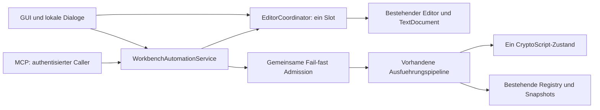

# MCP-00 – Exclusive Editor Coordination Design

Stand: **25.10.2026, Design Review R1 eingearbeitet**. **Designvorschlag zur Prüfung, keine Implementierungsfreigabe.** Produktentscheidung: ein sichtbarer Editor, ein gemeinsames Dokument, exklusive Übernahme durch MCP für einen zusammenhängenden Arbeitsauftrag. B2 bleibt zurückgestellt.

Dieses Dokument ersetzt oder ändert weder MCP-00-R1 noch die bisherigen MCP-01.4-Entscheidungen und Tests. Insbesondere bleiben R2/R4/R6/R7 im bisherigen Vertrag offen und MCP-01.4 BLOCKED. Eine engere Garantie wird hier ausdrücklich **zur Genehmigung vorgeschlagen**, nicht als bereits beschlossen behandelt.

## 1. Zusammenfassung und Entscheidungsbedarf

**Empfehlung D:** Ein hostinterner `EditorCoordinator` verwaltet genau eine Editorregistrierung und höchstens eine MCP-Übernahme. Diese Übernahme umfasst Lesen, mehrere revisionsgebundene Änderungen und mehrere einzeln bestätigte, serielle Ausführungen. Der Benutzer sieht denselben Editor und übernimmt nach Freigabe dasselbe Dokument mit dessen aktueller Undo-Historie. Es gibt keine zweite schreibbare Textkopie, keinen MCP-Runnerzustand und keine zusätzlichen Variablensammlungen.

Die Übernahme ist **kein dauerhaft gehaltener Interpreter-Lock**. Die bestehende nicht wartende Admission bleibt für einzelne Änderungen, Save-Commits und ganze Ausführungen bestehen. Zwischen MCP-Operationen ist die Ausführung idle, obwohl der Editor weiterhin MCP gehört. Ein angenommener Lauf bleibt Eigentum des Service, auch wenn HTTP-Wait, Übernahme oder Clientverbindung enden. Freigabe erfolgt erst nach den noch notwendigen Abschlussarbeiten am gebundenen Editor.

**Bibliotheksentscheidung:** Für den hier vorgeschlagenen **kontrollierten Hostvertrag H** ist eine Änderung von AvaloniaEdit voraussichtlich **nicht erforderlich**. Empfohlen wird, nach Vertragsreview die vorhandene 11er-Basis beizubehalten und H isoliert nachzuweisen. Das setzt vollständige Vermittlung der produktiven Schreibwege, kontrollierte native Kommandos und nicht mutierende/ausnahmekontrollierte Host-Observer voraus. Die technische Vollständigkeit dieser Integration ist noch nicht bewiesen. Ein blosses `IsReadOnly=true` erfüllt H nicht.

Für die **unveränderten direkten API-/Callbackgarantien** aus R2/R4/R6/R7 reicht auch mit exklusivem Benutzerzugriff ein Host-Coordinator **nicht**. Die nachgewiesenen Bibliotheksgrenzen bleiben bestehen; hier wäre weiterhin eine Bibliothekskorrektur beziehungsweise eine andere technisch abgesicherte Editorgrenze erforderlich. Ein Wechsel auf unverändertes AvaloniaEdit 12 löst das nicht. B1 ist ein isolierter positiver Kernnachweis mit geändertem Bibliothekscode, keine produktive Behebung.

**Zur Entscheidung stehen:**

1. **D1 – Vertragsumfang H:** Die Garantie gilt für **sämtliche produktiv verwendeten CryptoWorkBench- und nativen GUI-Schreibpfade**, einschliesslich ihrer internen Bibliotheksaufrufe, asynchronen Fortsetzungen und eigenen Ereignisbehandlungen. Die Inventur muss diese vollständige Menge erfassen; ein noch nicht vermittelter Produktpfad ist eine offene Nachweislücke, keine Vertragsausnahme. Nur direkte **Fremdzugriffe** auf öffentliche AvaloniaEdit-APIs ausserhalb dieser Produktpfade sowie fremde mutierende/werfende Bibliotheksabonnenten bleiben ausserhalb von H. Gegenüber dem bisherigen direkten Setter-/Callbackvertrag ist dies weiterhin eine genehmigungspflichtige Einschränkung; die bisherigen R2/R4/R6/R7-Findings und Tests gelten dadurch nicht als behoben.
2. **D2 – Bedienvertrag:** Während MCP-Besitz keine GUI-Editoränderungen, keine GUI-Ausführung, Variablenänderung, History-Einsetzung, Dateiöffnung oder GUI-Speicheraktion. Lesen, Suchen ohne Ersetzen, Scrollen, Auswahl/Kopieren, lokale Freigabedialoge, Cancel und Rückforderung bleiben verfügbar. Der zusätzliche Ausschluss von GUI-Zustandsmutationen ist ein Vereinfachungsvorschlag über die ausdrücklich verlangte Editorsperre hinaus.
3. **D3 – Lease/Lifecycle:** Anfangs-Lease von zehn Minuten, explizit erneuerbar, keine absolute Höchstdauer im MVP. Ohne rechtzeitige Erneuerung läuft sie ab; lokale Rückforderung ist jederzeit möglich. Rückforderung/Ablauf entziehen weitere MCP-Schreibrechte, entsperren aber nicht vor notwendigem Drain. Bereits angenommene Ausführungen behalten ihre eigene Lifecycle-, Cancellation- und Finalisierungslogik. Details in §§4/6.
4. **D4 – Protokoll:** Drei neue Tools und Besitzfelder in den bestehenden Editoroperationen; versionierter Vertragswechsel, kein stilles Ergänzen des strikten v1-Schemas (§8).

### 1.1 Evidenzkennzeichnung und geprüfter Stand

Die F-/E-Befunde zu Produktcode und Bibliotheken stammen aus der ursprünglichen Designanalyse vom 25.10.2026. Design Review R1 überarbeitet ausschliesslich diesen Bericht; es ist weder ein erneuter Laufzeitnachweis noch eine Änderung der bisherigen Findings. Für diese Revision wurden 757 vorhandene Dateien einschliesslich dieses Berichts als Vergleichsbasis erfasst.

- **F – belegte Tatsache:** in dieser Runde gelesener aktueller Quellstand oder Repositorymetadaten.
- **E – vorhandene experimentelle Evidenz:** Ergebnisse früherer Berichte/Artefakte, in diesem Auftrag nicht erneut ausgeführt.
- **D – Designvorschlag:** Sollverhalten nach ausdrücklicher Entscheidung und späterer Umsetzung. Alle Zustandsmodelle, Sequenzen, Tools und Akzeptanzkriterien unten sind D, sofern nicht anders markiert.
- **A – noch nicht geprüfte Annahme:** benötigt isolierten oder nativen Nachweis; keine heutige Produktgarantie.

**F:** Untersucht wurde der tatsächliche Worktree `C:/Users/stefa/Documents/projects/GITHUB/CryptoWorkBench-Mcp`, Branch `feature/mcp-server`, HEAD `bd48c57fa4cae9dc733da7d4521eb6f79a9017f0`. Der Chat-Arbeitsordner unter `Documents/ChatGPT/CryptoWorkBench-Mcp` ist ein separates Artefakt-Repository und nicht die Produktquelle. Keine `AGENTS.md` wurde im Zielworktree oder den geprüften Elternverzeichnissen gefunden.

**F, ursprüngliche Designanalyse:** Vor deren Beginn wurden 756 vorhandene versionierte und nicht ignorierte unversionierte Dateien per SHA-256 erfasst. Sechs versionierte Dateien waren geändert: `WorkbenchAutomationRegistry.cs`, `WorkbenchAutomationService.cs`, `CryptoScriptEditViewModel.cs`, `SidebarViewModel.cs`, `CryptoScriptEditView.axaml` und dessen Codebehind. Der Diff umfasst 116 Ergänzungen/56 Entfernungen; Staging war leer. Hinzu kommen unversionierte EditorBridge-/Editoroperations-/Save-/Control-/Testdateien und die vorhandenen MCP-01.4-Berichte, einschliesslich B1, B2, U0 und Post-U0. Dieser Designauftrag verwendet ausdrücklich diesen Arbeitsstand, nicht nur HEAD.

**F:** Produktiv gepinnt sind Avalonia 11.3.20 und Avalonia.AvaloniaEdit 11.4.1, siehe [Projektdatei](../../CryptoWorkBenchAvalonia/CryptoWorkBenchAvalonia.csproj). Kein Paketwechsel wurde vorgenommen. Es gab in dieser Runde keine Builds, Restores, neuen Laufzeittests oder Änderungen an bestehenden Proben.

Primäre Repositorybelege:

| Quelle | Verwendung |
| --- | --- |
| [MCP-00-Architektur](MCP-00-architecture.md), §§4–7 | Identität/Revision, Save, Admission, Security, Lebensdauer, Toolkatalog |
| [MCP-00-Plan](MCP-00-implementation-plan.md), Schritt 4, A04/A09/A18/A21/A22 | Bisherige Abnahmeverträge und Ausgabegrenze |
| [MCP-01.4-Editorentscheidung](MCP-01.4-editor-architecture-decision.md), §§2–5 | Direkte API-Garantien; vollständige Mutationsinventur; Alternative A/B |
| [MCP-01.4-Review](MCP-01.4-review.md), Final Re-Review/Korrekturrunde 2 | R2/R4 offen, R6/R7 reproduziert; Raw-Undo gesondert ausgeschlossen |
| [B1-Machbarkeit](MCP-01.4-B1-feasibility.md), §§6–10 | Frühe Bibliothekszulassung, positive Kernproben und offene Compositepfade |
| [U12](MCP-01.4-avalonia12-feasibility.md), [U0](MCP-01.4-U0-property-feasibility.md), [Post-U0](MCP-01.4-post-U0-architecture-options.md) | Upgrade löst Grundproblem nicht; zusätzliche Property-/Bindinggrenzen |
| [EditorBridge](../../CryptoWorkBenchAvalonia/Services/Automation/EditorBridge.cs), [WorkbenchTextEditor](../../CryptoWorkBenchAvalonia/Controls/WorkbenchTextEditor.cs) | Tatsächliche Identitäts-/Revisionsbeobachtung und späte Mutationsguards |
| [Editoroperationen](../../CryptoWorkBenchAvalonia/Services/Automation/WorkbenchEditorOperations.cs), [Save-Commit](../../CryptoWorkBenchAvalonia/Services/Automation/WorkbenchSaveCommit.cs) | Aktuelle Revalidierungen, Output-Insert, lokale Bestätigung und Drain |
| [Registry](../../CryptoWorkBenchAvalonia/Services/Automation/WorkbenchAutomationRegistry.cs), [HostQueue](../../CryptoWorkBenchAvalonia/Services/InterpreterHostQueue.cs), [Pipeline](../../CryptoWorkBenchAvalonia/Services/Automation/WorkbenchExecutionPipeline.cs) | Annahme, Besitzer, Ergebnisaufbewahrung, Fail-fast und Runnerfinalisierung |

### 1.2 Eingearbeitete Reviewkorrekturen

Die folgenden **Reviewpunkte R1–R4 dieses Auftrags** sind von den historischen **MCP-01.4-Findings R2/R4/R6/R7** zu unterscheiden.

| Reviewpunkt | Korrektur in diesem Vorschlag |
| --- | --- |
| R1 – Lease-Fristen | Zehn Minuten ab Übernahme und je erfolgreicher expliziter Erneuerung; keine absolute Höchstdauer. Zustände, Diagramme, Toolantworten und EC13 angepasst; Run-Lifecycle und Ergebnisretention bleiben getrennt |
| R2 – Vertragsgrenze H | Alle produktiv verwendeten Host- und nativen GUI-Schreibpfade sind verpflichtend erfasst; ausschliesslich direkte Fremdzugriffe bleiben ausgenommen. Historische Findings/Tests bleiben offen/unverändert |
| R3 – Machbarkeits-Gate | Isolierte Untersuchung mit Schwerpunkt EC04, EC05, EC06, EC16, EC19 und EC26 in §7.4 abgegrenzt; fehlende Kontrolle eines benötigten nativen Pfads erfordert erneuten Architekturentscheid vor Produktimplementierung |
| R4 – Editor-Gesamtausführung | Aktuelle Output-Einfügung als vor Abnahme zwingend zu korrigierende Abweichung festgehalten; interaktiver GUI-Return-Anchorpfad bleibt getrennt |

## 2. Gegenüberstellung bisherige/neue Architektur

| Aspekt | Bisheriger Vertrag/Stand F | Vorschlag D und Vertragswirkung |
| --- | --- | --- |
| Text und Variablen | Echter Editor; gemeinsamer prozessweiter CryptoScript-Zustand | Unverändert; immutable Snapshots sind Transport-/Ausführungseingaben, keine zweite editierbare Wahrheit |
| Exklusivität | Admission pro Mutation/Run/Save; keine auftragsübergreifende MCP-Übernahme | Ein Besitzrecht über mehrere Aufrufe; einzelne Operationen zusätzlich seriell zulassen |
| Benutzer während Run | MCP-00 §5.1 erlaubt normale Dokumenteingabe während kopierter Ausführung | Während MCP-Besitz gesperrt. Im GUI-Besitz bleibt das bisher erlaubte Weitereditieren bei GUI-Läufen möglich; Save-Commit weiterhin streng gesperrt |
| Interpreter | Ein Gate, neue Runner pro Einheit, gemeinsamer Variablenbestand | Unverändert; kein Runner pro Lease oder Client |
| Warteschlange | `InterpreterHostQueue.Reserve()` verwendet bereits `Wait(0)` | Beibehalten; der historische Klassenname bedeutet heute keine wartende Auftragsqueue |
| Reentrancy | Breite direkte Setter-/Callbackgarantien, teilweise unerfüllt | Frühe Ablehnung am Hosteingang; kein vollständiger Schutz beliebiger erreichbarer Bibliotheks-APIs. D1 erforderlich |
| Dokumenttausch | Registrierter Wechsel erzeugt neue editorId; direkte Properties Bestandteil bisheriger Untersuchungen | Ein fester Dokumentverbund pro Übernahme; kontrollierter Wechsel nur im GUI-Idle. Keine frei schreibbaren Teilbindungen als Hostvertrag. D1 erforderlich |
| Undo/Redo | Native Historie; jeder MCP-Edit eine Gruppe | Erhalten; keine leaseweite Gruppe und keine Undo-Gruppe über Dialog/HTTP-await |
| Ausführung | Revisions-/State-Bindung, lokale Bestätigung, HTTP-unabhängige Finalisierung | Unverändert, ergänzt um Besitzprüfung vor Annahme und vor Start |
| Ergebnisse | Registry, begrenzte immutable Resultate, Tombstones | Unverändert; Besitzfreigabe löscht Resultate nicht und macht sie nicht öffentlich |
| Mehrfenster | Nicht implementiert; globaler Zustand | Ein Slot jetzt. Identitäten bleiben im Vertrag, damit später mehrere Slots möglich sind; dann weiterhin ein Prozess-Gate, solange CryptoScript global ist |

Die Vereinfachung liegt vor allem im Bedien- und Ownershipmodell. Sie macht keine bestehende Bibliothekslücke technisch unwirksam. Save-Snapshot, Ausführungsfinalisierung, Geheimnisschutz und kontrollierte asynchrone GUI-Effekte bleiben erforderlich.

## 3. Komponenten und Verantwortlichkeiten

### 3.1 Ein Coordinator im vorhandenen Host

| Komponente | Verantwortung D |
| --- | --- |
| `EditorCoordinator`, einmal im Avalonia-Host | Ein Slot, Besitz, Leasefristen, Kontrollgeneration, einzelne aktive Editoroperation, gebundene Pending-Effekte und Freigabeabschluss. UI-Thread besitzt den veränderlichen Editorzustand |
| Vorhandene `EditorBridge` | Registrierung, editorId, Textversion/Revision, tatsächlicher Dokumentverbund und Snapshots. Unter dem Coordinator weiterverwenden oder später gezielt darin aufgehen lassen; keine zweite Registry mit eigener Revision |
| Host-Editoradapter/`WorkbenchTextEditor` | Typisierte kontrollierte Änderungen, UI-Commandgrenzen und native Undo-/Anchorfunktion. Kein Runner, keine Variablen, keine generelle Bibliothekspolicy behaupten |
| `WorkbenchAutomationService` mit bestehender Registry | Autorisierung, Gesamtadmission, Annahme/Deduplizierung von Läufen, Bestätigung, Deadline, Ergebnis/Cancel/Retention. Die Lease ergänzt diesen Service, ersetzt ihn nicht |
| `InterpreterHostQueue` + `InterpreterExecution` | Bestehende nicht wartende Admission und exklusiver Core-Scope; schützt Parsing, Ausführung und Zustandsaufnahme |
| `WorkbenchExecutionPipeline` | Parserreset, sequenzielle Runner, Password-Callbackdrain, Print/Info und sichere Projektion. Ein Variablenbestand bleibt massgeblich |
| View/VM/Sidebar/Completion | UI zeigt abgeleiteten Besitz-/Busy-Status und leitet Aktionen an kontrollierte Hosteingänge. Keine selbständige zweite Sperrwahrheit in `IsExecuting`/Commandflags |
| MCP-Transport/Abstractions | Hostneutrale DTOs, Schemas, Auth und Toolmapping. Kein Avalonia-/ViewModel-/Interpreterzugriff aus dem Transport |



### 3.2 Admission und Serialisierung

**F:** `Reserve()` weist konkurrierende Operationen unmittelbar ab; `RunAdmittedAsync` startet angenommene Arbeit ohne cancellable Task.Run-Token und unter unterdrücktem Caller-ExecutionContext. Die Registry hält die Reservation über Ressourcenbereinigung, terminale Veröffentlichung und Retentionpflege. Die Pipeline wartet notwendige Passwortcallbacks ab. Das ist die zu erhaltende Basis, kein neu zu erfindender Scheduler.

**D:** Ownershipprüfung und bestehende Admission beantworten unterschiedliche Fragen: „Darf dieser Aufrufer am Editor arbeiten?“ und „Kann diese Mutation beziehungsweise Ausführung jetzt beginnen?“. Die Lease reserviert **nicht** das Semaphore für die ganze Unterhaltung. Andernfalls würden die eigenen Folgeaufrufe an der bisherigen Admission scheitern oder einen gefährlichen pauschalen Bypass benötigen.

Neue editorbezogene Operationen werden auf dem UI-Dispatcher in einem kurzen Schritt auf Caller, Lease, Generation, Identität, Revision und freie lokale Operation geprüft. Die bestehende Admission wird nicht wartend erworben und bei Fehlschlag vollständig freigegeben. Noch einmal validieren, bevor der private Operationsdatensatz veröffentlicht wird. Während einer bereits angenommenen Ausführung erfolgen erforderliche Präsentationsaktionen über deren private gebundene Autorisierung; sie nehmen keine zweite Admission und sind nicht als öffentliche Reentrancy zugelassen.

Auch Acquire nimmt die bestehende Admission **kurz** bis zur vollständig publizierten Besitzübertragung; die Reservation endet mit dem Übergang, nicht erst mit Release. Umgekehrt müssen GUI-Run-/Clear-/Variablen-/Saveeingänge ihren zulässigen Besitz nach Erwerb derselben Admission nochmals prüfen. So kann kein konkurrierender GUI-Auftrag zwischen Idle-Prüfung und Besitzübertragung starten. Editorbezogene Übergänge werden auf UI serialisiert; für reine Registry-/Zustandszugriffe steht ein atomar publizierter Besitzstand zur Verfügung. Kein bisheriger direkter Serviceeingang darf diese zusätzliche Prüfung umgehen.

Keinen Monitor über `await` oder einen Dispatcheraufruf halten. Coordinatorzustand ist UI-eigen; Registry-Locks schützen nur kurze Registrydatenzugriffe. Worker dürfen niemals unter Registry-Lock synchron auf UI warten. Status wird als unveränderliches zusammenhängendes Abbild publiziert. Timer posten einen gebundenen Übergang auf UI; jede neue Operation prüft zusätzlich die monotone Frist, damit verspätete Timer keine Zulassung nach Ablauf ermöglichen.

**Empfehlung gegen Queue:** Eine Queue erhöht die Zahl veralteter Revisionen, ausstehender Freigaben und unklarer Clientabsichten. Es gibt derzeit keinen Bedarf, mehrere Runs vorzumerken. Ein ganzer ScriptBook-Lauf hält weiterhin einen Scope über alle Zeilen; zwischen Zeilen darf kein anderer Lauf oder Variablenedit eintreten. Ein zweiter Execute desselben Besitzers erhält ebenfalls `Busy`. Gleiche bereits angenommene executionId ist davon ausgenommen: sie fragt den vorhandenen Auftrag ab und führt nicht neu aus.

Warten auf einen **bereits besessenen Abschluss** bei Release/Shutdown ist Drain, keine Queue neuer Arbeit. Eine spätere Mehrfensterfunktion begründet heute weder Queue noch zusätzliche Runnerzustände. Für einen späteren Queuemaßstab wären Kapazität, Fristen, Fairness, neue Bestätigung und Revisionsneubindung separat zu entscheiden.

## 4. Editorbesitz- und Zustandsmodell

### 4.1 Identitäten und getrennte Lebensdauern

| Identität/Zustand D | Zweck |
| --- | --- |
| `instanceId` | Prozesslauf; alter Prozess darf keine neuen Aufträge autorisieren |
| `editorId` | Bereits vorhandene Identität der aktiven Dokumentregistrierung. Ein Dokument-/Editorwechsel erhält eine neue ID; kein zusätzliches öffentliches documentId nötig |
| Dokumentreferenz + Lifecyclegeneration | Interne Bindung an die reale Instanz und den Attach-Zyklus. A→B→A darf alte Fortsetzungen nicht wieder gültig machen |
| `revision` | Vorhandener monotoner Textversionszähler als Dezimalstring. Keine Rücksetzung bei Undo und keine Erhöhung allein durch Leasewechsel; No-op ohne neue Textversion |
| `stateVersion` | Bestehende Version der abgeschlossenen Interpreter-/Zustandsgrenze; kein Textzähler |
| `leaseId` | Vom Host erzeugte zufällige UUID der einen Übernahme; keine Authentifizierung und kein Ersatz für Rechte |
| Besitzer | Vertrauenswürdig erzeugtes `(PrincipalId, CallerSource.Mcp, ActivationEpoch)` wie bei der Registry. Nicht HTTP-Verbindung, frei gewählter Clientname oder übermittelte ownerId |
| `controlGeneration` | Interne monotone Generation bei Acquire, Entzug und Lifecyclewechsel; invalidiert ältere Clipboard-/History-/Save-/GUI-Fortsetzungen auch bei gleicher Textrevision |
| `leaseVersion` | Dezimalstring für Erneuerungs-CAS; getrennt von Dokumentrevision und controlGeneration |
| `executionId` | Bestehende einmalige Ausführungsidentität. Eine Lease kann null, eine oder mehrere sequenzielle executionIds enthalten |

Besitz kann länger als ein Lauf dauern; ein Lauf samt Drain kann länger als die restliche Leasezeit dauern. Weder eine neue leaseId noch ein anderer Runner erzeugt neue Variablen. Verschiedene Prozesse mit denselben Credentials gelten als derselbe Principal; eine Unterscheidung erfordert getrennt lokal gepaarte Credentials. Eine MCP-Session-ID ist dafür ungeeignet, zumal der vorhandene Probe-Transport stateless arbeitet.

### 4.2 Zustände

Ownership: `unavailable | gui | acquiring | mcp | releasing | faulted`. Davon getrennt bestehen die vorhandenen Ausführungszustände und eine kurze Editoroperation (`none | edit | saveCommit | lifecycle`). `awaitingConfirmation` gehört zum konkreten Edit/Run, nicht zu einem neuen Runnerzustand.

| Übergang D | Bedingungen und Wirkung |
| --- | --- |
| unavailable → gui | Tatsächlich angehängten, konsistenten Verbund registrieren; neue Lifecyclegeneration. Zweite aktive Registrierung wird abgelehnt, nicht still zum „aktuellen“ Editor gemacht |
| gui → acquiring → mcp | Auth/Rechte/instance/editor/revision gültig; keine Ausführung, kein Save-Commit, kein offenes Bibliotheksupdate und kein unkontrollierter noch schreibfähiger GUI-Task. Besitz/Completion zuerst publizieren, alte GUI-Intents invalidieren, Popups schliessen und Schreibpfade sperren, nach Callbackgrenzen erneut validieren; erst danach Erfolg |
| acquiring → gui/unavailable/faulted | Fehler oder Lifecycleänderung: keine verwendbare Lease zurückgeben. UI-Sperre kontrolliert zurücknehmen; bei unklarer Konsistenz faulted statt Erfolg |
| mcp → mcp | Besitzer führt einzelne zulässige Operation aus oder erneuert vor Ablauf explizit um zehn Minuten ab Annahme der Erneuerung. Keine absolute Höchstdauer und kein automatischer Wechsel aufgrund des Gesamtalters. Jeweils erneute Rechte-/Frist-/Identitätsprüfung; kein Reentrancyrecht aus Besitz |
| mcp → releasing | Release, Ablauf, Rückforderung, Widerruf/Disable/Shutdown/Detach. Schreibrecht sofort ungültig, Generation steigt; laufende angenommene Arbeiten werden serviceeigen finalisiert |
| releasing → gui/unavailable | Kein laufender gebundener Edit, Dialogcommit, Ausführungseffekt, Callback oder Save-Commit mehr; Dokumentzustand konsistent. GUI erst dann wieder beschreibbar; kein automatisch angewandter alter Intent |
| beliebig → faulted | Nicht erklärbare Bindungs-/Update-/Revisionsinkonsistenz. Weitere Mutationen sperren, Zustand sichtbar machen; keine erzwungene Freigabe durch Zähler-/Stackreparatur |

`acquiring` ist ein kurzer Übergang, keine wartende Reservierungsqueue. Ein noch laufender nativer Paste oder Drag mit möglichem Späteffekt führt zunächst zu `Busy`. Nicht mutierende Vorbereitungen können durch Generation entwertet werden; der spätere Callback muss das vor jeder Wirkung prüfen. Nicht beobachtbare native Fortsetzungen dürfen nicht einfach als beendet gelten.

### 4.3 Rechte und Zeitmodell

Acquire verlangt `editor.control` (neuer, lokal erteilter Grant), `editor.write` und gültige Prozess-/Editor-/Revisionsbindung. Lesen bleibt an `editor.read` gebunden; Lease-Antworten enthalten keinen Text ohne dieses Recht. Execute braucht zusätzlich `execution.run`, eine gültige Besitzerlease, expectedStateVersion und die bestehende lokale Einzelauftragsbestätigung. Vollersatz behält seine bisherige Vorher-/Nachher-Bestätigung; eine Lease ist keine pauschale Schreib-/Run-Freigabe.

Acquire ist die explizite Übernahmehandlung; vorgeschlagen wird kein zusätzlicher Dialog pro Acquire neben dem bewusst lokal erteilten control-Grant und der sichtbaren Besitzanzeige. Ein zusätzlicher Übernahmedialog wäre eine Produktoption, keine Voraussetzung dieses Entwurfs. Die GUI zeigt Clientbezeichnung, Besitz, Ablauf und „Zurückfordern“; dabei bleibt der Button auch bei deaktivierter Editorbearbeitung bedienbar.

**D, revidierter Fristvorschlag:** Die Anfangs-Lease beträgt **zehn Minuten ab erfolgreicher Übernahme**. Jede rechtzeitig angenommene explizite Erneuerung setzt die Frist auf **zehn Minuten ab Annahme dieser Erneuerung**, nicht zusätzlich auf die vorherige Restlaufzeit. **Keine absolute Höchstdauer im MVP:** Bei rechtzeitiger Erneuerung kann dieselbe Lease fortbestehen; ohne Erneuerung läuft sie ab. Textlesen, Statuspolling, Editieren und Ausführen verlängern sie nicht implizit. Monotone Zeit entscheidet, UTC-Zeitpunkte dienen der Anzeige. Eine abgelaufene oder entzogene Lease kann nicht erneuert oder durch einen Retry wiederbelebt werden; nach abgeschlossenem Release wäre eine neue Übernahme nötig. Lokale Rückforderung bleibt jederzeit möglich, auch bei fortgesetzten Erneuerungen; ihre Ausführung folgt dem Drain-Vertrag und verspricht kein sofortiges Ende eines synchronen Runners.

Die separate Run-Deadline bleibt unverändert: Default 30 Sekunden, erlaubte 1–120 Sekunden ab Annahme einschliesslich Bestätigung. Bereits angenommene Ausführungen behalten ihre eigene Lifecycle-, Cancellation- und Finalisierungslogik. Leaseerneuerung verlängert niemals einen Lauf; Leaseablauf ersetzt weder Jobdeadline noch serviceeigene Finalisierung. Auch die Ergebnisretention von 15 Minuten ab terminalem Abschluss (§8.3) ist keine Leasegrenze.

HTTP-Disconnect wird nicht als verlässlicher Besitz-Lifecycle benutzt. Solange die Lease gilt, kann derselbe berechtigte Principal wieder anknüpfen. Ohne Erneuerung läuft sie aus. Der Ablauf widerruft neue Arbeit und leitet Release ein; ein bereits angenommener Lauf wird dadurch **nicht automatisch abgebrochen**, sondern endet nach seiner eigenen Deadline/Cancel-Policy. So bleibt die geforderte HTTP-Unabhängigkeit eindeutig.

### 4.4 Operationen während MCP-Besitz

| Aktion | Verhalten D |
| --- | --- |
| Besitzer: Insert/Append/Replace | Exakte Revision, ggf. Bestätigung, danach revalidieren; eine native Undo-Gruppe je wirksamer Änderung. Keine synthetischen Tastenevents |
| Besitzer: zweiter mutierender Aufruf während Edit/Run/Save | Sofort Busy, keine Vormerkung. Reentrantes Hostkommando ebenso |
| Anderer MCP-Principal | Keine Übernahme/Änderung/Freigabe. Status und berechtigte Snapshots bleiben lesbar; keine fremde leaseId oder Ergebnisdaten offenlegen |
| Benutzer: Tippen/IME, Cut/Paste, Löschen, Undo/Redo, Completion, History, Replace, Drop | Vor tatsächlicher Aktion abweisen; nach Freigabe nicht automatisch nachholen |
| Benutzer: Lesen, Scrollen, Auswahl, Copy, reine Suche | Möglich; kein Dokument-/Undoeffekt. MCP-Edits bleiben offset-/revisionsbasiert und hängen nicht von aktueller Auswahl ab. Auswahlabhängige asynchrone GUI-Intents zusätzlich an Auswahlgeneration binden |
| GUI-Run/Open/Clear/Variablenedit/Save | Während Besitz bzw. Release abweisen. Rückforderung ist der Weg zurück zur interaktiven Arbeit |
| Lokale Replace-/Run-/Passwortdialoge | Bedienbar; Dialogantwort ist keine Übernahme des Editors durch GUI. Entzug invalidiert ausstehende Bestätigung vor Commit/Runnerstart |
| Print/Info/Historyaufzeichnung eines angenommenen Runs | Als gebundene serviceeigene Wirkung behandeln; keine öffentliche Reentrancy. Aufzeichnung von History ist nicht deren Einsetzung in den Editor |

### 4.5 Reentrancy und Abschluss

Der private synchrone Operationsdatensatz wird **vor** jedem beobachtbaren Property-/Commandcallback veröffentlicht. Ein Callback, der erneut die öffentliche Host-API aufruft, erhält Busy; auch mit richtigem Principal und leaseId. Kein `AsyncLocal`-/ThreadStatic-„MCP darf schreiben“-Flag und kein öffentlicher `Action<TextDocument>`-Escape. Nur der private Adapter verwendet die native Dokumentreferenz und native Undooperationen.

Hosteigene Observer aktualisieren Snapshots/Präsentation, mutieren jedoch nicht reentrant das Dokument und lassen keine Exceptions unkontrolliert in Bibliotheksupdates entweichen. Vorhandene Normalisierungen müssten als eigene später ausdrücklich angeforderte Hostoperation mit neuer Revisionsprüfung modelliert werden; kein automatisches rekursives Nachholen. Das betrifft auch Caret-, Selection-, Anchor-, Property-, Completion- und Historycallbacks, nicht nur `Changed`.

Ablehnung geschieht vor `BeginUpdate`, Undo-Pop, Textsetter und Clipboard-/Auswahleffekt. Nicht erst in `Changing` oder `UpdateStarted` werfen und dann durch `EndUpdate` „reparieren“. Die vorhandenen späten Guards sind keine Grundlage der neuen Garantie und müssen in einem späteren separaten Implementierungsauftrag neu bewertet werden.

Bei Fehlern nach realer Textwirkung wird die ursprüngliche Identität und tatsächliche Revision beobachtet; kein wirkungsloses Busy/Retry-Signal und kein Rollbackversprechen. Bei konsistent abgeschlossenem Edit kann ein Ergebnis den angewandten Stand und eine sichere Warnung melden. Bei unklarem Abschluss: faulted, sichere Fehlerantwort mit Hinweis auf erforderliches Neulesen, keine automatische Wiederholung. Die genaue DTO-Form dafür ist Teil des späteren Schema-Reviews. Ein gültiger No-op berührt weder Undo/Caret noch Revision, bleibt aber besitz- und revisionspflichtig.

## 5. Sequenzdiagramme für Übernahme, Bearbeitung, Ausführung und Freigabe

### 5.1 Übernahme

```mermaid
sequenceDiagram
  participant C as MCP-Client
  participant S as Automation-Service
  participant E as EditorCoordinator/UI
  participant G as GUI
  C->>S: acquire_editor(acquisitionId, instance, editor, revision)
  S->>S: Auth, Grants, Epoche, Deduplizierung
  S->>E: TryAcquire, ohne Warten auf fremde Arbeit
  E->>E: Identitaet/Revision, Idle und Pending-Effekte pruefen
  alt Konflikt oder noch schreibfaehige Fortsetzung
    E-->>C: Busy / RevisionConflict / EditorUnavailable
  else zulassbar
    E->>E: acquiring und Completion publizieren; Generation erhoehen
    E->>G: Bearbeitung sperren, Popups und alte Intents invalidieren
    E->>E: Nach Callbacks revalidieren; mcp + Lease publizieren
    E-->>C: leaseId, expiresAt = Uebernahme + 10 min, leaseVersion, editorId, revision
    Note over C,E: Keine absolute Hoechstdauer; nur explizites Renew verlaengert
    C->>S: renew_editor(leaseId, expectedLeaseVersion), vor Ablauf
    S->>E: Besitzer, Frist und Leaseversion atomar pruefen
    E->>E: expiresAt = Renew-Annahme + 10 min; leaseVersion erhoehen
    E-->>C: Renew-Receipt mit neuer Frist und Leaseversion
  end
```

Verlust der Acquire-Antwort hebt die Übernahme nicht auf. Derselbe acquisitionId-Aufruf gibt dieselbe noch aktive Lease zurück; eine terminale acquisitionId kann keine neue Übernahme erzeugen (§8). Der gezeigte Renew-Zweig setzt eine noch gültige, nicht entzogene Lease voraus; sonst wird ohne Friständerung abgewiesen. Eine verlorene Renew-Antwort wird mit demselben CAS wiederholt und verlängert die Frist nicht nochmals. Ohne rechtzeitiges Renew gilt die Freigabesequenz in §5.4.

### 5.2 Mehrere Bearbeitungen innerhalb einer Übernahme

```mermaid
sequenceDiagram
  participant C as MCP-Client
  participant S as Service/Coordinator
  participant U as Lokale GUI
  participant D as Reales TextDocument
  C->>S: update_editor(leaseId, editorId, expectedRevision=r1, replace)
  S->>S: Besitzer, Frist, Revision, Admission; Edit reservieren
  S->>U: Konkreten Vorher/Nachher-Inhalt bestaetigen
  U-->>S: Zustimmung
  S->>S: Rechte, Lease, Generation, Identitaet und Revision erneut pruefen
  S->>D: Synchroner Commit in einer Undo-Gruppe
  D-->>S: Version/Ereignisse; keine Host-Schreibreentrancy
  S-->>C: Gleiche editorId, revision=r2; Einzelreservation frei
  C->>S: update_editor(gleiche Lease, expectedRevision=r2, append)
  S->>D: Nach erneuter Zulassung exakt anhaengen
  S-->>C: revision=r3; Lease bleibt aktiv
```

Ablehnung des Dialogs lässt Text und Historie unverändert. Der Coordinator hält keine Bibliotheksupdategruppe während des Dialogs. Ein Rückforderungs- oder Ablaufereignis zwischen Dialog und Commit verhindert die Änderung.

### 5.3 Ausführung und HTTP-Disconnect

```mermaid
sequenceDiagram
  participant C as MCP-Client
  participant S as Service/Registry
  participant E as Coordinator/UI
  participant P as Gemeinsame Pipeline
  C->>S: execute_editor(leaseId, executionId, revision, stateVersion)
  S->>E: Besitzer/Identitaet/Revision pruefen, Snapshot binden
  S->>S: Admission und atomare Annahme; eigener Task/Deadline
  S->>E: Lokale Ausfuehrungsbestaetigung
  E-->>S: Zustimmung; Rechte/Lease/Revision/Zustand revalidiert
  S->>P: Ein Host-Scope fuer das gesamte ScriptBook
  Note over C,S: HTTP-Wait kann jetzt enden, ohne den Job abzubrechen
  Note over S,E: Lease-Renew oder -Ablauf ersetzt keinen Job-Lifecycle
  P->>P: Parserreset, serielle Runner, gemeinsamer Variablenbestand
  P->>E: Gebundene UI-/Passwortpraesentation
  P-->>S: Ergebnis plus Teilzustand; Callbacks drainen
  S->>S: Ressourcen/Resultat/Retention finalisieren; Admission freigeben
  S->>E: Gebundene Editorwirkungen abgeschlossen
  C->>S: get_execution(executionId), ggf. nach Reconnect
  S-->>C: Berechtigtes Ergebnis desselben Laufs
```

Auch Disconnect während einer bereits serviceeigenen Bestätigung beendet den Job nicht. Läuft die Lease ab oder fordert der Benutzer vor Runnerstart zurück, startet der noch ungestartete Lauf nicht mehr; er wird serviceeigen terminalisiert. Nach Runnerstart reichen die private Jobautorisierung und die bestehenden Abbruch-/Deadlinebedingungen zum Abschluss; ein abgelaufener externer Besitz darf den Drain nicht abschneiden.

### 5.4 Freigabe und Rückforderung

```mermaid
sequenceDiagram
  participant A as Besitzer oder lokaler Benutzer
  participant E as Coordinator/UI
  participant S as Service/aktiver Job
  participant G as GUI-Editor
  A->>E: release_editor oder jederzeit lokal Zurueckfordern
  Note over E: Auch ohne Renew bei expiresAt wird releasing eingeleitet
  E->>E: releasing publizieren; Lease sperren; Generation erhoehen
  alt Lokale Rueckforderung mit aktivem Lauf
    E->>S: Expliziter User-Cancel, kooperativ
  else Normale Freigabe oder Leaseablauf
    E->>S: Angenommenen Lauf regulär finalisieren lassen
  end
  E-->>A: ReleaseReceipt(releasing oder released)
  S-->>E: Job und gebundene UI-/Callbackwirkungen vollstaendig beendet
  E->>E: Konsistenz und offene Editoroperationen pruefen
  E->>G: Gleiches Dokument wieder bearbeitbar; Besitz gui
```

Ohne aktive Arbeit kann die Freigabe unmittelbar abschliessen. Der Receipt ist kein vorzeitiges Entsperrversprechen. Weitere Releaseaufrufe desselben berechtigten Besitzers sind idempotent; fremde Aufrufer können damit keine aktuelle Lease beenden.

## 6. Fehler-, Abbruch- und Lifecycle-Behandlung

### 6.1 Ereignisse und Wiederherstellung

| Ereignis | Verhalten D |
| --- | --- |
| HTTP-Abbruch vor atomarer Acquire-/Execute-Annahme | Kein neu angenommener Auftrag; Race über gleiche acquisitionId/executionId auflösen |
| HTTP-Abbruch nach Annahme | Nur Antwort-Wait endet. Leasefrist und serviceeigener Run laufen weiter; kein automatischer Replay |
| Edit-Requestabbruch vor Commit | Ausstehende Bestätigung/Einzeloperation beenden; Lease bleibt bis Release/Ablauf. Nach synchronem Commit kann die verlorene Antwort die Wirkung nicht rückgängig machen |
| Einzelner Syntax-/Runfehler | Resultat und Teilzustand finalisieren; Lease kann für Korrekturen weiterbestehen. Kein Variablenrollback |
| Leasefrist ohne rechtzeitige Erneuerung erreicht | Neue leasepflichtige MCP-Operationen sperren, ausstehende nicht angenommene Intents verwerfen, ungestartete leaseabhängige Bestätigung nach dem bestehenden Vorstartvertrag beenden. Jeder bereits angenommene Job wird weiterhin serviceeigen unter seiner Lifecycle-/Cancellation-/Finalisierungslogik abgeschlossen; kein automatischer Abbruch eines gestarteten Jobs allein durch Leaseablauf. Keine absolute Höchstdauer als weiterer Ablaufgrund |
| Normales Release bei aktivem Run | Keine automatische Ausführungscancellation; releasing bis vollständigem Abschluss. Für vorzeitiges Laufende separat cancel_execution |
| Lokales „Zurückfordern“ | Sofortige Besitzerentmachtung; Editor bleibt bis Drain schreibgesperrt. Aktiven MCP-Lauf mit `user` kooperativ abbrechen, konkrete Bestätigungen schließen/entwerten; kein hartes Stoppen synchroner Cryptooperationen |
| Token-/Epochenwiderruf, MCP-Disable | Keine weiteren Toolrechte, Lease entziehen; vorhandene MCP-Läufe nach bestehender Policy abbrechen/finalisieren, GUI-Läufe bei reinem MCP-Disable nicht pauschal abbrechen. Externer Resultatzugriff sofort gesperrt |
| Desktop-Shutdown | Keine neue Arbeit; Scriptaufträge abbrechen und Callbackdrain abwarten, begonnenen destruktiven Save finalisieren; Completion vor beobachtbaren Locks erhalten |
| Unvermeidbarer View-Detach | Registrierungsverfügbarkeit entziehen, Generation erhöhen, ausstehende Editorintents ungültig. Gebundene Arbeit drainen; keine Präsentation auf Nachfolger. Wiederattach erfordert neue Übernahme |
| Geplanter Dokument-/Viewwechsel | Während Besitz/Operation Busy. Erst nach Rückforderung/Release und Drain kontrollierter Wechsel; neue editorId bei Dokumentwechsel, immer neue Lifecyclegeneration bei Attach-Zyklus |
| Nie endender Callback/Dateizugriff oder korrupte Updategruppe | releasing/faulted sichtbar, kein falsches Idle und kein gewaltsames Unlock. Recovery/Neustart lokal anbieten; keine harte Fertigstellungsfrist behaupten |
| Prozessabbruch/Neustart | Keine persistente Lease/Jobgarantie. Neue instanceId; alte IDs abweisen. Bestehende ungespeicherte Text-/Variablendauerhaftigkeit wird nicht erweitert |

**Rückforderung ist kein Undo.** Bereits angewandter Text und ausgeführte CryptoScript-/Dateieffekte bleiben bestehen. Danach kann der Benutzer native Undo-/Redo-Schritte ausführen; diese ändern nur den Text und dessen Revision, nicht automatisch frühere Interpreterwirkungen.

### 6.2 Undo/Redo, Clipboard, Completion und History

Die Native-Undo-Historie bleibt am selben Dokument. Jede erfolgreiche MCP-Textänderung ist ein Undo-Schritt; reine Übernahme, Erneuerung und Freigabe erzeugen keinen Schritt und löschen keine History. Kein Einsatz des vollständigen `TextEditor.Text`-Setters als Ersatz für `Replace` bei MCP-Edits, da der Setter die History leert. Fehler-/No-op-Tests müssen tatsächlich Undo und Redo ausführen, nicht nur `CanUndo` lesen.

Sämtliche mutierenden nativen Commands brauchen tatsächliche Execute-Guards vor Side Effects; `CanExecute`, Tastaturfilter und ReadOnly sind nur Teile der UI-Anbindung. Bereits gestartete asynchrone Eingaben sind mitzuerfassen:

- **Paste:** Hostkommando liest Clipboard vor einer Dokumentgruppe. Es hält ursprüngliche Identität, Revision, Kontroll- und Auswahlgeneration; nach await erneute Zulassung, erst danach synchrones Ersetzen. Keine native Updategruppe über Clipboard-await. Eine vor Acquire gestartete alte Fortsetzung darf auch nach Release nicht wieder gültig werden.
- **Cut/Copy:** Copy darf lesen, aber eigene `TextCopied`-Observer dürfen nicht indirekt editieren. Cut prüft vor Clipboardwirkung und vor Löschung. Ein nach aussen bereits kopierter Text wird nicht zurückgerollt, falls die Löschung wegen Entzug ausbleibt; UI muss Teilwirkung korrekt behandeln.
- **Drag-and-drop/Move:** Quelle, Ziel, Revision und Generation vor/nach await binden. Während Besitz kein Drop/Move; Acquire bei unkontrolliert laufendem nativen Drag Busy. Späte Quelllöschung darf kein Nachfolgedokument treffen. Eigenes vermitteltes Inputhandling oder separat genehmigte Funktionsbeschränkung ist nötig, wenn der native Handler nicht vollständig kontrollierbar ist.
- **Completion/History:** Aktive Popups beim Übergang schließen; geplante Einsetzungen invalidieren. Completion-`Complete` und History-Remove/Insert auf eine gebundene Hostoperation umstellen; `_completed` erst nach Erfolg. Historyaufzeichnung eines Runs bleibt möglich, Einsetzung während Besitz nicht.
- **Search/Replace/Indent/Overstrike/IME:** Alle erreichbaren Mutatoren inventarisieren; Ablehnung vor vorbereitenden Auswahl-/Undoänderungen. Reine Suche darf bleiben. Plattformnachweise für IME und native Clipboard-/Dragprovider sind offen.

Keine dieser später erforderlichen Hostanpassungen wird in diesem Designauftrag implementiert. Falls ein produktiv erreichbarer nativer Nebenweg nicht vermittelbar ist, ist H auf diesem Stand **nicht abnahmefähig**. Ein stilles Entfernen von Funktionen oder Umdeklarieren als „fremder Rohzugriff“ ist keine Lösung.

### 6.3 Save und bereits ausstehende GUI-Effekte

Save bleibt eine lokale Benutzeraktion, kein neues MCP-Speichertool. Vor dem ersten Dialog wird weiterhin ein `SaveIntent` mit unveränderlichem Snapshot aufgenommen. Ergänzend bindet er die Kontrollgeneration. Während der Dialoge darf Acquire einen noch nicht destruktiv begonnenen SaveIntent entwerten; dieser darf auch nach zwischenzeitlichem Acquire **und** Release bei gleicher Textrevision nicht mehr löschen/schreiben. Eine vor Acquisition bereits begonnene Save-Commitphase macht Acquire Busy.

Vor Delete/Open bleiben Ziel-/Überschreibbestätigung, Identität, Revision, Generation, Lifecycle und bestehende Admission zwingend. Die Completion muss wie heute vor beobachtbaren Lease-/ReadOnlycallbacks sichtbar sein. Nach destruktivem Commitbeginn keine zusätzliche Cancel-Lücke zwischen Delete und Write. Ausschliesslich den bestätigten Snapshot mit bestehender ASCII-/Whitespacefilter-/LF-/Append-/Delete-Semantik schreiben; dirty nicht ohne verlustfreien Nachweis zurücksetzen. Ein Fehler nach Delete bleibt ein möglicher Dateiverlust, keine Transaktion.

**F, besonders relevant:** Die View wartet in `ExecuteInputAsync` auf die gemeinsame Ausführung und fügt danach Print über einen TextAnchor ein. Dieser Textinsert kann zeitlich nach der Ausführungsreservation liegen. Deshalb genügt für Acquire nicht nur `InterpreterHostQueue.IsBusy == false`. **D:** Die gebundene Pending-Editorwirkung muss bis zum abschliessenden Anchorinsert im Coordinator sichtbar sein; Acquire/Release dürfen die Lücke nicht überspringen. Bestehendes `PendingExecution` ist ein Integrationspunkt, noch kein vollständiger Coordinatornachweis. Späte Ausgabe wird niemals auf einen neuen Editor umgeleitet.

**F:** Der aktuelle `ExecuteEditorAsync` hängt in seiner Zeilenpräsentation Output an `registration.Document` an. **F:** MCP-00 §5.2 und Plan Schritt 4 verlangen für Editor-Gesamtausführung dagegen keine erneute Quelltextmutation. **D – verpflichtender Korrekturpunkt vor Abnahme:** Diese Codeabweichung muss in einem später ausdrücklich freigegebenen Implementierungsauftrag korrigiert und durch EC21 nachgewiesen werden. Gesamtlaufausgaben gehören in Resultat/Präsentation, ohne zusätzliche Output-Einfügung in das Quelldokument. Eine blosse Dokumentation der Abweichung oder deren Umdeutung als H-Ausnahme genügt nicht zur Abnahme. In dieser Dokumentrevision wird kein Code geändert und der Punkt nicht als behoben markiert. **Die interaktive GUI-Return-Ausgabe bleibt davon getrennt** und behält ihren bestehenden Anchorpfad sowie den eigenständigen Drain-Nachweis EC19.

### 6.4 Fault-Recovery

Normale Konflikte/Timeouts lösen kein Neuaufbauen des Dokuments aus. Intakter Zustand: Operation sauber beenden, Lease nach Regel behalten oder freigeben. Inkonsistenter Zustand: beide Schreibseiten sperren, sichere Fehlermeldung, keine erzwungenen `EndUpdate`-Schleifen, kein UndoStack-Austausch und keine Rückgabe alter Snapshots als frisch. Falls ein konsistenter Textsnapshot noch lesbar ist, kann lokale Wiederherstellung angeboten werden; das garantiert keine erhaltene Undo-Historie. Recovery durch bewusstes Neuregistrieren erhält eine neue Identität, alte Leases bleiben ungültig. Interpreter-Fault/Passwortquarantäne müssen unabhängig ebenfalls behoben sein, bevor ein neuer Lauf zugelassen wird.

## 7. AvaloniaEdit-Machbarkeitsbewertung

### 7.1 Aussagegrenzen von H

**D – vollständige Produktgrenze:** H umfasst sämtliche produktiv verwendeten CryptoWorkBench- und nativen GUI-Schreibpfade, nicht nur die bereits erfolgreich vermittelten oder bequem abfangbaren Einstiege. Dazu zählen produktive Defaultbindings, Contextmenüs, Popups, IME-/Clipboard-/Dragpfade, interne Dokumentaufrufe, eigene Observer und verzögerte Fortsetzungen. Ruft ein solcher Produktpfad direkt eine öffentliche AvaloniaEdit-API auf, bleibt er innerhalb der zu kontrollierenden Garantie. Der Ausschluss direkter Fremdzugriffe darf dafür nicht benutzt werden. Die technische Machbarkeit dieser vollständigen Vermittlung ist ein Gate, keine vorausgesetzte Tatsache.

| Oberfläche | Ohne Bibliotheksänderung unter H? | Begründung und erforderlicher Nachweis |
| --- | --- | --- |
| Reguläre CryptoWorkBench-Operationen | **D: ja, erwartbar** | Alle Einstiege sind durch den Host kontrollierbar; frühe Besitzer-/Operationsprüfung, gebundene async-Fortsetzungen und nicht mutierende Observer. A: vollständige Migration/Inventur noch nachzuweisen |
| Native GUI-Kommandos | **D: verpflichtender Teil von H; Machbarkeit offen** | Sämtliche produktiv verwendeten Benutzerwege vor Wirkung sperren/vermitteln; Defaultbindings/Fallbacks, Paste/Drag/IME, Replace/Overstrike und Popupaktionen vollständig berücksichtigen. Reines ReadOnly/IsEnabled reicht nicht. Nicht kontrollierbarer benötigter Pfad bedeutet Gate nicht bestanden |
| Direkte Fremdzugriffe auf `TextEditor.Text/Clear`, `TextDocument.Replace/BeginUpdate` usw. | **F/E: nein, keine allgemeine Garantie** | Nichtvirtuelle/versiegelte Bibliotheksgrenzen; öffentliche Referenzen bleiben erreichbar. Nur Fremdzugriffe ausserhalb der produktiven Host-/GUI-Pfade sind aus H ausgeschlossen. Direkte Aufrufe aus Produktpfaden müssen vermittelt und geprüft werden. D1 ist keine technische Isolation |
| Direkte fremde rohe `UndoStack`-Operationen | **E: nein** | Stack kann vor einem späten Dokumentguard verändert werden. Bereits separat aus bisherigem Hostvertrag ausgeschlossen; nicht mit der neuen Setter-/Callbackeinschränkung vermischen. Produktive native Undo-/Redo-Kommandos bleiben vollständig innerhalb von H |
| Reentrante Mutation über Host-API | **D: ja** | Aktive Operation vor Callbacks markieren; neuer Hosteintritt Busy vor Bibliotheksaufruf; keine vererbte private Autorisierung |
| Reentrante direkte Fremdmutation/werfender Fremdobserver | **E: nein** | Exklusive GUI-Bedienung verhindert keine synchrone Callback-Reentrancy. Fremdzugriff ist unter H nicht unterstützt; eigene produktive Ereignisbehandlungen müssen dagegen vollständig kontrolliert sein. Der alte vollständige Vertrag bleibt ohne Bibliothekskorrektur unerfüllt |
| Freie Document-Properties/Bindings an Editor/Area/View | **E: nein als generelle Veto-Garantie** | U0 zeigt Frameworkgrenzen. H verwendet ausschliesslich einen kontrollierten Verbund ohne eingehende Fremdbindings. Prüfung auf gleiche Referenzen erkennt Fehler, ist aber kein zustandsneutrales Veto |

Der Hostadapter schützt somit reale Benutzer-/MCP-Workflows, ist aber **keine Kapselung sämtlicher öffentlicher AvaloniaEdit-APIs**. `private` VM-Felder und Analyzer können die Disziplin unterstützen; bereits gehaltene Referenzen, Visual-Tree-Zugriffe, Eventsender und Basistypzugriffe bleiben technisch möglich. Der Ausschluss betrifft auch versehentlichen normalen Anwendungscode, nicht nur bösartigen Vollzugriff.

### 7.2 Warum 11 und unverändertes 12 die alten Garantien nicht erfüllen

**F:** Die lokal vorhandenen Originalquellen wurden an den fixierten Ständen gelesen: AvaloniaEdit 11.4.1/Commit `b56a35a5d4838f3c9a9adeba90dd80952f70e774` und 12.0.0/Commit `86fdebec4cff7affb0e14c7885df71d28edce777`. In beiden bleiben die relevanten Reihenfolgen:

- `TextEditor.Text` setzt Dokumenttext und führt danach Caret-Reset und `UndoStack.ClearAll` aus; `Clear` delegiert daran. Ein Text-No-op ist deshalb nicht automatisch ein historienneutraler Setter.
- `TextDocument.BeginUpdate` erhöht die Tiefe und öffnet die Undo-Gruppe **vor** `UpdateStarted`; verschachtelte Updates erzeugen kein neues äusseres Started. `RunUpdate` hat sein Disposable erst nach erfolgreichem BeginUpdate.
- Ein leerer Replace kann vor `Changing` zurückkehren. `Changing` schützt daher nicht die ganze logische Setteroperation.
- `EndUpdate` erzeugt reale Abschlussereignisse. Ablehnung durch nachträgliches Begin/End-Ausgleichen kann selbst weitere mutierende Callbacks auslösen.
- Native Paste beginnt in den lokal untersuchten Originalquellen ein Dokumentupdate vor dem Clipboard-await; Erfolg und Fehler brauchen eine vollständige Commandgrenze. Ein zuvor laufendes Paste lässt sich nicht durch spätes UI-ReadOnly neutralisieren.

Quellen: [TextEditor 11](https://github.com/AvaloniaUI/AvaloniaEdit/blob/b56a35a5d4838f3c9a9adeba90dd80952f70e774/src/AvaloniaEdit/TextEditor.cs), [TextDocument 11](https://github.com/AvaloniaUI/AvaloniaEdit/blob/b56a35a5d4838f3c9a9adeba90dd80952f70e774/src/AvaloniaEdit/Document/TextDocument.cs), [TextDocument 12](https://github.com/AvaloniaUI/AvaloniaEdit/blob/86fdebec4cff7affb0e14c7885df71d28edce777/src/AvaloniaEdit/Document/TextDocument.cs), [EditingCommandHandler 12](https://github.com/AvaloniaUI/AvaloniaEdit/blob/86fdebec4cff7affb0e14c7885df71d28edce777/src/AvaloniaEdit/Editing/EditingCommandHandler.cs). Maßgeblich sind die fixierten lokalen Originalkopien und die im B1/U12-Bericht belegte Provenienz; keine Aussage über inzwischen neuere Pakete oder eine akzeptierte Upstreamlösung.

### 7.3 R2/R4/R6/R7, B1 und U0

| Bisheriger Befund E | Wirkung der Übernahme allein | Konsequenz im vorgeschlagenen H |
| --- | --- | --- |
| R2: Setter/History und Abschlusszustellung unter Save | Keine Behebung; direktes Setzen ist auch ohne Benutzerinput möglich | Kontrollierte Setter vor Aufruf sperren; native Historie erhalten. Direkte Fremdsetter aus Garantie entfernen nur nach D1 |
| R4: Identität/Abschluss bei Callbackwechsel | Keine allgemeine Behebung; Callback kann weiterhin umschalten | Hostwechsel während Operation vorab abweisen, Ergebnis an Original binden. Freie Property-/Fremdcallbackwechsel ausdrücklich nicht abgesichert |
| R6: leerer Basistyp-Setter/Clear aus UpdateStarted | Bleibt technisch reproduzierbar; Lease verhindert diesen Aufruf nicht | Eigene Callbackschreibstellen beseitigen/vermitteln; Host-Reentrancy früh Busy. Alte direkte Probe bleibt als alter Vertragsnachweis bestehen |
| R7: EndUpdate-Ablehnung ruft Normalisierer rekursiv | Bleibt bei späten Guards möglich | Kontrollierte Hostoperation nie erst aus einem Bibliotheksupdate ablehnen; eigene Normalisierer nicht reentrant. Keine Terminierungsgarantie für fremden direkten Handler |

**E:** Korrekturrunde 2 und unveränderte U12-Gegenbasis: 42/46 Sollfälle bestanden, vier fehlgeschlagen. **E:** B1 mit lokaler Bibliotheksänderung: 46/46, zusätzlich 243 Bibliotheksprüfungen, 354 unveränderte Upstreamtests und 9 positive Host-Solltests. Diese getrennten Prüfprogramme werden nicht zu einer neuen Produkt-Testzahl addiert. B1 zeigt die technische Richtung für den breiten Vertrag, nicht deren Überflüssigkeit aufgrund einer Lease.

**E:** B1 lässt unter anderem native Composite-/Auswahlgrenzen, Drag, Completion, Provider, UI-Fehlerbehandlung und die produktive Migration offen. **E:** U0 Phase A: sieben von zwölf Matrixzeilen bestanden, fünf fehlgeschlagen; 208/416 Sollassertions bestanden. Insbesondere P04/P06 verhindern die damals entworfene umfassende Property-/Bindinggarantie; Phase B blieb gesperrt. Kontrolliertes einfaches Hostbinding in H vermeidet diesen allgemeinen Anspruch, behebt U0 aber nicht.

**A:** Noch zu beweisen ist, dass alle benötigten produktiven nativen Funktionen auf der gepinnten 11er-Basis mit angemessenem Hostaufwand vermittelt werden können und alle relevanten Hostcallbacks die H-Regeln einhalten. Wird dies widerlegt, muss der Entwurf erneut ins Review; keine Bibliotheksmigration und keine Funktionsstreichung auf Vorrat. Für 12 gilt dieselbe logische Trennung, aber kein zusätzlicher Freigabevorteil; ein späterer 12er-Wechsel benötigt eigene Nachweise für Framework/Prism/ExecutionContext, Funktionen und Publish.

### 7.4 Isoliertes Machbarkeits-Gate vor Produktimplementierung

**D – eigener späterer Untersuchungsauftrag, hier nur spezifiziert:** Auf der gepinnten produktiven Avalonia-/AvaloniaEdit-11er-Basis untersuchen, ob H für **alle benötigten produktiven Schreibpfade** durch Hostkoordination erfüllbar ist. Die Untersuchung findet in einem separaten Prüfbereich mit kopierter, identifizierter Produktbasis und unveränderter Bibliothek statt. Ein minimaler Coordinator-/Adapterprototyp ist ausschliesslich dort zulässig; keine Übernahme in Produktcode, keine Änderung bestehender Tests/Assertions, keine Paket-/Frameworkmigration und kein B2. Auch dieser isolierte Auftrag wird durch den vorliegenden Bericht noch nicht zur Durchführung freigegeben.

**Schwerpunkt und verbindliche Nachweise:**

| Kriterium | Isolierter Untersuchungsumfang und Evidenz |
| --- | --- |
| **EC04** | Für jeden produktiv verwendeten Host- und nativen GUI-Schreibpfad tatsächlichen UI-/Command-Einstieg, Default-/Fallbackbindings und Side Effects ermitteln. Gesperrten Versuch sowie normalen Erfolg und nutzbare Historie nach Freigabe prüfen; direkte Document.Insert-Ersatzproben genügen nicht für native Eingaben |
| **EC05** | Reale Clipboard-/Drag-/Completion-Fortsetzungen kontrolliert pausieren, dann Acquire, Release und gegebenenfalls neue Lease auslösen. Nachweisen, dass alte Intents nicht nachträglich schreiben; Quell-/Zielidentität, Revision, Kontroll- und Auswahlgeneration sowie ausstehende Wirkung erfassen |
| **EC06** | Eigene produktive Callbackflächen und neue öffentliche Hosteintritte unter echter Ereigniszustellung prüfen: frühe Ablehnung vor Side Effects, keine rekursive Abschlusszustellung, kein Autorisierungsfluss an Kindtasks. Alte direkte Fremd-API-Proben getrennt und unverändert erhalten |
| **EC16** | Reentrantes Release, lokale Rückforderung und Shutdown aus Completion-/Status-/Lockcallbacks injizieren. Ownership und Completion müssen vor Sichtbarkeit der Sperränderung bestehen; alte finally-/Timercallbacks dürfen keine erneuerte oder nachfolgende Lease freigeben |
| **EC19** | Die echte GUI-Return-Kette nach Runnerende vor Anchorinsert pausieren. Acquire bleibt bis zum Abschluss der gebundenen Editorwirkung Busy; genau eine Ausgabe am ursprünglichen gültigen Ziel, keine Spätwirkung auf Nachfolger |
| **EC26** | Vollständige Callsite-/Command-/Callback-/Fortsetzungsinventur vor und nach dem Prototyp abgleichen. Für jeden benötigten Pfad Herkunft, frühe Zulassungsgrenze, eventuelle await-Grenzen, Generation/Identität, beobachtete Wirkung und zugehörigen Nachweis dokumentieren; keine Produktpfade als Fremdzugriff ausnehmen |

Die sechs Schwerpunkte definieren das Machbarkeits-Gate, ersetzen aber nicht die übrige spätere Abnahme (§9). Reale Headless-/Commandproben sind um native Nachweise zu ergänzen, wo IME, Clipboardprovider oder Drag-Lifecycle dadurch nicht belegt werden. Ein nicht geprüfter benötigter Pfad bleibt **offen**, nicht still bestanden. Save-Generation, Undo/Redo und allgemeine Lifecyclefälle bleiben angrenzende Regressionen; die Untersuchung soll weder produktiven MCP-HTTP-Betrieb noch eine Vollimplementierung vorziehen.

**Liefergegenstand D:** Separater Machbarkeitsbericht mit genauer Quell-/Paketbasis, vollständiger Pfadmatrix, reproduzierbaren Proben/Logs, Vor-/Nachzuständen (Text, Identität, Revision, Undo/Redo, offene Updates, Pending-Effekte), Ergebnis je Schwerpunkt sowie klaren Plattform-/Aussagegrenzen. Die bisherigen R2/R4/R6/R7-Tests und Findings behalten ihren Status; neue H-Nachweise werden getrennt ausgewiesen.

**Exit-Gate:** Nur ein vollständig belegter kontrollierbarer Umfang darf als Grundlage eines gesonderten Implementierungsreviews dienen; ein positives Ergebnis ist noch keine Implementierungsfreigabe. **Falls ein benötigter nativer Schreibpfad nicht vollständig kontrollierbar ist, muss vor Produktimplementierung erneut über die Architektur entschieden werden.** Kein Umdeklarieren zum Fremdzugriff, kein stilles Entfernen einer Funktion, keine Abschwächung von Assertions und keine automatische Bibliotheksänderung/B2-Reaktivierung. Offene Nachweise sperren die Implementierungsfreigabe ebenfalls, bis sie erbracht oder durch einen ausdrücklichen Architekturentscheid behandelt sind.

## 8. Auswirkungen auf MCP-00 und MCP-01.4

### 8.1 Verträge: erhalten, vereinfachen, neu entscheiden

| Kategorie | Inhalt |
| --- | --- |
| **Unverändert erhalten** | Gemeinsame Pipeline/Variablen; Parser-/ScriptBook-/out:-Semantik; neue Runner pro Einheit; Fail-fast; Teilwirkungen; sichere immutable DTOs; lokale Execute-/Replace-Bestätigung; Auth/Grants/Epoche; instance/editor/revision/stateVersion; HTTP-unabhängige Jobs; Cancel/Deadline/Quarantäne; begrenzte Retention; nichttransaktionaler Savevertrag |
| **Vereinfachen, D** | Ein Editor-Slot; keine simultanen GUI-/MCP-Schreiber während Lease; kein universeller Dokumentbindungsbroker; keine wartende Runqueue; keine mehrfensterbezogene Vorausimplementierung |
| **Neu spezifizieren, D** | Acquire/Renew/Release, Owner-/Leaseidentität, Generation gegen alte Intents, Leasezeit, manuelle Rückforderung, draining Release, einzelne gebundene Editorwirkungen, Statusfelder und Fehler |
| **Ausdrücklich zu genehmigende Einschränkung D1** | Hostvertrag statt allgemeiner direkter Setter-/Fremdcallback-/Propertygarantie. Bestehende R2/R4/R6/R7-Tests und Findings bleiben unverändert; sie werden nicht durch neue Kriterien rückwirkend bestanden |
| **Vor Abnahme korrigieren** | Aktuelle Output-Einfügung bei Editor-Gesamtausführung widerspricht MCP-00; späterer freigegebener Codeauftrag muss sie beseitigen und EC21 erfüllen. Interaktive GUI-Return-Ausgabe bleibt getrennt |
| **Gesondert reviewen** | Genaue Fault-/Partial-Edit-Antwort, optionale GUI-Zustandssperre D2 und revidierter Fristvorschlag D3; positive Nachweise des isolierten Gates §7.4 |

Nach Genehmigung wäre eine **eigene** MCP-00-Vertragsrevision erforderlich, insbesondere §§4.1–4.5, 5.1/5.3, 6.3 und Plan Schritt 4/A04/A05/A09/A18/A21/A22. Dieser Auftrag bearbeitet diese Dokumente nicht. MCP-01.2/01.3-Laufzeit- und Ergebnisgarantien dürfen beim späteren Umbau nicht regressieren. MCP-01.4 bleibt bis Entscheidung und neuen Nachweisen BLOCKED; B2 bleibt zurückgestellt. MCP-01.5/externe Ausführung bleibt separat gesperrt.

### 8.2 Bestehender Katalog und vorgeschlagene Änderungen

**F:** MCP-00 spezifiziert acht Tools. Der heutige [StatusTransport](../../CryptoWorkBench.Mcp/StatusTransport.cs) registriert tatsächlich nur `workbench_get_status` als Probe; er startet keinen produktiven Desktoplistener. `ExecuteEditorAsync` lehnt externe Aufrufer bis MCP-01.5 weiterhin ab. Die folgende Tabelle beschreibt somit den **künftigen Sollkatalog**, nicht elf heute funktionierende Tools.

| Tool | Änderung D |
| --- | --- |
| `workbench_get_status` | Besitzphase, `editorWriteBlocked`, eigener Besitzstatus, Leasefristen/leaseVersion nur für Besitzer, Releasephase und vorhandene Executionfelder. Fremden Clients keine leaseId/Principal-ID offenlegen. `mutationBusy` bleibt Operations-/Gatezustand; es wird nicht mit langem Besitz gleichgesetzt |
| `workbench_get_editor` | Weiterhin sensitiver Snapshot mit editor.read; auch vor Acquire möglich. Optionales erwartetes editorId zur Bindung im neuen Schema. Bei laufender Mutation nur konsistenten Snapshot oder Busy liefern, keine halbfertigen Daten |
| **`workbench_acquire_editor` neu** | `{instanceId, acquisitionId, editorId, expectedRevision}`; Rechte control+write. Erfolgreiche Antwort: `{leaseId, editorId, revision, leaseVersion, acquiredAt, expiresAt, ownership}` ohne Text. Anfangsfrist zehn Minuten ab Übernahme; kein Feld für eine absolute Höchstdauer im MVP. Bindet Besitz atomar an Principal/Epoche |
| **`workbench_renew_editor` neu** | `{instanceId, editorId, leaseId, expectedLeaseVersion}`; gültiger Besitzer/control+write, kein Entzug/Ablauf. Erhöht leaseVersion und liefert `{leaseId, editorId, leaseVersion, expiresAt, ownership}` mit zehn Minuten ab Renew-Annahme; keine absolute Höchstdauer. Gleicher CAS-Retry liefert denselben Receipt ohne weitere Verlängerung |
| **`workbench_release_editor` neu** | `{instanceId, editorId, leaseId}`; nur authentisierter aktiver Besitzer oder idempotente Wiederholung seines abgeschlossenen Release. Kein `force`, kein Client-`ownerId`; Receipt `releasing|released` |
| `workbench_update_editor` | Bestehender EditorEdit plus erforderliche leaseId; Besitzer, Epoche, Frist und Generation vor und nach Bestätigung prüfen. Revisions-/Range-/No-op-Regeln bleiben |
| `workbench_execute_editor` | Bestehender EditorExecution plus erforderliche leaseId. Besitzerprüfung vor neuer Annahme und vor Runnerstart; gleiche bereits angenommene ID weiterhin abrufbar ohne neue aktive Lease |
| `workbench_get_execution` | Unverändert an Ergebnisbesitzer/execution.read/Epoche gebunden; Leasefreigabe oder -ablauf allein entzieht kein Ergebnisleserecht |
| `workbench_get_diagnostics` | Gleiches Eigentums-/Retentionmodell wie bisher; kein aktiver Editorbesitz erforderlich |
| `workbench_get_variables` | Metadatensnapshot nach bestehendem Recht; kein lebendes Dictionary und keine Values. Während Lauf stale |
| `workbench_cancel_execution` | Bestehende eigene Jobautorisierung; nach Leaseablauf weiter möglich, solange Credential/Epoche gültig. Keine Editorübernahme nötig |

Keine zusätzlichen Tools für Save, Clipboard, Passwort, Roh-Undo, beliebiges execute_text oder fremde Rückforderung. Die lokale Rückforderung läuft über einen vertrauenswürdigen GUI-Einstieg, nicht über ein besonders privilegiertes Clientargument.

**Deduplizierung D:** acquisitionId wird vom Client einmal gewählt und mit Principal/Epoche und normalisierten Argumenten gebunden. Gleichzeitige gleiche Anfragen erzeugen höchstens eine Lease; geänderte Argumente mit gleicher ID ergeben InvalidArgument. Nach Abschluss bleibt ein minimaler Tombstone; verspätetes Acquire darf dieselbe ID niemals neu aktivieren. Eigener Status bzw. Wiederholung derselben Anfrage klärt eine verlorene Antwort. Fremde IDs ergeben keine Besitzerinformation. Richtwert: höchstens 10 000 Acquisition-IDs pro Prozess zusätzlich zur bestehenden Execution-ID-Grenze, danach LimitExceeded für neue Übernahmen; kein unbeschränktes Leasearchiv.

Renew verwendet CAS: gleiche letzte erwartete leaseVersion wiederholt denselben gespeicherten Receipt und verlängert nicht erneut. Eine ältere Version ergibt Konflikt statt Rücksetzen oder Fristverlängerung. Pro aktiver Lease genügt der letzte Renew-Receipt; nach Ende nur terminale Antwort, keine Reaktivierung. Jede neue erfolgreiche Erneuerung setzt die Frist ab ihrer Annahme auf zehn Minuten; weder die Anzahl der Erneuerungen noch das Gesamtalter begründen im MVP eine absolute Höchstdauer. Der Speicherbedarf wächst dadurch nicht pro Renewal.

Renew ist ein kurzer Lifecycle-Metadatenschritt auf UI und benötigt keine freie Ausführungsadmission: Es bleibt bei gültigem Besitz auch während eines angenommenen Runs oder seiner Bestätigung möglich. Es autorisiert keinen zusätzlichen Edit/Runner und verändert keinen Jobtoken, keine Jobdeadline und keine Ergebnisretention. Bei einem Rennen mit Ablauf oder Rückforderung entscheidet die atomare Prüfung von Besitz, monotoner Frist und leaseVersion; einmal releasing bleibt nicht erneuerbar. Ein alter Ablauftimer muss zusätzlich seine leaseVersion beziehungsweise die aktuelle Frist prüfen, damit er eine inzwischen erneuerte Lease nicht entzieht.

Release ist idempotent und nimmt weder Text- noch Leaseversion vorweg. Kein neuer Besitzer darf durch alte Release-/Timercallbacks entsperrt werden: jeder Abschluss ist an leaseId und Kontrollgeneration gebunden. Lokale Rückforderung steht jederzeit unabhängig von weiteren Renew-Aufrufen zur Verfügung.

Updates benötigen zunächst keine eigene unbegrenzte Deduplizierungsregistry: wirksames Edit erhöht Revision, daher kann derselbe alte Request nicht ein zweites Mal wirksam angehängt werden. Bei verlorener Antwort Snapshot neu lesen und die Absicht prüfen; **nicht** blind mit neuer Revision wiederholen. Ein No-op bleibt nach gültiger Prüfung ein No-op. Execution-Deduplizierung, Argumentfingerprint und Tombstones bleiben unverändert massgeblich; ein Retry eines alten Laufs erhält dessen Ergebnis und startet auch nach neuer Lease keinen zweiten Lauf.

**Schema/Fehler D:** Bestehende camelCase-/UUID-/Dezimalstring-/UTC-Regeln und `additionalProperties:false` beibehalten. Da leaseId jetzt erforderlich wäre, versionierte Vertragsrevision und capability `editor.exclusiveControl` vereinbaren; empfohlen Schema v2, keine still gemischten v1/v2-DTOs. Neue unterscheidbare Fehler vorschlagen: `EditorOwned`, `LeaseRequired`, `LeaseExpired`, `LeaseRevoked`, `LeaseVersionConflict`, `EditorFaulted`. `Busy` für vorübergehend laufende Operation, `RevisionConflict` für Text, `StateConflict` für Interpreter, `Forbidden` für Rechte bleiben getrennt. Identitätsdetails erst nach Autorisierung prüfen/ausgeben; keine fremden Lease-/Principalinformationen in Fehlern.

Acquire/Renew/Release sind nicht read-only. Ihre Idempotenzhinweise gelten nur für den beschriebenen ID-/Versionsvertrag. Bestehende konservative destructive/openWorld-Hinweise für Update/Execute und die isError-Trennung von Toolerfolg und Scriptdiagnosen erhalten. Sichere Meldungskataloge erweitern, niemals Raw-Exceptions transportieren.

### 8.3 Sicherheitsprinzipien unverändert

Default-off, numerische Loopbackbindung, exakte Host-/Port- und Originprüfung, authentisierte Discovery/Status, lokale Credentials, Epochenwiderruf, Body-/Concurrencylimits und sichere Logs bleiben verpflichtend. Besitz ist zusätzliche Koordination, keine Sicherheitsfreigabe für Scripts. Tokens/Leaseargumente, Scriptinhalt, Passwörter und Ergebnisrohtexte gehören nicht in Logs; lokale Statusanzeige braucht keine Credentialdetails.

Jede neue MCP-Ausführung bestätigt weiterhin konkret Script, Revision, stateVersion, Arbeitsverzeichnis, anfragenden Client und Ausgabeoption. Vollersatz eines nichtleeren oder dirty/unknown Dokuments behält seine Bestätigung. `output.read` plus includeText plus lokale Zustimmung bleiben Voraussetzung für Roh-Print/Info; Variablen bleiben Metadaten. Der Editor ist mit editor.read bewusst sensibel. Keine neue Dateisystem-Sandbox und keine Abschwächung der CryptoScript-Prozessrechtebehauptung.

Bestehende Ergebnisgrenzen bleiben: maximal 15 Minuten ab terminalem Abschluss, 64 abgeschlossene Ergebnisse, insgesamt 8 MiB Transportdaten; aktive Jobs nicht verdrängen; 10 000 Execution-IDs/Tombstones pro Prozess. Script-/Editlimit 256 Ki UTF-16-Codeeinheiten, HTTP-Body 1 MiB, je Lauf 64 KiB Ausgabetext und jeweils 1000 Output-/Diagnose-/Variableneinträge. Lease-Metadaten speichern keine Textkopien und ersetzen keinen dieser Limits. Disable/Shutdown widerruft externen Zugriff sofort; aktive notwendige Finalisierungsdaten bleiben bis Drain erhalten.

## 9. Konkrete Test- und Akzeptanzkriterien

**D – zukünftige Nachweise, in diesem Auftrag nicht ausgeführt.** Bestehende Tests/Assertions nicht verändern und alte rote Proben separat als Nachweise des alten Vertrags erhalten. Neue H-Prüfungen dürfen nicht unter denselben Namen eine abgeschwächte Sollgarantie vortäuschen.

| ID | Prüfung und erwartetes Ergebnis |
| --- | --- |
| EC01 | Zwei Principals erwerben gleichzeitig: genau eine Lease; anderer EditorOwned/Busy. Falsche Epoche, instanceId, fehlendes control/write und fremde leaseId erzeugen keine Wirkung |
| EC02 | Zwei gleiche Acquire-IDs und verlorene Antwort: eine Übernahme, gleicher Receipt. Argumentabweichung abweisen; abgeschlossene ID nie reaktivieren; Cap erzeugt LimitExceeded |
| EC03 | Lesen→Acquire→Append→Insert→Replace→Run→Edit→Run→Release: gleiche Dokumentinstanz und native Historie, monotone Revision, keine Schattenkopie/Variablenkopie |
| EC04 | Sämtliche produktiv verwendeten CryptoWorkBench- und nativen GUI-Schreibpfade während Besitz über tatsächliche Host-/UI-/Commandwege versuchen: Tippen, Enter, IME-Commit, Delete/Tab, Cut/Paste, Undo/Redo, ReplaceAll/Next, Drag/Drop, Completion, History sowie produktive programmatische Einfügungen. Kein unberechtigter Text-/Historyeffekt; Copy/Suche/Scrollen/Rückforderung bleiben bedienbar. Nach Freigabe normale Funktion prüfen; Pflichtnachweis des Gates §7.4 |
| EC05 | Paste/Drag/Completion vor Acquire starten und nach Acquire bzw. nach Acquire+Release fortsetzen. Busy bis Drain oder früh invalidierter Intent; keine Spätmutation bei gleicher Textrevision. Tatsächliche Providerpausen statt Ersatz durch Document.Insert |
| EC06 | Reentrante öffentliche Hostaufrufe aus Started/Changed/Finished, Property-, Caret-, Selection-, Anchor-/History-/Präsentationscallbacks: frühes Busy, keine rekursive Ablehnungszustellung; kein geerbtes Recht in Kindtask/ExecutionContext |
| EC07 | Direkte alte R6-/R7-/Raw-Undo-/Propertyproben unverändert separat ausführen. Bericht muss das fortbestehende Bibliotheksrisiko ausweisen; kein „VERIFIED FIXED“ für R2/R4/R6/R7 durch H |
| EC08 | Wirklicher MCP-Edit mit vorhandenen Undo- und Redoeinträgen; pro Edit ein Schritt, No-op/Acquire/Release historienneutral, Undo/Redo nach Release tatsächlich wirksam und revisionssteigernd. Unicode/Surrogate/CRLF und exakte Offsets erhalten |
| EC09 | Zwei verschiedene Execute-IDs unter einer Lease, GUI-Run gegen MCP-Run, Save/Clear/Variablenmutationen: genau eine Admission, keine Queue/Interleaving. Innerhalb eines Books genau ein Scope und höchstens ein aktiver Runner |
| EC10 | Gleiche Execution-ID gleichzeitig, nach Disconnect und nach Leaseende wiederholen: höchstens ein Effekt; anderer Fingerprint abgewiesen, expired ergibt ResultExpired. Resultat nur für bisherigen berechtigten Owner |
| EC11 | Replace-/Run-Dialog offen; Leaseablauf, Rückforderung, Widerruf, Detach oder Shutdown vor Commit/Start: kein unbestätigter Edit/Runnerstart. Revisions-/State-Konflikt ohne neuen Effekt |
| EC12 | HTTP-Disconnect unmittelbar vor/nach atomarer Annahme und während Bestätigung/Run: vor Annahme kein Job, nach Annahme serviceeigene Finalisierung. Echter Kestrel-Disconnect und Entsorgung des Request-Scopes; kein Request-Token im Runner |
| EC13 | Monotone Fake-Uhr: Anfangsfrist exakt zehn Minuten ab Übernahme, jede erfolgreiche Erneuerung zehn Minuten ab Renew-Annahme statt Addition zur Restfrist. Wiederholte rechtzeitige Renewals auch über 15 Minuten und längere Gesamtbesitzzeiten bleiben zulässig; keine absolute Höchstdauer. Ohne Renewal Ablauf, danach keine Reaktivierung. Renew-CAS-Retry verlängert nicht erneut, alter Timer entzieht erneuerte Lease nicht. Rennen mit Ablauf/Rückforderung und Uhrzeitsprung prüfen. Renew während Bestätigung/Run möglich, ohne dessen eigene Deadline/Cancellation/Finalisierung oder Ergebnisretention zu ändern |
| EC14 | Release/Ablauf während Run: neue MCP-Edits abgewiesen, Job finalisiert weiter, GUI erst nach gebundenem Drain frei. Read/Cancel noch mit gültigen Grants möglich; kein Besitzrecht in Jobcallbacks erforderlich |
| EC15 | Lokale Rückforderung jederzeit, insbesondere nach vielen Renewals, während Editbestätigung, Run und Passwortdialog: Rechte sofort entzogen, spätes Renew abgewiesen, CancelReason user wo zutreffend, kein zweiter Dialog/Runner vor Quarantäneende. Bereits angenommener Job finalisiert serviceeigen; kein Rollback bereits angewandter Effekte |
| EC16 | Completion-/Statusobserver ruft reentrant Shutdown/Release/Rückforderung auf: Completion bereits sichtbar, kein vorzeitiger Idle-Zustand, kein Entzug einer erneuerten Lease durch alten Ablauftimer und keine Freigabe einer nachfolgenden Lease durch alten finally/Timer. Pflichtnachweis des Gates §7.4 |
| EC17 | Save-Picker/Overwrite pausieren; Acquire und Release ohne Textänderung dazwischen: Generation ungültig, vor Delete/Open ablehnen, Sentinel unverändert. Aktiver Delete/Write-Commit macht Acquire Busy |
| EC18 | Save nach destruktivem Beginn plus Shutdown/Detach/Cancel: Schreibversuch wird finalisiert, Sperre hält bis Ende; gleiche ASCII-/Filter-/LF-/Append-Semantik, kein falsches clean und kein Rollbackversprechen nach Fehler |
| EC19 | GUI-Return-Run endet, Anchorinsert künstlich verzögert: Acquire noch Busy bis Editorwirkung beendet. Später alter Callback darf keinen Nachfolger oder neuen Besitz treffen; Ausgabe genau einmal |
| EC20 | Geplanter Dokumenttausch unter Besitz abgewiesen; unerwarteter Detach führt zu unavailable/releasing. A→B→A und Reattach invalidieren alte Intents; Editor/TextArea/TextView bleiben bei allen erlaubten Übergängen konsistent |
| EC21 | Vor Abnahme zwingend: Die heutige Output-Einfügung bei Editor-Gesamtausführung muss in einem gesondert freigegebenen Codeauftrag korrigiert sein. Gesamtlauf liefert Output über Resultat/Präsentation ohne zusätzliche Textmutation; Quelltext und Textrevision bleiben durch Output unverändert. Interaktive GUI-Return-Ausgabe behält unabhängig davon ihren Anchor und wird mit EC19 separat geprüft. Dokumentation der Abweichung allein erfüllt dieses Kriterium nicht |
| EC22 | Fault nach realem Textcommit: tatsächliche Originalrevision sichtbar, kein wirkungsloses Busy/automatischer Retry; bei offenem Update keine neue Mutation, Recovery erzeugt neue Identität. Werfende Fremdobserver getrennt als ausserhalb H dokumentieren |
| EC23 | Auth/Host/Origin/Grants/Geheimnismarker für alle neuen Tools und Fehler: keine fremden Owner-/Lease-/Resultatdaten; editor.read und output.read bleiben unabhängig. Keine erhöhte Freigabe durch control |
| EC24 | Retention, Timer-/Annahmefehler und Disable bei aktivem Job: bestehende Registrygarantien erhalten, aktive Daten bis Finalisierung, terminale Daten begrenzt, Tombstones ohne Replay |
| EC25 | AES-GUI↔MCP-Szenario aus MCP-00 mit Acquire/Release ergänzen: GUI benutzt nach Freigabe dieselben zuvor erzeugten Objekte; ein folgender MCP-Lauf benutzt GUI-Zustand. Kein zweiter Dictionary-/Runnerzustand |
| EC26 | Sämtliche produktiv verwendeten CryptoWorkBench- und nativen GUI-Schreibpfade einschliesslich Bindings, Default-/Fallbackcommands, eigener Callbacks und async-Fortsetzungen vor/nach dem Prototyp inventarisieren und mit dynamischen Nachweisen verknüpfen. Kein unkontrollierter Produktpfad darf als Fremdzugriff aus H entfernt werden. Nicht vollständig kontrollierbarer benötigter nativer Pfad erzwingt erneuten Architekturentscheid vor Implementierung; fehlender Nachweis bleibt offen. Pflichtnachweis des Gates §7.4 |

Tests mit gemeinsamem statischem Interpreterzustand seriell im Prozess ausführen. Nach gezielten Host-/Transport-/Headlessnachweisen die vorhandenen Core-/GUI-/Registryregressionen erhalten und die bestehende Plattformmatrix prüfen. Native Windows-/Linux-/macOS-Smokes für IME, Clipboard, Drag, Dialogowner, StorageProvider und Closing bleiben erforderlich; Headless ist dafür kein vollständiger Ersatz. Kein realer Codex-/Desktop-HTTP-End-to-End-Erfolg wird in diesem Designbericht behauptet.

## 10. Offene Entscheidungen und empfohlener weiterer Implementierungsplan

| Entscheidung/Nachweis | Empfehlung | Vor Umsetzung erforderlich |
| --- | --- | --- |
| D1: Hostvertrag H oder unveränderte breite direkte API-Garantie? | H für den einen sichtbaren Editor wählen; direkte Fremdmutatoren nicht als Erweiterungs-API unterstützen | Explizite Eigentümerentscheidung zur Abschwächung, dokumentierte neue MCP-00-Version. Ohne sie bleibt Bibliotheksarbeit für den alten Vertrag notwendig |
| D2: GUI-Zustandsaktionen während Besitz | Zusätzlich Run/Clear/Variablenedit/Open/Save sperren; lokale Dialoge/Cancel/Rückforderung erlauben | Bedienreview; keine pauschale Deaktivierung der gesamten Anwendung |
| D3: Leasefristen und Rückforderung | Zehn Minuten Anfangs-Lease, jede explizite Erneuerung zehn Minuten ab Annahme; keine absolute Höchstdauer im MVP. Ohne Erneuerung Ablauf, lokale Rückforderung jederzeit; eigene Joblogik und Drain bleiben erhalten | Revidierten Vorschlag/UX prüfen, EC13/EC15 und übrige Lifecycle-/Racenachweise erbringen |
| D4: Tool-/Schemarevision | Drei Lifecycletools, control-Grant, leaseId, Schema v2 | Abstractions-/Transportreview, klare Clientcapability und Fehlerregeln |
| Native Funktionsvermittlung | Abgegrenztes isoliertes Gate §7.4 auf gepinnter 11er-Basis; Schwerpunkt EC04, EC05, EC06, EC16, EC19, EC26 | Vollständige Kontrolle aller benötigten produktiven Pfade nachweisen; andernfalls erneuter Architekturentscheid vor Produktimplementierung, kein B2/Upgrade als Automatismus |
| Output bei Editor-Gesamtausführung | Bestehenden MCP-00-Vertrag ohne zusätzliche Output-Textmutation erfüllen; interaktive Return-Ausgabe getrennt erhalten | Abweichung des heutigen Codes vor Abnahme zwingend in später freigegebenem Auftrag korrigieren und EC21 nachweisen |
| Faultantwort | Partial-Edit-Zustand ausdrücklich darstellbar | Genaue DTO-Antwort separat reviewen |
| Mehrfenster | Identitäten und internen Slotbegriff erhalten, sonst vertagen | Keine Queue, Registry mehrerer Fenster oder parallele Interpreterimplementierung jetzt |

Empfohlene Folgeaufträge, **erst nach diesem Review**:

1. **Vertragsentscheidung und separate Dokumentrevision:** D1–D4 beschliessen, MCP-00/Abnahmematrix explizit fortschreiben; alte Findings und Proben als historische/fortgeltende Evidenz erhalten. Kein automatisches Schliessen von MCP-01.4.
2. **Isolierter Host-Machbarkeitsnachweis ohne Bibliotheksänderung:** Separaten Untersuchungsauftrag gemäss §7.4 mit Schwerpunkt **EC04, EC05, EC06, EC16, EC19 und EC26** vergeben. Kopierte Produktbasis, unveränderte 11er-Bibliothek, vollständige Pfadmatrix und reproduzierbare native/Hostnachweise; kein Produktumbau in dieser Phase. Ist ein benötigter nativer Schreibpfad nicht vollständig kontrollierbar, **vor Produktimplementierung erneut über die Architektur entscheiden**. Ungeprüfte Pfade halten das Gate offen; B2 bleibt zurückgestellt.
3. **Gesonderte Hostimplementierung erst nach bestandenem Gate und ausdrücklicher Freigabe:** Einen Coordinator in den vorhandenen Service integrieren; EditorBridge, Registry und Queue wiederverwenden; sämtliche produktiv verwendeten Host- und nativen GUI-Schreibpfade anbinden. Die Output-Einfügungsabweichung des Editor-Gesamtlaufs in diesem späteren freigegebenen Umfang vor Abnahme korrigieren; GUI-Return-Ausgabe getrennt erhalten. Keine nebenläufige Interpreterpipeline, keine dauerhafte Semaphore-Reservation und keine offene Undo-Gruppe über die gesamte Übernahme.
4. **Separater MCP-/Securityauftrag:** Lifecycletools, neue Schemas und lokale Grants/Anzeige ergänzen; externe Ausführung weiterhin erst mit vollständig nachgewiesener Einzelbestätigung und MCP-01.5-Freigabe öffnen.
5. **Unabhängiges Review und Abnahme:** Neue H-Tests plus unveränderte Regressionen/alte Gegenproben, echte Disconnects und native Plattformsmokes. Erst danach über Integration/Commit entscheiden; kein Commit-/Push-/Mergeauftrag hier.

**Abschlussempfehlung:** Für **H nach ausdrücklicher Genehmigung und positivem Hostnachweis** ohne Bibliotheksänderung weiterplanen und AvaloniaEdit 11 beibehalten. Für **den heute unveränderten R2/R4/R6/R7-Vertrag** bleibt die Bibliothekskorrektur erforderlich; Exklusivbesitz und ein Upgrade auf unverändertes 12 ersetzen sie nicht. B2 bleibt zurückgestellt. Dieser Bericht erteilt **keine Implementierungsfreigabe**.

### Arbeitsnachweis der ursprünglichen Fassung und von Design Review R1

Die ursprüngliche Designfassung ergänzte ausschliesslich diesen Bericht; ihre Vergleichsartefakte `editor-coordination-before.json` und `editor-coordination-verification.json` liegen unverändert im Chat-Arbeitsordner. **Design Review R1 überarbeitet ausschliesslich die bereits bestehende Datei `docs/mcp/MCP-00-editor-coordination-design.md`.** Die 757 vorhandenen Dateien einschliesslich des Berichts wurden vor der Revision als Vergleichsbasis erfasst; die abschliessende Prüfung vergleicht alle übrigen 756 Dateien per SHA-256 sowie Branch, HEAD, Git-Status und Staging. Dafür werden keine neuen Prüfdateien angelegt.

Keine produktiven Code-, Test-, Paket- oder Projektänderungen; MCP-00-R1, der bestehende Implementierungsplan und `.codex/config.toml` bleiben unverändert. Bestehende uncommittete MCP-01.4-Arbeiten und historische Findings/Tests bleiben unangetastet. Keine Builds oder Laufzeittests, keine Bibliotheksmigration, kein B2, keine Resets/Rebases und kein Commit/Push/Merge. Der revidierte Bericht bleibt **ein Vorschlag ohne Implementierungsfreigabe**.
