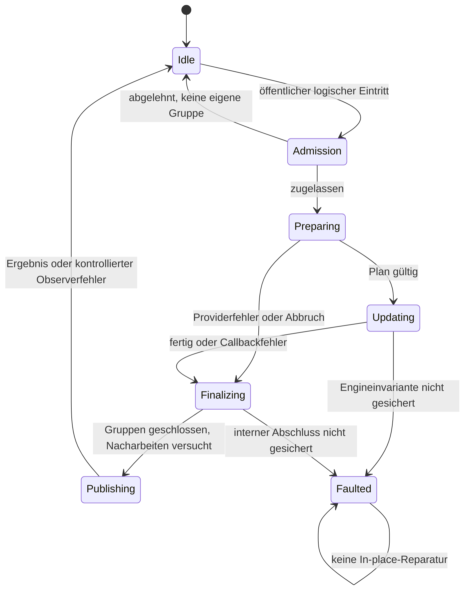

# MCP-01.4-B2 – AvaloniaEdit 12 Upstream Design

Stand: 24.10.2026. **B2-R1: DESIGN REVISED / PENDING INDEPENDENT RE-REVIEW.**

Dies ist der abschließende **Vorschlag** für den Bibliotheksvertrag, keine angenommene Upstream-API und keine Implementierungs-, Distributions- oder Produktfreigabe. Die nächste Tätigkeit ist ein unabhängiger Re-Review der Designkorrekturen. Der abgeschlossene [G-DESIGN-Review](MCP-01.4-B2-independent-review.md) urteilte CHANGES REQUIRED / BLOCKED; dieses Urteil wird hier nicht aufgehoben. MCP-01.4 bleibt gemäß bestehendem Review blockiert; R2/R4/R6/R7 werden hier nicht auf VERIFIED FIXED gesetzt. B3/B4 und die vollständigen CryptoWorkBench-Regressionen sind spätere Aufträge.

## 1. Basis, Evidenz und Bedeutung der Entscheidung

Produktiver Worktree: `C:/Users/stefa/Documents/projects/GITHUB/CryptoWorkBench-Mcp`, Branch `feature/mcp-server`, HEAD `bd48c57fa4cae9dc733da7d4521eb6f79a9017f0`. Grundlage ist auch die vorhandene uncommittete/unversionierte MCP-Arbeit. Verbindlich bleiben [MCP-00](MCP-00-architecture.md), insbesondere §§4.4, 4.5 und 5, [Editorentscheidung](MCP-01.4-editor-architecture-decision.md), [U12](MCP-01.4-avalonia12-feasibility.md), [B1](MCP-01.4-B1-feasibility.md) und [Review](MCP-01.4-review.md) einschließlich des letzten BLOCKED-Nachtrags.

Bibliotheksbasis: AvaloniaEdit **12.0.0**, Commit `86fdebec4cff7affb0e14c7885df71d28edce777`. B1-Verzeichnis: `C:/Users/stefa/Documents/ChatGPT/CryptoWorkBench-Mcp/mcp014-b1`. Gelesen wurden der tatsächliche `final-library.patch`, die Vertrags-/Engineänderungen in `library/src/AvaloniaEdit`, das vollständige `library/test/MutationContractTests/Program.cs`, die ergänzenden Hosttests und Ergebnislogs. Native Pfade wurden zusätzlich direkt in TextArea, EditingCommandHandler, SelectionMouseHandler, SearchPanel, CompletionWindow und RectangleSelection untersucht.

Kennzeichnung:

- **B1:** bereits ausgeführter, begrenzter Prototypnachweis; in B2 nicht erneut ausgeführt.
- **S:** statischer Befund am genannten Quellstand, kein neuer Laufzeitnachweis.
- **D:** normativer Designvorschlag dieses Berichts; muss implementiert und geprüft werden.
- **O:** externe Entscheidung oder noch fehlende Abnahme.

| Evidenz | Nachweis und Grenze |
| --- | --- |
| B1: ursprüngliche Sollmatrix | `boundary-final.log`: 46/46, unveränderte Assertions; frühe Ablehnung, R6/R7, Save-/Identitäts- und reale Undo-/Redo-Kontrollen |
| B1: Bibliothekskontrakte | `library-tests-final.log`: 243/243; u. a. 132 Reentrancykombinationen, 24 frühe Ablehnungen, gruppierter Replay, Provider, Tracker, Weak-Events, drei Pastefälle |
| B1: Standardbibliothek | `upstream-tests-final.log`: 354/354, 0 Skips; unveränderte Upstreamtests ohne Policy |
| B1: zusätzliche Host-Solltests | `host-contracts.log`: 9/9; R6 direkt/Service und R7 direkt/Save/Edit |
| B1: Patchidentität | SHA-256 `2265133825B9ED3364EA6F2646FDCBF1D8DA7C384D6218C0E4F81A671AF394B9` |
| B1: eigene Tests | Program.cs SHA-256 `F6B2914678FC20D0DA6AD7209E146295129426FA73CF24D5416E4D9455A82390` |
| Laufzeitgrenze | Windows, net10.0, Avalonia 12.1.4; keine vollständige native Windows-/Linux-/macOS-Abnahme |
| Historische Fehlerproben | Einige alte R6/R7-Programme behaupten das damalige Fehlverhalten. Ihr Exit 0 belegt dessen Reproduktion; nach Korrektur kann ihre Beobachtungsassertion scheitern. Nicht als grüne Solltests zählen. |

Der erneute Designreview ist möglich, weil die verbleibenden Semantikfragen hier konkrete Vorschläge, Gegenbeispiele und Abnahmekriterien erhalten. PENDING RE-REVIEW bedeutet nicht, dass diese neuen Eigenschaften schon implementiert oder von Maintainern akzeptiert wären. Insbesondere ist der B1-Patch allein noch kein freigabefähiges Paket.

### 1.1 Konkrete Differenz zwischen B1 und B2

| Quellbefund S | Konsequenz D |
| --- | --- |
| TextDocument.Mutation.cs: EndUpdate durchläuft wie eine neue Mutation die Policy | Verpflichtenden Abschluss von neuer Zulassung trennen. Sonst kann eine zwischen Begin und End verweigernde Policy eine legale Gruppe offenlassen. B1 testet diesen Wechsel nicht. |
| TextArea.PerformTextInput: TextEntering und Overstrike-SelectRight liegen vor der Dokumentmutation | Gesamten Eingabebefehl vor TextEntering, Auswahl und internen Folgeschritten zulassen. |
| SearchPanel.ReplaceNext: FindNext/SetCurrentSearchResult selektiert zuerst | Treffer zunächst ohne sichtbare Auswahl berechnen; die ganze ReplaceNext-Operation zulassen. |
| PasteStrictAsync prüft nach await nur Dokumentreferenz; getrennte Begin-/Replace-/End-Aufrufe; TextPasted außerhalb | Version, Auswahl, Bindungs-/Policygeneration binden; synchronen Commit als eine interne Operation ausführen, Abschlussmeldungen eingeschlossen. |
| OnCut/SetClipboardText wartet SetDataAsync nicht ab und löscht anschließend | Clipboarderfolg beobachten; getrennte Vorbereitung und erneute Zulassung der Löschung, keine Gruppe über await. |
| StartDrag hält AnchorSegments des Ausgangsdokuments, löscht nach await über TextArea.Document | Ursprungsdokument und Generation festhalten; keine Löschung am Nachfolger. Eigenen internen Move in einem synchronen Commit ausführen. |
| CompletionWindow versteckt Popup vor item.Complete; IndentationStrategy schreibt über öffentliche Dokumentmethoden | Neue planliefernde Providernaht, keine allgemeine Erlaubnis für mutierende Fremdcallbacks; Legacy-Provider nicht still privilegieren. |
| B1 NotifyObserver umschließt teils ganze Propertysetter; Avalonia besitzt eigene Property-Fanouts | Nur bibliothekseigene Empfängerlisten sind vollständig kontrollierbar. Interne Zustandsfortschreibung darf nicht von externem Framework-Fanout abhängen. Frameworkgrenze separat testen und dokumentieren. |
| StrictDocument prüft nur schon markierte Stackbesitzer | Vollständige Zuordnung auch bei vorher geteiltem Stack und späterer Zuweisung an ein Legacy-Dokument erforderlich. |

## 2. Vorgeschlagener öffentlicher API-Vertrag (D)

### 2.1 Kernoberfläche und Kompatibilität

Die B1-Kernsignatur bleibt bewusst klein und generisch:

```csharp
public interface IMutationPolicy
{
    void VerifyMutation(TextDocument document, MutationKind kind, bool isReentrant);
}

public enum MutationKind
{
    Replace = 0, BeginUpdate = 1, EndUpdate = 2,
    EditorText = 3, Undo = 4, Redo = 5, ClearHistory = 6,
    SelectedText = 7, Load = 8, TextInput = 9, Delete = 10,
    Indent = 11, Cut = 12, Paste = 13, DragMove = 14,
    Drop = 15, ReplaceNext = 16, ReplaceAll = 17,
    Completion = 18, DocumentChange = 19,
    Copy = 20, Selection = 21, Navigation = 22
}

// auf TextDocument:
public IMutationPolicy? MutationPolicy { get; set; }
```

Die neuen Werte bezeichnen den äußeren logischen Befehl, keine einzelnen Engineaufrufe. Insert/Remove/Document.Text/Append bleiben Replace, TextEditor.Text/Clear bleiben EditorText. Backspace und Delete sind Delete; Tab/Unindent sind Indent; Return/IME-Commit sind TextInput. Direkte Selection.ReplaceSelectionWithText-Aufrufe sind Selection; SelectedText bleibt SelectedText. Copy und reine Navigation tragen Copy bzw. Navigation als Ergebnis-/Diagnosekind, rufen aber keine Textpolicy auf. Auch sie besitzen Callbackschutz und dürfen nicht aus einer aktiven Operation reentrant sichtbare Zustände ändern. `EndUpdate = 2` bleibt als B1-Wert reserviert, wird im vorgeschlagenen Abschlussvertrag **nicht** an VerifyMutation gemeldet. XML-Dokumentation muss dies ausdrücklich sagen. Keine Serialisierung numerischer Enumwerte als MCP-Vertrag. Policies müssen unbekannte Werte explizit behandeln, im Zweifel ablehnen; neue Werte gehören in die Release Notes.

Die Policy ist synchron, kurz und auf dem Dokumentbesitzerthread auszuführen. Normale Rückkehr erlaubt den angefragten Eintritt; Throw lehnt ihn ab. Sie darf lesend den Hostzustand prüfen, aber keine Dokument-/Editor-/History-/Policyänderungen, keine Dispatcher-Pumps und kein await durchführen. Beliebige Exceptions aus VerifyMutation gelten als fehlgeschlagene Zulassung, nicht als Observerfehler einer bereits begonnenen Operation. Direkte synchrone Aufrufer erhalten weiterhin die ursprüngliche Exception; damit bleiben die B1-Adapter und Sollproben mit ihren eigenen Denied-/ExecutionBusy-Typen verwendbar.

`isReentrant` ist Diagnoseinformation, **kein** Schalter zur Freigabe. Bei einem neuen öffentlichen Eintritt aus einem aktiven Dokument-/Editorvorgang oder dessen Callback darf die Policy einmal mit true einen eigenen Fehler liefern. Kehrt sie zurück, verwirft die Bibliothek den Eintritt mit InvalidOperationException. Bei Rekursion während VerifyMutation selbst wird die Policy nicht erneut aufgerufen: sofortige InvalidOperationException, keine Effekte. Ein Fehler, den ein Observer nicht selbst behandelt, wird anschließend als Fehler des äußeren Vorgangs gesammelt.

ThreadStatic, AsyncLocal, öffentliche Allow-Flags und ein öffentliches `Execute(Action)` mit geerbtem Mutationsrecht sind ausgeschlossen. Die API eignet sich beispielsweise für schreibgeschützte Dokumentphasen, Importkoordination oder synchronisierte Editoren anderer Anwendungen. Sie kennt weder SaveIntent noch Interpreter, CryptoScript, MCP, Prism oder CryptoWorkBench.

### 2.2 Aktivierung, Eigentümer und Lebensdauer

Ein TextDocument hat genau eine Policyreferenz und genau einen unterstützten strikten UndoStack. Der Host besitzt die Policy; die Bibliothek hält sie bis zur expliziten Abtrennung und ruft kein IDisposable auf ihr auf. Dieselbe zustandslose Policy darf mehrere Dokumente betreuen; daraus entstehen weder gemeinsame Transaktionen noch globale Reentrancysperren. Ein Host, der dokumentübergreifende Admission braucht, koordiniert diese selbst.

Aktivierung, Austausch und Deaktivierung sind nur auf dem Besitzerthread im Ruhezustand zulässig: keine aktive Operation, Policyprüfung, Callbackzustellung, Replay oder offene Dokument-/Undo-Gruppe. Auch ein scheinbar identischer Setteraufruf während dieser Phasen wird abgewiesen. Es gibt keine rückwirkende Aktivierung für ein bereits gestartetes Update.

**Stackownership:** UndoStack muss alle angebundenen Dokumente erfassen, auch ohne Policy, vorzugsweise ohne neue starke Lifetimebindung. Aktivierung verweigert einen mit mehreren Dokumenten verbundenen Stack. Solange ein Stack strikt beansprucht ist, darf auch ein Legacy-Dokument ihn nicht übernehmen. Vorhandene Historie darf nur native Operationen des eigenen Dokuments und unterstützte bibliothekseigene optionale Aktionen enthalten; fremde/multidokumentäre Einträge verhindern Aktivierung. Diese Prüfung löscht die Historie nicht heimlich. Stackwechsel verlangt zunächst Deaktivierung im Ruhezustand. Historie und Text bleiben beim Policywechsel unverändert; jeder Wechsel erhöht intern eine Policygeneration.

TextDocument wird nicht zu einem neuen IDisposable-Objekt gemacht. Beim Editor-Detach/Windowclose werden ausstehende editorgebundene Asyncvorgänge ungültig und bibliothekseigene Subscriptions gelöst. Eine gehaltene Dokumentreferenz verliert ihre Policy dadurch nicht automatisch. Will der Besitzer weitere direkte Edits verhindern, bleibt eine verweigernde Policy angebunden; `null` schaltet ausdrücklich auf Legacy zurück. Bestehende synchrone Operationen werden finalisiert, bevor kontrollierte Hostdisposal abgeschlossen wird.

### 2.3 Vollständiger Dokumentbindungscommit (GD-01)

Ein Bindungsverbund besteht aus TextEditor, dessen TextArea und dessen TextView; eine eigenständige TextArea umfasst ihre TextView, eine eigenständige TextView nur sich selbst. Ein interner Coordinator besitzt die Zuordnung, Bindungsgeneration, Subscriptions und den Zustand Stable/Preparing/Committing/Publishing/Faulted. Es gibt innerhalb eines Verbunds nur ein verbindliches Dokument. Ein öffentlicher Wechsel an **jedem** der drei Mitglieder verlangt denselben Verbundwechsel; ein innerer Setter ist kein Weg zu einer abweichenden Teilbindung. Andere Editoren desselben Dokuments bilden eigene Verbünde.

Erfasst werden CLR-Setter, SetValue, SetCurrentValue, ClearValue, Set-/Entfernen/Ersetzen eines Bindings, neue Bindingwerte und erneute Coercion bzw. Prioritätswechsel. Ein identischer effektiver Wert ohne Detach ist ein No-op; expliziter Detach/Reattach erhöht die Generation auch bei A→A. Die Policy wandert nicht auf ein neues Dokument: der Host konfiguriert es vorher. Beide unterschiedlichen Dokumente werden mit DocumentChange geprüft, auch wenn sie dieselbe Policyinstanz verwenden; bei identischer Dokumentreferenz nur einmal. So bleibt eine dokumentabhängige Policy korrekt. null bedeutet Detach und hat selbst keine Policy.

**Verpflichtendes Protokoll:**

1. Vor der ersten Änderung eines effektiven Documentwerts reserviert der Coordinator den Verbund und beide Dokumente. Er prüft Thread, offene Operationen/Gruppen, Reentrancy, Policy und die vorbereitbaren neuen internen Ressourcen. Bis dahin bleiben effektive Werte, Generation, alte Subscriptions, Caret und Selection unverändert. Abweisung wird dem jeweiligen Setter bzw. dem Framework-Fehlerweg zugeordnet.
2. Der erste effektive Propertywechsel ist der Bindungscommitpunkt. Ab diesem Punkt ist ein Rollback auf die alte Bindung **nicht** die Fehlerstrategie. Der Coordinator erhöht die Generation genau einmal, invalidiert ausstehende Editorvorgänge und führt alle drei Propertywerte, internen Dokumentfelder, Document-/Undo-/Weak-Subscriptions, TextView-Line-/HeightTree-/Cachezustände und Caret-/Selectionreset zum neuen Zustand fort. Alte Subscriptions werden genau einmal getrennt, neue genau einmal hergestellt. Der Vorgang hält alte und neue Referenzen bis zum Abschluss.
3. Bibliothekseigene DocumentChanged-/TextChanged-Meldungen werden erst nach diesem internen Abschluss veröffentlicht. Fehler einzelner Empfänger verhindern weder weitere eigene Empfänger noch den Abschluss anderer Mitglieder. Ein Framework-Propertyobserver kann während der nacheinander erfolgenden effektiven Änderungen **vorübergehend unterschiedliche Propertywerte lesen**; globale atomare Avalonia-Propertysicht wird nicht versprochen. In diesem Fenster sind alle öffentlichen mutierenden Editor-/Dokument-/History-Eintritte und weitere Bindungswechsel gesperrt. Nach normaler Rückkehr oder ausschließlich Observerfehlern sind alle Mitglieder konsistent neu gebunden.
4. Ein Fehler im Frameworkfanout wird gesammelt, sofern der effektive Wert tatsächlich übernommen wurde; die übrigen internen Schritte folgen in eigenem finally. Schlägt dagegen die nötige Zustandsübernahme selbst fehl oder bleibt ein Mitglied nach Prüfung auf einem anderen effektiven Wert, wird der **Verbund Faulted**, keine erfundene erfolgreiche Bindung. Keine weiteren Edits über diesen Verbund; Wiederherstellung gemäß §3.6. Ein Observerfehler allein vergiftet kein Dokument.
5. Ein während Admission abgewiesener Bindingwert darf nach Entsperrung nicht heimlich nachgeholt werden. Die abgewiesene Auswertung wird konsumiert; erst eine neue explizite Quellemission/Zuweisung oder Prioritätsänderung startet einen neuen Versuch. Bestehende Bindings bleiben grundsätzlich erhalten. Abweisung als bloß vorübergehende Coercion mit späterem automatischem Replay ist unzulässig.

**Technische Abnahmegrenze:** Die ursprünglichen Changed-Subscriptions auf TextEditor/TextArea/TextView sind hierfür zu spät; sie dürfen nicht weiterhin unabhängig den Bindungswechsel steuern. Erforderlich sind gemeinsame Prüfung vor effektiver Wertübernahme und ein eigenständiger garantierter interner Abschluss, auch bei werfenden Frameworkempfängern. Coercion allein stellt weder dieses Abschlussprotokoll noch die Konsumierung abgewiesener Bindingwerte sicher; ein notifying-Hook ist kein Beleg für globale Propertyatomizität. U0 muss die konkreten Avalonia-12.0.0-Hooks und Bindingprioritäten in einer isolierten Machbarkeitsprobe nachweisen. Falls das ohne unzulässigen Eingriff ins Propertysystem nicht möglich ist, bleibt diese APIvariante blockiert und verlangt **erneuten Designentscheid**; ein später Changed-Rollback ist kein zulässiger Ersatz. Die Laufzeitsemantik ist festgelegt, ihre technische Erfüllbarkeit hier nicht behauptet.

Unkontrollierter Visual-Detach invalidiert die Generation. Ein bereits laufender Textabschluss arbeitet am festgehaltenen Dokument weiter und unterlässt UI-Arbeit auf einem Nachfolger. Host-Attach-/Shutdown-Serialisierung bleibt Hostaufgabe.

### 2.4 Logische Operation versus explizite Updategruppe

Eine logische Operation umfasst frühe Zulassung, fremde Vorbereitung, alle internen Textschritte und Historien-/Caret-/Selection-/Property-/Abschlussarbeiten. TextEditor.Text endet also erst nach seinem Caretreset und ClearAll, nicht bei UpdateFinished. No-ops werden vor möglichen Setter-/Historieneffekten zugelassen; identischer EditorText darf weiterhin Historie löschen, wenn zugelassen. Der Host besitzt den engeren fachlichen MCP-No-op-Vertrag.

Interne Delegation geschieht über nichtöffentliche, dokumentgebundene Coremethoden und einen nicht exportierbaren synchronen Operationskontext. An jeder Corecallsite werden Besitzer und Operationsphase geprüft. Native Replay-/Caretoperationen sind identifizierte Bibliotheksimplementierungen; gleiche Interfaces fremder Implementierungen begründen keine Berechtigung. Fremdcode erhält niemals diesen Kontext, auch nicht über einen Callbackparameter.

`BeginUpdate` und `RunUpdate` öffnen nach Zulassung eine **Gruppierung**, keine öffentliche Autorisierung für folgende Edits. Jeder später vom Aufrufer gestartete öffentliche Edit erhält eine eigene Zulassung; Callbacks bleiben verboten. Der aufrufende Code muss manuelle Gruppen in finally schließen und darf sie im strikten Vertrag nicht über await halten.

**EndUpdate ist verpflichtende Finalisierung:** Ein korrekt gepaarter öffentlicher Abschluss auf dem Besitzerthread außerhalb eines aktiven Vorgangs/Callbacks schließt die bereits zugelassene Gruppe ohne erneutes Policyveto. `RunUpdate().Dispose()` ist an genau seine Gruppe gebunden und schließt sie höchstens einmal. Ungültiges Pairing, fremder Thread und EndUpdate aus einem Callback werden vor Zähleränderung verworfen. Interne Abschlüsse benutzen nur das private Gruppenrecht. Die inzwischen verweigernde Policy kann neue Edits ablehnen, aber die nötige Bereinigung nicht verhindern. Es wird keine Gruppe eröffnet, um einen abgewiesenen Eintritt anschließend vermeintlich aufzuräumen.

Manuelle Gruppen akkumulieren Textwirkung für ihren Abschluss. Ein Fehler in einer einzelnen inneren Mutation wird an deren synchroner Rückkehr publiziert, ohne die vom Aufrufer besessene äußere Gruppe zu stehlen. Der Aufrufer schließt diese in finally. Bei Bibliothekscomposites besitzt dagegen die Bibliothek die komplette Gruppe und veröffentlicht Fehler erst nach deren Abschluss.

### 2.5 Historische Caret-/Selectionaktionen (GD-02)

Jede unterstützte native optionale Undoaktion speichert schwache Ziel-TextArea-Referenz, ursprüngliche Dokumentidentität, **damalige Bindungsgeneration** und kopierte Caret-/Selectionwerte einschließlich Richtung und nativer Rechteckgeometrie. Keine lebende Selection wird später an einen anderen Editorzustand angehängt. Die Werte gehören zur jeweils vorgesehenen Vor-/Nachversion der nativen Historie, nicht zur aktuellen Dokumentversion beim Replaystart.

Beim Replay werden optionale UI-Aktionen zunächst nur als Kandidaten pro Ziel-TextArea gesammelt; sie verändern vor dem ersten Textcommit keine sichtbare UI. Nach erfolgreichem Abschluss der erforderlichen nativen Textteile wird der gemäß nativer Replayreihenfolge letzte passende Kandidat angewandt. Bei Abbruch vor erster Textwirkung werden Kandidaten verworfen und der Historieneintrag zurückgelegt. Nach erster Textwirkung führen reine Observerfehler den nativen Replay weiter; dessen finale UI-Kandidaten werden noch versucht und Fehler gesammelt. Bei Enginefehler wird kein Kandidat auf einen unsicheren Textzustand angewandt (§3.6).

Stale heißt: Ziel gesammelt, abgehängt, anderes Dokument oder andere Bindungsgeneration, auch A→B→A. Dann entfällt ausschließlich diese historische UI-Aktion; das Undo/Redo am ursprünglichen Dokument bleibt erhalten. Unterschiedliche Editoren werden separat geprüft. Ein stale Skip ist kein Replayfehler. Optional-only-Gruppen wenden zulässige UI-Kandidaten an, ohne Textwirkung zu behaupten oder vorhandenes Redo durch neues Bookkeeping zu löschen. Ein Bindungswechsel im Kandidatencallback ist weiterhin verboten.

Historische Einträge ohne nachweisbare Dokument-/Generationsbindung sowie fremde optionale Aktionen sind unter Strict **nicht** nachträglich vertrauenswürdig. Aktivierung lehnt sie ab; kein Erraten, keine stille Historienlöschung. Der Besitzer kann vor Aktivierung ausdrücklich Historie leeren oder ein neues Dokument wählen. Ohne Policy bleibt die bisherige optionale Replayreihenfolge unverändert.

## 3. Event- und Exception-Zustandsmodell (D)

### 3.1 Zustände und verbindliche Reihenfolge



Bei Faulted darf die einmalige Fehlerpublikation stattfinden, ohne anschließend Idle zu setzen; der Faultzustand bleibt terminal. Das Diagramm bezeichnet Dokumentoperationen, nicht den gesonderten Bindungsverbund aus §2.3.

Asyncvorbereitung verlässt die synchrone Operation vollständig; sie hält nur immutable Daten und Gültigkeitsmerkmale, keine Updategruppe und kein internes Delegationsrecht. Ihr Commit beginnt wieder bei Admission. Ein unabhängig lesbarer, unveränderlicher Snapshot ist keine zweite schreibbare Dokumentengine.

Die Reihenfolge einer einzelnen Replace-Operation ist:

1. Thread-/strukturelle Prüfung und Mutationszulassung; noch keine eigenen Update-, Caret-, Selection-, Anchor- oder Historyeffekte. Primitive Nullprüfungen dürfen vorgezogen sein, fremde Getter/Provider nicht.
2. Fremde Quellen/Segmente unter Callbackschutz lesen, materialisieren und validieren. Im strikten Modus können Bereichsprüfungen vor Gruppenöffnung erfolgen, weil UpdateStarted keine erlaubte Dokumentmutation mehr ist.
3. Eigene Gruppe öffnen; UpdateStarted nur am Übergang von äußerer Tiefe 0 zu 1. Alle zu Beginn dieser Zustellung registrierten Empfänger in ihrer Reihenfolge abwickeln.
4. Changing, danach IDocument.TextChanging. Liegt vor dem ersten Textcommit ein Observerfehler vor, diesen Textschritt nicht ausführen; die tatsächlich eröffnete Gruppe trotzdem schließen.
5. Native Historie aufnehmen, Version/Text/Zeilen/Anker aktualisieren; Tracker laufen an ihren bisherigen algorithmischen Stellen. Verzögerte Anchorereignisse erst nach konsistenter Engine, dann Changed und IDocument.TextChanged.
6. Am äußeren Updateende TextDocument.TextChanged, PropertyChanged(Text), bei wirklicher Längenänderung TextLengthChanged und PropertyChanged(TextLength), entsprechend LineCountChanged und PropertyChanged(LineCount). Die im Ausgangsstand mögliche erstmalige LineCount-Meldung bleibt erhalten.
7. Undo-Gruppe schließen, zugehörige Historienmeldungen abwickeln, Dokumenttiefe auf null; UpdateFinished genau einmal. Bei verschachtelten Gruppen erst am äußeren Ende.
8. Noch ausstehende logische Nacharbeiten ausführen, etwa Textsetter-Caretreset/ClearAll oder TextEntered/TextPasted. Die Reentrancygrenze bleibt aktiv, auch wenn IsInUpdate bereits false ist.
9. Operationskontext abschließen und Fehler einmal publizieren. Eine Fehlerpublikationscallback-Zustellung erhält selbst einen Callbackschutz; sie darf nicht zum unmittelbaren erneuten Edit führen.

Dies ist eine **partielle Ordnung**, keine erfundene globale Sortierung aller UI-Ereignisse. UndoStack.PropertyChanged kann bereits beim Push auftreten; Editor-Text-, Caret- und Selectionmeldungen werden von bestehenden Dokumentempfängern ausgelöst und folgen deren Registrierungsreihenfolge. Das B1-Testbeispiel ohne diese Zusatzempfänger prüft Started → Changing → Changed → TextChanged → PropertyChanged(Text/TextLength/LineCount) → Finished. D verlangt zusätzlich genaue Traces je Composite und Replay.

### 3.2 Empfänger-, Callback- und Providervertrag

| Fläche | Strikter Vertrag D | B1-Evidenz |
| --- | --- | --- |
| UpdateStarted/Changing | Vollständiger Fanout des aktuellen Ereignisses; Fehler vor erster Textwirkung stoppen den betroffenen Textcommit, nicht den Abschluss | Gewöhnlicher Replace/Setter/Replay geprüft |
| Changed/TextChanged/PropertyChanged/UpdateFinished | Fehler sammeln, spätere notwendige Empfänger und Finalisierung fortsetzen; kein Textrollback, keine rekursiven Abschlussereignisse für abgewiesene Wiedereintritte | Dokumentfälle geprüft |
| Undo-/Redo-Meldungen | Native Gruppierung, Replayzustand und Listen in finally finalisieren; Fehler in IsOriginalFile/CanUndo/CanRedo dürfen keinen nötigen EndUpdate überspringen | B1 deckt mehrere Observerpfade, nicht beliebige fremde Undoaktionen |
| Caret/Selection | Bibliothekseigene Fanouts pro Empfänger; aktive Mutation umfasst Nacharbeiten. Auch bei eigenständiger Navigation dürfen deren Callbacks keine Textmutation reentrant starten | B1 sperrt solche Wiedereintritte; vollständiger Fehlerfanout ohne aktive Mutation ist neu |
| TextAnchors | Native Bewegungs-/Löschsemantik erhalten; verzögerte Deleted-Meldungen einzeln zustellen; keine Wiederbelebung gelöschter Anker durch eine Schattenengine | UTF-16/CRLF, Bias, survive/deleted geprüft |
| LineTracker | Aktuelle Empfängerliste snapshotten; jeder Tracker wird aufgerufen, Fehler unterbrechen keine nötige Zeilenbaumfortschreibung. Änderungen an der Trackerliste gelten erst für folgende Zustellungen | Fünf native Callbackstellen und spätere Tracker geprüft; Listenänderungen neu |
| Weak-Events | Aktive Empfänger in bestehender Reihenfolge einzeln behandeln; lebende Empfänger nicht wegen eines früheren Fehlers auslassen; keine zusätzlichen dauerhaften starken Referenzen | Zweiter Changed-Weak-Empfänger geprüft |
| Fremde TextSource/Segment-/Readonly-/Searchprovider | Innerhalb zugelassener Vorbereitung und Callbackschutz vollständig lesen/materialisieren, auch Enumeration/Dispose/Gettereintritt prüfen; ungültige Ergebnisse vor Engineeffekten ablehnen | ForeignSource/Segment teilweise geprüft |
| TextEntering, TextEntered, TextCopied, TextPasted, Completion/Indentation | Aufruf zählt als Fremdcode; kein automatisches Recht für öffentliche Mutationen. Handled/Cancel nach dem vorgesehenen Fanout auswerten | Vollständige Compositezustellung D |
| Avalonia-Property-/Routed-Eventsystem | Fremde Frameworkzustellung als möglicherweise werfenden Schritt behandeln; Bibliothekszustand vorher sichern und restliche eigene Finalisierung unabhängig fortführen | B1 Load prüft Reentrancy, nicht vollständige Framework-Fanout-Garantie |

Bibliothekseigene Eventlisten werden je Zustellung stabil aufgenommen: An-/Abmeldungen ändern die nächste Zustellung; bereits gesammelte Fehler bleiben in tatsächlicher Aufrufreihenfolge. Geschachtelte Fehler werden nicht nach Text oder Typ dedupliziert. Reflectionbedingte TargetInvocationException kann im strikten Weak-Eventpfad mit erhaltener Ursachenkette normalisiert werden; keine private Reflection zur Zustandsreparatur.

Die Bibliothek kann nicht garantieren, dass Avalonia nach einer Exception jeden fremden Frameworksubscriber weiter aufruft. Sie garantiert ihre eigene Finalisierung und die von ihr kontrollierten Listen. Intern notwendige Pflege darf daher nicht als bloßer später Frameworksubscriber implementiert sein. Benötigt der Gesamtvertrag weitergehende Frameworkzustellung, ist ein eigener Avalonia-Review nötig; nicht mit einer B1-NotifyObserver-Hülle als erledigt erklären. Beliebig überschriebene virtuelle Methoden und fremde Selection-Unterklassen bleiben ebenfalls Fremdcode, keine Coredelegation.

### 3.3 Ergebnis-, Phasen- und Exceptionvertrag (GD-06/GD-07)

Die additive Ergebnisoberfläche ist lokal, unveränderlich und bibliothekskonstruiert:

```csharp
public enum MutationFailureStage
{ Admission, Preparation, ExternalTransfer, Execution, Notification, Finalization, Publication }
public enum MutationOutcome { Completed, Rejected, Cancelled, Failed }
public enum MutationTextEffect { None, Applied, Possible }
public enum MutationPlanProgress { None, Partial, Complete, Unknown }
public enum MutationExternalEffect { None, Possible, Confirmed }
[Flags]
public enum MutationLocalEffects
{ None = 0, Caret = 1, Selection = 2, History = 4, Properties = 8, Popup = 16, Binding = 32 }
public enum MutationCancellationCause
{ None, Caller, StaleBinding, StaleVersion, StaleSelection, StalePolicy, Superseded, Detached }

public sealed class MutationResult
{
    public MutationKind Kind { get; }
    public TextDocument? Document { get; } // ursprüngliches lokales Ziel
    public MutationOutcome Outcome { get; }
    public MutationTextEffect TextEffect { get; }
    public MutationPlanProgress PlanProgress { get; }
    public MutationExternalEffect ExternalEffect { get; }
    public MutationLocalEffects AppliedLocalEffects { get; }
    public MutationLocalEffects PossibleLocalEffects { get; }
    public MutationCancellationCause CancellationCause { get; }
    public bool IsFaulted { get; }
    public IReadOnlyList<MutationFailure> Failures { get; }
}
public sealed class MutationFailure
{
    public MutationFailureStage Stage { get; }
    public Exception Exception { get; }
}
public class MutationOperationException : AggregateException
{
    public bool TextChanged { get; } // nur nachgewiesener Textcommit
    public MutationFailureStage Stage { get; } // erste Fehlerphase
    public MutationResult Result { get; }
}
public sealed class MutationCallbackException : MutationOperationException { }
```

Result und Failure besitzen keine öffentlichen Setter oder ausführbaren Datenprovider; Fehlerliste und Planwerte sind defensive Kopien. Die Liste enthält alle lokalen Ursachen in Beobachtungsreihenfolge mit ihrer eigenen Phase. Stage ist nur die erste Fehlerphase, kein Ersatz für diese Liste. TextChanged ist genau TextEffect=Applied; bei Possible kann es false sein und darf deshalb **nicht** als Wirkungsfreiheit ausgewertet werden. Applied heißt mindestens ein nachgewiesener Textcommit, auch wenn Endtext gleich Anfangstext ist. Ein Enginefehler nach vorherigem Commit bleibt Applied, PlanProgress kann Unknown und IsFaulted=true sein. Bei Fehler im ersten unbekannt abgeschlossenen Commit gilt Possible/Unknown.

Completed bedeutet planmäßig vollständig einschließlich nötiger interner Nacharbeiten; Observerfehler ergeben Failed auch bei PlanProgress=Complete. Rejected ist Admissionablehnung, Cancelled ausschließlich bibliothekseigener kontrollierter Abbruch vor lokalem Commit, Failed alle anderen Fehler. PlanProgress beschreibt nur lokale Textschritte; bei nichttextuellen Operationen ist es None. Ein Fehler vor erster Wirkung ist None, ein abgeschlossenes Präfix Partial, alle Textschritte Complete, unsicherer Enginefortschritt Unknown. AppliedLocalEffects protokolliert bestätigte nichttextuelle eigene Änderungen (Caret, Selection, History einschließlich ClearAll, Editorproperties einschließlich Encoding/IsModified, Popup und Bindung); PossibleLocalEffects protokolliert begonnene, nicht sicher abgeschlossene Änderungen. Ein Flag kann in beiden Mengen stehen, wenn ein früherer Teilschritt bestätigt und ein späterer unsicher ist. Beide sind Ausführungswirkungen, keine Endzustandsdifferenz. Ein versuchter, vor jeder Änderung abgewiesener Setter setzt kein Flag. Fremde Callbackseiteneffekte bleiben ausdrücklich außerhalb dieser Erfassung. ExternalEffect erfasst bibliotheksveranlasste Clipboardwrites/Transfers: None vor Start bzw. nach nachgewiesen wirkungslosem Abbruch, Possible ab Start bis eindeutiger Bestätigung, Confirmed nach Erfolgsmeldung des zuständigen Transports. Bestätigung ist ein Transportbeleg, keine Garantie über eine fremde Anwendung. Beliebige Fremdcallback-I/O bleibt außerhalb dieser Erfassung und kann auch bei None vorkommen.

**Synchrone bestehende APIs:** Frühe einzelne Argument-/Policyfehler und der alleinige Vorbereitungsfehler ohne eigene Gruppe bleiben zur B1-Kompatibilität unverändert. Der native Adapter führt unabhängig davon den Ergebnisdatensatz. Sobald eigene Gruppen/Nacharbeiten oder mehrere Fehler beteiligt sind, aggregiert die Bibliothek; reine Observerfehler ergeben MutationCallbackException, gemischte Fehler MutationOperationException. Lokale Fehler werden nie automatisch als MCP-Fehlertexte veröffentlicht.

**Grenze manueller Gruppen:** Die Bibliothek aggregiert nur Fehler, deren Ausführung sie besitzt. Bei `using (doc.RunUpdate()) { throw bodyError; }` kennt Dispose den bodyError nicht; ein zusätzlicher Abschlussfehler kann ihn nach C#-Semantik verdrängen. Es gibt hierfür keine vollständige Aggregationsgarantie. Wer beide erhalten muss, fängt den Rumpffehler selbst, schließt die erfolgreich eröffnete Gruppe genau einmal in einem separaten try/catch und wirft danach ein Aggregat aus beiden bzw. den Einzelursprung unter Erhalt seines Stacks. Nach fehlgeschlagenem Begin kein End; nach fehlgeschlagenem Dispose kein zweiter Abschlussversuch. Das gilt auch für fremde finally-/using-Rümpfe und Stream-Disposal. Bibliothekseigene Compositekörper und eigenes Stream-Disposal sammeln dagegen Haupt- und Abschlussfehler vollständig.

### 3.4 Tasks, Cancellation und Fehlerzustellung (GD-07)

Neue additive TextEditor-APIs sind `Task<MutationResult> CutAsync(CancellationToken)`, `CopyAsync(CancellationToken)` und `PasteAsync(CancellationToken)`. Erwartete Ablehnung, Veraltung und Cancellation liefern ein Result mit Rejected bzw. Cancelled; operative Fehler liefern Failed samt Ursachen. Nach begonnenem Operationsprotokoll werden diese Tasks nicht zusätzlich faulted/cancelled. Ungültige APIargumente/Threadverwendung vor Erstellung eines Vorgangs dürfen wie üblich synchron werfen; Prozess-/Ressourcenausfälle sind außerhalb der Garantie. Direkte Taskaufrufe lösen kein zusätzliches MutationFailed aus; Aufrufer müssen das Ergebnis auswerten. Dies ist ein neuer APIvertrag, keine Änderung vorhandener B1-Signaturen.

Cancellation wird nur aus einem vom Coordinator selbst beobachteten Caller-Token oder einer eigenen Generation-/Gültigkeitsprüfung erzeugt. Eine OperationCanceledException aus fremdem Provider, Observer oder Transport ist ohne eigenen bestätigten Abbruch **Failed**, auch bei gleichem Token; der Exceptiontyp allein klassifiziert nichts. Bei mehreren eigenen Abbruchgründen gilt der zuerst beobachtete, bei gleichzeitiger Prüfung: Detached, StaleBinding, StalePolicy, StaleVersion, StaleSelection, Superseded, Caller. Neue Eingaben überschreiben niemals alte Ziele. Stale nach erfolgreichem Cutwrite ist Cancelled mit ExternalEffect=Confirmed und TextEffect=None, somit keine wirkungsfreie Cancellation.

Ein gestarteter externer Write/Transfer wird bis zu seinem beobachtbaren Abschluss verfolgt; Tokenabbruch startet keine lokale Löschung und verschweigt kein noch laufendes I/O. Ohne eindeutige Erfolgsmeldung bleibt ExternalEffect=Possible. Bleibt ein fremder Task dauerhaft offen, gibt es keine Terminierungszusage; der Host braucht weiterhin seinen eigenen Request-/Drainvertrag. Vor synchronem Commit letzte Gültigkeits-/Cancellationprüfung; ab Beginn keine Tokenunterbrechung mehr, immer Finalisierung. Ein späteres Token ändert das abgeschlossene Ergebnis nicht rückwirkend.

Bestehende void-/Routed-/native Input-/Dragadapter werten denselben Datensatz aus. Rejected und Failed führen einmal zu TextArea.MutationFailed; Cancelled ohne externe Wirkung darf still enden, Cancelled mit Possible/Confirmed muss über MutationFailed als Teilwirkung zugestellt werden. EventArgs enthalten Result und Handled sowie kompatible Projektionen Kind, Stage (nullable bei fehlerfreier Cancellation), ursprüngliches Document, TextChanged und Exception (nullable). Handled unterdrückt nur globale Zustellung, nie Wirkung oder Ergebnis. Alle eigenen Empfänger laufen unter Callbackschutz. Ohne Handled wird nach Abschluss einmal an den Dispatcherfehlerweg weitergegeben; eine reine Teilwirkungs-Cancellation erhält dafür eine lokale resulttragende Diagnoseexception.

Werfen Fehlerempfänger, werden ursprüngliche Ursachen und Publicationfehler einmal an den Dispatcher weitergegeben, selbst wenn ein früherer Empfänger Handled setzte. Kein rekursives MutationFailed, kein erneutes EndUpdate. Wirft auch der globale Fehlerweg, endet die Garantie bei dieser Weitergabe; keine rekursive Fallbackkette. Bibliothekseigener Zustand ist zuvor abgeschlossen oder Faulted. Ein fremder Avalonia-Fanout garantiert nicht die Zustellung späterer Frameworkempfänger (§3.2). B1s Dispatcher-Pasteprobe bleibt für einen echten Fehler prüfbar; sie ist kein Nachweis dieses neuen Ergebnisvertrags.

### 3.5 Teilwirkung und deterministische Nacharbeiten (GD-05)

Bei normalen mehrteiligen Plänen beendet ein kontrollierter Observerfehler den laufenden nativen Textschritt einschließlich Enginefortschreibung und erforderlicher Meldungen. Danach beginnt **kein weiterer** unabhängiger Textschritt. Das angewandte Präfix bleibt in genau einer geschlossenen nativen Undo-Gruppe; kein Textrollback. Vor erster Wirkung bleiben Text und UI-Ausgangswerte erhalten, soweit nicht bereits explizit zulässige externe Wirkung eingetreten ist.

Für jeden Plan werden initialer Caretoffset samt Bias und Selectionwerte gespeichert. Für jeden tatsächlich abgeschlossenen Schritt wird die native Offsetabbildung in Ausführungsreihenfolge mitgeführt. Bei Partial werden **keine** für den vollständigen Ergebnistext berechneten Endpositionen benutzt: der Anfangscaret wird durch das angewandte Präfix abgebildet, die Auswahl wird dort zu EmptySelection kollabiert (auch bei Rechteck), virtuelle Spalten werden verworfen. Nur am weiterhin passenden Dokument/Bindungsgeneration wird diese deterministische UI-Nacharbeit ausgeführt. Sie ist Teil derselben Operation; ihre Observerfehler werden gesammelt. Das optionale Historybookkeeping speichert den tatsächlich resultierenden UI-Zustand nach §2.5.

Bei Complete gelten validierte finale Planpositionen; ohne solche Angaben gilt native Offsetfortschreibung. Bei None wird keine planbezogene Erfolgsauswahl gesetzt. Verpflichtende interne Finalisierung, Gruppenabschluss und Textsetter-ClearAll bleiben auch nach Observerfehlern erforderlich; erfolgsbezogene TextEntered/TextPasted-/Popupaktionen werden nur bei vollständig ausgeführten vorgesehenen Schritten versucht und dürfen nie eine Teiloperation als Erfolg melden. Searchrefresh wird gegen den tatsächlichen Endtext neu berechnet, unter Callbackschutz; bei Refreshfehler wird der Ergebnisindex invalidiert und die Suchtrefferanzeige geleert, ohne weiteren Textedit. Er macht den bereits angewandten Text nicht rückgängig.

**Native Replayausnahme:** Bekannte native Undo-/Redo-Teile werden nach erster Textwirkung trotz kontrollierter Observerfehler vollständig ausgeführt, damit der Gruppeneintrag konsistent bleibt. Vor erster Wirkung wird der verschobene Eintrag samt Descriptor zurückgelegt. UI-Aktionen folgen §2.5. Diese Ausnahme erlaubt weder fremde Undoaktionen noch Fortsetzung nach Enginefehler.

### 3.6 Faulted und Wiederherstellung (GD-08)

TextDocument erhält additive readonly Diagnosen `bool IsFaulted` und `MutationResult? FaultInfo`. Faulted wird gesetzt, wenn eine interne Engine-/History-/Gruppeninvariante nach einem Fehler nicht gesichert ist. Fehler externer Observer bei erfolgreich fortgeschriebenen Invarianten führen allein nicht dorthin. Einmal Faulted, bleibt **dieses Dokument dauerhaft Faulted**: kein automatisches Idle, kein öffentliches Resetflag, kein Reparatur-ClearAll oder Abschalten der Policy. Die Bibliothek versucht nur noch sichere, bereits bekannte Cleanupschritte einmal; sie behauptet weder ausgeglichene unbekannte Zähler noch Undo-Fähigkeit.

Öffentliche Mutation, Undo/Redo, neue Gruppen, Policy-/Stackwechsel und neue Snapshots/Text-/Line-/Anchorabfragen an diesem Objekt werden mit einer dokumentierten InvalidOperationException abgewiesen. IsFaulted/FaultInfo und zuvor erzeugte immutable Snapshots bleiben lesbar. Somit verlangt der Host bei Possible **keinen frischen Snapshot aus einer möglicherweise defekten Engine**. Vorhandene direkte Dokumentreferenzen werden durch Editorwiederherstellung nicht wieder gültig.

Kontrollierte Wiederherstellung bedeutet Ersatz: Host hält neue Arbeit an, beobachtet seine ausstehenden Vorgänge, wählt ausdrücklich einen zuvor gesicherten Snapshot bzw. externe Quelle und erstellt ein neues gesundes Dokument mit neuer Historie/Policy. Der Bindungscoordinator erlaubt aus Stable mit faulted Altdokument einen gesonderten DocumentChange zur gesunden Ersatzinstanz: keine alten Engineabfragen, kein Veto der faulted Altpolicy; neue Policy prüft DocumentChange, Reentrancy/Thread-/Verbundschutz bleibt bestehen. Dieser eng begrenzte Ersatz ist kein allgemeiner Gatebypass. Ausstehende alte Editorvorgänge sind bereits invalidiert; sie dürfen nur ihre eigenen beobachtbaren externen Ergebnisse abschließen.

Ist **der Bindungsverbund selbst** Faulted (§2.3), ist dessen interne Vollständigkeit unbekannt: kein weiterer Property-Reparaturversuch. Der Host verwirft den gesamten betroffenen Controlverbund und baut ihn mit einem gesunden Dokument neu auf. Sichere Subscriptionabtrennung wird best effort versucht; keine Wiederverwendungszusage. Wiederherstellung enthält keine automatische Speicherung und keinen automatischen Retry der gescheiterten Operation.

### 3.7 Move-Bestätigung und externe Teilwirkung (GD-04)

Ein bibliothekseigener Dragdescriptor ist quellgebunden, einmal konsumierbar und hat Pending, TargetPartial, TargetComplete oder InternalMoveComplete sowie einen separaten SourceDeleteAttempted-Marker. Er ist kein öffentliches Mutationsrecht. Das Ziel bestätigt Move erst, wenn **der gesamte vereinbarte Payload** inklusive aller Rechteckteile übertragen und der interne Zielabschluss konsistent beendet wurde. Ein vorab gesetztes e.DragEffects=Move ist unzulässig. Observerfehler nach vollständigem Transfer verhindern die Bestätigung nur dann, wenn vollständige Wirkung/konsistenter Abschluss nicht nachgewiesen sind; sie bleiben trotzdem Failed im lokalen Ergebnis.

Bei Teiltransfer oder unsicherem Abschluss: TargetPartial, keine Movebestätigung (DragEffects=None), keine automatische Zielrücknahme und keine Quelllöschung. Dies kann sichtbare Teilkopien hinterlassen; Ergebnis und Diagnose nennen sie. Das externe Protokoll ist nicht atomar. Bei fremden Zielen ist ein erfolgreich zurückgeliefertes Move die Transportbestätigung; deren interne Korrektheit kann die Bibliothek nicht beweisen.

Beim internen Move gilt innerhalb einer nativen Gruppe die Reihenfolge **vollständiger Zieleinfügeplan vor Quelllöschung**. Quellbereiche werden anschließend über native Abbildungen des Einfügepräfixes umgerechnet; kein allgemeines absteigendes Sortieren mischt Löschung vor Einfügung. Ziel innerhalb Quelle ist vorab definierter No-op. Fehler nach Einfügepräfix stoppt den normalen Plan, belässt die Quelle und nutzt §3.5. Ist Ziel vollständig, aber Quelllöschung scheitert/ist partiell, bleibt die tatsächliche Teilwirkung undo-fähig; kein vollständiges Move bestätigen. Der Descriptor wird schon bei Übernahme durch den internen Pfad konsumiert, **auch bei Fehler/Teilwirkung**. Die spätere Drag-Rückkehr darf dann niemals eine zweite Quelllöschung versuchen.

Bei dokumentübergreifendem oder externem Move löscht die Source nur nach bestätigtem vollständigem Zieltransfer, genau einmal und nach erneuter Source-Admission/A-Prüfung. SourceDeleteAttempted wird vor dem Versuch gesetzt; Stale/Denied führt nicht zum Retry. Eine erfolgreiche externe Kopie mit verworfener Source-Löschung bleibt als Teilwirkung sichtbar. Cut verwendet dasselbe Prinzip der beobachteten externen Wirkung, aber keine Movebestätigung.

## 4. Native Composite-Mutationsmatrix (D, sofern nicht B1 markiert)

Gemeinsame Regeln **R** für jede Tabellenzeile (einschließlich vollständiger Plan-/Readonlyprüfung §5.1, Teilwirkungsnacharbeiten §3.5, Faulted §3.6 und Ergebniszustellung §§3.3–3.4): früheste Zulassung vor eigenen sichtbaren Vorbereitungsänderungen; interne Delegation ausschließlich Core/validierter Plan; jeder fremde Callback bleibt gesperrt; ursprüngliche Dokumentreferenz während des ganzen Vorgangs halten. Synchrone Vorgänge dürfen zwischen Prüfung und Commit nicht den Dispatcher pumpen. Asyncbindungen **A** umfassen Dokumentreferenz, native Version, Editor-Bindungsgeneration, Policygeneration, Selection-/Caretgeneration und die verwendeten Options-/Providerwerte. Jede Abweichung verwirft den alten Commit; auch Dokument A → B → A und Änderung → Undo auf gleichen Text gelten als veraltet. R und A sind Teil jeder entsprechenden Zeile, keine optionalen Testhinweise.

| Operation und vollständige Grenze | Früheste Zulassung / interne Delegation / Reentrancy | Bindung / Fehlerbehandlung | Erforderliche Zusatztests |
| --- | --- | --- | --- |
| Overstrike: Eingabe bis TextEntered und Caretfinalisierung | TextInput vor TextEntering und SelectRight. Ersetzungsbereich ohne Selectioneffekt bestimmen; intern ReplaceSelectionCore, keine Ausführung eines öffentlichen SelectRight-Kommandos als Hintertür. R | Dokument/Version/Selection lokal festhalten; bei früher Ablehnung exakt alte Auswahl/Caret. Providerfehler vor Edit, Observerfehler gemäß §3 | OVR: leere/nichtleere Auswahl, Zeilenende, Surrogat/Graphem, Readonly, Denied und Throw in TextEntering/Selection/Changed |
| Backspace/Delete, auch Wort-/Zeilenlöschung | Delete vor Caret-/Auswahlvorbereitung und Readonly-Enumeration. Bereiche planen, in nativer Gruppe intern abarbeiten. R | Anfangsposition und Optionen; keine Löschung bei Stale/Denied, Teilwirkung geschlossen undo-fähig | DEL: Anfang/Ende, CRLF/UTF-16, über Zeilen, gesperrte Teilsegmente, beide Tasten/Shortcuts |
| Tab/Shift-Tab/Newline | Indent bzw. TextInput vor Auswahländerung, Newline und Provider. Newline plus geplante Einrückung in einer Gruppe. R | Optionen/Newlinekonvention/Provider einfrieren; kein nachträglich privilegierter öffentlicher IndentLine-Aufruf | IND: Tabs/Spaces, mehrere Zeilen, CRLF, Providerthrow/-reentry, Undo der gesamten Operation |
| Copy, einschließlich ganze Zeile/Rechteck | Keine Textpolicy nötig, reine Snapshot-/Clipboardoperation; TextCopied bleibt Callbackgrenze und darf keine Dokumentmutation autorisieren | Snapshottext; Clipboardtask beobachten, keine Erfolgsmeldung vor Erfolg. Keine Textgruppe. Copy kann Clipboard ändern, TextChanged=false | CPY: leere Zeile, Rechteckformate, Fehler/Cancel, TextCopied-Reentry, Clipboardownership |
| Cut: Snapshot/Clipboard bis gebundene Löschung/Nacharbeiten | Cut vor Provider, Copy-Callbacks und Clipboardwrite. Nach await erneut Cut zulassen; nur dann intern gebundene Bereiche löschen. R+A | Keine Gruppe über await. Clipboardfehler: keine Löschung. Stale/Denied nach Clipboarderfolg: Clipboard kann geändert sein, ursprünglicher Text bleibt. TextCopied-Fehler verhindert anschließende Löschung | CUT: verspäteter write, Fehler, Policyflip, gleiche Textrevision durch Undo, Auswahl-/Dokumentwechsel, WholeLine/Readonly, reale Rückfolge |
| Paste: Clipboardlesen bis TextPasted/Caret | Paste-Preflight vor erstem await; Ergebnis materialisieren, A prüfen, Paste erneut zulassen. Ein synchroner Corecommit mit ganzer Gruppe, TextPasted noch geschützt | R+A; weder bloße Referenzprüfung noch neue Zielauswahl ausreichend. Kein Update während Lesen; Fehler aggregieren, Task beobachten | PST: drei B1-Fälle behalten; zwei konkurrierende Pastes, detach/reattach, Version/Auswahl/Policywechsel, TextPasted-Throw/-Reentry |
| Dragstart und externe Move-Rückkehr | DragMove vor Movevorbereitung/Provider; Datensnapshot und Sourcebindung vor await. Quelllöschung ist später erneut zugelassener eigener Commit. R+A | Nur nach vollständiger Transferbestätigung gemäß §3.7 ausschließlich ursprüngliche Quelle einmal löschen. Externes Ziel ist nicht transaktional: erfolgreicher Drop plus verworfene Quelllöschung kann eine Kopie hinterlassen, nie Nachfolger löschen | DEX: Move/Copy/Cancel, externe Fehler, Sourcewechsel/Revision, verspätetes Ergebnis, doppelte Rückkehr, kein offenes Update |
| Drop und interner Move desselben Dokuments | Drop/DragMove vor endgültigem Caret/Selection/Historyeffekt. Dropziel separat anzeigen statt GetEffect über lebenden Caret. Ein interner Plan mit vollständiger Zieleinfügung vor umgerechneter Quellentfernung (§3.7), eine Zulassung/Gruppe | Bekannter Dragdescriptor plus gebundene Quelle/Zielversion. Quelllöschung nach dem nativen await bei jedem vom internen Pfad konsumierten Descriptor überspringen, auch bei TargetPartial; Move nur nach vollständigem Transfer gemäß §3.7 bestätigen. Drop innerhalb Quelle: definierter No-op | DIN: vor/nach/innerhalb Quelle, Rechteck, Observerfehler zwischen Schritten, Doppeldelete, genau eine tatsächliche Undo-/Redo-Gruppe |
| Move zwischen Dokumenten | Ziel-Drop und spätere Source-Löschung sind zwei gebundene lokale Operationen, keine geteilte UndoStack-Transaktion | Beide Policies separat. Ziel bestätigt Move nur bei vollständigem Transfer (§3.7); bei Teiltransfer keine Source-Löschung. Bei Quellablehnung bleibt Zielkopie; UI meldet Teilresultat. Kein SharedStack zur vermeintlichen Atomizität | D2: zwei Editoren, Quelle gesperrt/geschlossen, Zielthrow, echte getrennte Historien |
| Search/FindNext/FindPrevious | Reine Navigation ohne Textzulassung, Selectioncallbacks unter R. ReplaceNext darf nicht zuvor öffentlich FindNext ausführen | Suchnavigation kann Auswahl ändern; dies ist kein Edit/Save-Verstoß | SRCH: Navigieren während Textsperre erlaubt, Callbackedit verboten |
| ReplaceNext: Trefferbestimmung bis Searchrefresh | ReplaceNext vor FindNext/SetCurrentSearchResult; Treffer und Ersatz ohne Live-Selection planen, dann interne Ersetzung und endgültige Auswahl | Suchmuster/Resultgeneration/Version binden. Kein Treffer: keine vorgezogene Auswahländerung. Fehler aus Suche vor Text, Refreshfehler nach Wirkung | RN: Denied ohne Selection-/Index-/Caretänderung, Wraparound, leere Treffer, Regex/Providerfehler, Callbackphasen |
| ReplaceAll: gesamter Trefferplan bis Refresh | ReplaceAll vor fremder Suchenumeration; immutable absteigend sortierte gültige Bereiche, native ReplaceCore-Schritte in einer Gruppe; R | Plan an Anfangsversion; keine Neusuche zwischen Commits. Fehler nach Teilcommit: geschlossenes Präfix, Caret am durch das Präfix abgebildeten Anfangscaret und leere Auswahl gemäß §3.5, kein behauptetes Alles-oder-nichts | RA: viele/überlappende/Zero-length Treffer, erstem/mittlerem/letztem Schritt injizierte Fehler, eine Undo-Rückfolge |
| Completion: Auswahl eines Vorschlags bis Popup-/Caretabschluss | Completion vor Hide, Anchorerzeugung oder Provider. Synchroner Eingabekoordinator und Planprovider §5.3; altes mutierendes Complete erhält kein Corerecht | Dokument/Version/Popup-/Bindinggeneration und Completionbereich binden. Plan einschließlich konsumierter Commitzeichen/Separator gemäß §5.3 vor Hide; bei frühem Fehler Popup nicht als erfolgreicher Commit schließen. Spätere Hide-/Callbackfehler dürfen Finalisierung nicht verhindern | CMP: Tab/Enter/Maus/Texttrigger, Fokusverlust, Popupclose, TextEntering-Reentry, alter Provider, verzögerter Vorschlag |
| Simple-/Empty-/RectangleSelection.ReplaceSelectionWithText und rechteckiges Paste | Direkter öffentlicher Eintritt als Selection wird zugelassen; native Klassen delegieren intern, fremde Overrides niemals als Core klassifizieren. Vor Padding/Selection/Caret/Provider | Gebundenes Dokument plus virtuelle Spalten/Zeilen; nur native Geometrie, keine neue Selectionengine. Teilfehler gemäß §3 | SEL: virtuelle Spaces, kurze Zeilen, gemischte Newlines/Unicode, teilweise Readonly, neuer Fremdtyp |
| Reine Auswahl/Caretnavigation und Nacharbeiten | Navigation braucht keine Textpolicy; eigener Callbackschutz. Als Teil eines Edits bleibt die äußere Zulassung bis nach letzter Nacharbeit aktiv | Unabhängige Navigation darf einen pending Asyncedit veralten lassen. Keine automatische Caretrücksetzung auf nachträglich geänderte Bindung | CAR: selbstständige Selection-/Caret-Throws mit zweitem Empfänger, Handled-No-op, Fehler nach UpdateFinished |
| Anchors/LineTracker im Composite | Native Enginepfade und kontrollierte Callbackzustellung, kein öffentliches inneres Replace | Ursprungsdokument; verzögerte Löschmeldungen erst nach konsistentem Zustand | ANC: Anchorbias/löschung/survive, CRLF/UTF-16, Trackerlistenänderung, echte Historie |
| Indentation/Readonly/sonstige Provider | Zulassung vor Aufruf, reine Berechnung/Plan; öffentliche Callbackmutationen abweisen. Enumeration vollständig in Callbackphase | Snapshot und Optionen, atomare Gesamtvalidierung von AllowedEditAreas/Readonlyrechten vor Gruppe gemäß §5.1. Keine Aufnahme von Delegates/lebenden Dokumenten in ausführbare Pläne | PRV: jeder Getter/Iterator/Dispose wirft oder reentriert; unzulässiger Plan und mehrfach wiederverwendeter Plan |
| Undo/Redo und optionale Caret-Historie | Vor Pop/Push und vorgezogener Caretwirkung zulassen; nur bekannte native Operationen intern delegieren | Ein Dokument/ein Stack; B1-Regel vor/nach erster Textwirkung und dokument-/generationsgebundene historische UI-Aktionen §2.5. Keine Redolöschung durch rein optionale Caretaktion | UND: B1 acht Replayfälle plus optionale Aktionen davor/dazwischen/danach, volle mehrstufige Text-/Caret-/Selectionrückfolge |
| Text/Clear/SelectedText/Load/Append und direkte Dokument-APIs | B1-Kern bewahren; Load einschließlich Stream-/Encoding-/IsModifiedabschluss, Text einschließlich ClearAll. R | Früh ablehnen auch bei leer/gleich; fremder Stream kann eigene Effekte haben, keine globale Rollbackzusage | API: 46/243 Baseline, alle Überladungen/Basistyp/IDocument, werfendes Dispose/Frameworkproperty |

Drag-Preview ist ein nichtcommittender visueller Indikator, keine dauerhafte Caret-/Selectionänderung. Clipboard oder fremde Dropziele können nicht zusammen mit TextDocument atomar rückgängig gemacht werden. Das ist eine explizite Mehrressourcengrenze, keine Erlaubnis für verspätete Änderungen am Nachfolger.

## 5. Provider und benutzerdefinierte Erweiterungen (D)

### 5.1 Datenplan und atomare Validierung (GD-03)

Additive Interfaces ICompletionEditProvider.CreateEditPlan(CompletionEditRequest) und IIndentationEditProvider.CreateEditPlan(IndentationEditRequest) liefern TextEditPlan. Requests enthalten einen bibliothekseigenen immutable Textsnapshot, kopierte Eingabe-/Optionswerte und **AllowedEditAreas** mit expliziten Einfügepunktrechten. Kein TextDocument, TextArea, lebender Anchor, Delegate oder internes Recht wird exportiert. Fremde Getter, Enumeration und Dispose laufen vollständig in der geschützten Vorbereitungsphase; danach bleiben nur eigene versiegelte Wertdatensätze und Strings. Auch Implementierungen öffentlicher Dateninterfaces werden niemals als vertrauenswürdige Coreobjekte ausgeführt.

Die Bibliothek bestimmt den zulässigen Bereich aus dem aufrufenden Befehl: Completion standardmäßig nur Completionsegment, Indentation nur führender Whitespace der ausdrücklich angeforderten Zeilen. Autoimports oder andere Zusatzzonen sind **nicht** implizit erlaubt. Ein Consumer muss solche Erweiterungsbereiche ausdrücklich im jeweiligen Completionrequest konfigurieren; die Bibliothek schneidet diese mit den gültigen Readonlyrechten. Ein Provider kann seine eigene Berechtigung nicht erweitern. Readonly gilt für editorinitiierte Pläne; direkte TextDocument-APIs bekommen dadurch keine neue globale Editor-Readonlysemantik.

Vor jeder eigenen Gruppe wird der gesamte Plan materialisiert und **atomar** validiert: Snapshot-/Binding-/Policygeneration, Grenzen ohne Integeroverflow, UTF-16-Offsetkonvention, sämtliche Lösch-/Ersetzungsbereiche, Einfügepunktrechte, nichtüberlappende Bereiche, Ergebnislänge und finale Caret-/Selectionwerte. Mehrere Inserts am selben Offset oder Insert auf einem fremden Editrand sind ohne eindeutige native Reihenfolge unzulässig und werden vor Wirkung abgewiesen; ein Provider muss sie in einen Edit zusammenfassen. Ergebnispositionen gehören zum vollständig simulierten Textwert, niemals zur Zwischenversion.

Readonly-Provider werden für alle Bereiche und Einfügepunkte in der Vorbereitung abgefragt; Iteratoren vollständig konsumiert, Ergebnisse kopiert. Ihre Reentrancy/Fehler verwerfen den gesamten Plan. In derselben synchronen Operation wird nicht gepumpt; nach der Validierung wird kein Provider erneut aufgerufen. Änderbare Providerkonfiguration darf nur außerhalb aktiver Operationen übernommen werden; zwischen async Vorbereitung und Commit werden Rechte frisch validiert. Ein ungültiger Providerplan wird **nicht** still auf erlaubte Teilbereiche beschnitten.

Native Delete-/Selectionbefehle dürfen wie bisher vorab die löschbaren Teilsegmente bestimmen; diese native erlaubte Geometrie ist anschließend der vollständig zu validierende Plan. Sie ist nicht dasselbe wie nachträgliches Reparieren eines unzulässigen Fremdplans. Newline-Indentation berechnet gegen einen vorausberechneten immutable Textwert nach Newline. Die Bibliothek führt dessen Zonen auf Originalbereiche bzw. den ausdrücklich zugelassenen Newline-Einfügepunkt zurück; neue Zeichen erben nur dessen Einfügeerlaubnis. Kann eine Provideränderung nicht eindeutig auf diese Rechte abgebildet werden, wird **Newline plus Indentation vor jeder Textwirkung** verworfen.

Normale Editpläne werden absteigend nach Originaloffset ausgeführt, interne Moves nach §3.7. Einmalverwendung und Bindung liegen ausschließlich im internen Operationskontext. Ein öffentlich erzeugter oder erneut zurückgelieferter Plan verleiht kein Recht; jeder Auftrag prüft und kopiert neu. Teilwirkung und Endpositionen folgen §3.5.

### 5.2 Legacy und fremde Erweiterungen

Mutierende ICompletionData.Complete-/IIndentationStrategy-Implementierungen bleiben ohne Policy unverändert verwendbar. Unter Strict werden inkompatible Provider vor Popup-/Text-/Historienwirkung mit Konfigurationsdiagnose abgewiesen. Kein temporäres Allow, kein öffentliches Execute(Action), kein Recht aus ThreadStatic/AsyncLocal und keine Privilegierung fremder virtueller Overrides. Für fremde Selection-Unterklassen oder Undoaktionen gibt es im ersten strikten Vertrag ebenfalls keine automatische Coredelegation. Produktive Provider müssen separat adaptiert und abgenommen werden; dies genehmigt keinen Funktionsabbau.

### 5.3 Deterministische Completion-Eingabe (GD-09)

Strict verwendet einen synchronen nativen Eingabekoordinator, **keinen nachträglichen Dispatcher-Folgeauftrag**. Für Texttrigger beginnt er vor TextEntering mit TextInput-Admission und hält das ursprüngliche Eingabezeichen/-segment, Dokumentversion und Popup-/Bindinggeneration fest. TextEntering läuft als Fremdcallback und kann keine öffentliche Mutation ausführen. Das eingebaute Completionfenster bzw. ein kompatibler Trigger kann hier nur über die additive TextArea-Methode `ProposeCompletion(ICompletionEditProvider provider)` einen Kandidaten für **diese gerade laufende Eingabe** registrieren. Die Methode führt keinen Provider aus und gibt kein Recht zurück; außerhalb dieses Koordinators oder bei zweitem Vorschlag wird sie abgewiesen. Den Provider speichert sie nur als nicht vertrauenswürdige Berechnungsquelle.

Nach Abschluss aller TextEntering-Empfänger, vor jeder Wirkung, übernimmt der Koordinator höchstens diesen Vorschlag. Er prüft Completion-Admission zusätzlich zur vorangegangenen TextInput-Admission; dies ist ein definierter interner Phasenwechsel mit isReentrant=false, kein erneuter öffentlicher Eintritt. Jeder vom Policy-/Providercallback selbst gestartete Eintritt bleibt reentrant und verboten. Fehler aus TextEntering stoppen bereits vorher; Vorschlag und Eingabe werden nicht später wiederholt. Bei keinem Vorschlag gilt normale Eingabesemantik einschließlich Handled. Bei einem angenommenen Vorschlag besitzt der Koordinator die Eingabe; ein widersprechendes fremdes Handled wird als Abbruch vor Wirkung behandelt, kein uneindeutiger Fallback.

Der Completionrequest enthält den auslösenden Text und dessen Kategorie: Tab/Enter als bestätigende Tasten werden konsumiert und **nicht** zusätzlich eingefügt; ein textueller Separator wird genau einmal nach dem vorgeschlagenen Completiontext an der validierten finalen Caretposition eingefügt. Dieser zusätzliche Insert ist bibliothekseigener Teil des gemeinsamen Plans und unterliegt §5.1 einschließlich Readonlyrechten. Ein Provider darf den Separator nicht selbst hinzufügen; sein Request kennzeichnet ihn als vom Koordinator zu verarbeitenden Trigger. Mausklick hat keinen Texttrigger. Plain Tab/Newline ohne aktiven Completionvorschlag behält die normale Indent-/Newlinefunktion.

Completionersetzung und gegebenenfalls Separator bilden eine einzige zugelassene native Gruppe. Popupschluss und finale Auswahl erfolgen nach vollständiger Textausführung; bei Teilwirkung wird das Popup als abgebrochener Vorschlag invalidiert, nicht als erfolgreicher Commit bestätigt, und §3.5 bestimmt den Caret. Vorwirkungfehler bewahrt Popup/Text; der konsumierte Committrigger wird nicht zusätzlich als normale Eingabe ausgeführt. Fehler wird sichtbar zugestellt. Eigener geplanter Popupschluss ist ein finaler Schritt, keine nachträgliche Stale-Ursache gegen den eigenen Commit.

Tab/Enter/Maus außerhalb TextEntering starten denselben Completionpfad direkt mit Completion-Admission vor Popup-/Providereffekten. Verspätete oder fremde asynchrone Vorschläge gehören nicht zum synchronen ProposeCompletion-Vertrag; ein neuer ausdrücklicher Auftrag benötigt neue Admission und einen aktuellen Request. Damit gibt es keine Bindung an die durch die eigene Eingabe bereits veränderte Version und keinen versteckten Retry.

## 6. Opt-in, Legacy und Kompatibilitätsrisiken

Der Bindungscoordinator verwendet den strikten Vertrag, sobald Alt- oder Neudokument eine Policy besitzt oder der Verbund bereits in einem strikten Übergang ist; reine Legacy-zu-Legacy-Wechsel behalten ihre bisherige Semantik. Ein einmal faulted Dokument bleibt unabhängig von der früheren Policy gesperrt.

Ohne Policy bleiben zulässige Eventnormalisierungen, bisheriger Multicastabbruch beim ersten Throw, öffentliche API-Bedeutung und native Standardpfade erhalten. Insbesondere darf die strikte Replay-/Fehlerzustellung nicht global eingeschaltet werden. Der B1-Test `legacy/normalizer-permitted` erwartet weiter zwei Aufrufe/Tiefe 2; im strikten Modus sind unmittelbare Abschlussmutationen absichtlich untersagt.

Die 354 Upstreamtests beweisen keine vollständige Binär-/Verhaltenskompatibilität. Erforderlich sind zusätzlich API-Diff, Tests auf beiden ursprünglichen TFMs net8.0/net10.0, Basistyp-/IDocument-/StyledPropertyzugriffe, Reflection-/XAML-/TextMate-Laden und der ursprüngliche Avalonia-12.0.0-Mindestgraph neben 12.1.4. B1s Reduktion auf net10.0, SourceLink-Entfernung und Buildmetadaten sind **keine** vorgeschlagenen Upstreamänderungen.

Potentiell allgemeine Fehlerkorrekturen: sichere Gruppenbalance nach Startfehler, kein zerstörender Zählerreset in ThrowIfUndoGroupOpen, Clipboardtasks beobachten, keinen Dokumentupdate über await halten, Move an Ursprungsdokument binden. Ihr Nutzen macht sie noch nicht semantisch unabhängig: neue Eventauslieferung und Exceptiontypen können Legacy-Anwendungen verändern. Erste Umsetzung hält den kompletten strikten Vertrag opt-in. Eine spätere allgemeine Korrektur benötigt eigene Legacy-Spezifikation, Tests und Maintainerentscheidung; nicht aus diesem Bericht still auf alle Anwendungen ausrollen.

Relevante Risiken: Allokationen durch Eventlisten/Pläne/Materialisierung, große ReplaceAll- und Clipboarddaten, Tracker und fremde Frameworkcallbacks, optionale Historienaktionen, SharedStack-Ownership, Dokumentwechsel aus Propertysystemen und öffentliche virtuelle Erweiterungen. Benchmarkvergleich muss Defaultpfad und strikten Pfad getrennt messen. Bei nicht zurückkehrendem Callback, Prozessabbruch, OOM oder beliebiger Reflection-/Raw-Manipulation gibt es keine generelle Konsistenz-/Terminierungsgarantie. Dies ist ein Kooperationsvertrag, keine .NET-Sandbox.

Mit Maintainern zu klären: API-Namen/Enumwachstum, Abschluss ohne Policyveto, Fanout-/Fehleraggregation, partielle normale Composites versus vollständiger nativer Replay, Providerplan-API, strikte SharedStack-Beschränkung, UI-Fehlerweg, TFM-/Versionsstrategie und die Reichweite allgemeiner Bugfixes. Es wird keine Annahme über Zustimmung oder Liefertermin gemacht.

## 7. Reviewbare Upstream-Aufteilung und Implementierungsplan

Der B1-Patch umfasst 18 Dateien: zwölf funktionale Bibliotheksdateien, vier lokale Buildanpassungen und zwei Testdateien. Die vier Buildanpassungen werden nicht als Teil der Korrektur übernommen. Der Testkonsolenprototyp bleibt Referenz; neue Upstreamtests werden daneben in die vorhandene Teststruktur übertragen, ohne die Original-Sollproben zu verändern.

**Reihenfolge und Mergefähigkeit:**

| Einheit | Inhalt und tatsächliche Abhängigkeit | Exit |
| --- | --- | --- |
| U0 – Vertrags- und Testvorlage | Spezifikation, unabhängige Reproduktionen, Eventtraces, Herkunft/Hashes; isolierter Nachweis aller drei StyledProperty-/Bindingpfade und der Konsumierung abgewiesener Werte (§2.3). Noch kein aktivierbarer Produktmodus | R1-Re-Review und Propertymachbarkeit positiv; andernfalls Designblock, kein stiller Rückfall auf Changed-Rollback |
| U1 – A+B+C als gemeinsamer Kern | Vollständige funktionale B1-Basis einschließlich Text/Clear/Load/SelectedText, ursprünglichem PerformTextInput- und Pastepfad sowie API, Operations-/Callbackzuständen, Stackownership, Begin/End, TextDocument/UndoStack-finally, nativer Replay und Ereignisaggregation/Tracker/Weak-Events. Dazu R1-Kern: Ergebnis/Fehler/Faulted und gebundene historische UI-Aktionen. A alleine wäre unvollständig; B ohne C kann beim nächsten werfenden Empfänger wieder abbrechen | Alle vier Baselines 46/243/354/9 vor Compositeerweiterung plus neue Ownership-/Policyflip-/Replay-/Faultedfälle grün |
| U2 – D, vollständige synchrone Bibliothekscomposites | Dreigliedriger Bindungscommit gemäß U0-Nachweis, Erweiterungen bestehender Text/Clear/Load-Pfade, Selection/Rechteck, Search/Replace, Datenplanprovider, Caret-/Historytails; interne Delegationscallsites prüfen | Jede aktive synchrone Tabellenzeile hat Tests für Denied/Throw/Reentry/Rückfolge |
| U3 – E, native und asynchrone Integration | Erweiterungen bestehender TextInput-/Pastepfade um Overstrike/IME, Clipboardtaskpfade, Drag-/Dropgenerationen, Completion-Lifecycle, UI-Fehleradapter. Baut auf U1+U2 auf | Native Plattformmatrix und Fehlerzustellung bestanden |
| U4 – Paket-/API-/Kompatibilitätsabnahme | Unterstützte TFMs, TextMate/XAML, Defaultdifferenztests, Performance, reproduzierbare Paketvalidierung | Unabhängiger Implementierungsreview und freigegebener Distributionsweg |

U1/U2/U3 sind getrennte **Revieweinheiten**, nicht jeweils ein releasefähiger öffentlicher strikter Modus. Bis alle beworbenen Bibliothekscomposites integriert sind, bleibt die Serie auf einer nicht veröffentlichten Integrationsbasis. Alternativ kann Upstream rein interne Vorarbeiten ohne aktivierbare öffentliche Policy früher übernehmen. Eine öffentliche U1-Policy mit ungeschütztem Overstrike/ReplaceNext darf nicht als vollständiges Release erscheinen. U1 übernimmt die vollständigen funktionalen B1-Pfade, nicht nur Textsetter. U2/U3 erweitern deren Schutzumfang; sie liefern nicht erst Funktionen nach, die für die zugesagte U1-Baseline benötigt werden (GD-10). Buildanpassungen bleiben getrennt.

Konkrete spätere Umsetzungsschritte:

1. Nach separater Freigabe neue isolierte Bibliotheksbasis vom festen Originalcommit anlegen; B1 unverändert als Vergleich erhalten. Native API-/Callsiteinventur aller öffentlichen Mutatoren, virtuellen Provider und asynchronen Kommandos abschließen.
2. U1 auf der vollständigen funktionalen B1-Basis implementieren: eindeutige Phasen/Gruppeigentümer, Cleanup ohne neue Admission, vollständige Stackzuordnung, lokaler Fehlercollector und getrennte Provider-/Observerbehandlung. Keinen zweiten Undo-/Anchoralgorithmus einführen.
3. Vor Erweiterung Baseline 46/243/354/9 reproduzieren; zusätzliche Gegenproben für Policyflip zwischen Begin/End und Handlerlistenänderungen hinzufügen. Jeden Coreaufruf auf Fremdcodeübergang prüfen.
4. U2 integrieren, zuerst Overstrikevorbereitung und ReplaceNext als konkrete Ablehnungsgegenproben spezifizieren, dann übrige Selection-/Provider-/Bindungsflächen. Mutierende Legacyprovider unter Strict dürfen Tests nicht durch unbeabsichtigte Freigabe bestehen.
5. U3 umsetzen: gemeinsamer nativer Commandabschluss, Task-APIs, vollständige Asyncgenerationen, interner Movecommit und externe Move-Teilwirkung. Kein awaitsperrender Gruppenbesitz.
6. U4 und unabhängigen Implementierungsreview ausführen. Erst danach kann der Eigentümer Bibliotheksdistribution und B3-Integration separat freigeben. Eine upstreambezogene Kommunikation/PR-Erstellung ist ein eigener Auftrag.

## 8. Distribution und Pflege

| Weg | Vorteil | Grenze / Entscheidung |
| --- | --- | --- |
| 1. Offizielles Release nach Annahme | Regulärer Paketbezug und gemeinsame Wartung | Bevorzugtes Ziel. Annahme, konkrete Version und vollständiger Vertrag müssen nachgewiesen sein; kein Liefertermin aus B1 ableitbar |
| 2. Befristetes eigenständig versioniertes Patchartefakt | Entkoppelt geprüfte Integration von Upstreamwartezeit | Nur nach ausdrücklicher Eigentümerentscheidung mit Verantwortlichem, Budget, Ablauf-/Reviewtermin und Exit. Kein dauerhafter Fork als Standard |
| 3. Produktive Integration weiter blockieren | Kein ungeklärtes Distributions-/Wartungsrisiko | **Aktueller Zustand und Default**, solange Weg 1 nicht verfügbar bzw. Weg 2 nicht genehmigt und abgenommen ist |

### 8.1 Mindestvertrag für einen später genehmigten Patch

- **Quellen:** Originalcommit plus unveränderliche geprüfte Patchrevision, Quellen-/Patchhashes, Buildrezept und Testprovenienz. Kein bewegliches master, kein bloßer Verweis auf den lokalen B1-Ordner.
- **Paketidentität:** eigene eindeutig abgegrenzte PackageId unter einem vom Eigentümer kontrollierten Präfix; Version beispielsweise `12.0.0-mutation.1`, ausschließlich als Namensmuster, kein reservierter Pin. Keine Veröffentlichung unter einer vorhandenen offiziellen ID/Version und kein Ersetzen von Paketen im Cache. NuGet empfiehlt unterscheidbare Paketnamen und passende Metadaten: [Package authoring](https://learn.microsoft.com/en-us/nuget/create-packages/package-authoring-best-practices).
- **Assemblyidentität:** Vorschlag für die befristete, nicht parallel ladbare Ersatzlinie: Assemblyname `AvaloniaEdit` und bestehender Strong-Name-Key zur Kompatibilität mit avares-/XAML-Verweisen erhalten, aber eigene zugeteilte AssemblyVersion-Revisionsnummer, eindeutige FileVersion sowie InformationalVersion mit Patchrevision/Commit. Eine PackageId allein unterscheidet Assemblies nicht. B1s `12.0.0.0` war nur Fixturekompatibilität und ist keine Distributionsentscheidung. Keine Identität simuliert offiziellen Herausgeberstatus; Strong Naming ist kein Vertrauensnachweis. Keyänderungen würden binäre Referenzen ändern und verlangen Rebuild aller Verbraucher: [Strong naming](https://learn.microsoft.com/en-us/dotnet/standard/library-guidance/strong-naming).
- **Graph:** offizielles und gepatchtes AvaloniaEdit dürfen nicht gemeinsam im selben LoadContext landen. Eigene PackageId ersetzt transitive Abhängigkeiten nicht automatisch. Alle direkten/transitiven Verbraucher einschließlich TextMate prüfen, erforderlichenfalls kohärent neu bauen; Restore-/Publishprüfung muss Mischgraphen ablehnen. Vor Zustimmung zu Weg 2 konkrete AssemblyVersion und Abhängigkeitsstrategie dokumentieren.
- **Reproduzierbarkeit:** SDK/TFMs/Abhängigkeiten und Buildwerkzeuge pinnen, Restore mit Lockdateien und gesperrtem Graph, deterministische Builds, SourceLink auf tatsächliche Patchrevision, stabile Pfadabbildung und eingebettete Quellen. Zeitabhängige Copyright-/Versionsgenerierung aus B1/Upstream auf genehmigte reproduzierbare Werte festlegen. Zwei saubere Builds in getrennten Verzeichnissen vergleichen; ZIP-/Signaturzeitstempel nicht mit reproduzierbarem DLL-Inhalt verwechseln.
- **Lizenz/Notices:** geprüftes LICENSE nennt MIT und Eli Arbel; Quelldateien enthalten zusätzlich AlphaSierraPapa/SharpDevelop-Hinweise. Beide Herkunftsebenen erhalten, neue Änderungen zuordnen, erforderliche Notices im Paket und Quellbundle mitliefern; Abhängigkeiten separat inventarisieren. Kein eigener Marken-/Autorenanspruch auf Upstream. Dies ist eine Artefaktanforderung, keine Feststellung zu allen noch unbekannten Distributionsrechten.
- **CI:** Bibliotheksmatrix, unveränderte Upstreamtests, native Zielplattformen, API-Diff, Paketinhalt/Abhängigkeiten, sauberer Testkonsument und reproduzierbarer Zweitbuild. Keine produktiven Zugangsdaten in Logs oder Paketen. Buildfreigabe vom Publishingrecht trennen.
- **Ablage/Verifikation:** immutable versionierter Feed mit eingeschränkten Schreibrechten, festem Quellenmapping, signiertem Manifest/Paket nach Eigentümerinfrastruktur und unabhängig transportierten Hashes. Clean-cache-Restore und tatsächlich geladene DLL verifizieren; derselbe Feed mit Paket und Hash allein schafft keine unabhängige Herkunftsgarantie.
- **Pflege:** benannter Maintainer verfolgt Upstreamänderungen an Gate-, Input-, History- und Providerstellen; jedes Upgrade erneut diffen, patchen und vollständig prüfen. Sicherheitskorrekturen können eine neue Patchversion erzwingen. Keine unbegrenzte automatische Verlängerung; bei Ende des genehmigten Zeitbudgets erneute Eigentümerentscheidung oder Integrationsblock.
- **Exit:** erstes offizielles Release, das den geprüften Vertrag wirklich enthält, separat vergleichen und mit allen Gates testen. Patchreferences, Feedmapping und eventuell eigene TextMate-Pakete entfernen, Consumer neu bauen, Deployment auf Mischassemblies prüfen. Alten Patch nur revisionssicher archivieren. Offizielle Teilannahme allein ist kein Exitnachweis.

Hier wurde keine Paketinstallation, kein Pack-/Publishlauf und keine Upstream-Veröffentlichung vorgenommen. Die öffentlichen Microsoft-Quellen wurden nur für Distributions-/Identitätsanforderungen gelesen; aktuelle Annahme oder Verfügbarkeit eines passenden AvaloniaEdit-Releases wird nicht behauptet.

## 9. Test- und unabhängige Reviewgates

### 9.1 Verbindliche Baseline und Ergänzungen

46/46 ursprüngliche Sollproben, 243 B1-Bibliotheksfälle, 354 unveränderte Upstreamtests und 9 Hosttests bleiben getrennte Mindestnachweise. Bei API-Ergänzungen sind höchstens dokumentierte mechanische Fixtureanpassungen zulässig; keine abgeschwächten Assertions oder ersatzweise grüne Symptomtests. Der B1-Adapter ist kein fertig integrierter Hostadapter.

| Gate | Zusätzlich zwingend |
| --- | --- |
| T1 – Lebensdauer/Ownership | Aktivierung bei offenen Updates/Undo-Gruppen verweigert; shared vor/nach Aktivierung, historische fremde Operationen, Policywechsel pending Paste, Dispose/Detach, A→B→A, zwei Editoren an einem Dokument |
| T2 – Abschluss | Policy nach Begin verweigert und wirft: End/Dispose schließen trotzdem legal. Callback-End, Doppel-End und falsch gepaarte Gruppen bewahren äußeren Besitzer. Bibliothekseigener werfender Hauptschritt plus werfender Abschluss verlieren keinen Fehler; fremder using-Rumpf hat ausdrücklich keine solche Garantie (§3.3), Caller-Aggregationsmuster separat prüfen |
| T3 – Events/Fehler | Jede §3-Fläche: erster/mittlerer/letzter Handler wirft; späterer Handler erreicht; An-/Abmeldung während Fanout; Kombination mehrerer Phasen; Fehlerereignis wirft; keine rekursive Abschlusszustellung |
| T4 – Historie | Vorhandenes Undo **und** Redo; wiederholte Ablehnungen, danach mehrere echte Undo-/Redo-Schritte mit Text/Caret/Selection/Anchorvergleich, nicht nur CanUndo/CanRedo. Optionalaktionen und gruppierter Replay vor/nach erstem Texteffekt |
| T5 – Composite | Jede §4-Zeile hat erfolgreichen, frühen abgelehnten, vor/nach Wirkung werfenden, reentranten und Folgeeditfall; Overstrike/ReplaceNext prüfen Auswahl vor erster Mutation explizit |
| T6 – Async | Steuerbare Clipboard-/Drag-TCS, keine offene Gruppe an jedem Await, Version/Auswahl/Bindung/Policywechsel, vertauschte Antworten, Cancellation, Quelle-/Zielverwechslung, keine zweite Ausführung |
| T7 – Delegation | Fremde Provider, virtuelle Overrides, TextEntering/-Pasted, Readonlyiterator, Weak-Events, Fehlerhandler und Policy selbst versuchen sämtliche öffentlichen Einstiege. Kein geerbtes Recht, keine Weitergabe interner Kontexte |
| T8 – Legacy | Gleiche Eingaben/Eventtraces/Exceptions mit Policy=null gegen Original12.0.0; Normalisierung weiterhin möglich; keine globale Fanoutänderung, keine unbeabsichtigte neuen Providerpflicht |
| T9 – Plattform | Reale Windows-/Linux-/macOS-Ereignisse: IME-Komposition/Commit/Abbruch, Deadkeys, native Tasten/Shortcuts, Clipboardownership, DnD-Move zwischen Fenstern/Apps, Fokus-/Popup-/Detachrennen und Publishkonsument |
| T10 – Paket/Performance | Beide TFMs, Mindest-/Ziel-Avalonia, TextMate/XAML/StyledProperty, Assemblygraph, API-/Binarydiff, reproduzierbarer Build; Standardpfad- und Strictkosten bei großen Dokumenten |

Native Testprotokolle müssen OS/Backend, Runtime/Paketidentität, Eingabemethode, genaue Schritte und tatsächliche Resultate enthalten. Linux X11/Wayland sowie macOS Cmd-Shortcuts/IME sind nach dem später festgelegten Supportumfang auszuweisen. Headless, PerformTextInput und Cross-Publish ersetzen keine native Abnahme. Fehlende Zielplattformumgebung bleibt ein offenes Gate; keine grüne Zusammenfassung durch Skip.

Jeder Fehlerfall prüft: ursprüngliche Dokumentidentität und Version, Text, native Update-/Undotiefe soweit öffentlich bzw. über zulässige Testinternals beobachtbar, vollständige Ereignisspur, Caret/Selection/Anchor, Folgeedit und echte Historienrückfolge. Keine private Reflection als Produktreparatur. Deterministische Racefixtures statt zeitabhängiger Sleep-Erfolgsannahmen.

### 9.2 R1-Gegenproben und Disposition GD-01 bis GD-10

Diese Tabelle dokumentiert **Designkorrekturen**, keine VERIFIED-FIXED- oder Laufzeitnachweise. Alle Gegenproben sind zusätzlich zu T1–T10 und den unveränderten B1-Solltests erforderlich. Die Fundstellen im unveränderten Review beziehen sich auf die frühere B2-Fassung (SHA-256 FD92589558B3A32F68EFD5970A85EE5722BBD047D12367792A0F6B90C08F0FC2).

| Finding / Änderung | Gate und genaue negative Abnahme |
| --- | --- |
| GD-01 — §2.3 | U0/T1/T3/T10: TextEditor, TextArea, TextView jeweils CLR/SetValue/SetCurrentValue/ClearValue/Bindingupdate/-dispose/-ersatz/Prioritätswechsel; Denied vor Commit hält alle alten Werte/Subscriptions/Generation. Werfender erster Frameworkempfänger nach Commit: alle internen Mitglieder neu oder explizit Verbund-Faulted, niemals benutzbar halb gebunden. Abgewiesene Bindingemission wird nach Entsperren nicht automatisch übernommen. Vorübergehend gemischte Frameworksicht dokumentieren und jeden Edit daraus ablehnen. |
| GD-02 — §2.5 | T1/T4: A bearbeiten, E→B, Undo/Redo(A): B-Caret/Selection unverändert; A→B→A ebenfalls stale. Zwei Editoren getrennt. Changing wirft vor erstem Textteil: keine vorgezogene historische UI, Historieneintrag unverändert zurück. Observerfehler im zweiten nativen Teil: kompletter Textreplay plus passender finaler UI-Kandidat. Alte ungebundene optionale Aktion verhindert Strict-Aktivierung. |
| GD-03 — §5.1 | T5/T7: Completion versucht Edit außerhalb Segment, Readonlypunkt, versteckten Import; Indentation verändert Nichtwhitespace. Ein ungültiger letzter Edit verwirft den ganzen Plan vor Started/Text/History. Iterator/Dispose wirft, doppelte Zero-length-/Rand-Inserts, Overflow, ungültige Ergebnispositionen, virtuelle Newlinezonen und Readonlywechsel vor Asynccommit. Kein zweiter Provideraufruf im Commit. |
| GD-04 — §3.7 | T5/T6/T9: Rechteckdrop mit zwei Zielteilen, Fehler nach erstem: kein Move-Ack, Quelle unverändert, Zielpräfix sichtbar undo-fähig. Volltransfer mit Observerfehler unterscheidet sich von internem Abschlussfehler. Interner Teilmove konsumiert Descriptor und verhindert zweite Löschung nach Drag-Rückkehr. Extern bestätigter Transfer mit Source-Stale meldet Teilwirkung. |
| GD-05 — §3.5 | T4/T5: Zwei Inserts à 100 Zeichen, vollständiger Endcaret 202, Fehler nach erstem: Caret aus Anfangsoffset plus tatsächlicher nativer Abbildung, niemals 202 außerhalb Teiltexts; leere Auswahl auch bei Rechteck. ReplaceAll-Refreshthrow invalidiert Suchindex. Undo/Redo reproduziert tatsächliches Textpräfix und gespeicherte UI-Werte. |
| GD-06 — §§2.4/3.3 | T2/T3: CallerError im fremden using-Rumpf plus FinishError demonstriert ausdrücklich zulässige Verdrängung, nicht falsche Bibliotheksaggregation. Explizites Caller-Sammelmuster erhält beide. Bibliothekseigener Körper aggregiert beide, schließt genau einmal. Policyzustand kippt zwischen Begin/End: Abschluss bleibt zulässig; Policysetter während Gruppe wird schon abgewiesen. |
| GD-07 — §§2.1/3.3/3.4 | T3/T6: Copy-/Selectionkind, Admission- und ExternalTransferfehler, alle Fehlerphasen in Reihenfolge, Clipboarderfolg dann Stale: Cancelled/Confirmed/None. Provider-OCE auch mit gleichem Token ergibt Failed. Cancel während ausstehendem Write: Task beobachtet Abschluss, keine Löschung. Publicationfehler einmal im Dispatcheraggregat, keine doppelte Task-/Eventzustellung. |
| GD-08 — §3.6 | T2/T3/T4: interner Fehler in erstem Commit ergibt Possible/Unknown/Faulted; nach bekanntem Teilcommit Applied/Unknown/Faulted. Mutationen, Policy=null, ClearAll und neue Snapshotabfrage bleiben gesperrt. Frisches Ersatzdokument wird getrennt zugelassen; alte Referenz bleibt Faulted. Verbund-Faulted erfordert neuen Controlverbund. Reiner Observerfehler erlaubt gesunden Folgeedit. |
| GD-09 — §5.3 | T5/T7/T9: Tab/Enter/Maus/Separator mit aktivem Vorschlag: genau ein synchroner Commit, ein Undo, konsumierte Tasten bzw. genau ein Separator. TextEntering-Reentry, zwei Vorschläge, widersprechendes Handled, Providerthrow und Popupverlust vor Commit: kein späterer Retry/zusätzlicher normaler Text. Completion-Admission separat nach TextInputprüfung; Callback erhält nie dieses interne Recht. |
| GD-10 — §7 | U1/T5/T8: vollständige 46/243/354/9-Baseline bereits vor U2/U3, ausdrücklich einschließlich bestehender Input-/Paste-/Load-/SelectedTextpfade; keine Assertionabschwächung oder Verschiebung in spätere Einheiten. Keine einzelne Einheit ist veröffentlichbar. |

Noch nicht nachgewiesen sind insbesondere die Propertyintegration aus GD-01, native plattformabhängige Movebestätigung und Completionkoordination sowie API-/Binarykompatibilität der neuen Typen. Ihre Gates bleiben offen. Tests dürfen vorhandene B1-Dateien nicht ersetzen oder abschwächen. Zusätzliche Fixtures werden bei einem späteren Implementierungsauftrag daneben angelegt.

### 9.3 Separater unabhängiger Designreview

**G-DESIGN-R1** prüft die zehn Designkorrekturen erneut und findet vor Implementierungsfreigabe statt und wird von einem anderen Reviewer durchgeführt. Eingang: dieser Bericht, feste Originalquelle, unveränderter B1-Patch/Tests/Logs und die verbindlichen Architektur-/Reviewdokumente. Der Reviewer soll insbesondere eigene Gegenbeispiele für Cleanup nach Policywechsel, fremde Providerdelegation, StyledProperty-Documentwechsel, normale Teilcomposites versus Replay und Async-Dokumentbindung konstruieren.

Verlangtes Ergebnis: explizite Bewertung jedes §2-/§3-Vertrags und jeder Matrixzeile, Liste der Abweichungen, Schweregrad und Disposition, überprüfte Revieweinheiten sowie Entscheidung **DESIGN ACCEPTED** oder **CHANGES REQUIRED/BLOCKED**. Alle ungelösten Korrektheitslücken in angebotenen Mutationspfaden blockieren die Annahme. Maintainer-/Eigentümerentscheidungen dürfen als externe Bedingungen ausgewiesen werden; sie dürfen keine unbestimmte Laufzeitsemantik verdecken. Der Verfasser dieses Berichts erteilt diese Annahme nicht.

**G-LIBRARY** folgt erst nach separater Implementierung: unabhängiger Quell-/Callgraphreview und eigene Gegenproben gegen das tatsächlich zu integrierende Artefakt, alle T1–T10 einschließlich B1-Baseline. Fehlende Plattform-, Fehlerzustellungs- oder Providerbelege verhindern Produktintegration. G-LIBRARY ersetzt weder Upstreamannahme noch G-DESIGN noch B3/B4.

## 10. Zuständigkeiten des späteren Hosts

| CryptoWorkBench bleibt verantwortlich | Bibliotheksgrenze |
| --- | --- |
| editorId, Registry, monotone Revision, ursprüngliche Antwortidentität | Bibliothek hält native Dokument-/Versions-/Bindingreferenzen; diese sind keine externen editorIds |
| Gemeinsame fail-fast Interpreter-/Serviceadmission | Policy prüft Hostzustand; Librarygate ist weder Interpreterqueue noch globale Ausführungssperre |
| Serviceeigene Cancellation, Request-Wait-Trennung, Drain | Bibliotheks-Tasks/Callbacks besitzen keine HTTP-Requests und ersetzen nicht den Servicelebenszyklus |
| SaveIntent, Snapshot/Bestätigung, Delete→Write und Save-Completion | Policy kann Edits sperren; Dateioperationen, ASCII/Filter/LF/Append und Completion vor beobachtbarer Leasefreigabe bleiben Hostpflicht |
| GUI-Präsentation, lokale Diagnosen, Fehlerprojektion | MutationResult, MutationFailed und Exceptions liefern lokale Information; Host entscheidet über Busy-/Teilwirkungsdarstellung und Redigierung |
| Berechtigungen und lokale Bestätigung | Policy ist keine Authentisierung und kein öffentliches Zustimmungsflag |
| Authentisierung, Principal, MCP-Transport, Idempotenz | Keine Bibliotheksabhängigkeit auf MCP; externe ExecuteEditor-Sperre bleibt bis MCP-01.5 |
| Gesamte fachliche Operation über mehrere Bibliotheksaufrufe | Host behält seine Admission durch eigene Property-/Servicecallbacks; B1s kurzer Adapter allein beweist diesen Gesamtumfang nicht |

Avalonia-12-ExecutionContext-Schutz und Prism-Distribution bleiben getrennte U12-/Migrationsaufgaben. Weder ein internes Mutationsrecht noch ein Hostrecht darf via AsyncLocal/Dispatcher-ExecutionContext als Callbackautorisierung übertragen werden. Der Bibliothekspatch erhält keine CryptoScript-, CryptoWorkBench-, MCP- oder Prismreferenz.

## 11. Offene Eigentümerentscheidungen und Empfehlung

| Entscheidung O | Konkrete Empfehlung |
| --- | --- |
| Nächster Schritt | Unabhängigen R1-Re-Review beauftragen; aktuell **DESIGN REVISED / PENDING INDEPENDENT RE-REVIEW**, historisches CHANGES REQUIRED / BLOCKED bleibt bestehen |
| Implementierungsfreigabe | Erst nach angenommenem Design; isolierte Bibliotheksserie U0–U4, keine GUI-/Hostmigration als Nebenarbeit |
| Provider-/Extensionvertrag | Planbasierte strikte Interfaces und explizite Ablehnung inkompatibler Provider bestätigen; keine Aufgabe produktiver Funktionen ohne gesonderte Entscheidung |
| Native Teilwirkung | Externe Cut-/Move-Ressourcen sind nicht atomar; bei Veraltung keine Quelllöschung, verständliche lokale Darstellung. Internen Move dagegen als eine native Gruppe anbieten |
| Upstreamabstimmung | Maintainerfeedback zu den in §6 benannten API-/Semantikpunkten einholen, sobald Kommunikation ausdrücklich beauftragt wird |
| Distribution | Offizielles Release bevorzugen; bis dahin Produktintegration blockieren. Befristeten Patch nur mit benanntem Owner, Budget, konkreter Identität und Exit genehmigen |
| Abnahmeumgebungen | Windows/Linux/macOS und zuständige Prüfer bereitstellen; fehlende native Nachweise nicht durch Publish ersetzen |
| B3/B4 | Separat freigeben; vollständige CryptoWorkBench-Regressionen, Context-/Prismmigration und unabhängiger MCP-01.4-Re-Review bleiben ausstehend |

Die Empfehlung gründet auf dem belegten B1-Kern und den hier spezifizierten zusätzlichen Grenzen. Sie ist ausdrücklich keine Selbstfreigabe der produktiven Integration.

## 12. B2-R1-Arbeitsabschluss und Nachweisgrenze

B2-R1 überarbeitet ausschließlich dieses Dokument anhand des abgeschlossenen [unabhängigen Reviews](MCP-01.4-B2-independent-review.md). GD-01 bis GD-10 sind mit normativen Vertragsänderungen und zusätzlichen Abnahmekriterien disponiert (§9.2). Der Reviewbericht bleibt unverändert. Sein Urteil **CHANGES REQUIRED / BLOCKED** wird nicht durch Selbstabnahme ersetzt; Status dieser Fassung ist **DESIGN REVISED / PENDING INDEPENDENT RE-REVIEW**. Offene technische Machbarkeitsgates sind keine bestätigten Eigenschaften.

Keine Implementierung, keine neuen Laufzeitergebnisse, keine Änderung von Produktcode, B1-Patch oder bestehenden Solltests/Logs. Die historischen B1-Zahlen in §1 bleiben historische, begrenzte Evidenz. Keine Paketveröffentlichung, GUI-Migration, MCP-01.5-Arbeit oder Upstream-PR; kein Commit, Push, Merge oder Rebase. `.codex/config.toml` wurde weder gelesen noch verändert. Nach Dokument- und Integritätsprüfung endet dieser Auftrag.

Ein späteres DESIGN ACCEPTED wäre ausschließlich eine Designabnahme, keine Implementierungs-, Paket-, Migrations- oder Integrationsfreigabe.
