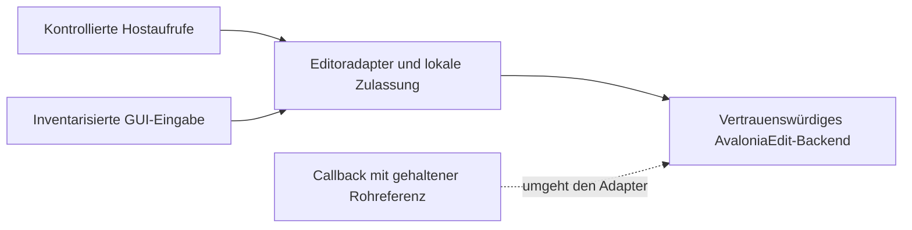
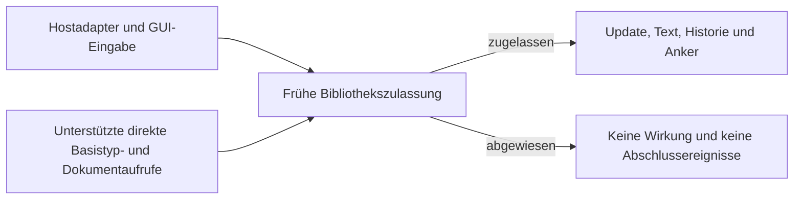

# MCP-01.4-A – Editor Architecture Decision

**Status: Entscheidungsvorlage, nicht beschlossen. Stand: 24.10.2026. Keine Implementierungsfreigabe.**

**Empfehlung:** Variante B als Voraussetzung für die unveränderten R2/R4/R6/R7-Garantien verfolgen: eine generische, upstreamfähige Bibliothekskorrektur mit früher Mutationszulassung und ausnahmesicherem Abschluss. Ergänzend eine schmale Hostschnittstelle als Nahtstelle für das GUI-Redesign vorsehen. Diese Schnittstelle ersetzt die Bibliothekskorrektur nicht. Keinen dauerhaften Fork zum stillen Standard machen. Variante A ist nur nach ausdrücklich genehmigter Einschränkung des bisherigen direkten Editor-/Callbackvertrags eine Alternative.

Der Projekteigentümer entscheidet über Variante, Vertragsumfang und Pflegebudget. Bis dahin bleiben MCP-01.4 **BLOCKED** und R2/R4/R6/R7 offen. Dieses Dokument verändert weder MCP-00-R1 noch die bisherige Reviewentscheidung.

## 1. Entscheidungsgrundlage und feste Randbedingungen

Zielworktree: `C:/Users/stefa/Documents/projects/GITHUB/CryptoWorkBench-Mcp`; Branch `feature/mcp-server`; verifizierter HEAD `bd48c57fa4cae9dc733da7d4521eb6f79a9017f0`. Bewertet wird der tatsächliche uncommitted MCP-01.4-Stand einschließlich beider Korrekturrunden, nicht nur der HEAD-Inhalt.

Verbindliche Grundlagen sind [MCP-00-architecture.md](MCP-00-architecture.md), insbesondere §§4.4, 4.5 und 5.1, [MCP-00-implementation-plan.md](MCP-00-implementation-plan.md), Schritt 4 und A04/A09/A18/A21/A22, sowie [MCP-01.4-validation.md](MCP-01.4-validation.md) und [MCP-01.4-review.md](MCP-01.4-review.md), insbesondere Final Re-Review und Korrekturrunde 2.

Unverändert bleiben:

- ein wirklicher Editor mit gebundener Dokumentinstanz, stabiler editorId und monotoner Revision; keine Schattenkopie als zweite schreibbare Wahrheit;
- eine Host-Ausführungspipeline, ein gemeinsamer CryptoScript-Zustand und fail-fast Admission; keine zweite Queue oder Interpreterinstanz;
- CryptoScript-Sprache, Parser, Crypto-Operationen und Kernbibliothek ohne neue Avalonia-/Editor-/MCP-Abhängigkeit;
- Trennung von Request-Wait-Cancellation und serviceeigener Execution-Cancellation; kein automatischer Replay;
- Save-Completion vor beobachtbaren Lease-/Propertycallbacks; bestätigter Snapshot, ASCII, Whitespace-Filter, LF, Append und ausdrücklich bestätigtes Delete vor Write; keine neue Abbruchstelle zwischen Delete und Write;
- externe ExecuteEditor-Ausführung gesperrt bis zum gesonderten MCP-01.5-Auftrag;
- die vorhandenen roten Vertragsproben und ihre Assertions als Nachweis des bisherigen Vertrags.

Die Wiederverwendung von CryptoScript ist von der Wahl A/B unabhängig. Weder ein neues GUI-Layout noch ein anderer Editor darf seine Semantik, Pipeline oder Zustandsverantwortung übernehmen. Zum geplanten GUI-Redesign wurde im untersuchten Repository keine konkrete Spezifikation für einen UI-Framework- oder Editorwechsel gefunden. Berücksichtigt wird deshalb die angekündigte Neugestaltung, ohne einen Wechsel von Avalonia oder AvaloniaEdit als bereits beschlossen anzunehmen.

**Art der Garantie:** Es geht um Konsistenz und kontrollierte Reentrancy innerhalb der vorgesehenen APIs. Auch Variante B ist keine Sicherheitsgrenze gegen beliebigen voll vertrauenswürdigen .NET-Code, Reflection, Prozessmanipulation oder Speicherfehler. Authentisierung und Ausführungsfreigabe bleiben Aufgaben des Host-/MCP-Vertrags.

## 2. Technische Ursache und belastbare Evidenz

### 2.1 Geprüfte Bibliotheksbasis

Das Projekt pinnt `Avalonia.AvaloniaEdit` 11.4.1. NuGet-Metadaten und die bereits im Blockernachweis geprüfte geladene Assembly verweisen auf Commit `b56a35a5d4838f3c9a9adeba90dd80952f70e774`. Die AssemblyVersion 11.3.0.0 ist ein anderes Feld als die Paketversion. Die Analyse verwendet die tatsächlichen Quellen dieses Commits; keine angenommenen Eventreihenfolgen und kein Austausch gegen `master`.

Primärquellen: [TextEditor](https://github.com/AvaloniaUI/AvaloniaEdit/blob/b56a35a5d4838f3c9a9adeba90dd80952f70e774/src/AvaloniaEdit/TextEditor.cs), [TextDocument](https://github.com/AvaloniaUI/AvaloniaEdit/blob/b56a35a5d4838f3c9a9adeba90dd80952f70e774/src/AvaloniaEdit/Document/TextDocument.cs), [UndoStack](https://github.com/AvaloniaUI/AvaloniaEdit/blob/b56a35a5d4838f3c9a9adeba90dd80952f70e774/src/AvaloniaEdit/Document/UndoStack.cs). Zeilenangaben zur Bibliothek beziehen sich auf die Rohdateien dieses Commits.

| Stelle | Beobachtete Reihenfolge | Bedeutung |
| --- | --- | --- |
| `TextEditor.Text:257–273`, `Clear:1071` | Document.Text → Caret-Reset → UndoStack.ClearAll; nichtvirtueller Setter, Clear delegiert an ihn | Ein gleicher leerer Text kann ohne Textwirkung Historie beeinflussen. Ein versteckter Setter schützt Basistypreferenzen nicht. |
| `TextDocument.BeginUpdate:451–461` | Zähler erhöhen → Undo-Gruppe öffnen → UpdateStarted; kein neues UpdateStarted für verschachtelte Updates | Das Ereignis ist keine zustandsfreie Vorabentscheidung. |
| `RunUpdate:437–441`, `Replace:810–838` | BeginUpdate vor Disposable beziehungsweise vor try/finally | Eine Exception aus UpdateStarted umgeht den regulären Abschluss dieses Aufrufs. |
| `DoReplace:841–875` | Leere Ersetzung auf leerem Dokument kehrt vor Changing zurück; sonst Changing vor Undo-/Textwirkung | Changing deckt nicht die ganze Setteroperation ab. |
| `Changed:930–932` | Text, Version, Anker und Historie bereits geändert | Callbackfehler nach Wirkung dürfen nicht als wirkungsloses Busy gemeldet werden. |
| `EndUpdate:468–487` | Text-/Propertymeldungen → Undo-Ende → Zähler 0 → UpdateFinished | EndUpdate im Ablehnungs-Guard erzeugt echte weitere Abschlusszustellung. |
| `UndoStack.ThrowIfUndoGroupOpen:252–264` | Setzt bei offener Gruppe die Tiefe auf 0, dann Exception | Ein fehlgeschlagenes ClearAll ist nicht zustandsneutral; Dokument- und Undo-Zähler können auseinanderlaufen. |

TextDocument und UndoStack sind versiegelt. Die relevanten Methoden sind nicht virtuell. Die DocumentProperty-Coercion kann einen Wechsel abweisen, aber keinen Aufruf auf einer bereits gehaltenen Dokumentreferenz. IsReadOnly/ReadOnlySectionProvider wirken auf UI-Pfade, nicht als allgemeines Gate für TextDocument.

### 2.2 Zusammenhang der Findings

**R6/R4:** Ein leerer Basistyp-Setter aus UpdateStarted erreicht ohne erneutes UpdateStarted und ohne Changing das ClearAll. Danach kann der angeforderte Edit bereits Text und Revision geändert haben, während der Abschluss mit InternalError und offener Gruppe endet. Ein Folgeedit bleibt Busy. Die Clear-Variante zeigt denselben Fehler. Die ursprüngliche Dokumenttauschkorrektur allein reicht deshalb nicht.

**R7/R2:** Der bisherige Guard gleicht ein abgewiesenes Update durch EndUpdate aus. Der dabei erneut aufgerufene UpdateFinished-Normalisierer findet seine Bedingung weiter unerfüllt, versucht wieder zu mutieren und löst den gleichen Pfad aus. Ohne künstliches Probelimit entsteht keine nachgewiesene Terminierungsregel. Den EndUpdate-Aufruf einfach zu entfernen lässt dagegen den begonnenen Updatezustand offen.

Historische, in dieser Architekturarbeit **nicht nochmals ausgeführte** Evidenz aus Korrekturrunde 2: 8 190 reguläre Tests bestanden; neue Sollvertragsmatrix 42 bestanden/4 fehlgeschlagen. Unveränderte Originalproben bestätigen R6 und R7. Die Rekursionsläufe wurden absichtlich begrenzt; ein tatsächlicher Stackoverflow wurde nicht ausgeführt. R1/R3/R5 sind im vorliegenden Nachweis nicht regressiert. Grüne reguläre Tests sind kein Ersatz für die roten Vertragsproben.

## 3. Vollständige betroffene Mutationsaufrufketten

Die Inventur umfasst alle im produktiven GUI-Quellstand gefundenen Workbench-Schreibstellen sowie die transitiv aktivierten AvaloniaEdit-Eingabefunktionen. Lesende Info-/Completion-Modelle werden von tatsächlichen Mutationen unterschieden. Nicht aktivierte künftige Plugins sind keine bereits geprüften Aufrufer. Bibliotheks-Upgrades oder neue GUI-Funktionen müssen die Inventur erweitern.

In der Tabelle bedeutet **Host**: CryptoWorkBench besitzt den Einstieg und kann ihn auf einen Adapter umstellen. **Backend**: eine mitgelieferte AvaloniaEdit-Funktion schreibt intern; sie muss für A ersetzt/umhüllt oder als überprüfter vertrauenswürdiger Backendpfad behandelt werden. **Roh**: bereits öffentlich erreichbare Objekte umgehen diese Vermittlung.

| Pfad und tatsächliche Kette | Eingriff und technische Durchsetzung bei A | Grenze / Eingriff bei B |
| --- | --- | --- |
| **Initialisierung:** XAML `CryptoScriptEditView.axaml:14` setzt Text; DI-View-Konstruktor `:38` ruft Clear; danach VM-Bindung/Attach | Host. Explizite Initialisierungsoperation vor Veröffentlichung; XAML-Textsetter aus produktiver Initialisierung entfernen. Keine Historielöschung auf einem bereits veröffentlichten Dokument. | Vollständiger Setter/Clear muss das neue Bibliotheksgate durchlaufen; Identitätsbindung im Host bleibt. |
| **Tastatur/Text:** Avalonia TextInput → `TextArea.OnTextInput:835` → `PerformTextInput:879` → TextEntering → Selection.ReplaceSelectionWithText beziehungsweise NewLine/Indentation → TextEntered | Backend. Kontrollierte TextArea/OnTextInput-Grenze und dynamischer ReadOnlySectionProvider; frühe Abweisung vor Bibliotheksaufruf. Ein interner synchroner Backendaufruf darf native Auswahl-/Ankersemantik nutzen. Nicht allein auf KeyDown prüfen. | Gate vor Dokumentoperation und kompletter Eingabetransaktion; Callbackzustellung darf keine Mutationsberechtigung vererben. |
| **IME:** Avalonia-InputMethodClient → Commit als Texteingabe; `TextAreaTextInputMethodClient:1196–1310` verwaltet Auswahl/SurroundingText | Backend. Commit über dieselbe TextInput-Grenze; Auswahl separat und ohne Textwirkung behandeln. Gepinnter Client meldet SupportsPreedit=false und implementiert SetPreeditText leer. Native Komposition wurde damit nicht allgemein nachgewiesen. | Gate schützt Commit-Effekt; Plattform-/Kompositionsverhalten zusätzlich nativ testen. Keine neue Preedit-Unterstützung in diesem Auftrag versprechen. |
| **Löschen/Einrücken/Transformationen:** `TextAreaDefaultInputHandler.Editing` → `EditingCommandHandler` für Delete/Backspace, Tab, Enter, DeleteLine, Whitespace/Case/Indent → RunUpdate/Selection/Replace | Backend. Vollständige Commandliste übernehmen, Actual-Execute vor Mutation prüfen; CanExecute ist nur UI-Hinweis. Standardmutatoren entweder kontrolliert delegieren oder ersetzen, keine unregistrierten Fallback-Bindings. | Bibliotheksgate muss auch direkte interne Document-Operationen und optionale Undo-Aktionen abdecken. |
| **Paste/Cut:** UI-/Contextmenu-Kommando → EditingCommandHandler.OnPaste/OnCut → Clipboard/Selection/Document | Backend. Paste ausdrücklich ersetzen: Clipboard asynchron **vor** Dokumentupdate lesen; gebundene Identität, Revision und Auswahlgeneration danach prüfen; erst dann synchroner Adaptercommit. Cut vor Löschen und nach beliebigen Clipboard-/Copycallbacks erneut absichern. | Auch hier die asynchrone Operation korrekt aufteilen und Fehler an der UI-Grenze behandeln. Ein frühes Dokumentgate allein schließt keine falsch offen gehaltene Gruppe. |
| **Drag-and-drop/Move:** SelectionMouseHandler.Drop → Undo-Gruppe/Document.Insert; StartDrag → await DoDragDrop → spätere Quelllöschung | Backend. Private asynchrone Handler sind nicht durch einen einzigen Commandwrapper vollständig kontrolliert. Entweder eigener Inputhandler mit ursprünglicher Quellbindung/Revalidierung und definiertem Move-Abschluss oder ausdrücklich genehmigte Deaktivierung dieser Funktion. Keine stillschweigende Funktionsentfernung. | Zulassung vor Undo-Gruppen und vor beiden Effekten; keine Löschung am Nachfolgedokument nach await. Externer Ziel-Effekt ist keine dokumentübergreifende Transaktion. |
| **Suche/Ersetzen:** installierter SearchPanel → ReplaceNext/Selection oder ReplaceAll/RunUpdate/Document.Replace (`SearchPanel:401–429`) | Backend. Eigene vermittelte Replace-Aktionen/Panelintegration. Alle GUI-Buttons und öffentlichen Panel-Kommandos berücksichtigen; nur IsReplaceMode umzuschalten reicht nicht als Roh-API-Schutz. Lesen/Suchen bleibt möglich. | Gate gilt auch für ReplaceAll und vollständige Compositeoperation; interne Commandfehler kontrolliert darstellen. |
| **Undo/Redo:** Shortcut/Contextmenu/TextEditor.Undo/Redo → CommandBindings → UndoStack; derzeit WorkbenchTextEditor:19–40 | Host + Backend. Guard im ausführenden Kommando vor Pop/Push; über Adapter und lokale Dokumentoperation führen. Nicht erst Changing ablehnen. Alte Defaultbindings entfernen. | Editor-/Commandoperation muss vor Stackänderung zugelassen werden; interner Replay erhält berechtigte Delegation, Eventcallbacks nicht. Rohe UndoStack-Aufrufe bleiben separat ausgeschlossen. |
| **History:** HistoryService.LineHistoryChanged → VM.OnHistoryChanged (`:125–137`) → Remove → Insert → Document-Zuweisung/IsModified | Host. Eine atomare Adapteroperation auf ursprünglicher Identität, ein Undo-Schritt; vorhandene Busy-Regel bei Ausführung bewahren. Lose Remove-/Insert-Kette ersetzen. | Derselbe Hostzuschnitt; Bibliotheksgate sichert zusätzlich direkte Callbackversuche ab. |
| **ScriptBook-Import:** Sidebar.OpenScriptBook → Picker/Bestätigung → VM.OpenScriptBookAsync (`:242–277`) → gemeinsamer RunAsync → optional ClearAdmitted und Document.Text → Buchschleife/Insert | Host. Bereits angenommene Ausführung gibt eine private Autorisierung für ihre gebundenen Editorwirkungen weiter; keine zweite Admission. Lifecycle nach jedem await prüfen. Variablen-Clear bleibt im vorhandenen Interpretervertrag. | Gleiche Koordination; Bibliotheksgate schützt tatsächliche Clears/Inserts. Kein neuer Parser oder separater Bookrunner. |
| **Interaktive Print-Einfügung:** OutputOperations.PrintEvent → VM.OnPrintEvent/Dispatcher → PrintMessage; View.ExecuteInputAsync (`:102–109`) wartet ParseLineAsync ab und fügt über ursprünglichen TextAnchor ein | Host. Anchor intern behalten oder als opaken Handle kapseln; Identität/Lifecycle und IsDeleted prüfen; tatsächlichen Insert vermitteln. Keine Rohreferenz an Redesign-VM ausgeben. | Native Anchor-Verarbeitung unverändert nutzen, Callbackschutz ergänzen. Kein Snapshot-Replace als Ersatz für Anchorinsert. |
| **Editor-Book-Output:** ExecuteEditorAsync → gemeinsame Buchschleife → Presentation.Output → gebundener Document.Insert (`WorkbenchEditorOperations:230–240`) | Host. Als tatsächliche vorhandene Schreibstelle inventarisiert und zu vermitteln. Die Inventur ist keine neue Freigabe einer Outputsemantik. MCP-00 §5.2 beschreibt für Editor-Gesamtausführung keine erneute Quelltextmutation; diese erkennbare Abweichung darf A/B nicht stillschweigend entscheiden. Vor der Umsetzung separat gegenüber bestehendem Auftrag/Testvertrag klären. | Gleiche Trennung von Mutationsschutz und fachlicher Ausgabeentscheidung. Keine semantische Änderung in einem Bibliotheksfix verstecken. |
| **Info:** OutputOperations.InfoEvent → VM.OnInfoEvent (`:151–160`) → InfoViewModel/Navigation | Kein Editor-Insert im untersuchten Pfad. Navigation kann Detach bewirken; deshalb Lifecyclekoordinator verwenden. Keine erfundene zusätzliche Textmutation. | Ebenfalls Lifecycle-, nicht Textsetterproblem. |
| **Completion:** View/InfoCompletionController → CompletionWindow → InfoCompletionData.Complete (`:400–406`) → `textArea.Document.Replace` | Host + Backend. Complete an gebundene Session/Revision/Segment und Adapter binden, direkte Replace-Stelle entfernen. `_completed` nur nach wirksam erfolgreichem Commit. Die Changed-/Update-Observer bleiben lesend/präsentierend und ausnahmekontrolliert; Invocation-TextAnchor bleibt intern. | Bibliotheksgate schützt auch die Event-/Caretcallbacks dieser Compositeoperation. |
| **MCP Insert/Append/Replace:** UpdateEditorAsync → Rechte/DTO/Identität/Revision → gemeinsame Admission → ggf. Bestätigung → Revalidierung → gebundene Mutation/Snapshot (`WorkbenchEditorOperations:51–147`) | Host. Ausschließlich typisierte Adapteroperation; bei Callbackwiedereintritt Busy vor Bibliotheksaufruf. Identität bis Dirty und Ergebnis halten, bereits angewandte Wirkung korrekt berichten. | Gleicher Adapter kann bleiben; zusätzliche frühe Bibliotheksgrenze erfüllt die bisherigen direkten Callbackproben. |
| **GUI-Save:** Sidebar.SaveScriptBookCommand → VM.SaveScriptBookAsync/SaveIntent vor await → Zielwahl/Bestätigung → CommitSaveAsync; direkter synchroner SaveScriptBook delegiert an denselben Writer | Host. Save-Lease sperrt alle registrierten Host-/Backendmutationswege; Completion zuerst, nach Leasecallbacks erneut prüfen. Kein Bibliotheksupdate über Delete/Write offen halten. Rohe Fremdreferenz ist bei A nicht gesperrt. | Bibliothekslease sperrt auch gewöhnliche direkte Document-/Basistypmutationen vor Zustandsänderung; Save-Ownership/Dateiverhalten bleibt im Host. |
| **Document-/Viewwechsel, Detach:** View Attached/Detached → VM.TextEditor/Attach/Detach → EditorBridge; DocumentProperty-Coercion; Info-Navigation | Host. Eigentümer intern, Switch über API, neue editorId; während Edit ablehnen oder Detach bis nach Ergebnis aufschieben. Savelease bleibt am ursprünglichen Dokument bis Finalisierung, auch wenn Registrierung abgemeldet wird. | Host-Identitätsprüfung bleibt nötig; Bibliotheksgate ist kein Registry-/View-Lifecycleersatz. |
| **Eventcallbacks:** UpdateStarted/Changing/Changed/TextChanged/UpdateFinished; Caret/Selection/Propertychanged; LineTracker/Anchor-/Undo-Meldungen; Completion-/Präsentationscallbacks | Adaptercallbacks liefern immutable Daten/opaque Handles; Mutationen daraus Busy, kein automatisches Nachholen. Eigene Bibliotheksabonnenten dürfen nicht ungeprüft werfen oder direkt schreiben. Fremde Rohabonnenten bleiben erreichbar und ungeschützt. | Opt-in strikte Callbackgrenze über alle Bibliotheksstellen, die Fremdcode aufrufen; Fehler vor/nach Wirkung unterscheiden, interne Konsistenzmeldungen zuverlässig abschließen. |

Zusätzliche Rohzugänge bleiben technisch vorhanden: `TextEditor.Text/Clear/AppendText/SelectedText/Load/BeginChange/EndChange`, `TextArea.PerformTextInput`, `TextArea.Document`, `Selection.ReplaceSelectionWithText`, SearchPanel-Methoden sowie `TextDocument.Text/Insert/Remove/Replace/BeginUpdate/EndUpdate/UndoStack`. Das öffentliche VM.TextEditor, FindControl am Visual Tree, alte Closures und Event-`sender` erleichtern heute das Erhalten solcher Referenzen. Ein `private`-Feld im Adapter kann bereits herausgegebene Referenzen nicht zurückrufen.

Bibliotheksbelege zur nativen Kette: [TextArea](https://github.com/AvaloniaUI/AvaloniaEdit/blob/b56a35a5d4838f3c9a9adeba90dd80952f70e774/src/AvaloniaEdit/Editing/TextArea.cs), [EditingCommandHandler](https://github.com/AvaloniaUI/AvaloniaEdit/blob/b56a35a5d4838f3c9a9adeba90dd80952f70e774/src/AvaloniaEdit/Editing/EditingCommandHandler.cs), [DefaultInputHandlers](https://github.com/AvaloniaUI/AvaloniaEdit/blob/b56a35a5d4838f3c9a9adeba90dd80952f70e774/src/AvaloniaEdit/Editing/TextAreaDefaultInputHandlers.cs), [SelectionMouseHandler](https://github.com/AvaloniaUI/AvaloniaEdit/blob/b56a35a5d4838f3c9a9adeba90dd80952f70e774/src/AvaloniaEdit/Editing/SelectionMouseHandler.cs), [SearchPanel](https://github.com/AvaloniaUI/AvaloniaEdit/blob/b56a35a5d4838f3c9a9adeba90dd80952f70e774/src/AvaloniaEdit/Search/SearchPanel.cs). Paste öffnet bei :502 ein Update vor dem Clipboard-await (:507); Drag-Move entfernt nach dem await bei :362 später Quellsegmente. Dies sind statisch belegte Architekturanforderungen, keine in dieser Runde neu ausgeführten Race-Reproduktionen.

## 4. Variante A – Kontrollierter Hostadapter mit eingeschränktem Vertrag

### 4.1 Umsetzbarer Zuschnitt

Ein UI-thread-eigener Editoradapter besitzt die aktive Bindung und liefert nur immutable Snapshots, typisierte Änderungsaufträge und opake Positions-/Lifecyclehandles. ViewModels, History, Import, Automation und Completion erhalten keinen schreibbaren TextEditor/TextDocument. Das vorhandene EditorBridge-/WorkbenchTextEditor-Verhalten wird in diesen Verantwortungsbereich integriert, kein zusätzlicher konkurrierender Eigentümer daneben eingeführt.

Vorgesehene Grenze bei A; der untere Weg bleibt technisch erreichbar:

Vorgesehene Operationen sind Lesen, initialisieren, revisionsgebunden Insert/Append/Replace, Historyzeile ersetzen, gebundene Ausgabe einfügen, Auswahländerung aus Benutzereingabe übernehmen, Undo/Redo, Dokument binden/abmelden und Savelease erwerben. Dies sind Entwurfsnamen, keine schon vorhandene API. Keine öffentliche Methode `Execute(Action<TextDocument>)`: sie würde die Rohreferenz und eine beliebige Mutation wieder ausgeben.

Der minimale lokale Zustandsautomat ist `ungebunden → bereit → Mutation → bereit` beziehungsweise `bereit → Savelease → bereit`. Ein Detach während synchroner Mutation wird vorgemerkt; der ursprüngliche Ergebnis-Snapshot entsteht vor Abmeldung. Eine Savelease überlebt Detach bis Writerabschluss. Ein erneuter Adaptermutationsaufruf während Mutation, Callbackzustellung oder Savelease wird **vor** dem Bibliotheksaufruf abgewiesen. Es gibt keine Dispatcherwarteschlange für abgewiesene Änderungen und keine implizite Wiederholung.

**Keine pauschale zweite Admission:** Gewöhnliche Benutzereingabe einschließlich geeigneter UI-Undo-/Redo-/Completionaktionen darf gemäß MCP-00 §5.1 während einer Scriptausführung weitergehen. Dafür gilt die kurze lokale Dokumentsperre, nicht eine zweite Reservation des Interpretergates. History/MCP/Save und neue Ausführungen behalten ihre bestehenden globalen Busy-Regeln. Editorwirkungen eines bereits angenommenen Imports/Outputs nutzen dessen private Eigentümerschaft; ein Eventhandler darf diese nicht allein durch Thread-/ExecutionContext-Vererbung erhalten. Der Return-Pfad mit Zeilenausführung und anschließendem nativen Newline muss diese Unterscheidung ausdrücklich testen.

Native Eingabe ist ein intern zugelassener Backendpfad, kein zweiter öffentlicher Hostmutator. Eine angepasste TextArea kann den synchronen OnTextInput-Pfad umschließen; der TextEditor besitzt dafür einen geschützten Konstruktor mit TextArea. Mutierende Kommandos, Paste, Search-Replace und Drag müssen zusätzlich vermittelt werden, weil sie diesen einen Einstieg nicht sämtlich benutzen. Das ist machbar, aber keine kleine Änderung nur an den vorhandenen VM-Schreibstellen. Nicht umhüllbare private asynchrone Handler müssen ersetzt oder Funktionen ausdrücklich aus dem freigegebenen Funktionsumfang genommen werden.

### 4.2 Technisch durchsetzbare Regeln

1. Nur ein eng benannter Backendbereich darf AvaloniaEdit-Mutationsobjekte verwenden; übrige produktive GUI-Dateien hängen am Hostinterface. Dependency-/API-Tests und statische Callsiteprüfungen sichern das. Ein späterer Analyzer kann helfen, ist aber weder jetzt Voraussetzung noch Schutz gegen fremden Laufzeitcode.
2. Ausführende Commandhandler prüfen den Zustand selbst; CanExecute, IsEnabled, IsReadOnly und ein KeyDown-Filter allein sind unzureichend. Nicht vermittelte Defaultbindings dürfen nicht weiter als Fallback mutieren.
3. Clipboard-/Drag-/Dateiauswahl-awaits halten keine Dokumentgruppe. Vor Commit sind Dokumentidentität, Lifecycle, Revision und gegebenenfalls Auswahl-/Caretgeneration erneut gültig zu prüfen. Ein veralteter Vorgang wird abgebrochen, nicht auf den aktuellen Nachfolger umgedeutet.
4. Eigene Raw-Observer sind überprüfte Backendimplementierung: keine Textmutationen, keine unkontrolliert entweichenden Exceptions. Anwendungsbenachrichtigungen werden erst nach konsistentem Bibliotheksabschluss als sichere Snapshots ausgeliefert und einzeln gegen Handlerfehler isoliert.
5. TextAnchors bleiben im Backend und werden nicht durch Volltext-Neusetzen oder Dokumentersatz simuliert. Undo/Redo bleiben die native Historie; initiales Setzen und reguläres Replace werden getrennt, damit ein normaler Edit kein ClearAll auslöst.
6. Den bisherigen UpdateStarted/EndUpdate-Ablehnungs-Guard als vermeintliche Vollabsicherung zu behalten ist keine A-Lösung. Ein genehmigter A-Umbau muss sich auf die beschriebenen frühen kontrollierten Einstiege stützen und den problematischen Guard gezielt ersetzen; die Rohschutzlücke wird dadurch offengelegt, nicht behoben.

### 4.3 Explizit eingeschränkter Vertrag A

**Nur nach Zustimmung gültiger Vertragsentwurf:** „CryptoWorkBench garantiert revisions- und identitätsgebundene, ausnahmesicher abgeschlossene Editoroperationen für die typisierten Host-API-Aufrufe und die vollständig inventarisierten, geprüften GUI-Eingabefunktionen. Während einer Savelease werden diese Wege vor ihrer Mutation abgewiesen. Anwendungs-Callbacks erhalten ausschließlich Snapshots/opaque Handles und können keine reentrante Hostmutation starten. Die zugrunde liegenden AvaloniaEdit-Objekte sind vertrauenswürdige Backenddetails; direkte Zugriffe außerhalb dieses Backends gehören nicht zum abgesicherten Vertrag.“

Damit würden gegenüber der bisherigen Zusage ausdrücklich entfallen:

- Schutz beliebiger Basistyp-Text/Clear/SelectedText- oder direkt gehaltener TextDocument-Aufrufe während Save oder Edit;
- Schutz gegen fremde Raw-UpdateStarted-/Changed-/UpdateFinished-Handler, die Dokumente oder Historie verändern oder die Bibliothekszustandsmaschine durch Exceptions unterbrechen;
- Garantie, dass **jede** technisch erreichbare Mutation die Savelease beachtet, und damit die lückenlose Kopplung zwischen eingefrorener GUI-Revision und Writerabschluss bei Rohmissbrauch;
- Garantie eines heilen Undo-/Updatezustands nach beliebigen Raw-Callbackfolgen sowie eines korrekten Mutationsergebnisses, wenn ein solcher Callback bereits unerlaubt eingegriffen hat;
- automatische Sicherheit neu eingebauter Bibliotheksfunktionen, Plugins oder UI-Handler ohne erneute Integration in den Adapter.

Das ist eine **zusätzliche** Einschränkung über die schon ausgeschlossenen rohen UndoStack-Aufrufe hinaus. Sie darf nicht unter diesem alten Ausschluss versteckt werden. Aufbewahrte Dokumentreferenzen bleiben veränderbar; Kapselung und Coderegeln begrenzen produktive Nutzung, sie erzeugen keine vollständige Laufzeitisolation. Weder das Writer-Snapshot noch eine nachträgliche Revisionskontrolle verhindern einen bereits erfolgten GUI-/Historieneffekt.

Die bestehenden roten Raw-Vertragsproben dürfen bei Wahl A nicht als „repariert“ umbenannt, gelöscht oder in grüne Negativtests umgeschrieben werden. Sie bleiben unverändert ausführbare Evidenz für den früheren stärkeren Vertrag. Eine genehmigte Vertragsabweichung muss gesondert identifizieren, welche dieser Garantien nicht mehr zur A-Abnahme gehören; parallel entstehen neue Adaptertests. Soll dagegen **jede bisherige rote Sollprobe unverändert grün werden**, ist A allein keine zulässige Auswahl.

### 4.4 Auswirkungen auf MCP-00-R1

§4.5 Punkt 3 („Alle Mutationswege“) und A22 müssten auf die genehmigte Liste kontrollierter Host-/Backendwege eingeschränkt werden. §4.4/A04 und Schritt 4 müssten die Identitäts-, Undo- und Fehlergarantie unter Ausschluss fremder Rohmutationen festlegen. Die allgemeinen Reentrancy-Zusagen müssten Hostcallbacks von Raw-Bibliothekscallbacks unterscheiden. Die reine Benutzereingabe während Scriptausführung aus §5.1 bleibt erhalten; sie darf nicht als Vereinfachung mitgesperrt werden.

Kein DTO-/MCP-01.1-Schema muss allein wegen A geändert werden. Die semantische Garantie wird trotzdem schwächer, auch wenn Signaturen gleich bleiben. Deshalb ist eine neue ausdrücklich angenommene Architekturrevision mit Review erforderlich. Dieses Dokument nimmt diese Änderungen nicht vor.

## 5. Variante B – Begrenzte Bibliotheksanpassung

### 5.1 Ziel und notwendige Eingriffe

Der Host registriert eine optionale generische Mutationspolicy/Lease an der tatsächlichen Dokument-/Editorinstanz. Der genaue API-Name ist mit Upstream zu entwerfen. Ohne konfigurierte strikte Policy sollen bestehende Anwendungen ihre dokumentierte Semantik behalten; CryptoWorkBench aktiviert den strikten Modus. Keine CryptoWorkBench-, MCP-, Dispatcher-Service- oder CryptoScript-Abhängigkeit in der Bibliothek.

Vorgesehene Grenze bei B für die unterstützten Mutations-APIs; rohe Stackmanipulation und Prozessmanipulation sind damit nicht eingeschlossen:

| Bibliotheksbereich | Notwendige Änderung | Abgrenzung |
| --- | --- | --- |
| TextDocument-Mutation/BeginUpdate | Entscheidung vor Zähler, Undo-Gruppe und auch vor No-op-Rückkehr; öffentliche direkte und verschachtelte Mutationen erfassen | Ein weiteres Changing-/UpdateStarted-Ereignis nach Gruppenöffnung genügt nicht. |
| TextEditor.Text/Clear und verwandte Composite-APIs | Vollständige Operation vor Document.Text, Caret und ClearAll zulassen; Berechtigung bis zum letzten Folgeschritt halten | Eine nur dokumentbezogene Sperre, die bei UpdateFinished zu früh endet, lässt wieder nachfolgende Settereffekte zu. AppendText/SelectedText/Load mitprüfen. |
| Autorisierung und Callbackzustellung | Opakes, besitzgebundenes Operationsrecht nur für interne Delegation; strikte Wiedereintrittssperre während fremder Callbacks | Kein öffentliches „Allow=true“, kein ThreadStatic/AsyncLocal-Recht, das beliebiger Callback erbt. Auch eine Policyabfrage darf sich nicht rekursiv selbst autorisieren. |
| Updateabschluss | BeginUpdate, RunUpdate, Replace und EndUpdate ausnahmesicher gestalten; genau begonnene Gruppen genau einmal beenden, kein blindes wiederholtes EndUpdate | Ein rejected-before-start-Aufruf erzeugt weder UpdateStarted noch UpdateFinished. Eine wirklich angenommene Operation besitzt einen definierten Abschluss auch bei Handlerfehlern. |
| Undo/Historie | Editor-Undo/Redo vor Pop/Push autorisieren; internen Replay korrekt delegieren; ClearAll-Fehler darf keine aktive Gruppentiefe zerstören | Rohe beliebige UndoStack-Manipulation wird dadurch nicht pauschal zum unterstützten Hostvertrag. Shared-UndoStack mit mehreren Dokumenten gesondert prüfen oder im strikten Hostmodus ausdrücklich nicht konfigurieren. |
| Native Compositepfade | Paste-Update aus dem Clipboard-await herausnehmen; Drag-Quelle an ursprüngliches Dokument binden; Drop/Search/Indent/Selection vor eigenem Gruppenbeginn zulassen | Der Corehook schützt Ablehnung, ersetzt aber nicht korrektes UI-Fehlerhandling oder Lebensdauer asynchroner Operationen. |
| Identität/Anker | Native DoReplace-/AnchorTree-Verarbeitung erhalten; Host-Coercion/Lifecyclebindung weiterverwenden | Kein Dokumenttausch als Reparatur, kein Volltext-Rollback, keine zweite Anker- oder Undohistorie. |

Diese Anpassung ist klein gegenüber einem Editorersatz, aber **kein Einzeilenpatch**. Mindestens TextDocument, TextEditor, ausgewählte Undo-/Eventpfade und die genannten nativen Composite-Handler benötigen Prüfung. Falls ein Entwurf alle Inputhandler neu schreiben oder eine zweite Dokumentengine aufbauen müsste, ist der begrenzte Umfang überschritten und die Entscheidung erneut vorzulegen.

### 5.2 Konkreter Operations- und Fehlervertrag

Eine öffentliche Mutation beantragt das Recht vor jeder Text-/Historien-/Gruppenwirkung. Bei Savelease, fremder Mutation oder Callbackwiedereintritt: zustandsneutrale Ablehnung, keine Folgeereignisse, keine Caret-/History-Nacharbeit. Autorisierte interne Aufrufe dürfen ihre notwendige Gruppierung verschachteln, öffentliche Callbackaufrufe aber nicht dieselbe Autorisierung übernehmen. Die Sperre gegen fremde Reentrancy muss bis nach vollständiger Setter-/Commandfinalisierung gelten, nicht nur bis der Dokumentzähler erstmals 0 ist.

Vorwirkung und Nachwirkung sind getrennte Fehlerfälle. Ein fehlschlagender Start-/Changing-Observer verhindert den Texteffekt und lässt einen definiert geschlossenen Zustand zurück. Nach Textwirkung werden Text/Revision/Anker nicht zurückgerollt; notwendige interne Beobachter und Gruppenfinalisierung müssen weiterlaufen, bevor ein Callbackfehler nach außen gemeldet wird. Der Host kann dann anhand der ursprünglichen Version einen wahren Mutationsabschluss erstellen. Die öffentlichen MCP-DTOs müssen dafür nicht stillschweigend erweitert werden; zusätzliche interne Fehlerdaten dürfen nicht als wirkungslose Ablehnung ausgegeben werden.

Die Eventauslieferung ist selbst Teil des Entwurfs: Ein normales Multicast-Invoke stoppt beim ersten werfenden Abonnenten. Für den strikten Modus müssen interne Konsistenzmeldungen von Benutzerhandlerfehlern geschützt oder alle erforderlichen Empfänger kontrolliert abgewickelt werden. Welche öffentlichen Handler nach einem Fehler noch aufgerufen werden und welche Exception danach geliefert wird, ist ausdrücklich zu spezifizieren und zu testen. Kein stilles Verschlucken und keine globale Verhaltensänderung ohne Upstreamabstimmung.

Zur Callbackfläche gehören nicht nur die fünf TextDocument-Ereignisse, sondern auch TextChanged/PropertyChanged, Undo-/Caret-/Selectionmeldungen, LineTracker, verzögerte Anchorereignisse, Indentation-/Provideraufrufe und die Mutationspolicy selbst. Ein Recht, das an einer dieser Stellen ungeschützt bleibt, wäre eine neue R6-Variante. Bereits explizit ausgeschlossene rohe Stackmanipulationen und absichtlich falsch gepaarte Raw-Begin/End-Aufrufe werden nicht automatisch mitgarantiert; legale unterstützte Compositeoperationen und deren Exceptions müssen dagegen vollständig funktionieren.

B lässt das ursprüngliche Dokument bestehen. TextAnchors bewegen sich über den vorhandenen Replacepfad; Bewegungstypen, CRLF/UTF-16-Offsets, gelöschte Anker, optionale Caret-Undoaktionen, Rechteckauswahl und eine Undo-Gruppe pro logischem Edit sind eigene Abnahmebedingungen. Ausschließlich `CanUndo=true` zu prüfen genügt nicht.

### 5.3 Upstreamfähige Änderung oder dauerhafter Fork

**Upstream zuerst ist vorzuziehen.** Exception-Sicherheit und eine optionale generische Mutation-/Reentrancypolicy sind bibliotheksweite Probleme und lassen sich mit minimalen TextDocument-/TextEditor-Reproduktionen ohne CryptoWorkBench demonstrieren. Die Entwicklung ist in zwei reviewbare Teile zu schneiden: (1) ausnahmesichere Gruppen-/Historyfinalisierung mit festgelegter Eventsemantik, (2) optionaler strikter Mutationsvertrag einschließlich Composite-/Callbackdelegation. Ein bloßer Vorschlag, alle Ereignismutationen weltweit zu verbieten, wäre wegen vorhandener Anwendungen mit absichtlicher Eventnormalisierung kein verträglicher Standardwechsel.

Die öffentliche [Repository- und Releaseinformation](https://github.com/AvaloniaUI/AvaloniaEdit/releases) wurde lesend geprüft. Daraus wurde **keine** bereits vorhandene, ausreichend nachgewiesene Lösung für diesen vollständigen Vertrag festgestellt. Das ist keine Behauptung, dass weltweit kein offenes Issue/PR existiert oder Maintainer eine bestimmte Lösung akzeptieren werden. Kontakt, Issue oder PR erfordern einen gesonderten Auftrag; in dieser Runde wurde nichts veröffentlicht. Auf eine unverbindliche Upstreamannahme kann kein Liefertermin gestützt werden.

Ein dauerhaft gepflegter Fork hätte laufende Kosten für Sicherheits-/Bugfixübernahmen, Mergekonflikte gerade an Input-/Undo-Code, reproduzierbare Paketherstellung, Signierung/Assemblyidentität, Lizenznachweise und die komplette Plattformmatrix. Das bestehende NuGet unter gleicher Versionsnummer lokal zu überschreiben ist keine akzeptable Distribution. Eine zeitlich begrenzte Patchlinie wäre nur nach ausdrücklicher Eigentümerentscheidung, eindeutigem Artefaktpin, Pflegeverantwortlichem, Upstreamziel und Ausstiegsregel vertretbar; sie ist keine implizite Folge der Empfehlung.

Für B ist später entweder ein geprüftes offizielles Release oder ein ausdrücklich zugelassenes, nachvollziehbar gebautes Patchartefakt notwendig. Ohne diesen Distributionsweg bleibt die Implementierung blockiert. Kein Paket wurde in dieser Architekturarbeit installiert, kein Fork angelegt und keine Bibliothek kompiliert oder verändert.

## 6. Vergleich, Aufwand und Risiken

| Kriterium | A – Hostadapter, eingeschränkter Vertrag | B – Bibliothekskorrektur plus schmale Hostnahtstelle |
| --- | --- | --- |
| Tatsächliche Garantie | Stark für vermittelte Aufrufe und geprüfte native Funktionen, abhängig von Backenddisziplin; keine Isolation gehaltener Rohreferenzen | Bisherige direkte Setter-/Callbackgarantien grundsätzlich erreichbar, wenn vollständige Bibliotheksfläche nachweislich abgesichert ist; keine Prozesssandbox |
| R2/R4/R6/R7 | Hostvarianten lösbar; bisherige Raw-Sollgarantien teilweise ausdrücklich aufgegeben | Unveränderte Raw-Gegenproben müssen tatsächlich grün werden |
| Implementierungsumfang | Migration aller Hostschreibstellen plus native Eingabe-/Command-/Asyncpfade; beträchtlicher UI-Integrationsanteil | Kleiner Bibliothekskern mit anspruchsvoller Semantik, Compositepfade und Hostintegration; größere externe Abstimmung |
| Bestehende GUI | Öffentliche TextEditor-Exposition reduzieren, Completion/History/Output umbauen, native Handler vermitteln | Hostkoordination gezielt bereinigen; mehr native Logik kann erhalten bleiben, Bibliothek muss alle Basistypwege abfangen |
| MCP-00-R1 | Explizite Abschwächung von §4.5/A22 und Callback-/Fehlergarantien nötig | Garantien können erhalten bleiben; Bibliotheks-/Distributionsumfang und strikter Modus brauchen Freigabe, keine stille Semantikänderung |
| Testbarkeit | Adapter gut isolierbar; Positivtests belegen nur die abgegrenzte Menge, rohe Negativproben bleiben als Vertragsabweichung sichtbar | Kleine Bibliothekstests plus unveränderte Hostproben; umfangreiche Event-/Exception-/Historymatrix erforderlich |
| Windows/Linux/macOS | UI-/Clipboard-/Drag-/IME-Integration je Backend nachweisen; zusätzliche Hosthandler erhöhen Plattformrisiko | Coregate plattformneutral, Native- und Inputpfade trotzdem auf allen Zielplattformen testen; Headless allein reicht nicht |
| Upgrades | Bibliotheksdetails/Defaultbindings und neue Mutatoren erneut inventarisieren; weniger Paketpflege, mehr Adapterkompatibilität | Nach Upstreamannahme reguläre Upgradepflege mit Regressionen; bis dahin Patchpflege und externe Lieferabhängigkeit |
| Erweiterbarkeit | Gute API für Redesign, aber jede neue Rohintegration erweitert die Vertrauensbasis | Gleiche Redesign-API möglich; neue Standardmutatoren erben eher den Bibliotheksschutz, Compositepfade dennoch prüfen |
| Hauptrisiko | „Alle Wege kontrolliert“ wird behauptet, obwohl ein Default-/Async-/Raw-Pfad übrig ist | Ein vermeintlich generischer Hook schließt nicht alle Delegations-/Callbackfenster oder verändert bestehende Eventsemantik |

**Unverbindliche Planungsschätzung, keine gemessene Dauer:** Für einen mit dem Code vertrauten Entwickler liegen A mit vollständiger Funktionsmigration und nativen Prüfungen grob bei **15–30 Personentagen**, B einschließlich Bibliotheksentwurf, Tests und Hostintegration grob bei **20–40 Personentagen**. Ein reiner Proof of Concept ist jeweils deutlich kleiner und keine Freigabe. Gemeinsame Abnahme-/Reviewarbeit ist in diesen Bandbreiten enthalten; ein vollständiges GUI-Redesign nicht. Upstreamwartezeit, Beschaffung nativer Testumgebungen und ungeplante Forkpflege sind zusätzlich und nicht seriös als feste Kalenderdauer anzugeben. Nach einem begrenzten Machbarkeitsmeilenstein neu schätzen.

Das Redesign spricht für eine schmale, AvaloniaEdit-freie Schnittstelle zu den Anwendungs-ViewModels, aber nicht automatisch für A als Konsistenzlösung. Bei einem späteren Editorwechsel bleiben diese Hostoperationen, Save-/Execution-Koordination und CryptoScript wiederverwendbar; nur Backend und dessen Konformitätstests werden ersetzt. Ein Frameworkwechsel oder mehrere aktive Editoren/Workspaces sind hier keine freigegebene Erweiterung. Zustandsmodell und Tests dürfen diese zukünftigen Entscheidungen ermöglichen, ohne sie jetzt zu implementieren.

## 7. Begründete Empfehlung und Eigentümerentscheidung

**B empfehlen, mit Upstreamziel und begrenztem Machbarkeitsgate.** Der Hauptgrund ist die verlangte Erhaltung der bisherigen garantierten Eigenschaften und der unveränderten roten Sollproben. A behebt diese stärkeren Garantien nicht; sie könnte nur auf einen ausdrücklich kleineren Vertrag umstellen. Zudem ist der praktische Aufwand für A wegen Paste, Drag, Search, Completion und nativer Eingabe größer als eine einfache VM-Fassade vermuten lässt.

Die Hostnahtstelle wird unabhängig davon empfohlen, soweit sie die bereits betroffenen Mutationswege ordnet und das Redesign entkoppelt. Daraus entsteht keine dritte Variante mit angeblich gleichzeitig unverändertem Paket und vollständigem Rohschutz. B liefert die frühe technische Grenze, der Host weiterhin Identität, Revision, Admission, Save-Ownership und fachliche Entscheidung.

Wenn B nicht upstreamfähig oder nicht in vertretbarem Umfang lieferbar ist, erfolgt **kein automatischer Rückfall** auf einen dauerhaften Fork oder A. Der Projekteigentümer entscheidet erneut zwischen einer begrenzten gepflegten Patchlinie, dem ausdrücklich eingeschränkten A-Vertrag oder weiterem Blockieren. Ein Editorersatz wäre eine weitere Architekturentscheidung im Redesign, nicht Bestandteil dieses Dokuments.

Vor dem nächsten Implementierungsauftrag sind festzuhalten:

| Entscheidung | Benötigte Festlegung |
| --- | --- |
| Garantien | B mit unverändertem bisherigen Sollvertrag oder A mit explizit akzeptierter Liste aus §4.3 |
| Bibliotheksweg bei B | Zunächst Machbarkeits-/Upstreamentwurf; später offizielles Release oder ausdrücklich freigegebenes Patchartefakt. Pflegeverantwortung benennen. |
| Funktionsumfang bei A | Sämtliche heutigen nativen Funktionen integrieren oder jede Einschränkung, insbesondere Drag/Replace, ausdrücklich genehmigen. |
| Redesign | Hostinterface als wiederverwendbare Grenze bestätigen; keine Vorentscheidung für neue UI-Technik daraus ableiten. |
| Fachliche Outputfrage | Die in §3 dokumentierte Editor-Book-Outputabweichung vor der betroffenen Migration gesondert klären; kein A/B-Nebeneffekt. |

Der Status bleibt **PROPOSED / OWNER DECISION PENDING**. Empfehlung, Aufwandsschätzung und Folgeplan sind keine Zustimmung des Eigentümers.

## 8. Abgegrenzter Folgeimplementierungsplan

### 8.1 Gemeinsame Vorbereitung nach Entscheidung

**P0 – Vertrag und Testbasis einfrieren (ca. 1–2 PT innerhalb der obigen Bandbreiten).** Entscheidung mit exakten Garantien und Ausschlüssen dokumentieren; bei A ausdrücklich neue MCP-00-Revision freigeben, bei B Bibliotheksumfang festlegen. Alle ursprünglichen roten Proben mit unveränderten Quellen/Assertions sichern und in die wiederholbare Abnahme aufnehmen. Historie, bereits vorhandene 49/47 Editorfälle und R1/R3/R5 erhalten. Die Quellen von `mcp014-independent-review`, `mcp014-final-independent-review` und `mcp014-corrections2/BoundaryProbe.cs` bleiben Referenz.

Dabei zwei Arten von Programmen unterscheiden: Die rote Sollvertragsmatrix in BoundaryProbe muss bei B unverändert bestehen. Einige ursprüngliche Beobachtungsprogramme besitzen dagegen ausdrücklich Assertions auf das damals fehlerhafte Verhalten und liefern gerade bei dessen Reproduktion Exitcode 0. Auch diese Quellen bleiben unverändert; bei einer Korrektur kann ihre Beobachtungsassertion erwartbar fehlschlagen. Ihre Logs sind auf das Verschwinden des Symptoms auszuwerten, nicht pauschal nach Exitcode als Freigabe zu zählen. Zusätzliche Produktregressionen verlangen die korrekten Endzustände und dürfen diese Unterscheidung nicht durch Abschwächung der bestehenden Sollproben umgehen.

### 8.2 Empfohlener B-Pfad

**B1 – begrenzter Bibliotheksnachweis (ca. 3–5 PT).** Nach gesonderter Implementierungsfreigabe minimalen strikten Mutationsentwurf gegen denselben Bibliotheksstand erproben. Zuerst die unveränderten R6-/R7-Fälle, vollständigen Basistyp-Setter und werfende Eventhandler beweisen; native Anchor-/Undo-Kontrollen daneben. Kein Hostrefactoring zum Kaschieren roter Rohproben. Exit-Gate: alle relevanten Primärgegenproben grün, keine private Reflection, keine künstliche Gruppenreparatur, kein geerbtes Callbackrecht. Andernfalls an Eigentümer zurück, keine Ausweitung zur zweiten Editorengine.

**B2 – upstreamfähige Aufteilung und Distributionsentscheidung (ca. 3–6 PT, Wartezeit offen).** Fehlerabschluss und optionale Policy getrennt spezifizieren; Default-/Strict-Verhalten und Eventfehlermatrix festlegen. Bibliotheks-Tests ohne CryptoWorkBench als reproduzierbare Grundlage. Erst mit ausdrücklicher Kommunikationsfreigabe Issue/PR einreichen. Vor produktiver Integration Artefakt, Pin, Lizenz-/Assemblyidentität und Pflegeweg festlegen. Keine Annahme, dass die Prüfung automatisch Upstreamannahme bedeutet.

**B3 – Hostintegration und native Compositepfade (ca. 6–12 PT).** Vorhandene Guard-Reparaturen durch das bestätigte Gate ersetzen; dieselbe Registry und WorkbenchTextEditor-Instanz nutzen. Schmale Hostoperationen für die inventarisierten fachlichen Wege einführen, rohe ViewModel-Exposition abbauen. Paste-/Drag-Lifetime sowie Editor-Undo und Completion integrieren. R1/R3/R5, normale Benutzereingabe während Ausführung und Return-Verhalten erhalten. Keine allgemeine Layoutneugestaltung, keine Sprach-/MCP-Tooländerung.

**B4 – vollständige Abnahme und unabhängiger Review (ca. 7–15 PT).** Die untenstehende Matrix automatisieren und nativ ergänzen; beide Solutions restaurieren und in Release bauen, vollständige Core-/GUI-/MCP-Suiten und Abhängigkeitskontrolle ausführen. Erst anschließend separater unabhängiger Re-Review. Gesamtbandbreite ist gerundet; externe Wartezeit bleibt außerhalb.

### 8.3 Alternativer A-Pfad nur nach Vertragsfreigabe

**A1:** API und Eigentümerschaft ohne rohe VM-/Callbackreferenzen einführen; Callsiteinventur und Abhängigkeitsprüfungen erstellen. **A2:** alle fachlichen Mutationen migrieren und ihre typisierten Adaptertests schreiben. **A3:** native Inputs/Commands, Clipboard, Search und Drag vollständig vermitteln oder einzeln genehmigte Funktionsgrenzen umsetzen; Backendobserver ausnahmekontrolliert und ohne direkte Reentrancy halten. **A4:** Plattform- und Vollsuite-Abnahme des eingeschränkten Vertrags plus unveränderte Raw-Sollproben mit expliziter Abweichungsbewertung.

Wichtiges A-Exit-Gate: Es darf keinen produktiv aktivierten, nicht inventarisierten Mutationsweg geben. Eine einzige kontrollierte **fachliche** Host-API ist nachweisbar; eine einzige öffentlich unüberwindbare Bibliotheks-API wird nicht behauptet. Ein verbleibender unkontrollierter Default-Paste-/Dragpfad ist kein akzeptabler Verweis auf den Raw-Ausschluss, sondern ein fehlender Teil der produktiven Migration.

### 8.4 Abnahmekriterien

| ID | Konkreter Nachweis | Geltung |
| --- | --- | --- |
| E01 | Identische/unterschiedliche Textzuweisung, leer/nichtleer, concrete/base, Clear/Document.Text/SelectedText während Save: vor jeder Wirkung ablehnen; Text, Revision, Caret, Undo/Redo und Updatezustand unverändert | B einschließlich Rohaufrufen; A für vermittelte Wege, Rohabweichung ausdrücklich getrennt |
| E02 | Original-R6 mit leerem Basistyp-Setter und Clear aus UpdateStarted: kein zerstörter Stack, keine offene Gruppe, keine verschwiegene Wirkung, zulässiger Folgeedit samt realem Undo/Redo | B unverändert grün erforderlich; A darf diesen stärkeren Test nicht als repariert ausgeben |
| E03 | Original-R7-Normalisierer ohne einmaliges called-Flag: unter Save/Identity kontrollierte Ablehnung mit Callbacktiefe unabhängig von künstlichen Limits; kein EndUpdate als Ablehnungsbereinigung | B für Raw; A zusätzlich äquivalente Adaptercallbacks |
| E04 | Exceptions in UpdateStarted, Changing, Changed, TextChanged, UpdateFinished, Undo-/Caret-/Anchorbenachrichtigung: Beginn/Abschluss exakt ausgeglichen; nach Wirkung wahrer Snapshot zur ursprünglichen editorId | B über Bibliotheksmatrix; A eigene kontrollierte Observer und Callbackgrenze |
| E05 | Document-/Viewwechsel/Detach aus allen Phasen sowie während Clipboard/Drag-await: kein Nachfolgertext/Dirty-Effekt, keine alte Antwort für neue ID, kein vorzeitiger Leaseverlust | beide im jeweils freigegebenen Vertrag |
| E06 | Zahlreiche unmittelbar aufeinanderfolgende Ablehnungen, anschließend mehrere Edits und vollständige Undo-/Redo-Rückfolge; TextAnchors beider Bewegungstypen, gelöschte Anker, CRLF/UTF-16, Rechteckauswahl | beide; nicht nur CanUndo/CanRedo prüfen |
| E07 | Tastatur, Return/Newline, Backspace/Delete/Tab, Paste/Cut, Contextmenu, Suche/ReplaceAll, Completion, interne/externe Drag-Moves und native IME-Commits gegen Save-/Edit-Lease | alle weiterhin angebotenen Funktionen; jede Deaktivierung separat genehmigt |
| E08 | Verspätetes Clipboard/Drag-Ergebnis nach Revision-/Auswahl-/Lifecyclewechsel verwirft den alten Vorgang; keine offene Gruppe über await; keine Löschung am Nachfolger | beide, inklusive bisher nicht ausreichend gedeckter nativer Asyncpfade |
| E09 | Save aus reentrantem Callback fail-fast, Completion vor Propertybeobachtung; Shutdown/Dispose vor Commit ohne Delete, nach echtem Delete Drain bis Write/Dispose; Fehlerwege lösen Sperren | beide; R3 unverändert |
| E10 | Native Benutzereingabe während Scriptausführung weiterhin möglich; History/MCP/Save Busy wie spezifiziert; autorisierter Import/Output nutzt bestehende Admission, Callback erbt kein Recht | beide; MCP-00 §5.1 erhalten |
| E11 | R1 tatsächlicher Runnerstart bei ungültiger Bindung verhindert; R5 Diagnosen einmal je neuem Lauf, kein Retryreset; Passwort-/Snapshot-/Idempotenzverträge unverändert, externe ExecuteEditor-Sperre bleibt | beide; vorhandene 49/47 plus vollständige Suiten |
| E12 | Source-/Dependencyprüfung: CryptoScript ohne UI-Abhängigkeit, keine zweite Variablensammlung/Editorpipeline, nur genehmigter Bibliothekspin und keine versteckten Produktionsmutatoren | beide |
| E13 | Headless und Bibliothekstests plus native Windows-, Linux- und macOS-Prüfungen von IME, Clipboard, Drag, Auswahl, StorageProvider/Closing; Ziel-RIDs entsprechend bestehender CI, reale Testprotokolle | beide; nicht allein durch Linux-/macOS-Build als bewiesen ausgeben |
| E14 | Alle bestehenden roten Sollvertragsproben unverändert verfügbar und bei B grün unter neuem Paket; ursprüngliche Beobachtungsprogramme gemäß P0 getrennt auswerten. Bei A bleibt der Vergleich gegen den alten Vertrag samt genehmigter Abweichung sichtbar | keine Löschung, Assertionabschwächung oder verdeckte Ausblendung |

Nur ein unabhängiger Re-Review darf nach vollständiger Umsetzung die Befunde freigeben. Die Prüfung von A dürfte ausschließlich den ausdrücklich revidierten Vertrag freigeben; sie wäre keine nachträgliche Erfüllung der früheren Vollgarantie.

## 9. Grenzen dieser Entscheidungsvorlage und Arbeitsnachweis

In dieser Runde wurden produktive Aufrufketten und gepinnte Bibliotheksquellen gelesen, aktuelle öffentliche Upstreaminformationen gesichtet und die bestehenden Gegenbelege ausgewertet. Es wurde kein Lösungsprototyp implementiert, kein Paket installiert, kein Fork erstellt und keine neue Testausführung als Architekturbeweis behauptet. Die neuen Paste-/Drag-Anforderungen stammen aus statischer Quellprüfung; eine künftige Implementierung muss ihre Laufzeitnachweise liefern.

Die vorhandenen Grenzen bleiben: rohe UndoStack-Manipulation außerhalb des unterstützten Hostvertrags; nichttransaktionaler Save und externe Dateisystemrennen; keine allgemeine Garantie gegen nicht zurückkehrende fremde Callbacks; native IME-/StorageProvider-/Closing-Nachweise noch offen; sporadische Headless-Dispose-Ausnahmen und Print-/Info-Multicast-Grenze nicht gelöst. B darf keine vollständige Sandbox behaupten, A keine Vollisolation durch Kapselung.

Alle bereits vorhandenen Repositorydateien und die externen roten Probequellen wurden für diesen Auftrag gehasht. Die Abschlusskontrolle erlaubt ausschließlich die neue Datei `docs/mcp/MCP-01.4-editor-architecture-decision.md`; bestehende Architektur-, Review- und Validierungsdokumente bleiben unverändert. Branch/HEAD bleiben wie angegeben. Keine Produktivcodeänderung, kein Commit/Push/Merge, kein MCP-01.5 und kein Lesen oder Ändern von `.codex/config.toml`.

**Vorlage abgeschlossen; Entscheidung und Folgefreigabe ausschließlich durch den Projekteigentümer.**
